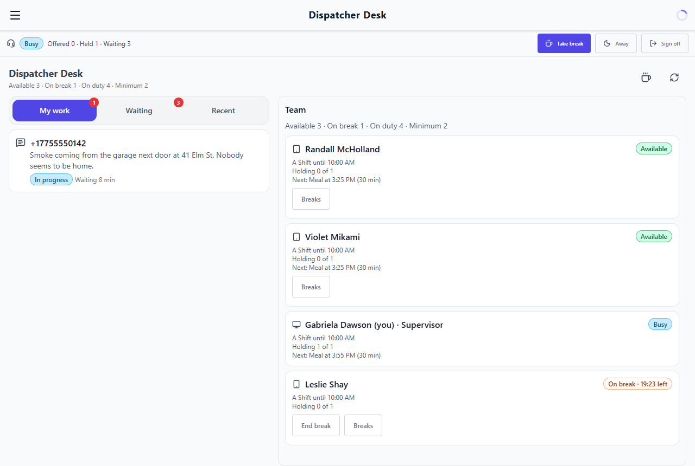
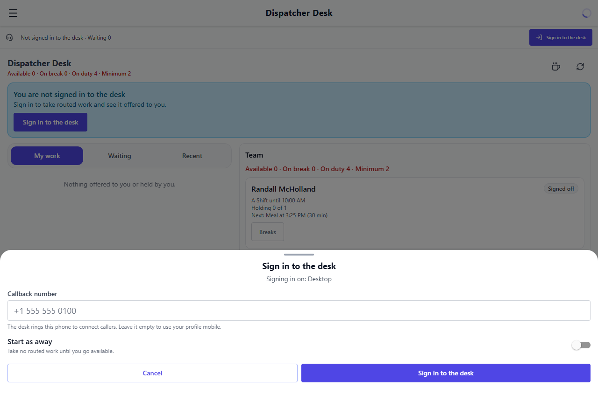
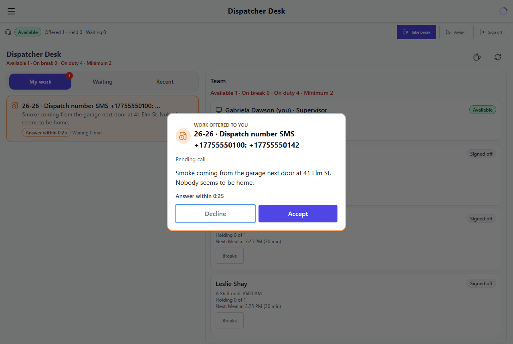
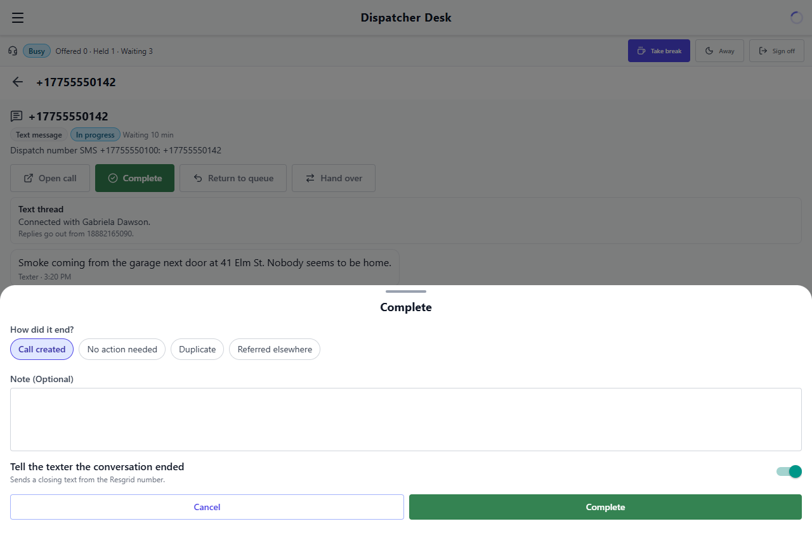
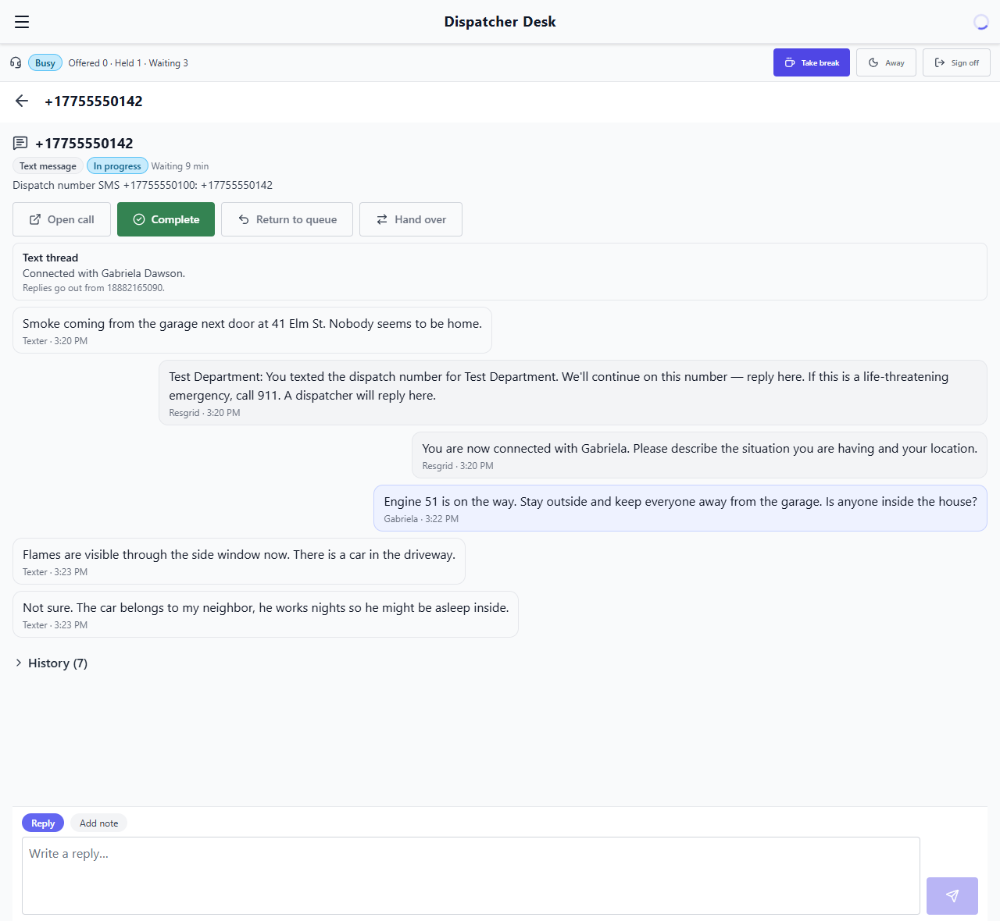
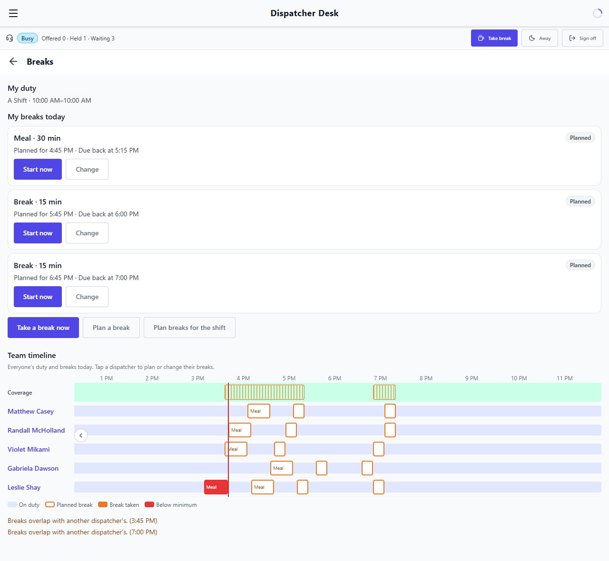
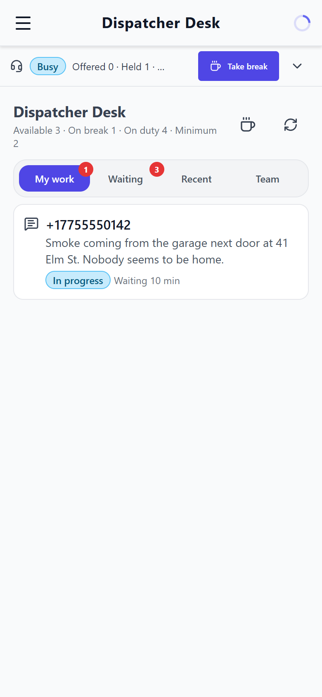
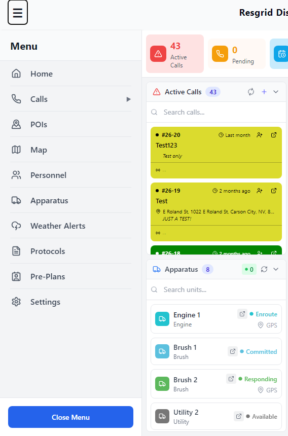

# Dispatch

Resgrid Dispatch is a cross-platform application designed for **dispatchers and coordinators** operating from a dispatch center, station, or remote location. It provides a comprehensive multi-panel dispatch console with real-time resource management, live mapping, activity logging, push-to-talk voice, and integrated call management — all optimized for tablet and desktop use with responsive multi-column layouts.

<AcademyVideo id="04-apps" />

## Ideal Use Cases

- **Dispatch Centers** — Dedicated dispatch operators monitoring and managing calls, personnel, and units from a desktop or wall-mounted display.
- **Station Duty Officers** — Command staff at a station managing incoming calls, tracking resources, and coordinating dispatch operations.
- **Remote Dispatch** — Portable dispatch capability on tablets for incident command posts, mobile command vehicles, or emergency operations centers.
- **Desktop Dispatch Workstation** — Full desktop application via Electron for Windows, macOS, or Linux dispatch workstations with large screens.
- **Web-Based Dispatch** — Accessible from any browser via the Docker-deployed web version, ideal for backup dispatch or temporary command posts.

## Supported Platforms

| Platform | Support Level | Details |
|----------|:------------:|---------|
| **iOS** | ✅ Full | iPad optimized with multi-column layouts |
| **Android** | ✅ Full | Tablet optimized with responsive layouts |
| **Web** | ✅ Full | Full web support with Docker deployment; platform-specific sidebar and map implementations |
| **macOS** | ✅ Full | Electron — DMG packages |
| **Windows** | ✅ Full | Electron — NSIS installer |
| **Linux** | ✅ Full | Electron — AppImage packages |

## Operations & Features

### Dispatch Console (Home Screen)

The dispatch console is the primary interface, providing a multi-panel view that adapts to screen size and orientation:

- **Tablet Landscape** — 3-column layout: Calls & Units | Map & Activity Log | Personnel, Notes & PTT
- **Tablet Portrait** — 2-column layout: Calls, Units & Personnel | Map, Notes, PTT & Activity Log
- **Phone** — Single column scrollable layout with all panels stacked

#### Stats Header
Real-time statistics banner displaying:
- **Active calls** count (calls that have been dispatched)
- **Pending calls** count — calls saved but not yet dispatched, waiting for a dispatcher; tap to open **Pending Calls**
- **Scheduled calls** count — calls waiting for their dispatch time; tap to open **Scheduled Calls**
- **Available units** count
- **Available personnel** count
- **On-duty personnel** count
- **Current time** (24-hour format, updated every second)
- **Weather widget** (based on department map center coordinates)

#### Active Calls Panel
- List of active calls with priority indicators (pending and scheduled calls have their own screens, below)
- **Call filter mode** — tap a call to filter all panels (units, personnel, notes, activity log) to show only data related to that call
- Priority colour-coded call filter banner when active
- Clear filter button to return to all-data view

#### Units Panel
- List of all department units with current status
- **Select a unit** to view details and track in the activity log
- When call filter is active, shows dispatched units and their statuses
- **Set unit status** directly from the panel for call-related operations
- **Release from call** (Omni): while the console is filtered to a call, the **−** button on a unit dispatched to it stands the unit down while the call stays open. Confirm, with **Notify** on by default. The unit leaves the call's lists and is free for the next call; see [Releasing a unit or person from a call](../web-app/dispatch-calls#releasing-a-unit-or-person-from-a-call)

#### Personnel Panel
- List of all department personnel with current status and staffing
- **Select personnel** to view details and track in the activity log
- When call filter is active, shows dispatched personnel
- **Set personnel status** directly from the panel
- **Release from call** (Omni): the **−** button on a person in the filtered list releases them from the call. A released person is left out of the call's list even when the group or role they were reached through is still on the call

#### Personnel & Unit Action Panels
- When a personnel member or unit is selected, a dedicated actions panel appears in the activity log area
- **Change status** of selected personnel or unit. A transport status (Transporting, At Hospital) that offers points of interest pre-selects the destination point of interest of the call the console is filtered to, or else of the call the unit is working, as the Unit app does for its crew ([Transport destinations](../web-app/dispatch-calls#transport-destinations)); a call whose destination is an address or point keeps the call as the destination. A unit's status starts on the call the unit is working, so the dispatcher does not pick the incident for every status: the call its latest status belongs to (unless that status cleared it), otherwise the one open call it is dispatched to. A call the unit's last clear ended does not count: the call that clear named or, when it named none (back in quarters at its station), every call the unit was sent to before it. A scheduled call counts once it has gone out or its dispatch time has passed. These are the same rules the server uses to [link a status to a call](../web-app/dispatch-calls#which-call-a-status-belongs-to). A unit with more than one call left starts on its last destination or the call selected on the console. The dispatcher can still pick another destination, and a status saved with no destination is still linked to the unit's call by the server
- **Change staffing** of selected personnel
- View detailed information about the selected resource

#### Map Widget
- Embedded **Mapbox GL** map with auto-fetched pins for personnel, units, stations, and calls
- Pins use the department's [uploaded icons](../web-app/mapping#custom-map-icons) for unit types, call types, POI types and personnel roles, in the browser, the desktop app and on tablets
- Call pins take the color of the call's priority and unit and personnel pins the color of their status ([icons by status and priority](../web-app/mapping#icons-by-status-and-priority)); pins redraw when a status or call changes, in the browser and desktop app as well as on tablets
- Role icons also show in the personnel panel, the combined resources list and the personnel list (inside each person's status ring), beside each role on a person's screen, and in the dispatch recipient picker beside every role and person
- Expand to full-screen map view
- Real-time position updates via SignalR

#### Notes Panel
- View **department notes** with search and refresh
- When call filter is active, shows **call-specific notes** instead
- **Add notes** to the selected call directly from the panel
- **Create new department notes** via bottom sheet

#### Activity Log Panel
- Chronological log of all dispatch console events
- Tracks: call selections, unit/personnel selections, status changes, PTT transmissions, system updates, note additions
- When call filter is active, shows only events related to the selected call
- **Radio log** tracks LiveKit voice transmissions with participant names, timestamps, and duration

#### Push-to-Talk (PTT) Interface
- Integrated **LiveKit WebRTC** push-to-talk directly in the dispatch console
- **PTT button** with press-and-hold to transmit
- Current channel display
- Transmitting indicator
- **Channel selector** for switching between department voice rooms
- All transmissions logged in the activity log with participant, timestamp, and duration

### Call Management
- **Create new calls** with:
  - Name, nature/description, priority, and type
  - Contact name and information
  - **Five location input methods**: address search, GPS coordinates, [what3words](https://what3words.com), Plus Code search, and interactive map picker. A call saved with a typed address that was never searched is geocoded by the server when it is created, so it still gets a location; a department that makes the location *required* needs a real point (search, coordinates or map pick)
  - **Location from POI**, a **Destination** and a pre-defined **Route** (Omni; see [below](#call-locations-destinations-and-routes))
  - External ID and Reference ID (the referring system's case or ticket numbers)
  - **Dispatch selection**: multi-select users, groups, roles, units, or everyone. The picker lists every unit, group, role and person whatever their status (it no longer shows *Everyone* alone when opened before the lists finish loading). If nobody is picked, the call is created for information only and pages nobody: choose *Everyone* to page the whole department.
  - The location map on New Call and Edit Call draws only the **available** units and personnel near the call, so it shows who can be sent; busy resources stay in the picker with their status for reassigning
  - **Schedule dispatch** for a future time (web and desktop), or **Save as pending (do not dispatch yet)**: the call is saved and numbered, nobody is notified and the field apps do not see it; any recipients picked are kept as the proposed dispatch. The button becomes **Save Pending Call** and the call opens on **Pending Calls**
- **Call detail view** with priority header, static map preview, and action buttons
  - A pending call shows a *Pending — not yet dispatched* banner with **Dispatch**; a scheduled call shows *Scheduled for* its time with **Dispatch now**
  - Add notes, attach images, attach files, route to call in native Maps
  - Tabbed content: Info, Contact, Protocols, Dispatched resources, Timeline, and **Route** (Omni) on a call with a route
  - Info shows the **Location POI**, the destination (a point of interest, or its address, **Destination Coordinates** and **Destination what3words**) and the **Route**; the call's map can switch between the call location and its destination
  - **Dispatched** tab (Omni): a **−** button on each unit and person releases them from the open call. Below the list, *Released from this call* shows who was released, when and by whom. Group and role rows have no button: release the person instead
  - Close call (permission-gated) — **Notify everyone on the call** (on by default) tells the dispatched personnel, groups, roles, units and command team it closed; a call under an active incident command is refused with the reason shown
- **Edit call** with the same form schema as creation
- Web-specific implementations (`.web.tsx`) for call views, creation, and editing

### Call locations, destinations and routes
The Omni call form and call page work like the System's [locations, destinations and routes](../web-app/dispatch-calls#locations-destinations-and-routes):

- **Location from POI** — pick any of the department's points of interest, searchable by name, type and address; it fills the address and the pin. Moving the location away afterwards unlinks it (*The location was moved away from …, so the call will not be linked to it*).
- **Destination** — switch between **Point of interest** (searchable, as before) and **Address or point**: a destination address (looked up by the server), a latitude and longitude (pasting *lat, lon* into either field fills both), what3words, a plus code (only finds the point) or **Pick destination on map**. Switching clears the other kind: a call has one destination. The department's *Destination* field rule covers both.
- **Suggested destinations** — with the department's [destination suggestions](../web-app/destinations#destination-suggestions) on, a panel under a **Point of interest** destination lists the 5 best destinations from the call's location for its type and priority (*Rules: …* · *Needs: …* · *Prefers: …*), with drive time and distance, availability badges, *Missing: …* / *Unavailable now: …* and **Use**. With *Suggest and fill in*, a new call's empty destination is filled with the *Suggested* one (*Filled in with the suggested destination. Choose another if needed.*) until the dispatcher picks or clears one; never over a destination address or point or a route.
- **Route** (*Pre-defined route*) — the routes a call can follow, searchable, each with its stops, distance, time and where it starts and ends (*Station 1 → General Hospital*). The route's start fills a blank call location and its end a missing destination when the call is saved. **Preview route** opens the plan. Shown only when the department has a route a call can follow, or the call already has one (*Route no longer available* when it can no longer be followed).
- **Route tab** on the call page — the route's name, stops, distance, time, start and end, and the **route runs**: each unit that started it, its status, stops done of the total, and when it started, reached the route start and ended. The tab's badge counts the runs still going. Units start the route from the [Unit app](unit#call-routes), not from here.

The same location and route fields are on pending and scheduled calls, and on the recurring call form (with **Destination address**, **Destination location** and **Route**).

<!-- Screenshots to take: Omni Dispatch New Call with Location from POI, Destination "Address or point" and a picked route; call page Route tab with a run. -->

### Routes
**Routes** in the side menu (Omni) shows the department's routes to the dispatch desk, read only:

- **Running** — every route in progress or paused: plan, unit, status, progress, the next stop and when it started. A run started for a call names it (*Call 26-153: Dialysis transfer*) and the call opens from there. Tap a run to see it with its stops. The list refreshes every minute while open, and on pull.
- **Plans** — the department's route plans with their status (Active first), searchable by name, description and unit. A plan opens its **Route Preview**: the map with the route line, start (*S*) and end (*E*), the stops, travel mode, distance and time with and without stops, and a warning when the stops changed after the route was calculated.

The two lists need the Route View permission; previewing an active plan only needs access to calls. Starting, checking in and managing plans stay on the web [Routes](../web-app/routes) pages and in the Unit app. The route preview also opens from the call form, a call's Route tab and the Incident Command and Unit apps.

<!-- Screenshots to take: Omni Dispatch Routes > Running with a call-linked run; Routes > Plans; Route Preview. -->

### Destinations
**Destinations** in the side menu (Omni, after POIs) is the dispatch desk's view of the department's [destinations](../web-app/destinations), refreshed each time it opens and on pull:

- **Availability** — every destination with its type, address, availability badge (*Open*, *Limited*, *Diversion*, *Closed*), capabilities (struck through when down), the note and *Until …*. Search, *All* and *Not open* chips, type and capability chips, and a count line (*Open · Limited · Diversion · Closed*); the tab's badge counts the destinations that are not open. **Set availability** opens the **Destination availability** sheet: the status, **Not available now** (the capabilities it offers), **What was reported** (*e.g. ED capacity overload, CT down*) and **Lasts** (*Until changed*, *1 h* … *24 h*). Saving needs a connection and permission to create calls. Tap a row for the POI's details.
- **Capabilities** — each capability with how many destinations offer it and how many cannot provide it now; press one to list those destinations on the Availability tab.
- **Rules** — read only: the suggestions setting (*Off*, *Suggest destinations*, *Suggest and fill in*) with its preferred capability window, and each [destination rule](../web-app/destinations#destination-rules) with when it applies, its destination types and what it requires and prefers. Rules are set on the web (*Rules and suggestions are set on the web under Mapping → POIs → Destination Rules.*).

The IC app sets availability from a destination's POI details instead. A dispatcher setting a unit's transport status gets the same ranked, rule-aware destination list as the Unit app ([Unit status destinations](../web-app/destinations#in-the-apps)).

### Pending and Scheduled Calls
Both are under **Calls** in the side menu (Pending Calls shows a count badge) and behind the console's tiles. They work like the System's [pending and scheduled calls](../web-app/dispatch-calls#pending-and-scheduled-calls).
- **Pending Calls** — calls waiting for a dispatcher, oldest first, with search: number, name, type, priority, address and when it was received. **Dispatch** opens the recipient picker with any proposed recipients already selected; confirming sends the call and it moves to the active calls. **Cancel Call** closes it as Cancelled without notifying anyone. Pending calls come from *Save as pending* here or on the web, from another system through the API (`IsPending`), from [intake channels](../web-app/intake-channels/overview) and the [Private Inbound Dispatch Number](../web-app/intake-channels/dedicated-number), or from emailed calls the department saves as pending. A call from an intake channel shows where it came from and any screening badge (*Enhanced AI: likely not an incident*); **Dismiss as Spam** (block the sender on by default) cancels it without notifying anyone ([Spam screening](../web-app/intake-channels/overview#spam-screening)). With the [dispatcher desk](#dispatcher-desk) on, pending calls are also offered to the dispatchers on duty.
- **Scheduled Calls** — calls waiting for their dispatch time, with **Dispatch now** to send one early and **Reschedule** on the call.

### Recurring Calls and alerts
Under **Calls** in the side menu, next to Scheduled Calls, they work like the System's [recurring calls](../web-app/scheduled-calls).
- **Recurring Calls** — the department's recurring calls with *Active / Paused / Ended* filters. A recurring call's page describes its schedule in plain words and shows its facility, destination and contact, its next dispatches and the calls it has created that have not gone out (a held one can be sent from there). **Pause** (with a reason, a resume date and an option to delete the calls already created), **Resume**, **Edit** and **Delete** are for its creator or a department admin; anyone who may create calls can create a new one. The form has every field the web form has; *Also use the matching run card* is greyed out with an explanation when the department has no run cards.
- **Calendar** — the next two weeks by day: scheduled calls, runs still to come, runs waiting for a dispatcher, held calls, missed and skipped runs. A run offers **Send now** (asks first), **Create call** and **Skip**; a skipped one **Restore**; a held call **Send**.
- **Recurring Call Alerts** — next to Awaiting Resources, with a count badge, and a banner on the console while any are open (red while some are unseen). Each alert shows what happened (*time to send*, *nobody could be sent*, *sent without some resources*, *missed*, *could not be created*), the recurring call, when it is due, the call number, the reason and the units or people left off. Actions: **Send now** (says whether it went out or was held), **Create call**, **Skip**, **Send** a held call through the usual recipient picker, **Open call**, **Acknowledge** and **Dismiss** (with a note). New alerts pop up with a sound and stay highlighted until you leave the screen; the list updates live and when the app comes back to the foreground. Tapping a recurring call alert notification opens this screen.
- A call created by a recurring call shows *Created by the recurring call …* on its page, linking to the recurring call.
- Both lists refresh when the server reports a call was added, changed or closed.

### Dispatcher desk (Dispatcher On-The-Go) {#dispatcher-desk}

When your department turns on the [dispatcher desk](../web-app/dispatcher-desk), the Dispatch app is where dispatchers take the work it routes: pending calls, scheduled calls coming up for review, texts, phone calls and emailed calls. Work is offered to one free dispatcher at a time, with a push notification and a sound, and anything nobody can take waits in a shared queue. Because it works the same on a phone as on a tablet or desktop, a dispatcher can cover the desk from anywhere: **Dispatcher On-The-Go**.

Open it from the side menu: **Dispatcher Desk** (its badge counts the work offered to you plus the work waiting). A **desk status bar** across the top of every screen shows *Offered N · Held N · Waiting N* and your next desk action, so you can keep working the console, the map or a call while signed in. Only members with the **Dispatch app login** permission can use the desk (*You are not a dispatcher* otherwise); if the department has not turned it on, the screen says *The dispatcher desk is turned off* and that a department administrator can turn it on under **Shifts > Dispatcher Desk Settings**.



#### Signing in to the desk

Press **Sign in to the desk** (on the status bar, or *You are not signed in to the desk* on the desk screen):

| Field | What it does |
|---|---|
| *Signing in on: Phone / Tablet / Desktop* | The device kind, shown to supervisors on the board. |
| **Callback number** | *The desk rings this phone to connect callers. Leave it empty to use your profile mobile.* Enter the phone you have with you. |
| **Unscheduled duty** and **On duty until (optional)** | Shown when the department allows duty without a shift: *Go on duty without a dispatch shift (an event, cover).* |
| **Start as away** | *Take no routed work until you go available.* Use it to sign in early and settle in before offers start. |

When you are not on a dispatch shift right now, the sheet warns that the desk may refuse the sign-in (*You are not on a dispatch shift right now.*). Once signed in you get offers whenever you are **Available**.

**The status bar** offers, depending on your state: **Take break**, **Away** and **Sign off** while available; **Go available** while away; **I'm back** on a break. On a phone it shows the main action, with **More desk actions** for the rest. **Sign off** asks *Sign off the desk?*; any work you hold goes back to the queue for someone else. With the department's **Sign off at the end of the shift** setting, the desk signs you off when your shift ends.



#### Offers

When work is offered to you, **Work offered to you** appears over whatever screen you are on, with a sound: the kind of work (Pending call, Scheduled call, Text message, Phone call, Email), the call or sender and a preview, and a countdown (*Answer within 0:42*).

- **Accept** takes it: it moves to **My work** and opens.
- **Decline** sends it straight on to the next free dispatcher.
- If the countdown runs out (45 seconds by default) it moves on too. Let two offers in a row run out and the desk sets you **Away**, so it stops waiting on you; press **Go available** to take work again.
- *More offers waiting: N* when more than one is out for you.

With the app in the background, the offer arrives as a push notification; tapping it opens the item.



#### My work, Waiting and Recent

The desk screen's header shows *Available N · On break N · On duty N · Minimum N* (red when coverage is below the minimum), a **Breaks** button and refresh. The lists:

| Tab | Shows |
|---|---|
| **My work** | Work offered to you, then work you hold. *Nothing offered to you or held by you.* when empty. |
| **Waiting** | The shared queue: work nobody holds, with how long it has waited and *Waiting too long* once it escalated. **Take** takes an item straight from the queue, whoever it would have gone to. |
| **Recent** | Work that recently left the desk (finished, sent to overflow or handled elsewhere) while this device was watching, with its last state. |
| **Team** | The [team board](#team-board-and-coverage-timeline) (phone only; on a tablet it fills the right-hand side). |

#### Working an item

An item shows its kind, its state (**Waiting**, **Offered**, **In progress**, **Done**, **Sent to overflow**, **Cancelled**), who holds it and how long it has waited, then:

| Button | What it does |
|---|---|
| **Accept** / **Decline** | For an offer to you. |
| **Take** | For waiting work. |
| **Dispatch now** | Pending and scheduled calls: opens the recipient picker with the proposed recipients ticked; once sent, the item completes as *Dispatched*. |
| **Open call** | Opens the item's call (for example to edit it before sending). |
| **Create call** | A text or email with no call yet: opens New Call filled in from the conversation; the saved call is linked to it (*The call is linked to the conversation.*). Saved offline, it is linked once it is sent. |
| **Complete** | Finish it (below). |
| **Return to queue** | Give it back for another dispatcher. |
| **Hand over** | Offer it to another signed-in dispatcher who is free, with an optional note. A supervisor can also hand over someone else's open work. |

Texts and emails show the conversation, oldest first, with each outgoing message marked **Sending**, **Sent** or **Not delivered**. **Reply** answers the sender (texts go from the number they texted, except in a [text thread](#text-threads-from-the-private-inbound-dispatch-number) on the Private Inbound Dispatch Number, where replies go out from the main Resgrid number; emails are answered by email from Resgrid's address). **Add note** writes a note for the desk that is never sent. **History** lists each step: *Came in*, *Offered*, *Accepted*, *Declined*, *Offer ran out*, *Returned to the queue*, *Handed over*, *Sent to overflow*, *Completed*.

**Completing.** **Complete** asks *How did it end?*:

- for a pending or scheduled call: **Dispatched**, **Left pending**, **Duplicate**, **Call closed** or **Referred elsewhere** (nothing is picked for you, so the record says what really happened);
- for a text or email: **Call created** (when a call is linked; picked for you), **No action needed**, **Duplicate** or **Referred elsewhere**.

Add an optional **Note** and press **Complete**. A call dispatched or closed somewhere else (on the web, by another dispatcher) leaves the desk by itself.



#### Text threads from the Private Inbound Dispatch Number

A text to the department's [Private Inbound Dispatch Number](../web-app/intake-channels/dedicated-number) comes to the desk as a **Text message** linked to its pending call, with a **Text thread**:

- The top line says who is answering: *Enhanced AI is asking the texter questions until a dispatcher connects.*, *The texter is waiting for a dispatcher.* or *Connected with (name).* Messages are labeled **Texter**, **Enhanced AI**, **Resgrid** (automatic texts such as the welcome) and the dispatcher's name. *Replies go out from* (the main Resgrid number).
- **Accept** (or **Take**) connects you: the texter is told *You are now connected with* (your first name)*. Please describe the situation you are having and your location.* and Enhanced AI stops answering.
- **Reply** texts the texter. If the carrier refuses it, you see *That channel cannot send right now*, your draft is kept, and the reply shows **Not delivered** in the thread.
- **Return to queue** hands the texter back (to Enhanced AI, or waiting for a dispatcher) without texting them.
- **Complete** ends the thread. **Tell the texter the conversation ended** (on by default) *Sends a closing text from the Resgrid number.*; turn it off to end it silently. The pending call stays for you to dispatch.
- A texter who sends STOP is opted out: *The texter opted out (STOP). Nothing more can be sent.* An ended thread says *This text thread has ended.*

The same thread is on the call's page on the web ([Text conversations](../web-app/intake-channels/dedicated-number#text-conversations)).



#### Answering phone callers

A **Phone call** item is a caller held on the line for a dispatcher (a non-member calling the department's text-to-call number). It shows the **Caller** (or *Unknown number*) and *Caller waiting* or *Caller hung up*:

1. Check **Ring this number** (your callback number) and press **Answer**. *Your phone will ring. Press 1 to connect.*
2. Your phone rings with *Resgrid dispatch call from* (the caller's number)*. Press 1 to connect.* Press 1 and you are talking to the caller. Any phone or tablet with a phone number works.
3. If the caller hung up before you answered, the item stays on your desk with **Call back**: the desk rings you, you press 1, and it calls them back.

*The desk cannot connect phone calls for this department.* means phone calls are not set up for your department.

#### Breaks {#breaks}

**Breaks** (the coffee cup on the desk screen, or a break push) shows:

- **My duty**: your shift and its times (*Unscheduled duty until …*, *Not on a dispatch shift*).
- **My breaks today**: each break with *Planned for …*, *Started …*, *Due back at …* or *Overdue by …*, and **Change** while it is planned. **Plan a break** when your shift lets dispatchers plan their own (or you are a supervisor): type, length and **Planned start** (*A break is a length: it can start early or late, and is due back its length after it starts.*).
- **Take a break now**, and the **Team timeline** below (see the next section).
- Supervisors: **Plan breaks for the shift** (*Stagger the shift's break plan across today's dispatchers so breaks do not overlap.*), with **Replace breaks already planned**.

**Taking a break.** The app reminds you before a planned break (*Your Meal starts in 5 min*) and when it is due (*Your Meal is due now. Tap to take it.*). **Take break** opens **Take a break**: start the planned break, or **A new break now** with its **Type** and **Length**. If you hold work, tick **Return my work to the queue (held: N)**; *A break starts only once your work is back in the queue for another dispatcher.* If the break would take coverage below the minimum you are warned and can **Take break anyway**, unless the department prevents it (*ask a desk supervisor to start it*). Then *Enjoy your break. You are due back at …*

**On break** the status bar shows *On break · 12:00 left* (or *Break overdue by N min*). You get no offers, and while the department keeps breaks quiet (the default), no desk notifications, sounds or pop-ups. Other alerts the Dispatch app shows in the foreground (new calls, chat, toasts and their sounds) are held back too; the break reminders still come. Notifications other apps or the phone itself show while the app is in the background are not changed.

**Coming back.** *Your break is over. Tap "I'm back" to return to the desk.* Press **I'm back** (*Welcome back. You are on the desk again.*); waiting work is offered to you straight away. If the department returns dispatchers automatically you are told *Your break ran past its length, so the desk returned you automatically.*; if a supervisor ended it, *Your break was ended. You are back on the desk.*



#### Team board and coverage timeline

The **Team** board lists every dispatcher on the desk: their state (**Available**, **Busy**, **Away**, **On break** with time left, *Signed off*), *you*, **Supervisor**, *Holding 1 of 2*, *Offered: N*, their shift (*A Shift until 19:00*, *Unscheduled duty until …*), and their next break (*Next: Meal at 12:00 (30 min)*). Supervisors can **End break** for someone and open **Breaks** to plan or change that dispatcher's breaks.

The **Team timeline** (*Everyone's duty and breaks today. Red marks coverage below the minimum.*) draws each dispatcher's duty and breaks across the day, with a **Coverage** lane. The legend: **On duty**, **Planned break**, **Break taken**, **Overdue break** (red, a dispatcher late back) and **Below minimum** (red on the Coverage lane). Supervisors tap a dispatcher to plan or change their breaks.

#### Phone, tablet and desktop

| Layout | How the desk looks |
|---|---|
| **Phone** | The lists as tabs (**My work**, **Waiting**, **Recent**, **Team**); an item opens on its own screen. The status bar shows one action with **More desk actions**. |
| **Tablet and desktop** | The lists on the left and the picked item on the right; with nothing picked, the right side shows the team board. The status bar shows every action. |

A desk push opens its item (on a phone as its own screen, on a tablet picked beside the lists); a break push opens **Breaks**.



#### Sounds

The Dispatch app has **its own sound set**, so a dispatcher can tell it apart from the Responder or Unit app on the same device: the modern call, status, message and alert sounds in a distinct dispatch tone, plus five desk sounds: **work offered**, **work waiting too long**, **new message** in a conversation you hold, **break reminder** and **break over**. The other apps keep their sounds.

### Additional Screens
- **Calls list** — searchable paginated list of all calls
- **Personnel list** — all department personnel with status information
- **Units list** — all department units with status information
- **Contacts** — department contact directory with detail sheets and notes
- **Notes** — department notes with detail views
- **Protocols** — emergency response protocols/SOPs with detail sheets
- **Map** — full-screen interactive map with pins and detail modals
- **Destinations** — destination availability, capabilities and rules ([above](#destinations))
- **Dispatcher Desk** — routed work, the shared queue, breaks and the team ([above](#dispatcher-desk))
- **Settings** — account, preferences, and configuration options

### Inactivity Lock Screen
- **Configurable inactivity timeout** (in minutes) that automatically locks the screen
- Password-based unlock using the user's credentials
- Prevents unauthorized access when a dispatch workstation is left unattended
- Configurable via the `INACTIVITY_TIMEOUT_MINUTES` environment variable

### Maintenance Mode
- Remote-controlled maintenance mode via environment variable
- When enabled, displays a maintenance screen instead of the application
- Useful for coordinated system updates

### Push-to-Talk Voice (LiveKit)
- **LiveKit WebRTC** voice channels for dispatcher communication
- Microphone toggle with mute/unmute
- Audio routing to Bluetooth, speaker, or earpiece
- **CallKeep integration** for OS-level VoIP call handling
- **Bluetooth PTT headsets**: scan, discover, and connect supported BLE devices (AINA PTT, B01 Inrico, HYS)

### Audio Streams
- Listen to **department audio streams** (scanner feeds, dispatch radio)
- Play/pause streaming audio via bottom sheet

### Notifications
- **Push notifications** via Firebase Cloud Messaging with Notifee
- Android notification channels mapped to call priorities
- iOS critical alert support to bypass Do Not Disturb
- **In-app notification inbox** powered by Novu with unread badges (native platforms)
- **Dispatcher desk** pushes (work offered, work waiting too long, new messages, break reminders) go only to the Dispatch app, never to the Responder app on the same account, and are not sent while you are on a break, except *break over* ([Dispatcher desk](#dispatcher-desk))

### Real-Time Updates (SignalR)
- Persistent WebSocket connection for real-time event updates
- Personnel status/staffing updates, unit status updates, call updates
- Auto-reconnect with background resume refresh; after any reconnect the console reloads units, calls and personnel, so changes made while the connection was down are not missed
- Events trigger automatic data refresh across all console panels. Unit statuses are always reloaded from the server (never from the device's saved copy), and a status change that arrives while a reload is already running triggers one more reload, so the console matches the web dashboard

### Run cards and recommendations

When the department uses [Run Cards](../web-app/run-cards), the New Call screen shows the recommended units and personnel for the call's priority and type (or dispatches them automatically), lets the dispatcher escalate alarm levels, and surfaces move-up recommendations. The recommendation refreshes once the call has a location (from the address search, coordinates, what3words, Plus Code or the map picker); closest-unit selection needs that location, measures units in an **In Quarters** status from their station and adds the department's [turnout times](../web-app/run-cards#how-closest-unit-mode-measures-a-unit).

**Adding resources to an active call** (**Dispatch additional resources** on the call, or the add button on a call in the console's Active Calls panel) shows the run card recommendation at the top of the recipient picker: what the call's run card still needs at its current alarm level, after counting the units and people already on the call, picked the same way as at creation (station-based or closest unit). **Apply recommendation** ticks them; nothing is sent until **Confirm**. When the call already covers its run card the picker says so, and anyone can still be added by hand. To dispatch the next level's resources in full, use **Strike Next Alarm**.

### Chat, moderation and the Assistant

Dispatch is the reference chat client: all channels, incident channels per call, urgent messages and the Assistant. See [Chat & Assistant](../web-app/chat).

### Field Records

With `Records.Field.Dispatch` enabled, dispatchers can start the NERIS incident report or a run record directly from the call. See [Records](../web-app/records/overview).

### Deployments and pre-plans

Dispatchers see the department's **deployments** read-only (roster, window, identifiers, time-report numbers and status) so a call's crew and assignment are in view; time reports, usage and F-42 drafting are done from the Responder and Unit apps. A call's contact shows its **pre-plan** and **alert hazards** in the dispatch alert and on the Site Info tab. See [Deployment Finance](../web-app/business-ops/deployment-finance) and [Contacts](../web-app/contacts).

### Department terminology

Names a department sets under [Terminology](../web-app/department-settings#terminology) replace the app's own labels: the side menu (Calls, Map, Personnel, Units, Contacts, Records), the console's **Units**, **Personnel**, **Notes** and **Map** panel titles, the **Calls** tab in a unit's or person's action panel, the Map and Records screen titles, and record types in Field Records. Labels that combine a module with other words, such as *Active Calls* or *Units on Call*, keep the app's wording. The names load when the app starts or a dispatcher signs in.



## Settings & Configuration

| Setting | Description |
|---------|-------------|
| **Server URL** | Custom API endpoint for self-hosted deployments |
| **Login Info** | Update username and password |
| **Theme** | Light, Dark, or System |
| **Language** | English, Spanish, or Arabic |
| **Keep Alive** | Prevent screen from sleeping (important for dispatch workstations) |
| **Background Geolocation** | Enable/disable background GPS tracking |
| **Bluetooth Device** | Scan and pair BLE PTT headsets |

### Environment Variables

| Variable | Purpose |
|----------|---------|
| `MAINTENANCE_MODE` | Enable/disable application maintenance mode |
| `INACTIVITY_TIMEOUT_MINUTES` | Configurable lockscreen inactivity timeout |
| `BASE_API_URL` | API server hostname |
| `MAPBOX_PUBKEY` | Mapbox public access token for maps |
| `SENTRY_DSN` | Sentry error tracking DSN |
| `COUNTLY_APP_KEY` / `COUNTLY_SERVER_URL` | Countly analytics configuration |

### Docker Deployment

The web version can be deployed as a Docker container:

```bash
# Build the Docker image
docker build -t resgrid-dispatch-web .

# Run with environment file
docker run -p 3000:80 --env-file .env.docker resgrid-dispatch-web

# Or use Docker Compose
docker-compose up -d
```

## Hardware & Permission Requirements

### Required Hardware
| Hardware | Required | Purpose |
|----------|:--------:|---------|
| Internet | **Yes** | API, SignalR, LiveKit, push notifications |
| Large Screen | Recommended | Multi-panel dispatch console is optimized for tablets and desktops |
| Speaker | Recommended | Audio streams and voice playback |
| Microphone | Recommended | PTT voice communication |
| GPS | Optional | Dispatcher location tracking |
| Camera | Optional | Image attachments to calls |
| Bluetooth LE | Optional | External PTT button devices |

### iOS Permissions
| Permission | Reason |
|------------|--------|
| Bluetooth Always | BLE PTT device connectivity |
| Microphone | PTT voice communication |

**Background Modes**: remote-notification, audio, bluetooth-central, voip

**Entitlements** (production): Critical alerts and time-sensitive notifications

### Android Permissions
| Permission | Reason |
|------------|--------|
| Wake Lock | Keep device awake for continuous dispatch operations |
| Record Audio | PTT voice |
| Capture Audio Output | Audio routing for PTT/voice |
| Post Notifications | Push notifications (Android 13+) |
| Foreground Service | Background services |
| Foreground Service (Microphone) | Voice in foreground service |
| Foreground Service (Connected Device) | BLE in foreground service |
| Foreground Service (Media Playback) | Audio stream in foreground service |
