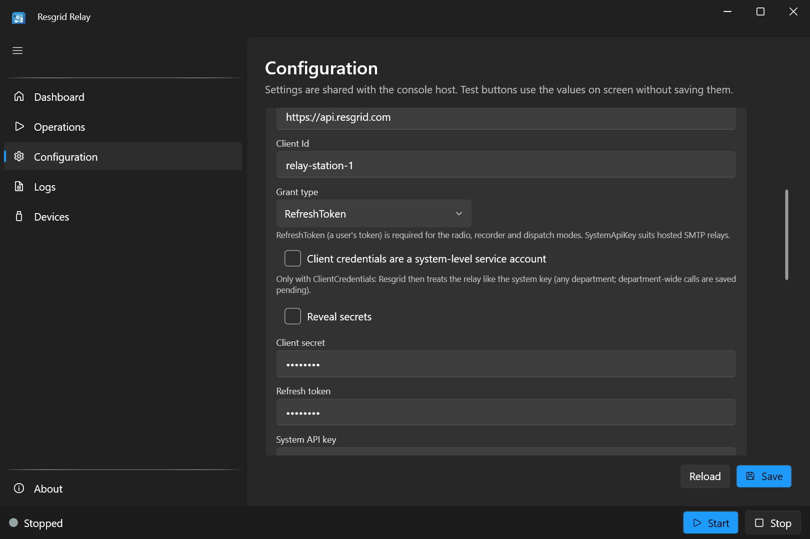

# Connect Relay to Resgrid

Every Relay mode talks to your department through the Resgrid v4 API. This page covers the credentials Relay signs in with, which kind of sign-in (the **grant type**) each mode needs, and how Relay keeps its sign-in working for months without attention.

## What you need

| Setting | Value |
| --- | --- |
| **Base URL** (`Resgrid:BaseUrl`) | `https://api.resgrid.com` for Resgrid's hosted service, or your own API address on a self-hosted installation. |
| **API version** (`Resgrid:ApiVersion`) | `4` (`v4` also works). |
| **Client id** and **client secret** (`Resgrid:ClientId`, `Resgrid:ClientSecret`) | The OpenID Connect client Relay signs in through. Every grant type needs them. On Resgrid's hosted service, ask Resgrid support for a client for Relay; on a self-hosted installation, use a client configured on your installation. |
| **Grant type** (`Resgrid:GrantType`) | `RefreshToken` (the default), `ClientCredentials` or `SystemApiKey`. See below. |
| **Refresh token** (`Resgrid:RefreshToken`) | For the `RefreshToken` grant: a refresh token for the member account Relay acts as. |
| **System API key** (`Resgrid:SystemApiKey`) | For the `SystemApiKey` grant only. |

## Which grant each mode needs

Which grant a mode can use is decided by Resgrid's API, not by Relay:

| Grant | How Relay signs in | `smtp` | `audio` | `radio`, `record`, `dispatch` |
| --- | --- | --- | --- | --- |
| `RefreshToken` (default) | As a member, with that member's refresh token | Yes, for that member's department | Yes | **Required** |
| `ClientCredentials` | As the client itself, with no member | Yes | Yes | No |
| `SystemApiKey` | With the installation's system API key (`X-Resgrid-SystemApiKey` header) | Yes, for any department (hosted relays) | Yes | No |

The voice modes (radio bridge, recorder, tone-out) join a Resgrid PTT channel, and Resgrid's voice service only lets a **member** join: it refuses the system API key, and a client-credentials sign-in has no member to join as. Those modes refuse to start with another grant, and the Operations screen's pre-flight check says so.

**Use `RefreshToken` unless you have a reason not to.** It works for every mode, and everything Relay does is attributed to the member it signs in as.

## The Relay member account

Relay acts as a member of your department, so create a member just for it, for example *Relay – Station 1*:

- Calls Relay creates show that member as their creator, and PTT users see that name when the radio bridge talks on a channel or the tone-out announces a call.
- The member must be allowed to [create calls](../../web-app/security-permissions.md) for SMTP dispatch, tone detect and radio emergency calls, and to send messages for SMTP group messages.
- Each voice mode occupies one of your department's PTT voice seats while it is connected (one per recorded channel for the recorder).
- Don't delete the member while Relay uses it: Relay can no longer sign in as it.

## Get a refresh token

Request a token once, as the Relay member, with the **same client id and secret** you give Relay and the `offline_access` scope (see [API Authentication](../../api/authentication.md)):

```bash
curl -X POST "https://api.resgrid.com/api/v4/connect/token" \
  -H "Content-Type: application/x-www-form-urlencoded" \
  --data-urlencode "grant_type=password" \
  --data-urlencode "client_id=YOUR_CLIENT_ID" \
  --data-urlencode "client_secret=YOUR_CLIENT_SECRET" \
  --data-urlencode "scope=openid profile email offline_access mobile" \
  --data-urlencode "username=RELAY_MEMBER_USERNAME" \
  --data-urlencode "password=RELAY_MEMBER_PASSWORD"
```

Copy the `refresh_token` value from the response into Relay. The member's password is only used for this request: Relay never stores it.

Use your own API address instead of `api.resgrid.com` on a self-hosted installation. The scope matches Relay's default `Resgrid:Scope`; if you change one, change the other.

## Enter the settings

### In the desktop app

Open **Configuration › Resgrid API**:



1. Enter the **Base URL** and **Client Id**.
2. Leave **Grant type** on **RefreshToken** (or see the other grants below).
3. Tick **Reveal secrets**, then enter the **Client secret** and **Refresh token**.
4. Press **Test connection**, then **Save**.

Secrets show as dots once saved; a field left as dots keeps the stored value.

### In appsettings.json or relay.user.json

```json
{
  "Resgrid": {
    "BaseUrl": "https://api.resgrid.com",
    "ApiVersion": "4",
    "ClientId": "YOUR_CLIENT_ID",
    "ClientSecret": "YOUR_CLIENT_SECRET",
    "GrantType": "RefreshToken",
    "RefreshToken": "YOUR_REFRESH_TOKEN",
    "TokenCachePath": "./data/resgrid-token.json"
  }
}
```

### With environment variables

```bash
RESGRID__RELAY__Resgrid__BaseUrl=https://api.resgrid.com
RESGRID__RELAY__Resgrid__ClientId=YOUR_CLIENT_ID
RESGRID__RELAY__Resgrid__ClientSecret=YOUR_CLIENT_SECRET
RESGRID__RELAY__Resgrid__GrantType=RefreshToken
RESGRID__RELAY__Resgrid__RefreshToken=YOUR_REFRESH_TOKEN
RESGRID__RELAY__Resgrid__TokenCachePath=/var/lib/resgrid-relay/resgrid-token.json
```

The settings files and environment files hold these secrets in plain text: keep them readable only by the account that runs Relay (the systemd setup does this with `chmod 600`).

## Test connection

**Test connection** (Configuration › Resgrid API) signs in to Resgrid with the values on the screen, saved or not, and calls the API's health check. It answers in the line under the button:

| Message | Meaning |
| --- | --- |
| *Connected: signed in to https://api.resgrid.com with the RefreshToken grant.* | Everything works. |
| *Signed in, but the Resgrid API health check did not succeed.* | The credentials are good, but the API reported a problem. Try again shortly; on a self-hosted installation, check the API service. |
| *Connection test timed out after 30 seconds.* | Relay couldn't reach the base URL: check the address, the PC's internet connection, and any proxy or firewall. |
| *Connection failed: …* | The reason follows: a missing setting, a wrong client id or secret, or a refresh token Resgrid no longer accepts. See [Troubleshooting](troubleshooting.md#test-connection-fails). |

The test is a real sign-in, so with the `RefreshToken` grant it also rotates the refresh token (below). It shares the token cache with the running modes, so testing never strands them with a spent token.

## Refresh token rotation

Resgrid **replaces the refresh token every time it is used**: each sign-in returns a new refresh token and retires the old one. Relay handles this for you:

- It writes the newest token to the **token cache** file (`Resgrid:TokenCachePath`) as soon as it gets one (atomically, and readable only by the owner on Linux), and on the next start uses the cached token instead of the one in your settings, which Resgrid has already retired.
- The modes of one Relay process share the cache file safely.
- When you paste in a **new** refresh token (because you issued a fresh one), Relay notices that the configured token changed and starts from the new one instead of the cache.

The cache must be on **writable, persistent storage**, or every restart begins with a spent token and fails to sign in. Where it goes by default:

| Host | Token cache |
| --- | --- |
| Desktop app | `%LOCALAPPDATA%\Resgrid\Relay\resgrid-token.json` (written into `relay.user.json` when you save, so a console host on the same account uses it too) |
| Console host (`appsettings.json`) | `data/resgrid-token.json` next to the executable |
| Linux systemd unit | `/var/lib/resgrid-relay/resgrid-token.json` |
| Docker | `/app/data/resgrid-token.json`: mount a volume on `/app/data` |

A refresh token that isn't used for longer than its lifetime expires: 2 days, unless your Resgrid installation treats Relay's client as long-lived. A running relay keeps its sign-in fresh by itself: the voice modes use the API as they work, and SMTP dispatch, which otherwise only signs in when mail arrives, checks in with Resgrid every 6 hours while it is idle (with the system API key, which doesn't expire, it doesn't need to). Only a relay that was switched off for longer than the token's lifetime needs a new refresh token.

:::warning One refresh token, one Relay process
Don't run two Relay processes (two PCs, two systemd units, two containers) from the same refresh token with different token caches. The first one to sign in retires the token the other holds, and the other one stops working. Give each process its own refresh token (sign in once per process) and its own `TokenCachePath`.
:::

**Desktop app and console host on the same Windows account:** when you save in the desktop app, it writes its token cache path (`%LOCALAPPDATA%\Resgrid\Relay\resgrid-token.json`) into `relay.user.json` if none is set, so the console host on the same account reads the same, current token. You can move a relay from the desktop app to the console without a new refresh token; stop the desktop app's modes first, so only one of them runs on the token at a time.

## Client credentials and service accounts

With `GrantType` `ClientCredentials`, Relay signs in with the client id and secret alone: no refresh token, nothing to rotate, nothing that expires. It suits single-department SMTP relays and tone detect, but not the voice modes.

If the client is a **system-level service account** on your Resgrid installation (not a department's client), tick **Client credentials are a system-level service account** (`Resgrid:ServiceAccount` `true`). Resgrid then treats Relay like the system API key: it may act for any department, and a department-wide call is saved as a pending call (below). Resgrid can't tell Relay which kind of client it is, so Relay needs this setting to behave correctly. It is ignored for the other grants.

## System API key and hosted relays

With `GrantType` `SystemApiKey`, Relay sends the installation's system API key (`Resgrid:SystemApiKey`) on every request. On a self-hosted installation it is the API's `RESGRID__SecurityConfig__SystemApiKey` (see the [Docker reference](../../reference/docker.md)). The client id and secret are still required.

The system key can act for **any department**, which is what a hosted SMTP relay serving many departments needs ([hosted mode](smtp-dispatch.md#hosted-mode-many-departments)). Resgrid limits what it may do:

- **It never pages a whole department on its own.** A call for a department address is saved as a **pending call**: it waits in the dispatchers' pending queue, and pages everyone once a dispatcher sends it. Group addresses are dispatched straight away.
- **It can't send messages**, so group-message addresses are refused.
- **It can't join PTT channels**, so the voice modes can't use it.

The department comes from the dispatch address in hosted mode, or from `Resgrid:DepartmentId` or `Smtp:DefaultDepartmentId` for a relay that serves one department.

## Department Id

`Resgrid:DepartmentId` matters only to system callers (the system API key or a service account): it is the department Relay acts for when the dispatch address doesn't say. With a member's refresh token, Relay always acts in that member's department, and you can leave it blank.
