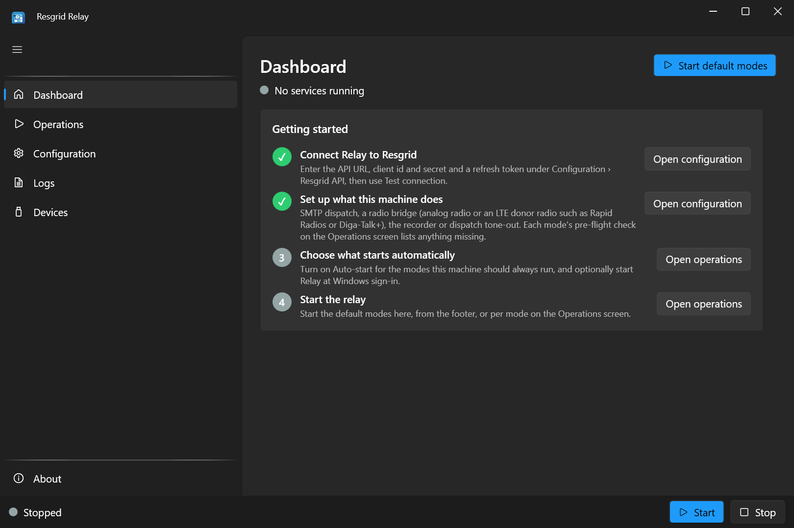
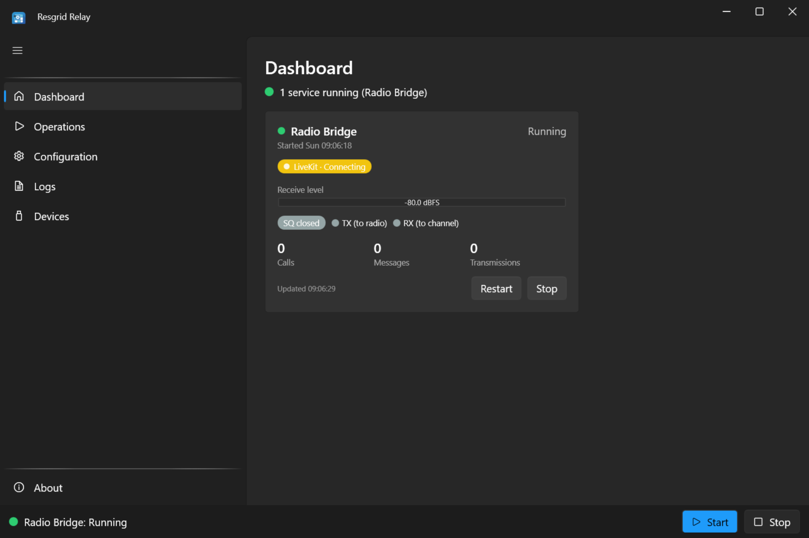
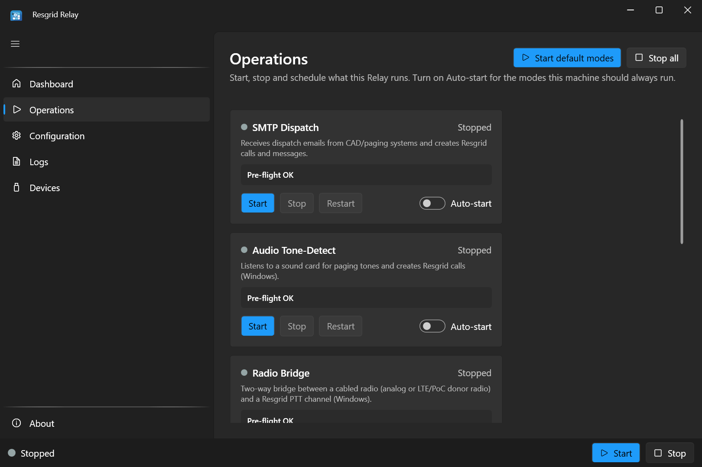
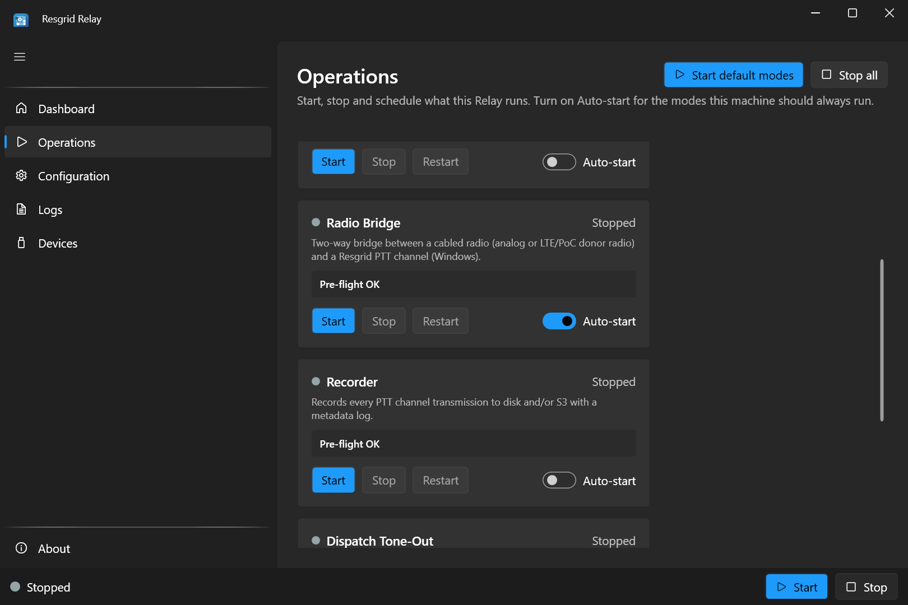
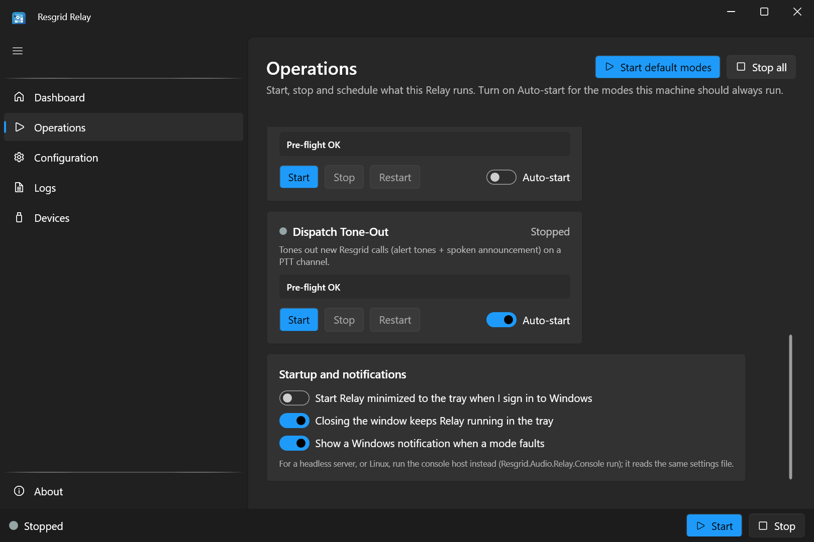
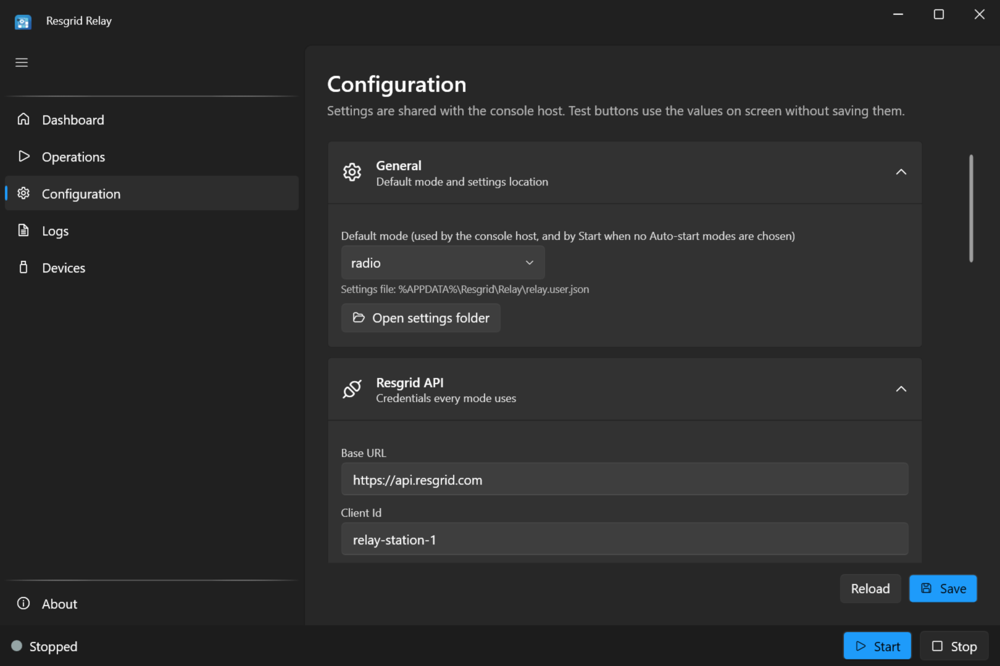
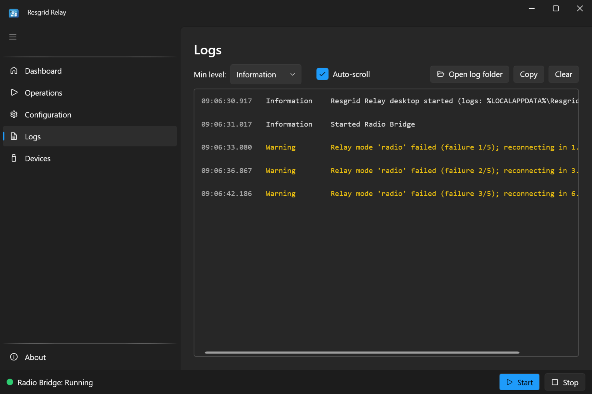
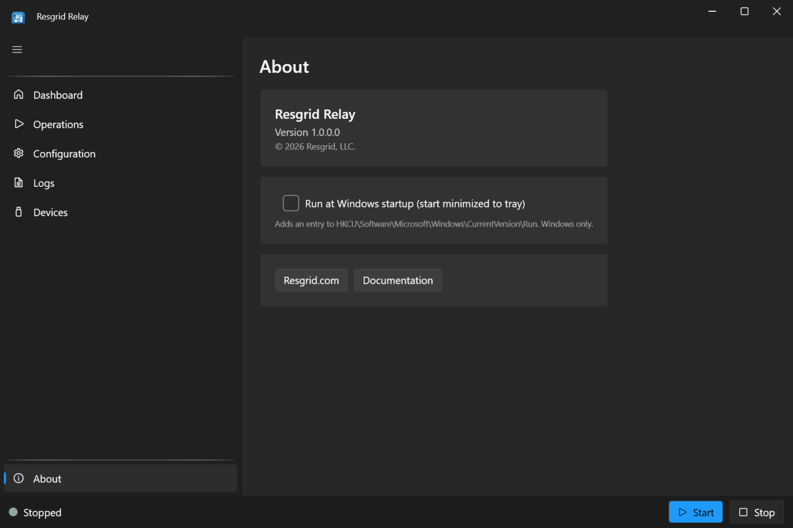

# Relay Desktop App

`ResgridRelay.exe` is the Windows app for setting up, running and watching Relay. It runs every mode, several at once, and keeps running in the tray when you close the window. To install it, see [Install Relay](install.md#windows-desktop-app).

The window has a navigation pane on the left (**Dashboard**, **Operations**, **Configuration**, **Logs**, **Devices** and, at the bottom, **About**) and a footer that shows the overall state (*Stopped*, or each running mode and its state) with **Start** and **Stop** buttons. **Start** starts the default modes (below); **Stop** stops every running mode.

## Dashboard

The Dashboard shows what Relay is doing right now. The line under the title summarizes it (*No services running*, *1 service running (Radio Bridge)*), and **Start default modes** appears while nothing is running.

### Getting started checklist

Until Relay is set up and running, the Dashboard shows a four-step checklist. A step turns green once it is done, and its button takes you to the screen where you do it.



1. **Connect Relay to Resgrid**: the API URL, client id and secret and a refresh token under **Configuration › Resgrid API**, checked with **Test connection**. See [Connect to Resgrid](connect-to-resgrid.md).
2. **Set up what this machine does**: SMTP dispatch, a radio bridge, the recorder or dispatch tone-out. The step is done when at least one default mode passes its pre-flight check.
3. **Choose what starts automatically**: turn on **Auto-start** for at least one mode on the Operations screen.
4. **Start the relay**: start the default modes from the Dashboard, the footer, or per mode on Operations.

### Mode tiles

Each running mode gets a live tile:



| Part of the tile | What it shows |
| --- | --- |
| Name, state and *Started* time | *Starting*, *Running*, *Stopping*, *Stopped* or *Faulted*, and when the mode started. |
| Connection pills | The connections this mode uses, each *Connecting*, *Connected*, *Degraded* or *Disconnected*: **API** (Resgrid), **LiveKit** (the PTT channel, voice modes), **Redis** (the SMTP lookup cache), **SMTP** (the mail listener) and **TTS** (the text-to-speech service for tone-out). |
| Receive level | The live level of the radio or scanner audio, in dBFS (radio bridge and tone detect). |
| **SQ** lamp | *SQ open* while the squelch is passing radio audio to the channel, *SQ closed* otherwise (radio bridge). |
| **TX (to radio)** and **RX (to channel)** | Lit while Relay keys the radio with channel audio, and while it sends radio audio to the channel (radio bridge). |
| **Calls**, **Messages**, **Transmissions** | Calls created, messages processed and transmissions recorded since the mode started. |
| Last fault | Why the mode faulted, in red, when it did. |
| *Updated* | When the tile last changed. |
| **Restart**, **Stop** | Restart or stop this mode. |

## Operations

Operations is where you start, stop and schedule each mode.



There is a card for each of the five modes (**SMTP Dispatch**, **Audio Tone-Detect**, **Radio Bridge**, **Recorder**, **Dispatch Tone-Out**), with:

- its state, and the time it started;
- a **pre-flight check**: *Pre-flight OK*, or *N issue(s) to fix before starting* with the list. **Start** stays disabled until the issues are fixed;
- the last fault, when the mode faulted;
- **Start**, **Stop** and **Restart**;
- an **Auto-start** switch: start this mode whenever Relay launches.



**Start default modes** (top of the screen, the footer's **Start** and the tray menu) starts every mode with **Auto-start** on. When no mode has Auto-start, it starts the **Default mode** chosen under Configuration › General. **Stop all** stops every running mode.

### Pre-flight checks

Before a mode starts, Relay checks the settings it would otherwise fail on:

| Mode | Checks |
| --- | --- |
| Every mode except tone detect | The Resgrid base URL, API version, client id and secret, and the refresh token (or token cache) or system API key the grant type needs. |
| Radio Bridge, Recorder, Dispatch Tone-Out | The grant type is **RefreshToken** (see [Connect to Resgrid](connect-to-resgrid.md#which-grant-each-mode-needs)). |
| SMTP Dispatch | At least one dispatch domain; a port from 1 to 65535; a Redis connection string when the Redis cache is on. |
| Audio Tone-Detect | The watcher file exists. |
| Radio Bridge | The input and output audio devices exist; a serial port is set for serial PTT or carrier detect; an LTE radio profile isn't keyed with Vox. |
| Recorder | An S3 bucket when S3 storage is chosen. |
| Dispatch Tone-Out | A text-to-speech service URL. |

A settings file that can't be read is also reported here.

### Startup and notifications



| Setting | What it does |
| --- | --- |
| **Start Relay minimized to the tray when I sign in to Windows** | Adds Relay to your Windows sign-in (the current user's `Run` key) with `--minimized`. Combined with **Auto-start**, the modes come back on their own after a reboot once Windows signs in. |
| **Closing the window keeps Relay running in the tray** | On (the default): closing the window hides it and the modes keep running; the first time, a notification says so. Off: closing the window quits Relay, after asking if modes are running. |
| **Show a Windows notification when a mode faults** | A tray notification with the mode and the reason whenever a mode faults. |

For a headless server or Linux, run the console host instead; it reads the same settings file. See [Install Relay](install.md).

### The tray icon

The tray icon's color follows the overall state, and its tooltip lists the running modes. Click it to open the window. Right-click it for **Open Resgrid Relay**, **Start default modes**, **Stop all modes** and **Quit**. **Quit** asks first when modes are running, then stops them cleanly before Relay exits.

## Configuration

Configuration edits Relay's settings, grouped in sections (a few advanced ones are [set in the file](#settings-that-arent-on-the-screen)). The settings are saved to `%APPDATA%\Resgrid\Relay\relay.user.json`, the same file the console host reads.



| Section | What's in it | Details |
| --- | --- | --- |
| **General** | The default mode (used by the console host, and by Start when no mode has Auto-start), the settings file location and **Open settings folder**. | |
| **Resgrid API** | Base URL, client id, grant type, the service-account switch, secrets, department id and **Test connection**. | [Connect to Resgrid](connect-to-resgrid.md) |
| **Radio bridge (Windows)** | Radio profile, audio devices, PTT and carrier detect, transmit timing and gain, **Test transmit**, squelch and the **Tune** meter, emergency signaling and recording while bridging. | [Radio bridge](radio-bridge.md) |
| **PTT channel** | The channel the radio bridge joins, the department, and the voice-seat limit. | [Radio bridge](radio-bridge.md#choose-the-ptt-channel) |
| **SMTP dispatch** | Server name and port, the four domain lists, call defaults, data directory, code checks, hosted mode and the Redis cache. | [SMTP dispatch](smtp-dispatch.md) |
| **Recorder** | Channel, storage, metadata log and S3. | [Recorder](recorder.md) |
| **Dispatch tone-out** | Channel, poll interval, give-up time and the text-to-speech service. | [Dispatch tone-out](dispatch-tone-out.md) |
| **Audio tone-detect (Windows)** | The watcher file path and **Open watcher file**. | [Tone detect](tone-detect.md) |
| **Reconnect (voice modes)** | Keep retrying, failure limit and the longest wait between attempts. | [Reconnecting](settings-reference.md#resilience) |
| **Telemetry** | Optional Sentry and Countly reporting. | [Settings reference](settings-reference.md#telemetry) |

### Saving

Changes are not used until you press **Save**. *Unsaved changes* shows at the bottom while there are any, and **Reload** throws them away and re-reads the file. Save checks the required fields first (base URL and client id, plus whatever the grant type needs) and says what is missing. It writes only the settings that differ from `appsettings.json` and the defaults, plus the desktop app's token cache path when none is set, so a console host on the same account runs the same relay with the same token (see [Where settings come from](settings-reference.md#where-settings-come-from)).

Running modes keep the settings they started with. After a save, the status line tells you which running modes to restart (on Operations) to pick up the change.

### Secrets

The client secret, refresh token, system API key, S3 keys, Sentry DSN and Countly app key show as dots. A field left as dots keeps the stored value. To change one, tick **Reveal secrets** (in the Resgrid API section), then type the new value.

### Test buttons

The test buttons use the values **on the screen**, without saving them, so you can try a change before you keep it:

- **Test connection** (Resgrid API) signs in to Resgrid and checks the API's health. See [Test connection](connect-to-resgrid.md#test-connection).
- **Start tuning** (Radio bridge) shows the live receive level and whether the squelch would open. See [Tune the squelch](radio-bridge.md#tune-the-squelch).
- **Test transmit** (Radio bridge) keys the radio, waits the key-up lead and plays a 2-second 1 kHz tone. See [Test transmit](radio-bridge.md#test-transmit).

Tuning and Test transmit use the radio interface directly, so stop the Radio Bridge first. While it runs, its live meter is on the Dashboard.

### Banners

- **Environment overrides active**: some `RESGRID__RELAY__` environment variables are set on this PC. They win over the saved values when a mode runs, and Save never writes them into the file. See [Where settings come from](settings-reference.md#where-settings-come-from).
- **Settings could not be read**: a settings file has a mistake (often a hand edit that broke the JSON); the screen shows defaults and names the problem. Fix or delete the file, then press **Reload**.

### Settings that aren't on the screen

A few advanced settings have no field on the screen: emergency tone frequencies and the emergency call's dispatch list, the tone-out's alert tones, the recorder's segmentation, and the SMTP size limits, for example. Set them in `relay.user.json` (**Open settings folder**) or with environment variables; the [settings reference](settings-reference.md) lists them all. After editing the file by hand, press **Reload** before you change anything on the screen, so the next Save doesn't put back the old values.

## Logs



The Logs screen shows what Relay is doing, live: starts and stops, calls created, messages processed, reconnects and faults.

- **Min level** hides entries below a level (*Information* by default; choose *Warning* to see only problems).
- **Auto-scroll** follows new entries.
- **Copy** copies the entries shown, to paste into a support request.
- **Clear** empties the screen (not the log files).
- **Open log folder** opens `%LOCALAPPDATA%\Resgrid\Relay\logs`.

The screen keeps the latest 5,000 entries. Everything is also written to a log file per day (`relay-YYYYMMDD.log`, a new file after 50 MB), and files older than 14 days are deleted. Log entries for SMTP include the sender, recipients and subject of each message, never the body.

## Devices

The Devices screen lists what the radio bridge and tone detect can use, with the numbers the settings refer to:

- **Audio Input (radio receive)**: sound-card inputs, as `number: name (channels)`. The number is `Radio:InputDevice` (radio bridge) or `InputDevice` in the watcher file (tone detect).
- **Audio Output (radio transmit)**: sound-card outputs. `-1` is the Windows default output.
- **Serial Ports (PTT / carrier detect)**: COM ports, including USB-serial adapters.
- **CM108-class HID (PTT GPIO)**: USB radio interfaces with a C-Media CM108-type chip (vendor id `0x0D8C`), as `VID=0x0D8C PID=0x.... name`. The DMK URI, AIOC, RA-40 and RIM-Lite are this kind.

Press **Refresh** after plugging in an interface. Windows sometimes renumbers sound devices when one is plugged in or removed; the Configuration screen picks devices by name, so check the radio bridge's devices after a change.

## About



About shows the version (for example *Version 2.1.50 (abc1234)*), a **Run at Windows startup (start minimized to tray)** switch (the same setting as on Operations), and links to Resgrid.com and this documentation.

## Launch options

| Option | What it does |
| --- | --- |
| `--minimized` | Starts hidden in the tray, without showing the window. Sign-in start uses it. |
| `--page <name>` | Opens on a given screen: `dashboard`, `operations`, `configuration` (also `config` or `settings`), `logs`, `devices` or `about`. |

For example, a desktop shortcut that opens Relay on its logs:

```text
"C:\ResgridRelay\ResgridRelay.exe" --page logs
```

If Relay is already running, starting it again only tells you so; open the running copy from the tray.
