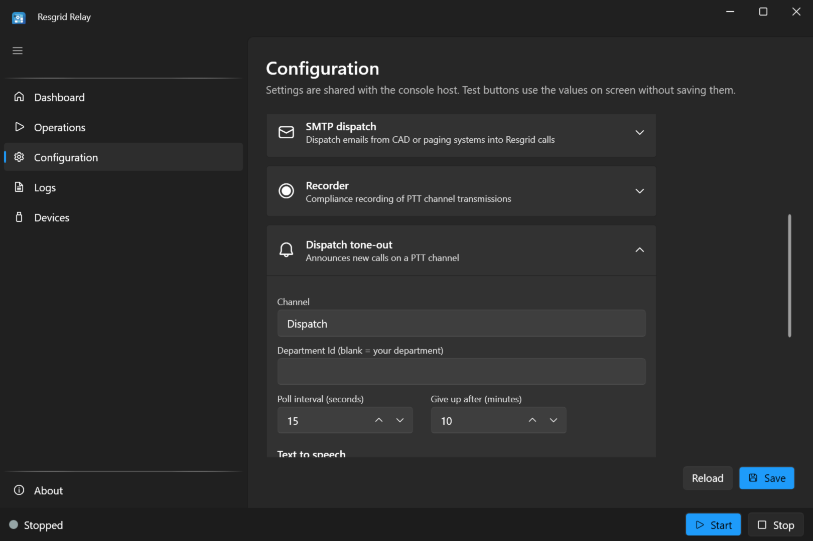
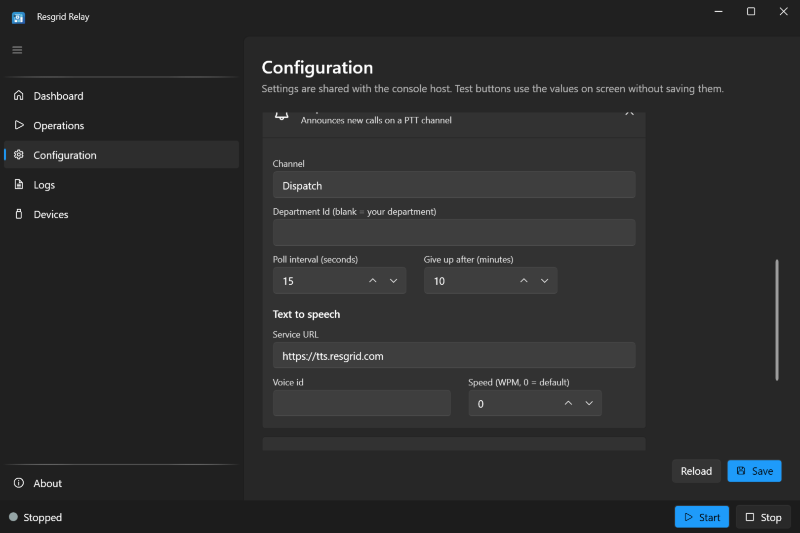

# Dispatch Tone-Out

In `dispatch` mode Relay announces each new Resgrid call on a PTT channel, the way a station tone-out does: **alert tones**, then the call **read out** by Resgrid's text-to-speech. Crews listening to the channel in the Responder or Unit app, and radio users when a [radio bridge](radio-bridge.md) is on the same channel, hear every dispatch as it goes out.

The tone-out runs on every Relay build (desktop app, console on Windows, Linux and macOS, Docker). It is a voice mode, so it needs the `RefreshToken` grant ([Connect to Resgrid](connect-to-resgrid.md)) and your department's Push To Talk add-on, and it occupies one PTT voice seat while connected.

## What it says

Each announcement is the alert tone, a short pause, then:

> New call, Structure fire. Nature, Smoke showing from the second floor. Address, 123 Main St, Springfield. Priority, High.

- **New call** becomes **Second alarm**, **Third alarm** and so on for a call that has been escalated.
- **Address** reads the call's address without the trailing state, postal code and country; a location that doesn't start with a number is read as **Location**. A call without one skips it.
- **Priority** uses your department's own priority names.

The wording is exactly the wording Resgrid uses for its own voice dispatch, so the text-to-speech audio Resgrid already generated for the call is reused from its cache and the announcement goes out without waiting for new speech.

## Which calls are announced

Relay checks for new active calls every **Poll interval** (15 seconds by default) and tones out each one once:

- Calls that were already open when Relay started are **not** announced; only calls created after that.
- Calls created while Relay was reconnecting **are** announced once it is back.
- **Scheduled** calls are announced when they are dispatched, not when they are created.
- **Pending** calls (saved but not sent) are announced once a dispatcher sends them.

If a tone-out fails (the text-to-speech service or the channel is unreachable), Relay tries again at every poll for **Give up after** minutes (10 by default), then logs an error for that call and moves on. While the channel is disconnected, it holds the tone-outs until the channel is back; one cut off by a dropped connection is announced again.

With a poll interval of 15 seconds, an announcement goes out up to about 15 seconds after the call is dispatched. A shorter interval announces sooner, at the cost of more requests to Resgrid.

## Set it up

### In the desktop app

Open **Configuration › Dispatch tone-out**:



| Setting | Value |
| --- | --- |
| **Channel** | `default` (your department's default voice channel), a channel's name, or its id. |
| **Department Id** | Leave blank: your department. |
| **Poll interval (seconds)** | How often Relay checks for new calls: 15 by default, 5 at the least. |
| **Give up after (minutes)** | How long a failing tone-out is retried: 10 by default. |



| Setting | Value |
| --- | --- |
| **Service URL** | The Resgrid text-to-speech service: `https://tts.resgrid.com` for Resgrid's hosted service. On a self-hosted installation, your installation's `tts` service (port 5154 on the Docker Compose install). Required: the pre-flight check won't start the tone-out without it. |
| **Voice id** | Optional: a voice of the text-to-speech service. Blank uses the service's default voice. |
| **Speed (WPM, 0 = default)** | Optional: words per minute. 0 uses the service's default. |

Keep **Voice id** and **Speed** at their defaults unless you have a reason: a different voice or speed can't reuse the speech Resgrid already generated, so each announcement waits for new speech.

Save, then start **Dispatch Tone-Out** on the Operations screen and turn on **Auto-start**.

### With environment variables (Linux, Docker)

```bash
RESGRID__RELAY__Mode=dispatch
RESGRID__RELAY__Tts__ServiceBaseUrl=https://tts.resgrid.com
RESGRID__RELAY__DispatchVoice__Channel=default
RESGRID__RELAY__DispatchVoice__PollSeconds=15
RESGRID__RELAY__DispatchVoice__GiveUpAfterMinutes=10
```

plus the [Resgrid credentials](connect-to-resgrid.md).

## Alert tones

The alert tone plays before every announcement. It has no fields on the screen; set it in `relay.user.json` (or `appsettings.json`, or environment variables) under `DispatchVoice:Tone`:

| Setting | Default | Meaning |
| --- | --- | --- |
| `Type` | `TwoToneSequential` | `TwoToneSequential` (tone A, then tone B), `HiLo` (alternating high and low warble), `SingleTone` (tone A only) or `None` (no tones: speak straight away). |
| `ToneAFrequency` | 1000 | Tone A in Hz. For `HiLo`, the high tone. |
| `ToneADurationMs` | 1000 | Tone A's length, in milliseconds. |
| `ToneBFrequency` | 2000 | Tone B in Hz. For `HiLo`, the low tone. |
| `ToneBDurationMs` | 3000 | Tone B's length, in milliseconds. |
| `HiLoCycles` | 6 | For `HiLo`: how many high-low pairs. |
| `HiLoSegmentMs` | 250 | For `HiLo`: the length of each high or low step. |
| `Amplitude` | 0.5 | Volume of the tones, from 0 to 1. |
| `PreSpeechSilenceMs` | 500 | The pause between the tones and the announcement. |

For example, a hi-lo warble:

```json
{
  "DispatchVoice": {
    "Tone": {
      "Type": "HiLo",
      "ToneAFrequency": 1200,
      "ToneBFrequency": 800,
      "HiLoCycles": 4,
      "HiLoSegmentMs": 250,
      "Amplitude": 0.4
    }
  }
}
```

With environment variables: `RESGRID__RELAY__DispatchVoice__Tone__Type=HiLo`, and so on.

## Tips

- **Use a channel crews monitor.** The tone-out speaks on one channel; members hear it in the apps while they are joined to that channel.
- **Pair it with a radio bridge** to put Resgrid dispatches on the air: run the tone-out and the [radio bridge](radio-bridge.md) on the same channel, and the bridge transmits the announcement on the radio.
- **Don't run two tone-outs on the same channel**, or every call is announced twice.
- **Going the other way?** The tone-out puts Resgrid calls on a channel. To create Resgrid calls from your county's paging tones on the radio, see [Tone detect](tone-detect.md).

## Troubleshooting

| Symptom | Check |
| --- | --- |
| Won't start: *needs a TTS service URL* | Set **Service URL**. |
| Won't start: grant type | The tone-out needs the `RefreshToken` grant. |
| The Dashboard tile shows **TTS** disconnected, and calls aren't announced | The service URL is right and reachable from the Relay host; the Logs screen shows the error. Calls are retried for **Give up after** minutes. |
| Calls that were open before Relay started aren't announced | Expected: only calls created after Relay started are announced. |
| Nobody hears announcements | Members are joined to the tone-out's channel; the tile shows **LiveKit** connected; the right **Channel** is set. |
| Every call is announced twice | Two tone-outs (two PCs, or the desktop app and a console host) on the same channel. |

See also [Troubleshooting](troubleshooting.md#tone-out-is-silent).
