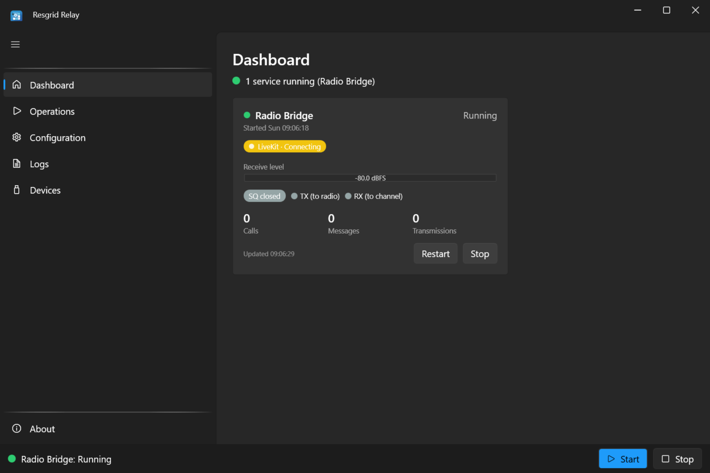

# Resgrid Relay

Resgrid Relay connects the equipment and systems your department already has to Resgrid: dispatch email from a CAD or paging system, two-way radios, LTE push-to-talk radios, scanners and paging tones. Calls, messages and voice then flow between that equipment and the Resgrid apps.

Relay runs on a computer you control: a dispatch PC, a small server in the station, a Linux box or a container. It talks to your department through the Resgrid v4 API, the same way the Resgrid apps do, so anything it creates (a call, a group message, a recording) belongs to your department like everything else.

<AcademyVideo id="22-relay" />

## The five modes

Relay does five different jobs, called **modes**. A machine can run one mode or several.

| Mode | Runs on | What it does | Page |
| --- | --- | --- | --- |
| `smtp` | Windows, Linux, macOS, Docker | A small mail server for your dispatch domain. Dispatch email from a CAD, alarm panel or paging gateway becomes a Resgrid call (department-wide or for one group) or a group message. | [SMTP dispatch](smtp-dispatch.md) |
| `radio` | Windows | A two-way bridge between a radio cabled to the PC and a Resgrid push-to-talk (PTT) channel. Radio traffic is heard in the Responder, Unit and Dispatch apps, and app users are heard on the radio. Works with analog VHF/UHF radios and with LTE push-to-talk radios such as Rapid Radios and Diga-Talk+. | [Radio bridge](radio-bridge.md), [LTE donor radios](lte-donor-radios.md) |
| `record` | Windows, Linux, macOS, Docker | Records every transmission on one or all of your PTT channels as a WAV file, on disk or in S3-compatible storage, with a log of who talked, on which channel, when and for how long. | [Recorder](recorder.md) |
| `dispatch` | Windows, Linux, macOS, Docker | Tones out each new Resgrid call on a PTT channel: alert tones, then the call read out by Resgrid's text-to-speech. | [Dispatch tone-out](dispatch-tone-out.md) |
| `audio` | Windows | Listens to a scanner or radio on a sound card for two-tone or single-tone pages and creates a Resgrid call with the recorded dispatch audio attached. | [Tone detect](tone-detect.md) |

The `radio`, `record` and `dispatch` modes are the **voice modes**: they join Resgrid PTT channels, so your department needs the [Push To Talk](../../configuration/audio.md) add-on, and Relay must sign in as a user (see [Connect to Resgrid](connect-to-resgrid.md)).

## Which mode do you need?

| You want to… | Run |
| --- | --- |
| Turn the dispatch email your county or CAD already sends into Resgrid calls, on your own domain and server | `smtp` |
| Let members on the Resgrid apps talk with crews on your analog radio channel | `radio` with an analog radio |
| Join a Rapid Radios, Diga-Talk+ or other LTE push-to-talk talk group to Resgrid PTT | `radio` with a donor radio |
| Keep a recording of everything said on your Resgrid PTT channels | `record` |
| Have new calls announced over PTT, like a station tone-out | `dispatch` |
| Create a Resgrid call when the county tones out your station on the radio | `audio` |
| Turn a radio emergency button or emergency tone into a Resgrid call | `radio` with emergency detection |

The [use cases](use-cases.md) page walks through complete setups for fire departments, EMS agencies, search and rescue teams, emergency management, industrial teams and others.

:::tip Resgrid already imports dispatch email
Every department has a **dispatch import email** address that turns email into calls with no software to run (see [Call Import](../../configuration/call-import.md)). Use Relay's `smtp` mode when you want the dispatch addresses on **your own domain**, need to receive mail on your own network (a CAD that can only reach a local mail server), or run a self-hosted Resgrid installation.
:::

## Desktop app, console or Docker

Relay comes in three forms. They share the same settings, so you can set Relay up in the desktop app and later run it headless.

| | Desktop app | Console host | Docker image |
| --- | --- | --- | --- |
| Runs on | Windows 10 and 11 (x64, Arm64) | Windows, Linux (x64, Arm64), macOS (Intel, Apple silicon) | Linux containers |
| Modes | All five, several at once | One mode per process; Windows runs all five, Linux and macOS run `smtp`, `record` and `dispatch` | `smtp`, `record`, `dispatch`, one per container |
| Set up with | A settings screen with test buttons, device pickers and radio profiles | `appsettings.json`, the desktop app's settings file, or environment variables | Environment variables |
| Best for | Radio bridges, tone detect, and anyone who prefers a window to a config file | Headless servers, systemd services | Container hosts and self-hosted Resgrid |
| Page | [Desktop app](desktop-app.md) | [Install](install.md) | [Install](install.md#docker) |

All builds are self-contained: you don't need to install .NET.

## Before you start

- A Resgrid department, and a member account for Relay to sign in as. A dedicated account (for example *Relay – Station 1*) makes it clear in Resgrid what Relay created and who is talking on PTT. See [Connect to Resgrid](connect-to-resgrid.md).
- An API client id and secret, and a refresh token for that account.
- For the voice modes: the Push To Talk add-on and at least one [voice channel](../../configuration/audio.md#voice-channels).
- For the radio bridge and tone detect: a Windows PC with the audio and radio interface described on the [radio bridge](radio-bridge.md) and [tone detect](tone-detect.md) pages.

## Next steps

1. [Install Relay](install.md).
2. [Connect it to Resgrid](connect-to-resgrid.md) and run **Test connection**.
3. Set up the mode you need: [SMTP dispatch](smtp-dispatch.md), [radio bridge](radio-bridge.md), [LTE donor radios](lte-donor-radios.md), [recorder](recorder.md), [dispatch tone-out](dispatch-tone-out.md) or [tone detect](tone-detect.md).
4. Keep the [settings reference](settings-reference.md) and [troubleshooting](troubleshooting.md) pages handy.

Relay is open source (Apache 2.0) at [github.com/Resgrid/Relay](https://github.com/Resgrid/Relay).
