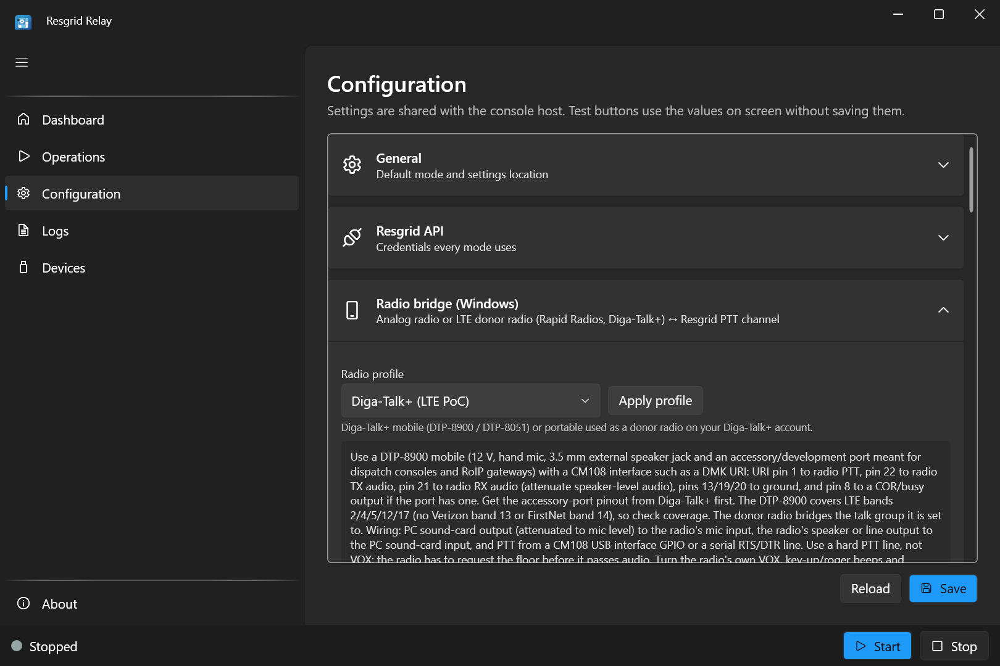

# LTE Donor Radios (Rapid Radios, Diga-Talk+ and other PoC)

LTE push-to-talk radios, also called push-to-talk over cellular (PoC), such as **Rapid Radios** and **Diga-Talk+**, talk over the cellular network instead of radio frequencies. Relay's [radio bridge](radio-bridge.md) can join one of their talk groups to a Resgrid PTT channel, so your PoC radio users and your Resgrid app users hear each other.

Read the [radio bridge](radio-bridge.md) page first: everything there applies. This page covers what is different for an LTE radio.

## Why a donor radio

Rapid Radios and Diga-Talk+ publish no API or radio-over-IP gateway that other software could use to send and receive their audio. So Relay bridges them the way it bridges an analog radio: you dedicate one of their radios, the **donor radio**, to the bridge, cable it to the Relay PC, and set it to the talk group you want. Relay keys it and listens to it like any other radio.

```text
PoC users  <-- LTE talk group -->  donor radio  <-- cable + interface -->  Relay PC  <-- Internet -->  Resgrid PTT channel  <-->  Responder / Unit / Dispatch apps
```

## What is different about an LTE radio

| An LTE radio… | So Relay… |
| --- | --- |
| Must ask the PoC server for the floor before it passes mic audio, which takes a moment | Keys it with a **hard PTT line** (a CM108 GPIO or serial RTS/DTR line), never VOX, and waits a **key-up lead** of about 500–800 ms before playing audio. |
| Has to ask for the floor again every time it is re-keyed | Keeps it keyed through normal pauses with a longer **transmit hang** (1000 ms). |
| Has a silent speaker between transmissions | Uses the audio-level (`Vox`) squelch, which is clean on a PoC radio, with a lower open level and a longer **squelch hang** (900 ms) to ride out gaps in the LTE audio. |
| Has its own end-of-transmission beeps | Turns its own **courtesy beep** off. |

The LTE profiles set all of this for you.

## What to buy

| Radio system | Donor radio | Interface | Notes |
| --- | --- | --- | --- |
| **Diga-Talk+** | **DTP-8900** mobile: 12 V, hand mic, a 3.5 mm external speaker jack, and an accessory (development) port meant for dispatch consoles and radio-over-IP gateways | **DMK URI** or a similar CM108 USB interface | Get the accessory-port pinout from Diga-Talk+ before you build the cable. The DTP-8900 uses LTE bands 2, 4, 5, 12 and 17 only (no Verizon band 13 or FirstNet band 14): check coverage where the relay will sit. |
| **Rapid Radios** | **G1** handheld | **AIOC** (All-In-One-Cable) on the G1's Kenwood 2-pin (K1) jack | The AIOC is a CM108 interface: it is the sound card and the PTT in one cable. Keep the G1 on USB-C power. |
| Other PoC systems (Inrico, Retevis, Hytera PoC, Zello radios, carrier push-to-talk handsets) | A radio with a wired accessory jack (mic, speaker and PTT) that can run on external power | A CM108 interface or AIOC that fits its jack | Use the *Other LTE / PoC radio* profile. |

:::warning Not the Rapid Radios Base/Car Unit
Don't use the Rapid Radios Base/Car Unit as a donor radio. Its RJ45 jack carries mic and PTT only, with no speaker or line output, so Relay can't hear the talk group.
:::

Whichever radio you use, you need:

- an account plan for the donor radio: it occupies one radio on your PoC account;
- LTE coverage at the relay's location, and external power for the radio;
- a way to turn off the radio's VOX, key-up and roger beeps and Bluetooth.

## Wiring

The connections are the same as for an analog radio (see [Wiring](radio-bridge.md#wiring)): interface audio out to the radio's mic input (attenuated to mic level), the radio's speaker or line output to the interface's audio in, and the interface's PTT line to the radio's PTT.

### Diga-Talk+ DTP-8900 with a DMK URI

| URI pin | Connect to the DTP-8900 accessory port's |
| --- | --- |
| 1 | PTT |
| 22 | TX audio (mic input): audio to the radio |
| 21 | RX audio: audio from the radio (attenuate speaker-level audio) |
| 13, 19, 20 | Ground |
| 8 | COR/busy output, if the port has one |

Map these to the radio side using the pinout from Diga-Talk+. Relay keys the URI on GPIO 3. It doesn't read the URI's COR input, so use the audio squelch: on a PoC radio it is clean.

### Rapid Radios G1 with an AIOC

Plug the AIOC into the G1's Kenwood 2-pin (K1) jack and its USB end into the PC. In Relay, pick the AIOC as **both** the input and the output device, and set **PTT keying** to `Cm108` with GPIO pin 3 (the AIOC's usual default), or to `SerialDtr` on the AIOC's serial port. Confirm which against the notes for your AIOC's firmware.

### Prepare the donor radio

- Turn off its own VOX, its key-up and roger beeps, and Bluetooth (a paired headset would take the audio).
- Set its volume to a fixed level and leave it; tune Relay's squelch at that level.
- Keep it on external power (12 V for a mobile, USB-C for the G1) and stop it from sleeping.
- Set it to the talk group you want to bridge, and don't let anyone change it.

## Set it up

1. In **Configuration › Radio bridge (Windows)**, choose **Rapid Radios (LTE PoC)**, **Diga-Talk+ (LTE PoC)** or **Other LTE / PoC radio**, and press **Apply profile**. The profile's wiring advice shows under it.

   

2. Choose the interface as the input and output devices, and set the PTT. An LTE profile needs a hard PTT line: if PTT keying was `Vox`, applying the profile switches it to `Cm108`, and the pre-flight check won't start the bridge with `Vox`.
3. Choose the [PTT channel](radio-bridge.md#choose-the-ptt-channel) to join to the talk group.
4. [Tune the squelch](radio-bridge.md#tune-the-squelch) with the donor radio's fixed volume.
5. **Save**, then [tune the key-up lead](#tune-the-key-up-lead).

From the console: `profiles` lists the profiles and `profiles apply rapidradios` (or `digatalkplus`, `poc`) writes one into the settings file. It reminds you if `Radio:PttMethod` is still `Vox`.

| Profile | Key-up lead | Transmit hang | Tail | Squelch open / close / hang | High-pass | Courtesy beep |
| --- | --- | --- | --- | --- | --- | --- |
| Rapid Radios (LTE PoC) | 700 ms | 1000 ms | 200 ms | −42 / −50 dBFS / 900 ms | 200 Hz | Off |
| Diga-Talk+ (LTE PoC) | 600 ms | 1000 ms | 200 ms | −42 / −50 dBFS / 900 ms | 200 Hz | Off |
| Other LTE / PoC radio | 700 ms | 1000 ms | 200 ms | −42 / −50 dBFS / 900 ms | 200 Hz | Off |

When the bridge starts with an LTE profile, Relay warns in the log if PTT is `Vox` or the key-up lead is 0.

## Tune the key-up lead

The profile's key-up lead is a starting point. How long the floor grant takes depends on the vendor's server and the LTE link at your site, so check it with a listener:

1. Put a second radio (or the vendor's app on a phone) on the same talk group, with someone listening.
2. In Relay, press **Test transmit**. Relay keys the donor radio, waits the key-up lead, and plays a 2-second 1 kHz tone.
3. Ask the listener whether they heard the **whole** tone, from the start.
4. If the start was cut off, raise **Key-up lead** by 100 ms and test again. Repeat until the whole tone comes through, every time.
5. Test a few times through the day: a busy cell site can be slower.
6. **Save**, and confirm with real speech: talk on the Resgrid channel from the Responder app and have the listener repeat your first words.

Don't make the lead longer than you need: every transmission from the Resgrid side waits that long before it is heard. The lead can go up to 3000 ms.

Check the other direction too: talk on the PoC radio and listen in the Responder app. If the first syllable is missing on the Resgrid side, lower the squelch **Open** level a little (re-[tune](radio-bridge.md#tune-the-squelch) so static still stays closed).

## One talk group per radio

A donor radio bridges whichever talk group it is set to, one at a time. To bridge another talk group, add another donor radio and interface, on another PC or another Relay instance, each joined to its own Resgrid PTT channel.

## Limits

- **Audio only.** Relay passes voice. PoC features such as emergency buttons, location, text messages and private calls don't cross the bridge.
- **Half duplex, both sides.** Relay carries one direction at a time, and the PoC talk group gives the floor to one talker at a time. While a PoC user holds the floor, the donor radio can't transmit what Resgrid users say.
- **Delay.** The floor grant and the LTE network add a moment at the start of each transmission. Encourage users on both sides to key up and pause briefly before speaking.
- **The donor radio's service.** The bridge depends on the PoC vendor's service, the donor radio's plan and LTE coverage at the relay's location.

## Troubleshooting

| Symptom | Check |
| --- | --- |
| PoC users miss the first words from Resgrid users | Raise the key-up lead ([Tune the key-up lead](#tune-the-key-up-lead)). |
| PoC users hear nothing at all | PTT keying is a hard line, not `Vox`; the donor radio shows it is transmitting when you press **Test transmit**; it is on the right talk group and has service. |
| Resgrid users hear nothing from the talk group | The input device is the interface; the donor radio's volume is up and fixed; the receive meter moves when a PoC user talks; squelch **Open** is below the speech level. |
| Beeps on the Resgrid channel at every transmission | Turn off the donor radio's key-up and roger beeps. |
| PoC audio is chopped on the Resgrid side | Raise the squelch **Hang**. |
| Each Resgrid transmission is split into pieces on the PoC side | Raise the transmit **Hang time** so the radio stays keyed through pauses. |
| The bridge works, then stops after a while | The donor radio's battery or power, sleep settings, or lost LTE service. |

See also [Troubleshooting audio](radio-bridge.md#troubleshooting-audio) and [Troubleshooting](troubleshooting.md).
