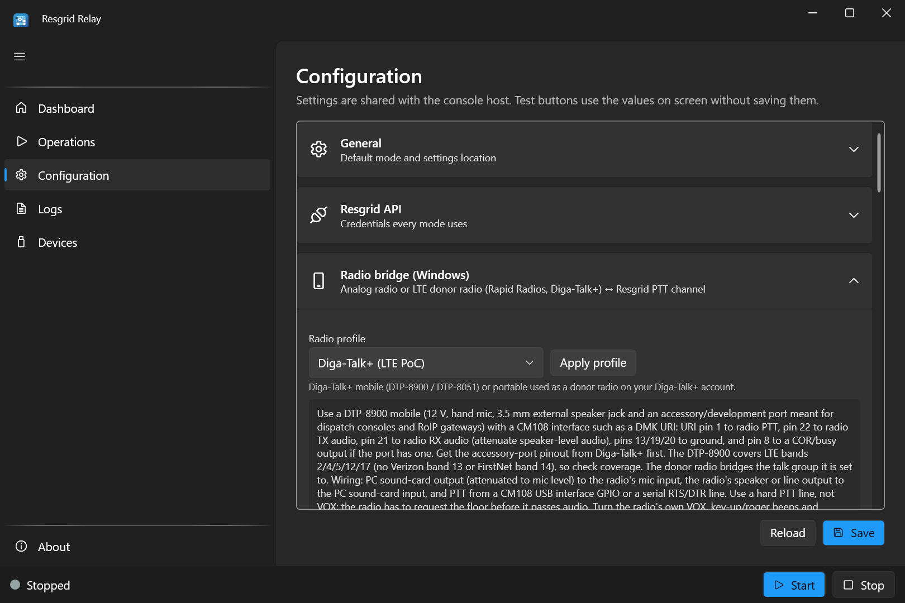
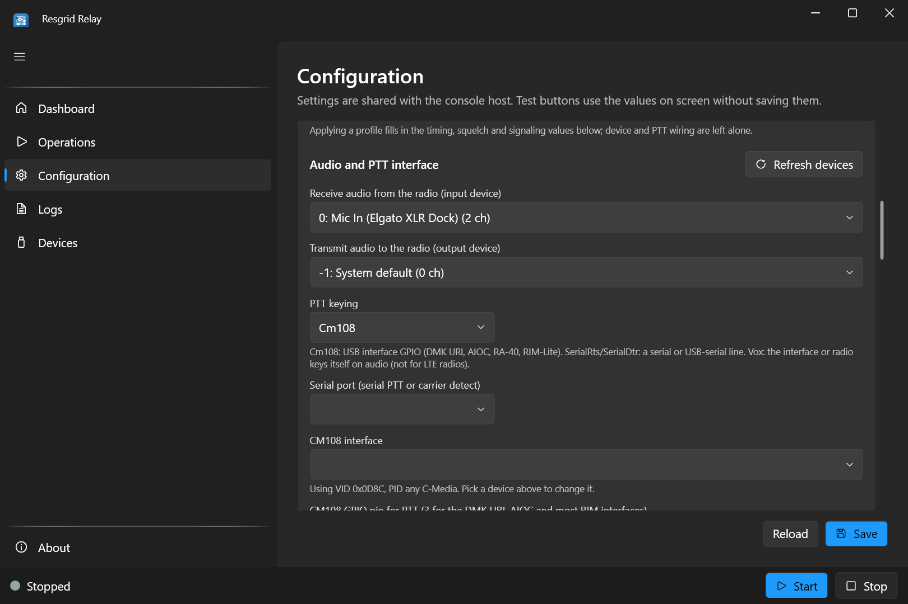
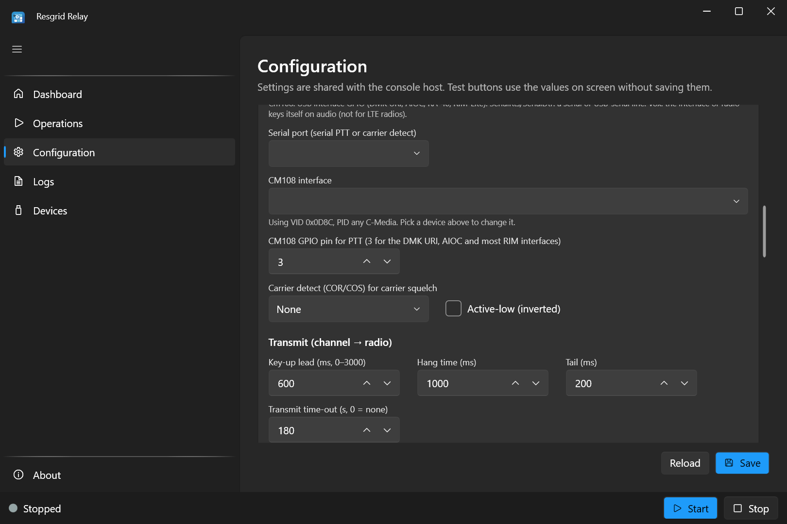
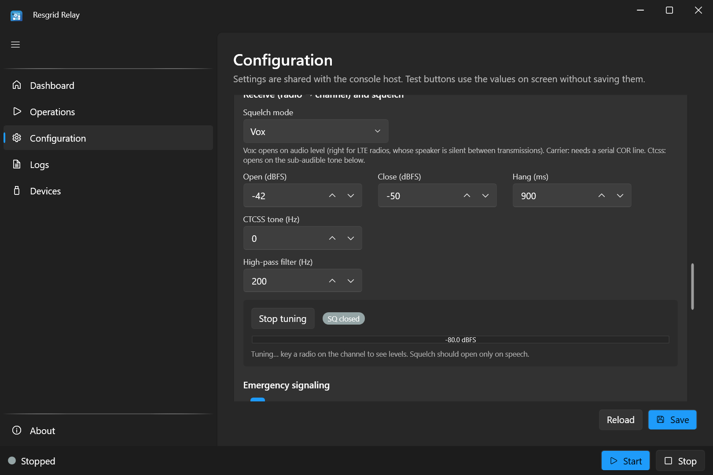
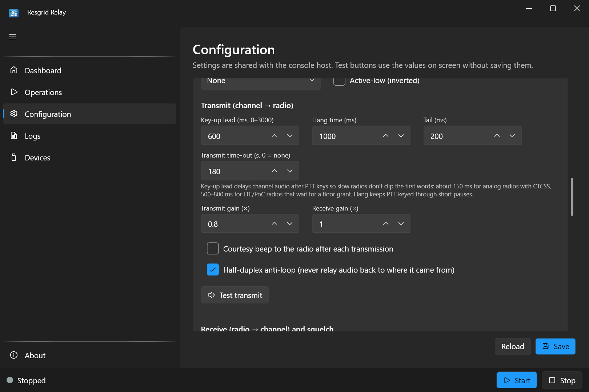
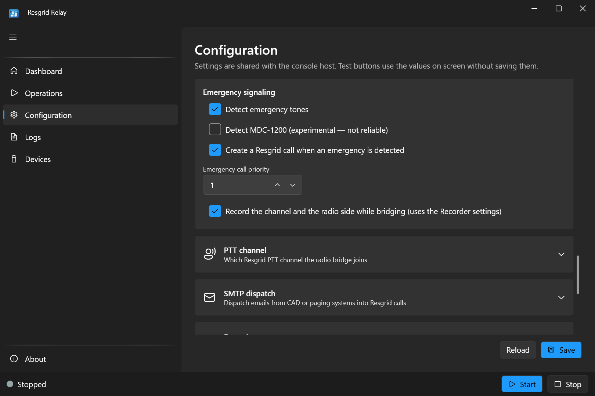

# Radio Bridge

In `radio` mode Relay bridges a two-way radio, cabled to a Windows PC, with a Resgrid push-to-talk (PTT) channel:

- **Receive (radio → channel):** what the radio hears passes Relay's squelch, which keeps static off the channel, and is sent to the PTT channel. Members on the Responder, Unit and Dispatch apps hear it.
- **Transmit (channel → radio):** when someone talks on the PTT channel in the apps, Relay keys the radio and plays them over the air.

Relay only does one direction at a time (half duplex), so audio is never sent back to where it came from.

The radio bridge runs on Windows only, in the desktop app or the Windows console host. It is a voice mode, so it needs the `RefreshToken` grant ([Connect to Resgrid](connect-to-resgrid.md)) and your department's Push To Talk add-on with a [voice channel](../../configuration/audio.md#voice-channels).

This page covers analog VHF/UHF radios. For Rapid Radios, Diga-Talk+ and other LTE push-to-talk radios, read this page, then [LTE donor radios](lte-donor-radios.md).

## What you need

- A **Windows 10 or 11 PC** that stays on, near the radio.
- A **radio** on the channel you want to bridge. A mobile or base radio on a power supply is better than a handheld on a charger: it runs all day and has a proper accessory connector.
- A **radio interface**: a sound card for the audio plus a way to key the radio's PTT. One of:

| Interface | How it keys the radio | Relay's PTT setting |
| --- | --- | --- |
| USB radio interface with a CM108-type chip: **DMK URI**, **AIOC** (All-In-One-Cable), **RA-40**, **RIM-Lite** | A GPIO pin on the interface's USB sound chip | `Cm108` |
| Any sound card plus a serial or USB-serial port | The port's RTS or DTR line, through the interface's keying circuit | `SerialRts` or `SerialDtr` |
| An interface that keys the radio itself when it hears audio (SignaLink style) | The interface's own VOX | `Vox` |

- A **cable** from the interface to the radio's mic and speaker jacks or its accessory connector. Interface makers sell cables for common radios.
- An optional **carrier detect** (COR/COS) line from the radio, if you want carrier squelch: Relay reads it on a serial port's CTS or DSR line.

Use **Devices** in the desktop app, or the console's `devices` command, to see the sound cards, COM ports and CM108 interfaces Windows found.

## Wiring

Whatever the interface, the connections are the same:

| From | To | Notes |
| --- | --- | --- |
| Interface audio **out** | Radio **mic** (or data) input | Attenuate to mic level. Too hot distorts; lower `TxGain` or the interface's level. |
| Radio **speaker**, discriminator or line output | Interface audio **in** | Set the radio's volume to a fixed level and leave it. Attenuate speaker-level audio. |
| Interface **PTT** (GPIO or serial line) | Radio **PTT** | Keys the radio while Relay transmits. |
| Radio **COR/COS** (optional) | Serial port CTS or DSR | For carrier squelch. |
| **Ground** | **Ground** | |

**DMK URI** (DB-25 connector):

| URI pin | Connect to |
| --- | --- |
| 1 | Radio PTT |
| 22 | Radio TX audio (mic input): audio to the radio |
| 21 | Radio RX audio (speaker or line output): audio from the radio |
| 8 | COR/busy output from the radio, if it has one |
| 13, 19, 20 | Ground |

Relay keys the DMK URI's PTT on GPIO 3 (the default). It doesn't yet read carrier detect from a CM108 interface's input pin, so with a URI alone use the audio-level squelch (`Vox`) and set it with the [Tune](#tune-the-squelch) meter. Wiring pin 8 does no harm and is ready for carrier squelch if you add a serial COR line.

Before you start, turn off the radio's own key-up and roger beeps and its VOX, and fix its volume: Relay's squelch and timing are tuned to that level.

## Set it up in the desktop app

Open **Configuration › Radio bridge (Windows)** and work down the section.

### 1. Pick a radio profile



Choose **Analog / LMR radio** and press **Apply profile**. A profile fills in starting values for the key-up timing, squelch and courtesy beep for that kind of radio, and shows wiring advice. It never changes the device or PTT wiring settings. You can fine-tune every value afterwards; the profile is a starting point, not a lock.

| Profile | Key | Key-up lead | Hang | Tail | Courtesy beep | High-pass | Squelch open / close / hang |
| --- | --- | --- | --- | --- | --- | --- | --- |
| Custom | `custom` | Leaves every value as it is | | | | | |
| Analog / LMR radio | `analog` | 150 ms | 300 ms | 150 ms | On | 250 Hz | Vox −38 / −45 dBFS / 600 ms |
| Rapid Radios (LTE PoC) | `rapidradios` | 700 ms | 1000 ms | 200 ms | Off | 200 Hz | Vox −42 / −50 dBFS / 900 ms |
| Diga-Talk+ (LTE PoC) | `digatalkplus` | 600 ms | 1000 ms | 200 ms | Off | 200 Hz | Vox −42 / −50 dBFS / 900 ms |
| Other LTE / PoC radio | `poc` | 700 ms | 1000 ms | 200 ms | Off | 200 Hz | Vox −42 / −50 dBFS / 900 ms |

Applying any profile except Custom also turns half-duplex anti-loop on and emergency detection off (turn it back on afterwards if you use it). The LTE profiles are covered on [LTE donor radios](lte-donor-radios.md).

### 2. Choose the audio devices and PTT



- **Receive audio from the radio (input device)**: the interface's input. Press **Refresh devices** after plugging the interface in.
- **Transmit audio to the radio (output device)**: the interface's output. `-1: System default` is Windows' default output, which is rarely the interface: pick it by name.
- **PTT keying**: `Cm108`, `SerialRts`, `SerialDtr` or `Vox` (see [PTT keying](#ptt-keying)).



- **Serial port**: the COM port, for serial PTT or carrier detect.
- **CM108 interface**: pick the interface from the list. Until you do, Relay uses the first C-Media device it finds (*Using VID 0x0D8C, PID any C-Media*), which is fine when there is only one.
- **CM108 GPIO pin for PTT**: 3 for the DMK URI, AIOC and most RIM interfaces.
- **Carrier detect (COR/COS) for carrier squelch**: `None`, `SerialCts` or `SerialDsr`, with **Active-low (inverted)** if your radio's COR line is low while it receives.

### 3. Set the transmit timing

See [Transmit timing](#transmit-timing). The analog profile's values work for most radios.

### 4. Set and tune the squelch

See [Squelch](#squelch-keeping-static-off-the-channel) and [Tune the squelch](#tune-the-squelch).

### 5. Choose the PTT channel

See [Choose the PTT channel](#choose-the-ptt-channel).

### 6. Save, test and start

1. Press **Save**.
2. Press **Test transmit** with someone listening on another radio ([Test transmit](#test-transmit)).
3. On **Operations**, start **Radio Bridge** and turn on **Auto-start**.
4. On the Dashboard, watch the tile: **LiveKit** turns *Connected*, the receive meter moves when the radio hears traffic, **SQ open** lights for speech, **RX (to channel)** lights while it is sent to the channel and **TX (to radio)** while app users are transmitted.

## PTT keying

| Method | Use it for |
| --- | --- |
| `Cm108` | USB radio interfaces with a C-Media CM108-type chip (DMK URI, AIOC, RA-40, RIM-Lite). Set the GPIO pin (3 on most). |
| `SerialRts`, `SerialDtr` | An interface or keying circuit on a serial or USB-serial port's RTS or DTR line. |
| `Vox` | An interface that keys the radio itself when it hears audio. Relay sends no PTT signal, and the key-up lead is ignored. Not for LTE radios. |

The CM108 interface is identified by its USB vendor id (`Radio:Cm108VendorId`, `0x0D8C` for C-Media) and product id (`Radio:Cm108ProductId`, `0` for any). Picking the interface in the list sets both.

When PTT and carrier detect both use the serial port, Relay opens the port once for both.

## Choose the PTT channel

Open **Configuration › PTT channel**:

| Setting | Value |
| --- | --- |
| **Channel** (`Voice:Channel`) | `default` (your department's default voice channel), a channel's name, or its id. |
| **Department Id** (`Voice:DepartmentId`) | Leave blank: your department. |
| **Respect the department's concurrent voice-seat limit** (`Voice:EnforceSeatLimit`) | On: Relay doesn't join when all your PTT seats are in use. |

The bridge occupies one PTT seat while it is connected. One radio bridge joins one radio to one channel; the desktop app runs one radio bridge. To bridge a second radio and channel, use a second PC, or a second Relay console process on the same PC with its own interface, settings and refresh token.

## Squelch: keeping static off the channel

The squelch decides when the radio is receiving real traffic worth sending to the channel, so static, hiss and an open receiver don't fill the channel.

| Squelch mode | Opens when | Use it when |
| --- | --- | --- |
| `Vox` (default) | The audio level reaches **Open (dBFS)** | Most setups, and every LTE radio (their speaker is silent between transmissions). |
| `Carrier` | The radio's COR/COS line says it is receiving | The radio has a COR output wired to a serial port's CTS or DSR. Without that, Relay falls back to `Vox` and logs a warning. |
| `Ctcss` | The sub-audible CTCSS (PL) tone in **CTCSS tone (Hz)** is present | You want to pass only traffic with your PL tone, and the radio passes the tone to its output (discriminator audio). Without a tone set, Relay falls back to `Vox`. |
| `Off` | Audio reaches **Open (dBFS)**, held through pauses for **Hang** | The radio has its own (hardware) squelch and its audio is silent while that is closed. Silence is never sent and doesn't count as receiving. |

For the audio-level squelch:

- **Open (dBFS)**: the level at or above which the squelch opens. Set it just above the static floor.
- **Close (dBFS)**: below this level the hang time runs out at full speed. Between Close and Open it runs out at half speed, so only audio at or above Open keeps the squelch open.
- **Hang (ms)**: how long the squelch stays open after the audio drops, so pauses between words don't chop the speech.

The **High-pass filter (Hz)** (250 Hz by default) removes hum and the CTCSS tone from the audio sent to the channel. **Receive gain** raises or lowers that audio.

### Tune the squelch

The tune meter shows the live receive level and whether the squelch would open, so you can set Open and Close against your radio's real noise:



1. Stop the Radio Bridge if it is running (it owns the interface; while it runs, its meter is on the Dashboard).
2. Press **Start tuning**.
3. With nobody transmitting, note the highest level the meter shows: that is the static floor.
4. Set **Open** a few dB above it, and **Close** about 7–8 dB below Open (the profiles' spacing).
5. Have someone transmit. **SQ open** should light for their speech and go back to **SQ closed** within the hang time after they stop. It must not open on static alone.
6. Press **Stop tuning**, then **Save**.

Tuning uses the values on the screen, saved or not. From the console, `tune` shows the same meter (see [Console commands](#console-commands)).

## Transmit timing



| Setting | Default | What it does |
| --- | --- | --- |
| **Key-up lead** (`Radio:TxLeadMs`) | 0 ms | Waits this long after keying the radio before playing channel audio, so radios that are slow to pass mic audio don't clip the first words. About 150 ms for analog radios with CTCSS (the receivers need time to open), 500–800 ms for LTE radios. The unkey tail grows by the same amount. Ignored with `Vox` keying. |
| **Hang time** (`Radio:TxHangMs`) | 300 ms | Keeps the radio keyed through short pauses in the channel audio. |
| **Tail** (`Radio:TxTailMs`) | 150 ms | Keeps the radio keyed this long after the last audio has played out. |
| **Transmit time-out** (`Radio:MaxTransmitSeconds`) | 180 s | A channel talker who keeps talking longer than this, counted from when they took the floor, is cut off and ignored until they stop talking. A quick back-and-forth between talkers doesn't add up: each talker gets their own time. 0 means no limit. |
| **Transmit gain**, **Receive gain** | 1.0× | Level of the audio sent to the radio, and of the radio audio sent to the channel. |
| **Courtesy beep to the radio after each transmission** (`Radio:CourtesyTone`) | On | A short beep on the radio when a channel talker finishes, so radio users know they can answer. |
| **Half-duplex anti-loop** (`Radio:AntiLoop`) | On | Never sends audio back to where it came from. Leave it on. |

Only channel audio with sound in it keys the radio, and one talker holds the floor at a time: if two app users talk at once, the radio carries the first until they stop.

### Test transmit

**Test transmit** keys the radio, waits the key-up lead, and plays a 2-second 1 kHz tone, using the values on the screen. Have someone listen on another radio on the same channel:

- They should hear the whole tone. If the start is cut off, raise the key-up lead.
- If it is distorted, lower the transmit gain (or the interface's output level).
- If the radio doesn't key at all, check the PTT method, port or pin, and the cable.

Click **Test transmit** again to cancel; the radio is unkeyed. Stop the Radio Bridge first: it owns the radio while it runs. From the console, run `test-tx`.

## Emergency signaling



Relay can listen on the radio side for an emergency signal and raise it in Resgrid.

- **Detect emergency tones** (`Radio:Emergency:DetectTones`): triggers when a tone at one of your system's emergency frequencies holds for about 0.6 seconds. Set the frequencies in `Radio:Emergency:ToneFrequencies` (in `relay.user.json` or environment variables; there is no field on the screen): nothing is detected until you do.
- **Create a Resgrid call when an emergency is detected** (`Radio:Emergency:CreateCall`): creates a call named *RADIO EMERGENCY (Tone)* at **Emergency call priority** (`Radio:Emergency:CallPriority`). Without it, a detection is only logged.
- `Radio:Emergency:DispatchList` (no field on the screen): who the call pages, in Resgrid's dispatch list format, for example `G:42` for one group. Blank pages everyone in the department.
- `Radio:Emergency:CooldownSeconds` (120 s): repeats of the same emergency within this window create no further calls.

```json
{
  "Radio": {
    "Emergency": {
      "DetectTones": true,
      "ToneFrequencies": [ 1500 ],
      "CreateCall": true,
      "CallPriority": 3,
      "DispatchList": "",
      "CooldownSeconds": 120
    }
  }
}
```

Use your own system's emergency tone frequency; `1500` is only an example. With environment variables: `RESGRID__RELAY__Radio__Emergency__ToneFrequencies__0=1500`.

:::warning MDC-1200 is experimental
**Detect MDC-1200 (experimental — not reliable)** doesn't implement standard MDC-1200 framing, so Motorola emergency bursts are not decoded. Don't rely on it for emergency alerting: use tone detection or your radio system's own alerting.
:::

## Recording both sides

**Record the channel and the radio side while bridging** (`Radio:RecordWhileBridging`) records both directions on the bridge's own connection: the app users heard on the radio, and the radio traffic sent to the channel. It uses the [Recorder](recorder.md) settings (storage, folder, S3 and log), and needs no separate recorder or extra PTT seat.

## Reconnecting and unplugged interfaces

The bridge reconnects to the PTT channel on its own after a network or Resgrid outage (see [Reconnect](settings-reference.md#resilience)), and rebuilds itself when its audio device stops, for example when the USB interface is unplugged and plugged back in. It also rebuilds itself when the output device stalls without disconnecting: if the audio queued for the radio hasn't played for 2 seconds, the log says *Transmit output stalled* and the device is reopened. The radio is unkeyed first. While it is reconnecting, the tile shows **LiveKit** as disconnected.

## Run it from the console

On a headless Windows PC, run the bridge with the console host. A minimal `appsettings.json` (or `relay.user.json`):

```json
{
  "Mode": "radio",
  "Voice": { "Channel": "default" },
  "Radio": {
    "Profile": "analog",
    "InputDevice": 1,
    "OutputDevice": 2,
    "PttMethod": "Cm108",
    "Cm108GpioPin": 3,
    "TxLeadMs": 150,
    "TxHangMs": 300,
    "TxTailMs": 150,
    "MaxTransmitSeconds": 180,
    "Squelch": { "Mode": "Vox", "OpenDbfs": -38, "CloseDbfs": -45, "HangMs": 600 }
  }
}
```

plus the [Resgrid credentials](connect-to-resgrid.md). Then `.\Resgrid.Audio.Relay.Console.exe run`.

### Console commands

| Command | What it does |
| --- | --- |
| `devices` | Lists audio inputs (radio receive), outputs (radio transmit; `-1` is the system default), serial ports and CM108 interfaces. |
| `monitor 1` | Prints the input level of audio device 1, to check the radio audio reaches the PC. |
| `tune` (or `tune 1`) | A live level meter with the squelch state, for `Radio:InputDevice` (or the device given). Adjust `OpenDbfs` until static stays *closed*. `Ctrl+C` stops it. |
| `test-tx` | Keys the radio and plays a 2-second 1 kHz tone after the key-up lead. |
| `profiles` | Lists the radio profiles with their values and wiring advice. |
| `profiles apply analog` | Writes a profile's values into `relay.user.json` (only the keys the profile sets). |

## Troubleshooting audio

| Symptom | Check |
| --- | --- |
| Nothing from the radio reaches the channel | The input device is the interface; the meter moves when the radio receives; **Open** isn't above the speech level; the radio's volume isn't down. |
| Static or hiss on the channel | **Open** is too close to the static floor: re-[tune](#tune-the-squelch). Consider carrier squelch if the radio has a COR line. |
| Speech is chopped | Raise the squelch **Hang**, or lower **Close**. |
| The radio doesn't key | PTT method, COM port or CM108 pin; another program holding the COM port; the cable's PTT wire. Try **Test transmit**. |
| First words clipped on the radio | Raise **Key-up lead**. See [LTE donor radios](lte-donor-radios.md#tune-the-key-up-lead) for the procedure. |
| The radio stays keyed, or audio loops | **Half-duplex anti-loop** on; Windows isn't playing the interface's input to its output ("Listen to this device"); a `Vox` interface isn't hearing the radio's own receive audio. |
| Distorted audio on the radio | Lower **Transmit gain** or the interface's output level. |
| App users hear the radio too quietly or too loud | Adjust **Receive gain**, or the radio's fixed volume, then re-tune the squelch. |
| Hum on the channel | Keep the high-pass filter at 200–250 Hz; check grounding and use an isolated interface. |

More symptoms are on the [Troubleshooting](troubleshooting.md) page.
