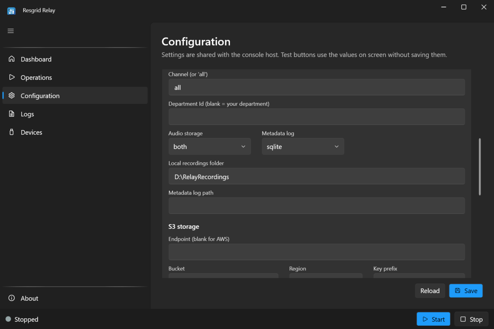

# Recorder

In `record` mode Relay joins one of your Resgrid PTT channels, or all of them, and saves **every transmission** as its own WAV file, on disk, in S3-compatible storage or both. For each one it writes a row to a metadata log: who talked, on which channel, when, and for how long. Use it for compliance, after-action reviews and training.

The recorder runs on every Relay build (desktop app, console on Windows, Linux and macOS, Docker). It is a voice mode, so it needs the `RefreshToken` grant ([Connect to Resgrid](connect-to-resgrid.md)) and your department's Push To Talk add-on.

:::note Voice seats
Each channel the recorder listens to occupies one of your department's PTT voice seats while it is connected. With **Channel** `all` and **Respect the department's concurrent voice-seat limit** on, the recorder records as many channels as it has seats for, and logs an error naming the first channel it couldn't join (that one and the ones after it aren't recorded).
:::

## Set it up

### In the desktop app

Open **Configuration › Recorder**:



| Setting | Value |
| --- | --- |
| **Channel (or 'all')** | `all` (the default) records every channel in your department. Or a channel's name or id. |
| **Department Id** | Leave blank: your department. |
| **Audio storage** | `local` (a folder), `s3` (S3-compatible storage) or `both`. |
| **Metadata log** | `jsonl` (a JSON Lines text file), `sqlite` (a SQLite database) or `none`. |
| **Local recordings folder** | Where WAV files go. Blank: a `recordings` folder next to the Relay program. |
| **Metadata log path** | The log file. Blank: `transmissions.jsonl` (or `transmissions.db`) in the recordings folder. |
| **S3 storage** | See [S3-compatible storage](#s3-compatible-storage). |

Save, then start **Recorder** on the Operations screen and turn on **Auto-start**. Its Dashboard tile counts **Transmissions**.

Set the recordings folder to a drive with room to grow: a folder in the program folder is fine for a test, not for a year of recordings.

### In appsettings.json or relay.user.json

```json
{
  "Mode": "record",
  "Recorder": {
    "Channel": "all",
    "Store": "local",
    "LocalPath": "D:\\Recordings\\Resgrid",
    "Log": "jsonl"
  }
}
```

### With environment variables (Linux, Docker)

```bash
RESGRID__RELAY__Mode=record
RESGRID__RELAY__Recorder__Channel=all
RESGRID__RELAY__Recorder__Store=local
RESGRID__RELAY__Recorder__LocalPath=/var/lib/resgrid-relay/recordings   # Docker: /app/recordings
RESGRID__RELAY__Recorder__Log=jsonl
```

The systemd unit already points `Recorder__LocalPath` at `/var/lib/resgrid-relay/recordings`, the one writable folder it allows. If you record elsewhere, add the path to the unit's `ReadWritePaths=`. In Docker, recordings go to `/app/recordings`: mount a volume or host folder there.

## What a transmission is

The recorder splits each talker's audio into transmissions:

- A transmission starts when someone starts talking, and ends after `Recorder:Segmentation:HangMs` (1.5 seconds) without audio.
- One longer than `Recorder:Segmentation:MaxSegmentSeconds` (5 minutes) continues in a new file.
- One with less than `Recorder:Segmentation:MinActiveMs` (250 ms) of audio, a stray key-up, is dropped.
- Audio quieter than `Recorder:Segmentation:SilenceFloorDbfs` (−50 dBFS) counts as silence.

Two people talking at once are recorded as two transmissions. These values have no field on the screen; set them in the settings file or environment variables if you need to (see the [settings reference](settings-reference.md#recorder)).

## The files

Each transmission is a WAV file (16-bit PCM, 48 kHz, mono; about 5.8 MB per minute of speech), named after the channel, the start time in UTC, the talker and a short id:

```text
<recordings folder>/2026/11/22/Fireground_1_20261122T140512Z_Jane_Smith_3f9a1c2e.wav
```

Files go into a `year/month/day` folder (UTC). In S3 the key is `<prefix>/2026/11/22/<file name>`, with the prefix `relay-recordings` by default.

If a recording can't be uploaded (S3 unreachable, the bucket refusing the write), Relay keeps it in `failed-uploads` inside the recordings folder, so an outage costs an upload, not the audio. Move those files into place once the problem is fixed.

That fallback needs a writable recordings folder. `failed-uploads` is on the same filesystem, so when the recordings disk is full or read-only nothing can be kept there and the transmission is lost: watch the free space, restore capacity as soon as the Logs screen reports a write failure, and treat the recordings from that period as missing.

**Relay never deletes recordings.** Plan for the disk space, and set retention to match your records policy: an S3 lifecycle rule, or a scheduled clean-up of old day folders.

## The metadata log

With `jsonl`, each transmission adds one line to `transmissions.jsonl`:

```json
{"id":"3f9a1c2e...","channelId":"...","channelName":"Fireground 1","roomName":"...","participantIdentity":"...","participantName":"Jane Smith","trackSid":"...","startUtc":"2026-11-22T14:05:12.410Z","endUtc":"2026-11-22T14:05:19.020Z","durationMs":6610,"sampleRate":48000,"channels":1,"codec":"pcm_s16le","samples":317280,"locations":[{"kind":"local","location":"D:\\Recordings\\Resgrid\\2026\\11\\22\\Fireground_1_20261122T140512Z_Jane_Smith_3f9a1c2e.wav","sizeBytes":634604}]}
```

| Field | Meaning |
| --- | --- |
| `id` | The transmission's id (also in the file name). |
| `channelId`, `channelName`, `roomName` | The PTT channel. |
| `participantIdentity`, `participantName` | Who talked. |
| `trackSid` | The talker's audio track. |
| `startUtc`, `endUtc`, `durationMs` | When, and how long. |
| `sampleRate`, `channels`, `codec`, `samples` | The audio format. |
| `locations` | Where the WAV was stored: one entry per store (`kind`, `location`, `sizeBytes`). |

The file is append-only and easy to search (`grep`, `jq`, a spreadsheet import). With `sqlite`, the same fields go into a `transmissions` table in `transmissions.db`, for querying with any SQLite tool.

## S3-compatible storage

Set **Audio storage** to `s3` (cloud only) or `both` (a local copy as well), and fill in the S3 settings:

| Setting | AWS S3 | MinIO, RustFS, Wasabi and other S3-compatible stores |
| --- | --- | --- |
| **Endpoint** | Blank | The store's URL, for example `https://minio.example.org:9000` |
| **Bucket** | Your bucket | Your bucket |
| **Region** | The bucket's region, for example `us-east-1` | As the store requires |
| **Key prefix** | `relay-recordings` by default | Same |
| **Use HTTPS** | On | On, unless the store is plain HTTP on a private network |
| **Path-style addressing** | Off | On for MinIO and most S3-compatible stores |
| **Access key**, **Secret key** | An access key allowed to write objects to the bucket | Same |

Tick **Reveal secrets** (in the Resgrid API section) to enter the keys. The pre-flight check wants a bucket when S3 is chosen.

With environment variables: `RESGRID__RELAY__Recorder__Store=s3`, `RESGRID__RELAY__Recorder__S3__Bucket`, `__S3__Region`, `__S3__Endpoint`, `__S3__AccessKey`, `__S3__SecretKey`, `__S3__Prefix`, `__S3__ForcePathStyle` and `__S3__UseSsl`.

## Recording the radio side

A recorder joined to a channel records everyone heard on it, including a radio bridge on that channel. To record a radio bridge's traffic without running a separate recorder, turn on **Record the channel and the radio side while bridging** in the [radio bridge](radio-bridge.md#recording-both-sides) settings: the bridge then uses these Recorder settings to save both directions, the radio side as *Radio (channel name)*.

## Stopping cleanly

When the recorder stops (Stop in the app, `Ctrl+C`, `systemctl stop`, `docker stop`), it finishes the transmissions in progress and stores them before it exits, waiting up to 10 seconds for uploads. Stop it the normal way rather than killing the process.

## Privacy

Recordings and the log contain your members' voices and names. Keep the recordings folder and bucket private, and the S3 keys secret. Under the systemd unit, the files Relay writes are readable by the `resgrid` account only.
