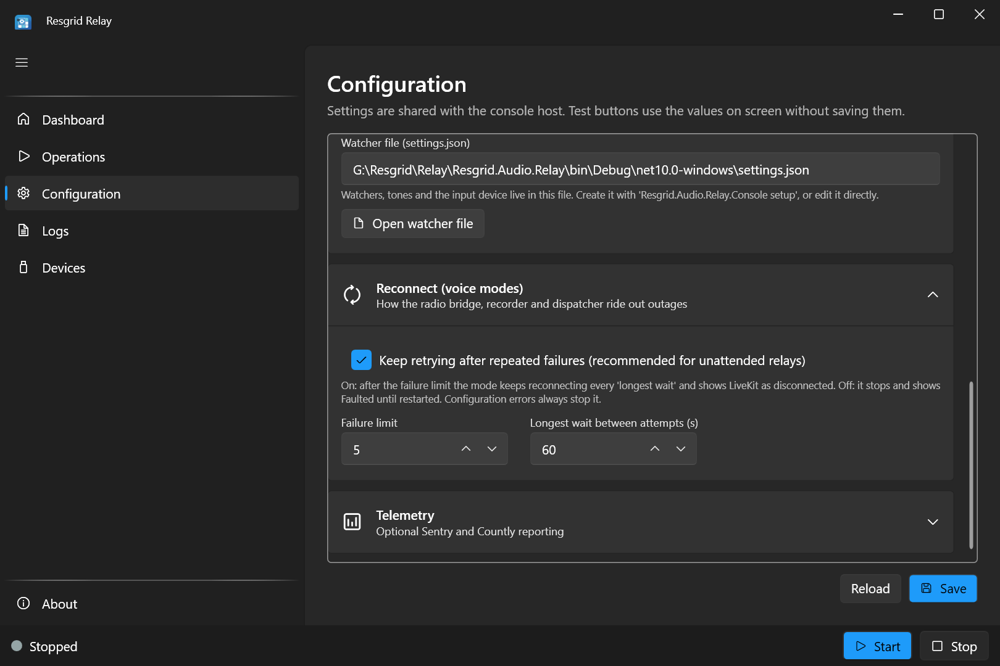

# Settings Reference

Every Relay setting, with its path in the settings files, its environment variable, its default and what it does. The desktop app's [Configuration](desktop-app.md#configuration) screen edits most of them; the rest are set in a settings file or with environment variables.

## Where settings come from

Relay reads three layers. Each one overrides the one before it:

1. **`appsettings.json`** next to the program. The console host and Docker image ship one; the desktop app doesn't.
2. **`relay.user.json`**, per Windows user: `%APPDATA%\Resgrid\Relay\relay.user.json`. The desktop app's Configuration screen writes it, and the console host reads it too, so a relay set up in the desktop app runs unchanged from the console on the same account. The desktop app saves only the values that differ from `appsettings.json` and the built-in defaults. (Where the user's application-data folder doesn't exist, the file is looked for next to the program.)
3. **Environment variables** starting with `RESGRID__RELAY__`. They win over both files, which makes them the right place for containers and systemd. The desktop app never writes them into its file, and shows a banner when they are set.

To turn a JSON path into an environment variable, add the prefix and write each `:` as `__` (two underscores): `Smtp:Port` becomes `RESGRID__RELAY__Smtp__Port`. List items are numbered from 0: `Smtp:DepartmentAddressDomains` is `RESGRID__RELAY__Smtp__DepartmentAddressDomains__0`, `__1` and so on. Names aren't case-sensitive; true/false values are `true` and `false`; choices such as `GrantType` take the names shown below.

A value Relay can't read (an empty port, a misspelled grant type), a missing required setting or an unknown mode stops it with a *Configuration error* naming the setting, instead of running with a guess. The console host then exits with code 78 (see [Exit codes](install.md#exit-codes)). `help` on the console host prints the common settings.

:::note What the desktop app saves
When you press **Save** in the desktop app, it writes to `relay.user.json` only the settings whose values differ from `appsettings.json` and the built-in defaults. Those settings then win over `appsettings.json`; every other setting still comes from `appsettings.json`, so edits there keep reaching a console host on the same account. A setting you changed in the app stays the app's: change it in the app (or in `relay.user.json`), or remove it from `relay.user.json` to fall back to `appsettings.json`. When no token cache path is set, Save also writes the desktop app's own (`%LOCALAPPDATA%\Resgrid\Relay\resgrid-token.json`), so the console host shares its rotated token.
:::

In the tables, **Desktop** names the field on the Configuration screen; *file only* means there is no field and you set it in a settings file or the environment.

## General

| JSON path | Environment variable | Default | Meaning | Desktop |
| --- | --- | --- | --- | --- |
| `Mode` | `RESGRID__RELAY__Mode` | `smtp` | What the console host runs: `smtp`, `audio`, `radio`, `record` or `dispatch`. In the desktop app, what **Start** runs when no mode has Auto-start. | General › Default mode |
| `AudioConfigPath` | `RESGRID__RELAY__AudioConfigPath` | `settings.json` | The [tone detect](tone-detect.md) watcher file. A relative path is relative to the program's folder. | Audio tone-detect › Watcher file |

## Resgrid

See [Connect to Resgrid](connect-to-resgrid.md).

| JSON path | Environment variable | Default | Meaning | Desktop |
| --- | --- | --- | --- | --- |
| `Resgrid:BaseUrl` | `RESGRID__RELAY__Resgrid__BaseUrl` | `https://api.resgrid.com` | The Resgrid API address. | Base URL |
| `Resgrid:ApiVersion` | `RESGRID__RELAY__Resgrid__ApiVersion` | `4` | The API version, `4` or `v4`. | *file only* |
| `Resgrid:ClientId` | `RESGRID__RELAY__Resgrid__ClientId` | (none) | The OpenID Connect client id. Required. | Client Id |
| `Resgrid:ClientSecret` | `RESGRID__RELAY__Resgrid__ClientSecret` | (none) | The client secret. Required. | Client secret |
| `Resgrid:GrantType` | `RESGRID__RELAY__Resgrid__GrantType` | `RefreshToken` | `RefreshToken`, `ClientCredentials` or `SystemApiKey`. The voice modes need `RefreshToken`. | Grant type |
| `Resgrid:RefreshToken` | `RESGRID__RELAY__Resgrid__RefreshToken` | (none) | The Relay member's refresh token (`RefreshToken` grant). Not needed once the token cache holds a token. | Refresh token |
| `Resgrid:TokenCachePath` | `RESGRID__RELAY__Resgrid__TokenCachePath` | Desktop: `%LOCALAPPDATA%\Resgrid\Relay\resgrid-token.json` (saved to `relay.user.json` on Save). Console: `./data/resgrid-token.json`. systemd: `/var/lib/resgrid-relay/resgrid-token.json` | Where the rotated refresh token is kept. Must be writable and survive restarts. A relative path is relative to the program's folder. | *file only* |
| `Resgrid:Scope` | `RESGRID__RELAY__Resgrid__Scope` | `openid profile email offline_access mobile` | The scopes Relay asks for. | *file only* |
| `Resgrid:SystemApiKey` | `RESGRID__RELAY__Resgrid__SystemApiKey` | (none) | The installation's system API key (`SystemApiKey` grant). | System API key |
| `Resgrid:DepartmentId` | `RESGRID__RELAY__Resgrid__DepartmentId` | (none) | The department a system caller acts for when the address doesn't say. Ignored for a member's token. | Department Id (hosted / system key) |
| `Resgrid:ServiceAccount` | `RESGRID__RELAY__Resgrid__ServiceAccount` | `false` | `true` when `ClientCredentials` are a system-level service account: Relay then behaves as with the system key. | Client credentials are a system-level service account |

## SMTP

See [SMTP dispatch](smtp-dispatch.md).

| JSON path | Environment variable | Default | Meaning | Desktop |
| --- | --- | --- | --- | --- |
| `Smtp:ServerName` | `RESGRID__RELAY__Smtp__ServerName` | `resgrid-relay` | The name the mail server gives in its greeting. | Server name |
| `Smtp:Port` | `RESGRID__RELAY__Smtp__Port` | `2525` | The port Relay listens on. | Port |
| `Smtp:DepartmentAddressDomains` | `RESGRID__RELAY__Smtp__DepartmentAddressDomains__0` | `dispatch.resgrid.com` | Domains whose addresses page the whole department. A list you set replaces the default; an empty list keeps it. | Department call domains |
| `Smtp:GroupAddressDomains` | `RESGRID__RELAY__Smtp__GroupAddressDomains__0` | `groups.resgrid.com` | Domains whose addresses page one group. | Group call domains |
| `Smtp:GroupMessageAddressDomains` | `RESGRID__RELAY__Smtp__GroupMessageAddressDomains__0` | `gm.resgrid.com` | Domains whose addresses send a message to one group. | Group message domains |
| `Smtp:ListAddressDomains` | `RESGRID__RELAY__Smtp__ListAddressDomains__0` | `lists.resgrid.com` | Distribution list domains. Addresses on them are refused. | Distribution list domains |
| `Smtp:DefaultCallPriority` | `RESGRID__RELAY__Smtp__DefaultCallPriority` | `1` | The priority of calls Relay creates. | Default call priority |
| `Smtp:DefaultCallType` | `RESGRID__RELAY__Smtp__DefaultCallType` | (blank) | The call type of calls Relay creates. Kept only if it exactly matches one of your call types (case-sensitive). | Default call type |
| `Smtp:DuplicateWindowHours` | `RESGRID__RELAY__Smtp__DuplicateWindowHours` | `72` | How long a message id is remembered, so a repeated delivery is ignored. | Duplicate window (hours) |
| `Smtp:DataDirectory` | `RESGRID__RELAY__Smtp__DataDirectory` | `./data` (systemd: `/var/lib/resgrid-relay/smtp`) | Where the processed-message list and raw messages are kept. | Data directory |
| `Smtp:SaveRawMessages` | `RESGRID__RELAY__Smtp__SaveRawMessages` | `true` | Keep a copy of each message in `messages` in the data directory, deleted after the longer of the duplicate window and 7 days. | Save raw messages |
| `Smtp:MaxAttachmentBytes` | `RESGRID__RELAY__Smtp__MaxAttachmentBytes` | `10485760` (10 MB) | Larger attachments are skipped (and noted on the call). | *file only* |
| `Smtp:MaxMessageBytes` | `RESGRID__RELAY__Smtp__MaxMessageBytes` | `26214400` (25 MB) | Larger messages are refused. | *file only* |
| `Smtp:ValidateDepartmentCodes` | `RESGRID__RELAY__Smtp__ValidateDepartmentCodes` | `true` | Check a department address's code with Resgrid before paging the department. Turn off only for a self-hosted Resgrid too old to support the check. | Require a valid department dispatch code |
| `Smtp:ResolveDispatchCodes` | `RESGRID__RELAY__Smtp__ResolveDispatchCodes` | `true` | Look group codes up to their Resgrid ids. Leave on. | Resolve dispatch codes to Resgrid ids |
| `Smtp:HostedMode` | `RESGRID__RELAY__Smtp__HostedMode` | `false` | Serve many departments: a group address may carry the department id in its domain (`code@<departmentId>.<group domain>`). | Hosted (multi-department) mode |
| `Smtp:DepartmentDomainSeparator` | `RESGRID__RELAY__Smtp__DepartmentDomainSeparator` | `.` | In hosted mode, what separates the department id from the domain. | *file only* |
| `Smtp:DefaultDepartmentId` | `RESGRID__RELAY__Smtp__DefaultDepartmentId` | (none) | Dispatch only this department; refuse recipients of any other. | Default department Id |
| `Smtp:DepartmentDispatchPrefix` | `RESGRID__RELAY__Smtp__DepartmentDispatchPrefix` | `G` | Legacy: the prefix for codes of other types in the dispatch list. Leave as it is. | *file only* |
| `Smtp:RedisCache:Enabled` | `RESGRID__RELAY__Smtp__RedisCache__Enabled` | `false` | Cache dispatch-code lookups in Redis. | Enable Redis cache |
| `Smtp:RedisCache:ConnectionString` | `RESGRID__RELAY__Smtp__RedisCache__ConnectionString` | (blank) | For example `redis:6379,abortConnect=false`. Required when the cache is on. | Connection string |
| `Smtp:RedisCache:TtlMinutes` | `RESGRID__RELAY__Smtp__RedisCache__TtlMinutes` | `60` | How long a cached lookup is used. | TTL (minutes) |

## Voice

The PTT channel the radio bridge joins, and settings the voice modes share. See [Radio bridge](radio-bridge.md#choose-the-ptt-channel).

| JSON path | Environment variable | Default | Meaning | Desktop |
| --- | --- | --- | --- | --- |
| `Voice:Channel` | `RESGRID__RELAY__Voice__Channel` | `default` | The radio bridge's channel: `default`, a channel name, or its id. | PTT channel › Channel |
| `Voice:DepartmentId` | `RESGRID__RELAY__Voice__DepartmentId` | (blank) | The department of the channels (blank: yours). Also the fallback for the recorder and tone-out. | PTT channel › Department Id |
| `Voice:EnforceSeatLimit` | `RESGRID__RELAY__Voice__EnforceSeatLimit` | `true` | Don't join when all of the department's PTT seats are in use. Applies to every voice mode. | Respect the department's concurrent voice-seat limit |
| `Voice:PublishQueueMs` | `RESGRID__RELAY__Voice__PublishQueueMs` | `1000` | How much audio, in milliseconds, may queue up to be sent to the channel. | *file only* |

## Radio

See [Radio bridge](radio-bridge.md) and [LTE donor radios](lte-donor-radios.md). Windows only.

| JSON path | Environment variable | Default | Meaning | Desktop |
| --- | --- | --- | --- | --- |
| `Radio:Profile` | `RESGRID__RELAY__Radio__Profile` | `custom` | The profile the values came from: `custom`, `analog`, `rapidradios`, `digatalkplus` or `poc`. Informational: it drives setup advice and start-up warnings, not the values. | Radio profile |
| `Radio:InputDevice` | `RESGRID__RELAY__Radio__InputDevice` | `0` | The audio input that receives the radio. | Receive audio from the radio |
| `Radio:OutputDevice` | `RESGRID__RELAY__Radio__OutputDevice` | `-1` | The audio output to the radio; `-1` is Windows' default output. | Transmit audio to the radio |
| `Radio:PttMethod` | `RESGRID__RELAY__Radio__PttMethod` | `Vox` | `Cm108`, `SerialRts`, `SerialDtr` or `Vox`. | PTT keying |
| `Radio:SerialPort` | `RESGRID__RELAY__Radio__SerialPort` | (blank) | The COM port for serial PTT or carrier detect, for example `COM3`. | Serial port |
| `Radio:Cm108VendorId` | `RESGRID__RELAY__Radio__Cm108VendorId` | `3468` (`0x0D8C`, C-Media) | The CM108 interface's USB vendor id. | CM108 interface |
| `Radio:Cm108ProductId` | `RESGRID__RELAY__Radio__Cm108ProductId` | `0` | The CM108 interface's USB product id; `0` for the first C-Media device found. | CM108 interface |
| `Radio:Cm108GpioPin` | `RESGRID__RELAY__Radio__Cm108GpioPin` | `3` | The GPIO pin that keys PTT (1 to 8). | CM108 GPIO pin for PTT |
| `Radio:CarrierDetect` | `RESGRID__RELAY__Radio__CarrierDetect` | `None` | The COR/COS input for carrier squelch: `None`, `SerialCts` or `SerialDsr`. (`Cm108Gpio` isn't implemented yet and falls back to the audio squelch.) | Carrier detect |
| `Radio:CarrierDetectInverted` | `RESGRID__RELAY__Radio__CarrierDetectInverted` | `false` | The COR line is active-low. | Active-low (inverted) |
| `Radio:TxLeadMs` | `RESGRID__RELAY__Radio__TxLeadMs` | `0` | Milliseconds between keying and the first channel audio (0 to 3000). About 150 for analog with CTCSS, 500 to 800 for LTE radios. Ignored with `Vox`. | Key-up lead |
| `Radio:TxHangMs` | `RESGRID__RELAY__Radio__TxHangMs` | `300` | Keep the radio keyed through pauses this long. | Hang time |
| `Radio:TxTailMs` | `RESGRID__RELAY__Radio__TxTailMs` | `150` | Keep the radio keyed this long after the last audio played out. | Tail |
| `Radio:MaxTransmitSeconds` | `RESGRID__RELAY__Radio__MaxTransmitSeconds` | `180` | Transmit time-out: cut off a channel talker this long after they took the floor; 0 for no limit. | Transmit time-out |
| `Radio:TxGain` | `RESGRID__RELAY__Radio__TxGain` | `1.0` | Level of the audio sent to the radio. | Transmit gain |
| `Radio:RxGain` | `RESGRID__RELAY__Radio__RxGain` | `1.0` | Level of the radio audio sent to the channel. | Receive gain |
| `Radio:HighPassCutoffHz` | `RESGRID__RELAY__Radio__HighPassCutoffHz` | `250` | High-pass filter on the radio audio sent to the channel. | High-pass filter |
| `Radio:CourtesyTone` | `RESGRID__RELAY__Radio__CourtesyTone` | `true` | Beep on the radio after each channel transmission. | Courtesy beep |
| `Radio:AntiLoop` | `RESGRID__RELAY__Radio__AntiLoop` | `true` | Half duplex: never send audio back to where it came from. | Half-duplex anti-loop |
| `Radio:RecordWhileBridging` | `RESGRID__RELAY__Radio__RecordWhileBridging` | `false` | Record both directions with the Recorder settings. | Record the channel and the radio side |
| `Radio:Squelch:Mode` | `RESGRID__RELAY__Radio__Squelch__Mode` | `Vox` | `Vox`, `Carrier`, `Ctcss` or `Off` (for a radio with its own hardware squelch: passes audio at or above `OpenDbfs`, held for `HangMs`). | Squelch mode |
| `Radio:Squelch:OpenDbfs` | `RESGRID__RELAY__Radio__Squelch__OpenDbfs` | `-38` | Level (dBFS) at which the squelch opens. With `Off`, the level audio must reach to be passed. | Open (dBFS) |
| `Radio:Squelch:CloseDbfs` | `RESGRID__RELAY__Radio__Squelch__CloseDbfs` | `-45` | Below this level the hang runs out at full speed. At or below Open. | Close (dBFS) |
| `Radio:Squelch:HangMs` | `RESGRID__RELAY__Radio__Squelch__HangMs` | `600` | How long the squelch stays open after the audio drops (also with `Off`). | Hang (ms) |
| `Radio:Squelch:CtcssFrequency` | `RESGRID__RELAY__Radio__Squelch__CtcssFrequency` | `0` | The CTCSS (PL) tone in Hz, for `Ctcss` squelch. | CTCSS tone (Hz) |
| `Radio:Squelch:CtcssMinStrength` | `RESGRID__RELAY__Radio__Squelch__CtcssMinStrength` | `0.30` | How strong (0 to 1) the CTCSS tone must be to count. | *file only* |
| `Radio:Emergency:DetectTones` | `RESGRID__RELAY__Radio__Emergency__DetectTones` | `false` | Listen for emergency tones. | Detect emergency tones |
| `Radio:Emergency:ToneFrequencies` | `RESGRID__RELAY__Radio__Emergency__ToneFrequencies__0` | (none) | The emergency tone frequencies in Hz. | *file only* |
| `Radio:Emergency:DetectMdc1200` | `RESGRID__RELAY__Radio__Emergency__DetectMdc1200` | `false` | Experimental, not reliable: doesn't decode standard MDC-1200 bursts. | Detect MDC-1200 |
| `Radio:Emergency:CreateCall` | `RESGRID__RELAY__Radio__Emergency__CreateCall` | `false` | Create a Resgrid call for a detected emergency (otherwise only logged). | Create a Resgrid call |
| `Radio:Emergency:CallPriority` | `RESGRID__RELAY__Radio__Emergency__CallPriority` | `1` | The emergency call's priority. | Emergency call priority |
| `Radio:Emergency:DispatchList` | `RESGRID__RELAY__Radio__Emergency__DispatchList` | (blank) | Who the emergency call pages, for example `G:42`; blank pages everyone. | *file only* |
| `Radio:Emergency:CooldownSeconds` | `RESGRID__RELAY__Radio__Emergency__CooldownSeconds` | `120` | Repeats of the same emergency within this window create no further calls. | *file only* |

## Recorder

See [Recorder](recorder.md). Also used by `Radio:RecordWhileBridging`.

| JSON path | Environment variable | Default | Meaning | Desktop |
| --- | --- | --- | --- | --- |
| `Recorder:Channel` | `RESGRID__RELAY__Recorder__Channel` | `all` | `all`, a channel name, or its id. | Channel |
| `Recorder:DepartmentId` | `RESGRID__RELAY__Recorder__DepartmentId` | (blank) | The channels' department (blank: `Voice:DepartmentId`, then yours). | Department Id |
| `Recorder:Store` | `RESGRID__RELAY__Recorder__Store` | `local` | `local`, `s3` or `both`. | Audio storage |
| `Recorder:LocalPath` | `RESGRID__RELAY__Recorder__LocalPath` | (blank: `recordings` next to the program; systemd: `/var/lib/resgrid-relay/recordings`) | The recordings folder. | Local recordings folder |
| `Recorder:Log` | `RESGRID__RELAY__Recorder__Log` | `jsonl` | `jsonl`, `sqlite` or `none`. | Metadata log |
| `Recorder:LogPath` | `RESGRID__RELAY__Recorder__LogPath` | (blank: `transmissions.jsonl` or `transmissions.db` in the recordings folder) | The metadata log file. | Metadata log path |
| `Recorder:S3:Endpoint` | `RESGRID__RELAY__Recorder__S3__Endpoint` | (blank: AWS) | An S3-compatible store's URL. | Endpoint |
| `Recorder:S3:Bucket` | `RESGRID__RELAY__Recorder__S3__Bucket` | (blank) | The bucket. Required for `s3` and `both`. | Bucket |
| `Recorder:S3:Region` | `RESGRID__RELAY__Recorder__S3__Region` | (blank) | The bucket's region. | Region |
| `Recorder:S3:Prefix` | `RESGRID__RELAY__Recorder__S3__Prefix` | `relay-recordings` | The key prefix. | Key prefix |
| `Recorder:S3:AccessKey` | `RESGRID__RELAY__Recorder__S3__AccessKey` | (blank) | The access key. | Access key |
| `Recorder:S3:SecretKey` | `RESGRID__RELAY__Recorder__S3__SecretKey` | (blank) | The secret key. | Secret key |
| `Recorder:S3:UseSsl` | `RESGRID__RELAY__Recorder__S3__UseSsl` | `true` | Use HTTPS. | Use HTTPS |
| `Recorder:S3:ForcePathStyle` | `RESGRID__RELAY__Recorder__S3__ForcePathStyle` | `false` | Path-style addressing (MinIO and most S3-compatible stores). | Path-style addressing |
| `Recorder:Segmentation:HangMs` | `RESGRID__RELAY__Recorder__Segmentation__HangMs` | `1500` | End a transmission after this much silence. | *file only* |
| `Recorder:Segmentation:MaxSegmentSeconds` | `RESGRID__RELAY__Recorder__Segmentation__MaxSegmentSeconds` | `300` | Continue a longer transmission in a new file. | *file only* |
| `Recorder:Segmentation:MinActiveMs` | `RESGRID__RELAY__Recorder__Segmentation__MinActiveMs` | `250` | Drop transmissions with less audio than this. | *file only* |
| `Recorder:Segmentation:SilenceFloorDbfs` | `RESGRID__RELAY__Recorder__Segmentation__SilenceFloorDbfs` | `-50` | Audio below this level counts as silence. | *file only* |
| `Recorder:Segmentation:ScanIntervalMs` | `RESGRID__RELAY__Recorder__Segmentation__ScanIntervalMs` | `500` | How often finished transmissions are looked for. | *file only* |

## Dispatch tone-out

See [Dispatch tone-out](dispatch-tone-out.md).

| JSON path | Environment variable | Default | Meaning | Desktop |
| --- | --- | --- | --- | --- |
| `DispatchVoice:Channel` | `RESGRID__RELAY__DispatchVoice__Channel` | `default` | The channel to announce on. | Channel |
| `DispatchVoice:DepartmentId` | `RESGRID__RELAY__DispatchVoice__DepartmentId` | (blank) | The department (blank: `Voice:DepartmentId`, then yours). | Department Id |
| `DispatchVoice:PollSeconds` | `RESGRID__RELAY__DispatchVoice__PollSeconds` | `15` | How often to check for new calls. | Poll interval |
| `DispatchVoice:GiveUpAfterMinutes` | `RESGRID__RELAY__DispatchVoice__GiveUpAfterMinutes` | `10` | How long a failing tone-out is retried. | Give up after |
| `DispatchVoice:Hosted` | `RESGRID__RELAY__DispatchVoice__Hosted` | `false` | Reserved for a future multi-department tone-out; requires `DispatchVoice:DepartmentId`. Leave off. | *file only* |
| `DispatchVoice:Tone:Type` | `RESGRID__RELAY__DispatchVoice__Tone__Type` | `TwoToneSequential` | `TwoToneSequential`, `HiLo`, `SingleTone` or `None`. | *file only* |
| `DispatchVoice:Tone:ToneAFrequency` | `RESGRID__RELAY__DispatchVoice__Tone__ToneAFrequency` | `1000` | Tone A in Hz (the high tone for `HiLo`). | *file only* |
| `DispatchVoice:Tone:ToneADurationMs` | `RESGRID__RELAY__DispatchVoice__Tone__ToneADurationMs` | `1000` | Tone A's length. | *file only* |
| `DispatchVoice:Tone:ToneBFrequency` | `RESGRID__RELAY__DispatchVoice__Tone__ToneBFrequency` | `2000` | Tone B in Hz (the low tone for `HiLo`). | *file only* |
| `DispatchVoice:Tone:ToneBDurationMs` | `RESGRID__RELAY__DispatchVoice__Tone__ToneBDurationMs` | `3000` | Tone B's length. | *file only* |
| `DispatchVoice:Tone:Amplitude` | `RESGRID__RELAY__DispatchVoice__Tone__Amplitude` | `0.5` | Tone volume, 0 to 1. | *file only* |
| `DispatchVoice:Tone:HiLoCycles` | `RESGRID__RELAY__DispatchVoice__Tone__HiLoCycles` | `6` | High-low pairs for `HiLo`. | *file only* |
| `DispatchVoice:Tone:HiLoSegmentMs` | `RESGRID__RELAY__DispatchVoice__Tone__HiLoSegmentMs` | `250` | Length of each `HiLo` step. | *file only* |
| `DispatchVoice:Tone:PreSpeechSilenceMs` | `RESGRID__RELAY__DispatchVoice__Tone__PreSpeechSilenceMs` | `500` | Pause between the tones and the announcement. | *file only* |

## Text-to-speech

| JSON path | Environment variable | Default | Meaning | Desktop |
| --- | --- | --- | --- | --- |
| `Tts:ServiceBaseUrl` | `RESGRID__RELAY__Tts__ServiceBaseUrl` | (blank) | The Resgrid text-to-speech service, for example `https://tts.resgrid.com`. Required for the tone-out. | Service URL |
| `Tts:PlaybackBaseUrl` | `RESGRID__RELAY__Tts__PlaybackBaseUrl` | (blank) | A separate address to download the synthesized audio from, if your installation serves it elsewhere. | *file only* |
| `Tts:Voice` | `RESGRID__RELAY__Tts__Voice` | (blank: the service's default) | The voice to speak with. | Voice id |
| `Tts:Speed` | `RESGRID__RELAY__Tts__Speed` | `0` (the service's default) | Words per minute. | Speed |
| `Tts:RequestTimeoutSeconds` | `RESGRID__RELAY__Tts__RequestTimeoutSeconds` | `20` | How long to wait for the service. | *file only* |

## Resilience

How the voice modes (radio bridge, recorder, tone-out) ride out network and Resgrid outages. A mode that fails is restarted after a wait that doubles each time, from `InitialBackoffSeconds` up to `MaxBackoffSeconds`.

| JSON path | Environment variable | Default | Meaning | Desktop |
| --- | --- | --- | --- | --- |
| `Resilience:Enabled` | `RESGRID__RELAY__Resilience__Enabled` | `true` | Restart a failed voice mode automatically. | *file only* |
| `Resilience:MaxConsecutiveFailures` | `RESGRID__RELAY__Resilience__MaxConsecutiveFailures` | `5` | Failures in a row, without a healthy run between them, before the failure limit is reached (see `KeepRetrying`). | Failure limit |
| `Resilience:InitialBackoffSeconds` | `RESGRID__RELAY__Resilience__InitialBackoffSeconds` | `2` | The first wait. | *file only* |
| `Resilience:MaxBackoffSeconds` | `RESGRID__RELAY__Resilience__MaxBackoffSeconds` | `60` | The longest wait. | Longest wait between attempts |
| `Resilience:HealthyRunSeconds` | `RESGRID__RELAY__Resilience__HealthyRunSeconds` | `30` | A run at least this long resets the failure count. | *file only* |
| `Resilience:KeepRetrying` | `RESGRID__RELAY__Resilience__KeepRetrying` | `true` | After the failure limit, keep trying every `MaxBackoffSeconds` and show LiveKit as disconnected. `false`: stop and show *Faulted* until restarted. Recommended on for unattended relays. | Keep retrying after repeated failures |

A configuration error (a wrong grant type, a missing setting) stops the mode at once, whatever these settings say: retrying can't fix it.

## Telemetry

Optional error and usage reporting to your own Sentry or Countly. Off unless you set them.

| JSON path | Environment variable | Default | Meaning | Desktop |
| --- | --- | --- | --- | --- |
| `Telemetry:Environment` | `RESGRID__RELAY__Telemetry__Environment` | (blank) | An environment name for the reports, such as `production`. | Environment |
| `Telemetry:Sentry:Dsn` | `RESGRID__RELAY__Telemetry__Sentry__Dsn` | (blank: off) | Your Sentry DSN. | Sentry DSN |
| `Telemetry:Sentry:Release` | `RESGRID__RELAY__Telemetry__Sentry__Release` | (blank) | A release name for Sentry. | *file only* |
| `Telemetry:Sentry:SendDefaultPii` | `RESGRID__RELAY__Telemetry__Sentry__SendDefaultPii` | `false` | Let Sentry collect personal data by default. | *file only* |
| `Telemetry:Countly:Url` | `RESGRID__RELAY__Telemetry__Countly__Url` | (blank: off) | Your Countly server. | Countly URL |
| `Telemetry:Countly:AppKey` | `RESGRID__RELAY__Telemetry__Countly__AppKey` | (blank) | The Countly app key. | Countly app key |
| `Telemetry:Countly:DeviceId` | `RESGRID__RELAY__Telemetry__Countly__DeviceId` | (blank) | A device id for Countly. | *file only* |
| `Telemetry:Countly:RequestTimeoutSeconds` | `RESGRID__RELAY__Telemetry__Countly__RequestTimeoutSeconds` | `5` | How long to wait for Countly. | *file only* |

SMTP telemetry includes the sender, recipients and subject of each message, never the body.

## Environment-only settings

| Variable | Meaning |
| --- | --- |
| `LOCLX_ENABLED`, `LOCLX_TOKEN`, `LOCLX_RESERVED_ENDPOINT` | Start a LocalXpose tunnel to the SMTP port (console host and Docker). See [SMTP dispatch](smtp-dispatch.md#no-inbound-port-localxpose-tunnel). |
| `TZ` | The Docker container's time zone (default `Etc/UTC`). |
| `WAIT_HOSTS` | Docker only: wait for these `host:port` addresses before starting. |

## The tone detect watcher file

Tone detect's watchers, triggers and input device are in their own file (`AudioConfigPath`). Its settings are described on [Tone detect](tone-detect.md#the-watcher-file).
