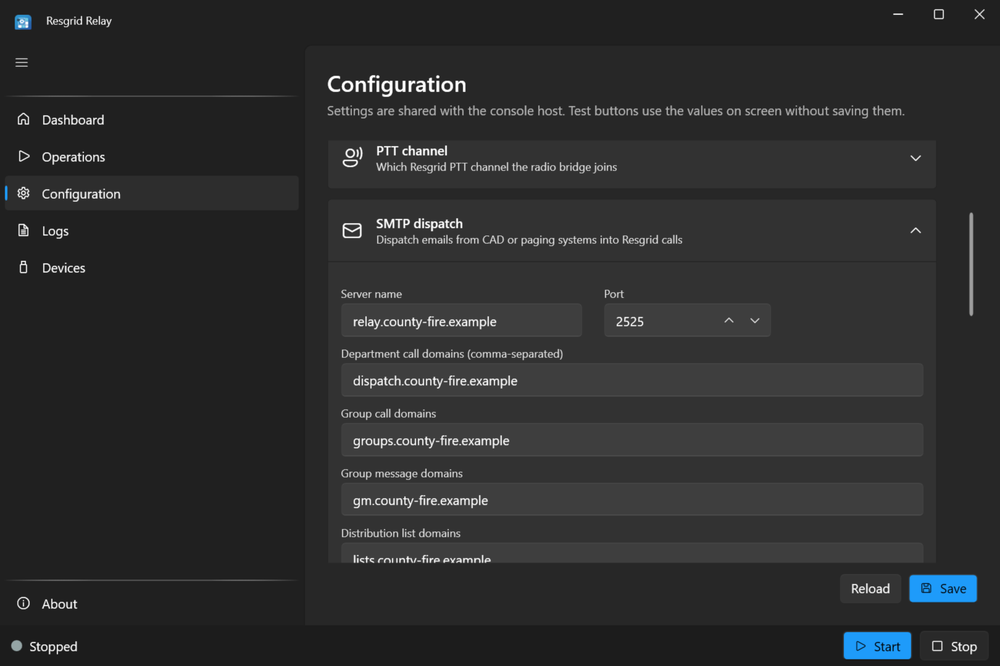
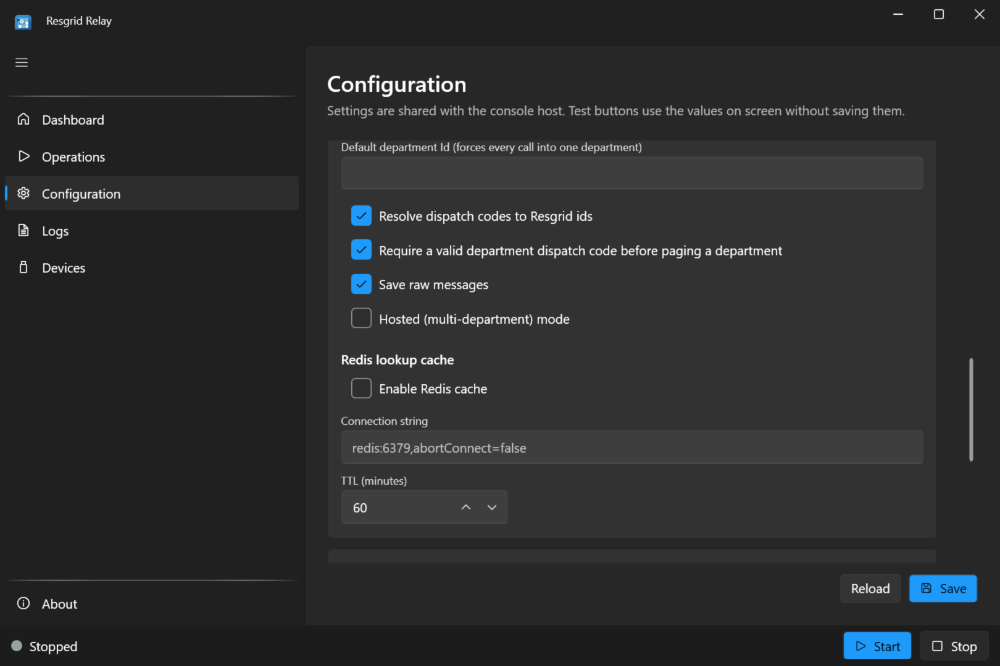

# SMTP Dispatch (Email)

In `smtp` mode Relay is a small mail server for your **dispatch domains**. Your CAD, alarm panel, paging gateway or any system that can send email sends its dispatch email to an address on that domain, and Relay turns it into a Resgrid call, for the whole department or for one group, or into a message to a group.

```text
CAD / alarm panel  --email-->  station5@groups.your-county.org  --SMTP-->  Relay  --API-->  Resgrid call for Station 5
```

The mode runs on every Relay build: the desktop app, the console host on Windows, Linux or macOS, and Docker.

:::tip Do you need Relay for email?
Every Resgrid department already has a **dispatch import email** that turns email into calls, with formats for many dispatch centers, address lookup and follow-up updates (see [Call Import](../../configuration/call-import.md)). Use Relay when you want the dispatch addresses on **your own domain**, need a mail server on your own network (a CAD that can only reach a local SMTP server), or run a [self-hosted](../../self-hosted/installation.md) Resgrid installation.
:::

## How it works

1. The sending system delivers the email to Relay: through your domain's MX record, or directly over SMTP.
2. While the sender is still connected, Relay checks each recipient address. Addresses it can't dispatch are refused on the spot, so the sender learns the address is wrong instead of the email vanishing.
3. Relay reads the recipients (the envelope recipients, which include Bcc and forwarded copies, as well as **To** and **Cc**), looks up each dispatch code in Resgrid, and creates the call (or sends the group message).
4. It uploads the attachments to the call.
5. It answers the sender: accepted, try again later, or rejected (see [What senders see](#what-senders-see)).

## Address types

The domain of a recipient address decides what Relay does; the part before the `@` is the **dispatch code**.

| Recipient | Result |
| --- | --- |
| `code@` a **department domain** | A call for the **whole department**. The code must be your department's dispatch email code; any other code is refused. |
| `code@` a **group domain** | A call dispatched to the **group** (station) whose dispatch email code is `code`. |
| `code@` a **group message domain** | A Resgrid **message** (not a call) to the group whose message email code is `code`. Needs a member's or department's sign-in: the system API key can't send messages. |
| `code@` a **distribution list domain** | Refused: Resgrid has no API for distribution lists. |
| Anything else | Refused. |

You choose the domains, one or more of each type. Use subdomains of a domain you control, for example `dispatch.your-county.org`, `groups.your-county.org` and `gm.your-county.org`.

If you leave a list empty, Relay keeps the default for that type: `dispatch.resgrid.com`, `groups.resgrid.com`, `gm.resgrid.com` and `lists.resgrid.com`, the domains of Resgrid's hosted service. A list you fill in replaces the default for that type. A relay of your own should always have its own domains.

## Find your dispatch codes in Resgrid

- **Department code**: the part before the `@` of your department's **Dispatch Import Email**, shown on **Department → Call Settings** (see [Call Import](../../configuration/call-import.md#configuring-call-import)). If the dispatch import email is `k7x2q@dispatch.resgrid.com`, the department code is `k7x2q`, and with Relay the department address becomes `k7x2q@dispatch.your-county.org`.
- **Group codes**: the **Dispatch email** and **Message email** set on each group or station (see [Groups & Stations](../../web-app/groups-stations.md) and [Group dispatch addresses](../../configuration/call-import.md#group-dispatch-addresses)). A group with dispatch email `station5` is paged by `station5@groups.your-county.org`; with message email `station5-crew` it gets messages at `station5-crew@gm.your-county.org`.

The department code is checked with Resgrid before anything is paged, so nobody can page your whole department by guessing an address.

## Get the email to Relay

Relay listens for plain SMTP on port **2525** by default (`Smtp:Port`). How mail reaches it depends on who sends it.

### Relay as the mail server for your dispatch domains

Point each dispatch domain's MX record at the host running Relay, and let port 25 through to it:

```text
dispatch.your-county.org.   MX  10  relay.your-county.org.
groups.your-county.org.     MX  10  relay.your-county.org.
gm.your-county.org.         MX  10  relay.your-county.org.
relay.your-county.org.      A       203.0.113.10
```

Mail servers deliver to port 25. Forward port 25 to Relay's 2525 in your firewall or router (or publish it with `-p 25:2525` in Docker), or set `Smtp:Port` to 25 where Relay may listen on it (see the [systemd notes](install.md#what-the-unit-does-for-you)).

:::warning Lock the port down
Relay is not an open mail relay: it only accepts recipients on your dispatch domains. But it accepts mail from **any sender**, and it offers no TLS and no SMTP authentication, so the recipient addresses are its only gate. Before you open it to the internet, restrict port 25 to the senders you expect (your dispatch center's mail servers) with a firewall, or put a filtering mail server that handles TLS in front of it and forward the dispatch domains to Relay.
:::

### The CAD sends to Relay directly

If the sending system lets you set its SMTP server (smarthost), set it to the Relay host and port, with no authentication and no TLS. The recipient addresses still have to be on your dispatch domains; no DNS change is needed when the CAD addresses the server directly.

### Your existing mail server forwards to Relay

Add a rule on your mail server that routes the dispatch domains to the Relay host and port (a send connector, a transport map or a smart host for those domains). Your mail server then handles TLS, spam filtering and sender restrictions, and Relay only sees what it lets through.

## Configure

### In the desktop app

Open **Configuration › SMTP dispatch**:





Enter your domains (comma-separated), save, and start **SMTP Dispatch** on the Operations screen. The pre-flight check wants at least one domain.

### In appsettings.json or relay.user.json

```json
{
  "Mode": "smtp",
  "Smtp": {
    "Port": 2525,
    "DataDirectory": "./data",
    "DepartmentAddressDomains": [ "dispatch.your-county.org" ],
    "GroupAddressDomains": [ "groups.your-county.org" ],
    "GroupMessageAddressDomains": [ "gm.your-county.org" ],
    "DefaultCallPriority": 1,
    "DefaultCallType": ""
  }
}
```

### With environment variables

```bash
RESGRID__RELAY__Mode=smtp
RESGRID__RELAY__Smtp__Port=2525
RESGRID__RELAY__Smtp__DepartmentAddressDomains__0=dispatch.your-county.org
RESGRID__RELAY__Smtp__GroupAddressDomains__0=groups.your-county.org
RESGRID__RELAY__Smtp__GroupMessageAddressDomains__0=gm.your-county.org
```

A second domain of the same type is `__1`, and so on. Add the [Resgrid credentials](connect-to-resgrid.md) too. Every SMTP setting is in the [settings reference](settings-reference.md#smtp).

### Test it

Send an email to a group address you created for testing (so you don't page everyone), for example `test@groups.your-county.org`, from a mail client or with `swaks`:

```bash
swaks --server relay.your-county.org --port 2525 \
  --to test@groups.your-county.org --from cad@your-county.org \
  --header "Subject: TEST - Structure fire" --body "Smoke showing, 123 Main St"
```

The call appears in Resgrid, the Dashboard tile's **Calls** counter goes up, and the Logs screen shows the message and the call.

## What the call looks like

Relay creates the call through the Resgrid API with:

| Call field | From the email |
| --- | --- |
| **Name** | The subject (up to 200 characters). |
| **Nature** | The first non-empty line of the body (up to 500 characters), or the subject. |
| **Notes** | The body, plus a note for any attachment that was skipped. HTML-only email is converted to text. |
| **Priority** | `Smtp:DefaultCallPriority` (1 by default). |
| **Type** | `Smtp:DefaultCallType`, kept only if it exactly matches one of your call types (case-sensitive); blank by default. |
| **Contact** | The sender's name (or address) and email address. |
| **Dispatched to** | Everyone, for a department address; the addressed groups, for group addresses. |
| **Files** | The attachments. |

Relay doesn't read your dispatch center's format: it doesn't pick an address, incident number or call type out of the body, and a follow-up email creates another call rather than updating the first. If you need that, send to Resgrid's own dispatch import email with the matching [email type](../../configuration/call-import.md#email-types).

### Pending calls with the system API key

With the system API key or a service account (see [Connect to Resgrid](connect-to-resgrid.md#system-api-key-and-hosted-relays)), Resgrid never lets Relay page a whole department on its own. A department-address call is saved as a **pending call**: it waits in the dispatchers' pending queue and pages everyone once a dispatcher sends it. Group addresses are dispatched straight away. With a member's refresh token, department calls are dispatched straight away too.

## Group messages

Email to a group message address sends a Resgrid message to that group: the subject is the title (up to 200 characters) and the body the message (up to 4,000 characters). It is sent once per email, even when a sender delivers the same email in several transactions. Group messages need the `RefreshToken` or a department's `ClientCredentials` sign-in; with the system API key these addresses are refused.

## Attachments

Every attachment (run cards, maps, PDFs, audio) is uploaded to the call as a file, typed as audio, image, video or file. An attached email is kept as `attached-message.eml`.

- An attachment larger than `Smtp:MaxAttachmentBytes` (10 MB by default) is skipped, and the call's notes say so.
- One that Resgrid rejects outright is skipped; the call is still created.
- A whole email larger than `Smtp:MaxMessageBytes` (25 MB by default) is refused while it is being sent.

## Duplicates and retries

Mail systems sometimes deliver the same email twice, and senders retry after errors. Relay makes sure that never creates a second call:

- It remembers each email's Message-Id for `Smtp:DuplicateWindowHours` (72 hours by default), in `processed-messages.json` in the data directory, and ignores repeats.
- The call and each attachment carry an idempotency key, so even a retry that reaches Resgrid gets back the call it already created.

So a failure that might succeed later is answered with `451`, and the sender keeps retrying (most mail servers retry for days) instead of the dispatch being lost.

With `Smtp:SaveRawMessages` on (the default), each email is also saved as received under `messages` in the data directory, for troubleshooting. These copies contain dispatch content: Relay deletes them after the longer of the duplicate window and 7 days, but protect the folder.

## What senders see

| Reply | When | What the sender does |
| --- | --- | --- |
| `250` | The email was accepted: the call was created (or the message sent), or it was a duplicate. | Done. |
| `550` to a recipient | The address isn't a dispatch address on your domains, is a distribution list address, is a group message address while Relay uses the system API key, or belongs to another department than `Smtp:DefaultDepartmentId`. | Bounces that recipient. |
| `452 4.5.3` to a recipient | The recipient belongs to a different department than the email's other recipients. | Sends it again in a separate delivery, so one email to several departments pages each of them. |
| `550 5.1.1` after the email | None of the dispatch addresses names a department or group Resgrid knows (an unknown code). | Bounces the email, so the sending system learns its address is wrong. |
| `451 4.3.0` | Something that may work later: Resgrid unreachable or busy, a sign-in failure (which an operator can fix), a wrong base URL, a timeout. | Retries later. |
| `554` | The email can't be read, or Resgrid rejected the call outright. | Bounces the email. |

A sign-in problem is answered with `451` on purpose: once you fix the credentials, the senders' retries come through and nothing is lost. Watch the Logs screen (or `journalctl`) after changing credentials.

## Hosted mode: many departments

One relay can serve many departments with the system API key, for example a dispatch center paging every agency it serves, or a self-hosted installation with several departments. Turn on **Hosted (multi-department) mode** (`Smtp:HostedMode`) and use the `SystemApiKey` grant (or a service account).

- **Department addresses** need nothing extra: the department code says which department it is.
- **Group addresses** also need the department. Relay takes it from a department id in the domain, `code@<departmentId>.<group domain>` (for example `station5@dept123.groups.example.org`); from `Smtp:DefaultDepartmentId`; or from a department address on the same email. With hosted mode, publish the dispatch domains with a wildcard MX record (`*.groups.example.org`) so every department's subdomain reaches Relay.
- An email is dispatched in one department per delivery: addresses for another department are deferred (`452`) and arrive in a delivery of their own, and targets that disagree about their department are dropped.

`Smtp:DepartmentDomainSeparator` is what separates the department id from the domain (`.` by default).

**One department with the system key:** set `Smtp:DefaultDepartmentId` (or `Resgrid:DepartmentId`). Relay then dispatches only that department and refuses recipients of any other with `550`.

### Redis lookup cache

A hosted relay looks up a lot of dispatch codes. Turn on **Enable Redis cache** (`Smtp:RedisCache:Enabled`) with a connection string such as `redis:6379,abortConnect=false` to keep department and group lookups for `Smtp:RedisCache:TtlMinutes` (60 by default). Lower it if your groups change often. The Dashboard tile's **Redis** pill shows the connection.

## Department code checks

**Require a valid department dispatch code before paging a department** (`Smtp:ValidateDepartmentCodes`, on by default) checks each department code with Resgrid before anything is paged. Only turn it off for a self-hosted Resgrid installation too old to have that check, and then only behind a firewall: without it, anyone who can reach Relay can page your whole department.

**Resolve dispatch codes to Resgrid ids** (`Smtp:ResolveDispatchCodes`, on by default) looks group codes up to their ids. Leave it on.

## No inbound port: LocalXpose tunnel

If the Relay host can't accept inbound connections (no public address, a carrier that blocks port 25), the console host can open a [LocalXpose](https://localxpose.io) TCP tunnel to its SMTP port when it starts. Set these environment variables:

| Variable | Value |
| --- | --- |
| `LOCLX_ENABLED` | `true` |
| `LOCLX_TOKEN` | Your LocalXpose access token. |
| `LOCLX_RESERVED_ENDPOINT` | Optional: a reserved `host:port`, so the address doesn't change. |

Or mount a LocalXpose tunnels file at `/etc/resgrid/loclx-tunnels.yaml`. The Docker image includes the LocalXpose client; elsewhere, install it so `loclx` is on the PATH. Point the sender, or your MX record, at the tunnel's address. The tunnel is a third-party service: all the [port warnings](#relay-as-the-mail-server-for-your-dispatch-domains) above still apply.

## Privacy

Relay's logs and optional telemetry include each email's sender, recipients and subject, never its body. The raw copies in the data directory do contain the body (see [Duplicates and retries](#duplicates-and-retries)).
