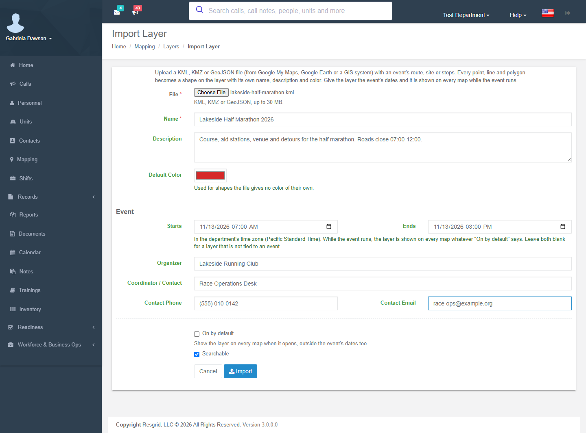

# Mapping Layers

Mapping Layers in Resgrid allow you to add custom geographic data overlays to your department's maps. Layers are defined using GeoJSON data and can represent district boundaries, response zones, hazard areas, water sources, or any other geographic information relevant to your operations. In addition to layers, you can also configure **Points of Interest (POIs)** to mark specific locations on the map.

:::tip Custom Maps for Building Floor Plans
If you need to upload a building floor plan, indoor map, or venue schematic — and draw named polygon zones (e.g., "Room 405a", "Staging Area B") on top of it — use **Custom Maps** instead of a standard layer. Custom Maps support multi-floor images geo-projected onto real-world coordinates, zone-based call locations, pre-plan attachments, and offline mobile caching. See the [Custom Maps](../web-app/custom-maps) documentation.
:::

<AcademyVideo id="07-mapping" />

## Why Mapping Layers Matter

Standard maps show streets and terrain but lack the operational context your department needs. Mapping layers let you overlay your own geographic data — such as first-due response districts, hydrant locations, pre-plan locations, mutual aid boundaries, or flood zones — directly onto the maps your personnel use for dispatch and response. POIs mark important fixed locations that responders need to quickly find during operations.

## Scope

Mapping layers and POIs are department-wide. All layers and POIs are visible on the department map for all personnel. Layers can be toggled on or off by individual users, and some can be configured to show by default.

## Map Layers

### Viewing Layers

Navigate to **Mapping → Layers** to see all configured map layers.

### Creating a Layer

Click **New Layer** to create a new map layer.

| Field            | Required | Description                                                     |
| ---------------- | -------- | --------------------------------------------------------------- |
| Name             | Yes      | A descriptive name for the layer (e.g., "First Due Districts")  |
| Color            | Yes      | The color used to render the layer on the map                   |
| Layer Elements   | Yes      | The shapes, drawn on the map: markers, lines, polygons, rectangles, circles and text labels |
| Is Searchable    | No       | Whether the layer's features are included in map search results |
| Is On By Default | No       | Whether the layer is visible by default when the map loads      |

Draw the shapes with the toolbar on the map: markers, lines, polygons, rectangles, circles and text labels, with tools to cut holes, rotate, move and reshape, and snapping to shapes you already drew. See [Map Layers](../web-app/mapping#map-layers) for each tool.

:::tip Shapes from a GIS system
The layer is stored as a GeoJSON **FeatureCollection** (each shape with its `shape`, `color`, `name` and, for circles and labels, `radius` or `text`). Polygons keep their holes and shapes cut into several parts are stored as multipolygons. To bring in a district or event file from QGIS, Google Earth, Google My Maps or another GIS system, [import it as a layer](#importing-a-layer-kml-kmz-geojson).
:::

### Importing a Layer (KML, KMZ, GeoJSON)

Click **Import Layer** to make a layer from a file: the route of a marathon or cyclocross race, the site plan of a concert or festival, the vendors and stops of a street event over several blocks. Google My Maps and Google Earth export KML/KMZ; most GIS tools export KML or GeoJSON.

| Field | Required | Description |
| ----- | -------- | ----------- |
| File | Yes | A `.kml`, `.kmz`, `.geojson` or `.json` file, up to 30 MB |
| Name | Yes | The layer's name, usually the event's ("City Marathon 2026") |
| Description | No | What the layer is for |
| Default Color | Yes | The color for shapes the file gives no color of their own |
| Starts / Ends | No | The event's dates, in the department's time zone |
| Organizer, Coordinator / Contact, Contact Phone, Contact Email | No | Who runs the event and who to call |
| On by default, Searchable | No | As for a drawn layer |

Every point, line and polygon in the file becomes a shape on the layer:

- Each shape keeps its **name**, its **description** (as plain text: HTML is removed, and KML ExtendedData or extra GeoJSON properties are added as "Field: value" lines), its **color** (the KML style or the GeoJSON `stroke`/`fill`/`marker-color`), and the KML **folder** it was in.
- Multi-geometries are split into single shapes, GPS tracks (`gx:Track`) become lines, and polygons keep their holes.
- Placemarks located only by address (a Google My Maps layer built from a spreadsheet) have no coordinates and are left out; the import says how many. Import those as [POIs](#importing-pois-from-kmlkmz) instead, which looks the addresses up.
- A layer holds up to 20,000 shapes and 250,000 coordinates. Simplify long GPS tracks, or split a large file into several layers.

On the maps, clicking a shape with a name or description opens it.

**Event dates.** A layer with event dates is shown on every map (web, Omni and the older apps) while the event runs, whatever its *On by default* setting, so crews see the course or site without anyone switching it on and off. Before and after the event it follows *On by default*. The Layers page shows each event as *Upcoming*, *Active now* or *Ended*.

### Editing a Layer

Click **Edit Shapes** on a drawn layer to change its name, color, shapes or visibility settings. Click **Details** on any layer to set its event dates, organizer and contact, or to **replace the file**: a new file replaces every shape on the layer and keeps the details. An imported layer has no shape editor, because the editor would overwrite each shape's own name and color with the layer's.

### Deleting a Layer

Delete a layer from the Layers page. It disappears from every map, and everything it held goes with it: its shapes, description, organizer and contact details.

## Points of Interest (POIs)

POIs mark specific locations on the map with a marker icon. They are organized by **POI Type**, which defines the icon and color used for all POIs of that type.

### POI Types

Before creating individual POIs, you must define POI Types to categorize them.

Navigate to **Mapping → POIs** to view all POI types.

#### Creating a POI Type

Click **Add POI Type** to create a new type.

| Field   | Required | Default   | Description                                         |
| ------- | -------- | --------- | --------------------------------------------------- |
| Name    | Yes      | —         | The name of the POI type (e.g., "Hydrant", "AED")   |
| Image   | No       | —         | Custom image for the map marker                     |
| Color   | No       | —         | Color of the map marker                             |
| Marker  | No       | MAP_PIN   | Marker style to use on the map                      |

#### Deleting a POI Type

Deleting a POI type removes all POIs of that type from the map.

### Creating Individual POIs

Navigate to a POI type and click **Add POI** to add a specific location.

| Field     | Required | Description                                    |
| --------- | -------- | ---------------------------------------------- |
| Latitude  | Yes      | GPS latitude in decimal format                 |
| Longitude | Yes      | GPS longitude in decimal format                |
| Note      | No       | A descriptive note about the location          |

### Importing POIs from KML, KMZ or CSV {#importing-pois-from-kmlkmz}

If you have location data in KML or KMZ format (common export formats from Google Earth, Google My Maps, GIS systems, and other mapping tools) or a spreadsheet saved as CSV, you can bulk-import POIs.

On **Mapping → Manage POIs**, click **Import** on the POI type's row.

| Field | Required | Description                                              |
| ----- | -------- | -------------------------------------------------------- |
| File  | Yes      | A KML, KMZ or CSV file. Each entry needs a latitude and longitude, or an address that is located during the import |

**Allowed file types:** .kml, .kmz, .csv

**Maximum file size:** 10 MB

The import runs in the background and reports what it imported, what it located from an address and what it could not place. See [Importing POIs](../web-app/mapping#importing-pois) for the columns it recognizes, address lookup and the import report, and [Removing POIs](../web-app/mapping#removing-pois) to undo an import.

The import process extracts coordinates from the KML file and creates individual POIs for each point. All imported POIs are assigned to the selected POI type.

## How the Map Displays Data

The department map combines multiple data sources into a single view:

| Data Source      | Description                                                |
| ---------------- | ---------------------------------------------------------- |
| Layers           | Custom GeoJSON overlay layers                              |
| POIs             | Points of Interest markers                                 |
| Active Calls     | Markers for currently active dispatch calls                |
| Personnel        | GPS locations of personnel (subject to permissions)        |
| Units            | GPS locations of units                                     |
| Stations         | Station markers with their configured locations            |
| Geofences        | Station district boundaries (configured in Groups)         |

### Map Visibility Controls

Users can toggle the visibility of map data using controls on the map view:

| Control          | Description                                    |
| ---------------- | ---------------------------------------------- |
| Show Calls       | Toggle active call markers                     |
| Show Personnel   | Toggle personnel location markers              |
| Show Units       | Toggle unit location markers                   |
| Show Stations    | Toggle station markers                         |
| Show Districts   | Toggle station geofence/district boundaries    |
| Show POIs        | Toggle point of interest markers               |

## Routing

The mapping module also supports routing:
- **Live Routing** — Route from your current location to a call
- **Station Routing** — Route from a station to a call location

## How Mapping Layers Connect to Other Features

| Feature             | Connection                                                       |
| ------------------- | ---------------------------------------------------------------- |
| Stations/Groups     | Station locations and geofences appear on the map                |
| Dispatch            | Active calls are shown on the map with location markers          |
| Personnel           | Personnel GPS locations appear on the map (permission-dependent) |
| Units               | Unit GPS locations appear on the map                             |
| Department Settings | Map center, zoom level, and location TTL are configured in settings |
| Permissions         | Personnel and unit location visibility is controlled by permissions |

## Common Errors and Resolutions

| Error                                       | Resolution                                                           |
| ------------------------------------------- | -------------------------------------------------------------------- |
| Layer not appearing on map                  | Verify the GeoJSON is a valid FeatureCollection; check "Is On By Default" setting |
| "File type is not importable"               | Only .kml and .kmz files are supported for POI import                |
| "File is too large"                         | POI import files must be smaller than 10 MB                          |
| GeoJSON parse error                         | Validate your GeoJSON at geojson.io before pasting into Resgrid      |
| POIs not showing on map                     | Ensure the POI type is not deleted and POIs have valid coordinates    |
| Map centered on wrong location              | Update department address or Map Center settings in Department Settings |

## See Also

- [Custom Maps](../web-app/custom-maps) — Upload floor plans, schematics, and event maps; draw named polygon zones; use zones as call locations with pre-plan attachments