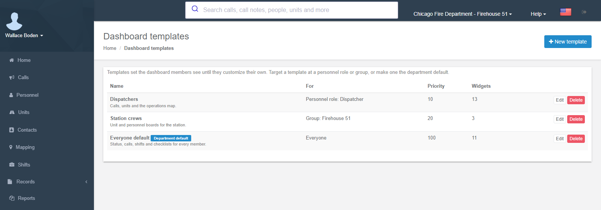
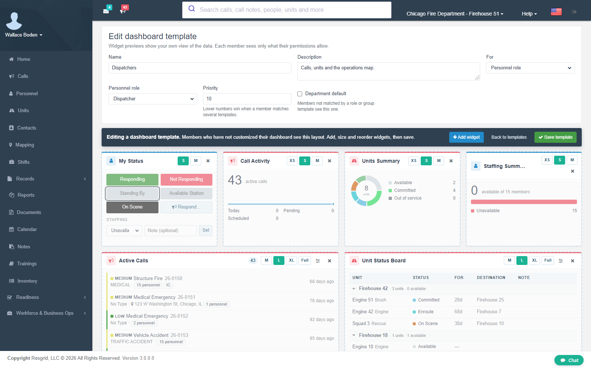

# Dashboard templates

**Dashboard templates** let a department administrator decide what the [home dashboard](dashboard) looks like for members who have not customized their own. Build a board once — the widgets, their sizes, order and settings — and give it to everyone, or to the members holding one personnel role or belonging to one group. Members can still customize; a template only sets their starting point.

:::note Department admins only
Only department administrators can see, create, edit or delete templates. There is no separate permission to delegate it. The page needs the new dashboard (`Dashboard.Modern`) to be useful — while the flag is off, members see the classic dashboard and templates have no effect.
:::

## Where to find it

On the home dashboard: **⋯ (More dashboard options) → Dashboard templates**, or go to `/User/Dashboard/Templates`.

The list shows each template's **Name** (with the **Department default** label on the one marked as default, and its description), **For** (*Everyone*, *Personnel role: …* or *Group: …*), **Priority** and the number of **Widgets**, with **Edit** and **Delete**. With no templates yet, members see the built-in default for their role — see [Built-in defaults](dashboard#built-in-defaults).

## Creating or editing a template

**New template** (or **Edit**) opens the template editor: the dashboard itself, in template mode, with a panel of template details above the board and the bar *Editing a dashboard template.* with **Add widget**, **Back to templates** and **Save template**.

| Field | What to enter |
|---|---|
| **Name** | Required. What admins see in the list (*Dispatchers*, *Station 2 crews*, *Everyone default*). |
| **Description** | Optional note for other admins — who it is for, what it emphasizes. |
| **For** | **Everyone**, **Personnel role** (pick the role) or **Group** (pick the group or station). |
| **Priority** | A number. *Lower numbers win when a member matches several templates.* |
| **Department default** | *Members not matched by a role or group template see this one.* Only one template can be the default; ticking it on another template moves the label. |

Then build the board exactly as a member would ([Customizing](dashboard#customizing-your-dashboard)): add widgets from the gallery, drag them into order, choose sizes and open each widget's **Settings**. A new template starts from the built-in administrator board; remove what the audience does not need.

- *Widget previews show your own view of the data. Each member sees only what their permissions allow.* A widget a member cannot use (no permission, module off, no add-on) is simply left out of their board, and the remaining widgets close up.
- The gallery offers the widgets **you** can use, plus locked add-on cards. Put add-on widgets on a template only when the department holds the add-on.
- A template holds up to 40 widgets; a department can keep up to 25 templates.

**Save template** saves it. *Back to templates* returns to the list without saving.

## How members pick templates up

A member's board is chosen in this order: their **own saved board** → the first matching **role or group template** (lowest priority number, then name) → the **department default** template → the **built-in default** for their audience. See [Department defaults](dashboard#department-defaults).

- **Members who have never customized** see template changes the next time they open or refresh the dashboard — editing a template updates all of them at once. Changing someone's role or group changes which template they get straight away.
- **Members who have customized** keep their own board. They get the current template with **Customize → Reset to department default**, and a new board they add (**⋯ → Add board**) also starts from it.
- **Deleting** a template does not change anyone's saved board; members who were following it see the next matching template or the built-in default (*Delete this template? Members who have not customized their dashboard will see the next matching template or the built-in default.*).
- A template aimed at a personnel role or group that is later deleted matches nobody (the list shows **?** in *For*). Edit it to pick another target, or delete it.

## Audit

Every template save and delete is recorded in Resgrid's **system audit trail** as `DashboardTemplateChanged` (system audit type 47), with the action (*saved* or *deleted*), the template id and name, the department, the admin and their IP address. These entries are kept for Resgrid support and operators; they are not listed on the department's [Audit Logs](security-permissions#audit-logs) page.

## Setup examples

| Department | Templates |
|---|---|
| **Volunteer fire** | One *Everyone* default: My Status, Active Calls, Upcoming Events, Checklists Due, My Certifications, Personnel Status Board. |
| **Career fire / EMS** | *Dispatcher* role (priority 10): Call Activity, Active Calls (XL), Unit Status Board, Operations Map, Awaiting Resources, Pending & Scheduled. *Company officer* role (priority 20): Today's Shifts, Shift Approvals, Checklist Compliance, Unit Status Board filtered to the station. Members: the built-in default. |
| **Combination department** | One template per station *group* with the Unit Status Board and Personnel Status Board filtered to that station, plus an *Everyone* default for members without a station. |
| **SAR / CERT** | *Everyone* default with Staffing Summary, Personnel Status Board (hide unavailable), Weather Alerts, Upcoming Events; a *Team leaders* role template adding Communication Tests and Certification Expiry. |
| **Emergency management** | *EOC* group template: Active Incidents, Incident Desk per desk, Check-in Queue, Incident Costs, Coordination Boards (Incident Back Office add-on). |
| **Private security** | *Site supervisors* role template: Active Calls, Unit Status Board grouped by type, Shift Approvals, Inventory Alerts. |

## Technical reference

| Item | Value |
|---|---|
| Routes | `/User/Dashboard/Templates` (list), `/User/Dashboard/EditTemplate?id=` (editor — `rg-dashboard` with `mode="template"`), `GET /User/Dashboard/TemplateTargets` (roles and groups), `POST /User/Dashboard/SaveTemplate`, `POST /User/Dashboard/DeleteTemplate` |
| Access | Department admins (`IsUserDepartmentAdmin`); everyone else gets 401. Targets are re-checked as belonging to the department on save |
| Table | `DepartmentDashboardTemplates` — `Name`, `Description`, `Audience` (0 everyone, 1 personnel role, 2 group), `TargetId`, `Priority`, `IsDefault` (at most one per department, enforced by a filtered / partial unique index), `LayoutJson`, `SchemaVersion`, created / updated by and on (migration M0307) |
| Resolution | `DashboardService` — user board → role/group template by priority → default template → built-in audience default; templates cached per department and invalidated on every save or delete |
| Audit | `SystemAuditTypes.DashboardTemplateChanged` (47) |
| Flag | `Dashboard.Modern` |
