# Home dashboard

The **home dashboard** is the first page you see after you sign in. It is a board of **widgets** — small live cards such as *Active Calls*, *My Status*, *Unit Status Board*, *Upcoming Events* or *Checklists Due* — that together show what needs your attention across every part of Resgrid. Each member arranges their own board: which widgets, how big, in what order and with which settings. The layout is saved to your account, so it follows you to any browser you sign in on.

A member who never customizes still gets a useful board: your department's default (set by an administrator with [dashboard templates](dashboard-templates)) or, if there is none, a built-in default for your role — member, dispatcher/officer or administrator.

:::info Classic and new dashboards
Resgrid has two home pages. The **new dashboard** described on this page is switched on per department with the `Dashboard.Modern` feature flag. Until it is on — or when a member chooses **Use the classic dashboard** — the home page is the **classic dashboard** (the personnel table with Actions, Staffing Level and Department Info panels), described in [Classic dashboard](#classic-dashboard) below. Both show the same data with the same permissions.
:::

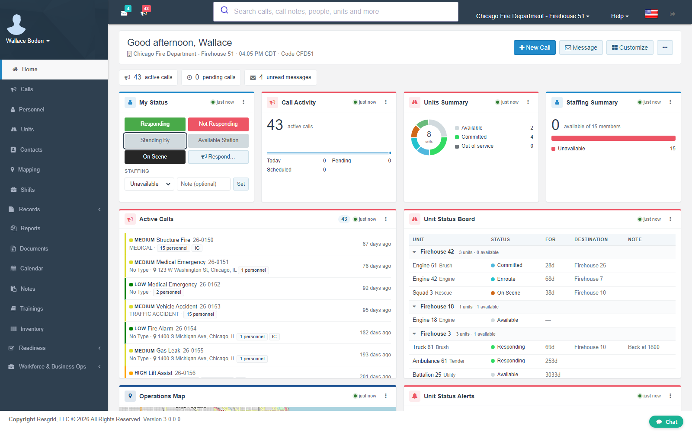

## Where to find it

**Left menu → Home**, `/User/Home/Dashboard` — and the page you land on after signing in. Every member of the department can open it; what each widget shows follows the member's own permissions.

| You are | What you see |
|---|---|
| **Member** | Your board, the widgets your permissions allow, and **Customize**. |
| **Dispatcher / officer** (can create calls, or a group admin) | The same, starting from the dispatcher default board, plus **New Call** in the header and pending / awaiting counters in the pulse strip. |
| **Department admin** | The same, starting from the administrator default board, plus **Dashboard templates** in the header's **⋯** menu and *locked* add-on widgets in the gallery (see [Add-on widgets](#add-on-widgets-and-locked-cards)). |

## Turning it on

The new dashboard ships **off**. It is controlled by the feature flag **`Dashboard.Modern`**, evaluated per department:

- **Hosted Resgrid** — ask Resgrid support to switch it on for your department (or wait for the general rollout).
- **Self-hosted** — the operator turns it on for one department or for everyone with the tools console, for example `dotnet Resgrid.Console.dll --FeatureFlags --Key=Dashboard.Modern --DepartmentId=1 --On`. See [Feature flags](../reference/feature-flags).

While the flag is on:

| Situation | What happens |
|---|---|
| A member opens Home | The new dashboard, unless they chose the classic one. |
| A member wants the old page back | **⋯ (More dashboard options) → Use the classic dashboard**. The choice is saved for them in this department; their new-dashboard boards are kept. |
| A member on the classic page wants to try again | The classic page shows a banner *A new, customizable dashboard is available for your department.* with **Try the new dashboard**. |
| Just once | `/User/Home/Dashboard?classic=true` opens the classic page without changing the saved choice. |
| JavaScript is off, or the dashboard cannot load | The page offers a link to the classic dashboard instead. |

When the flag is off, everyone sees the classic dashboard and nobody's saved boards are lost — they are there again when the flag comes back on.

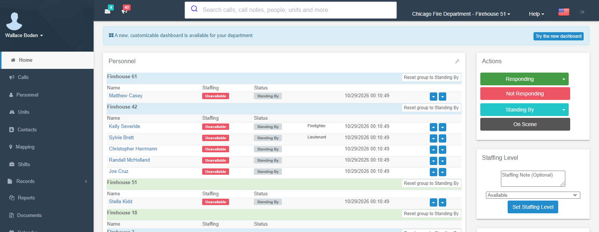

## The page at a glance

| Part | What it does |
|---|---|
| **Header band** | *Good morning / afternoon / evening* with your first name, the department name, the **department clock** (department time zone), the **department ID** and the **department code** (shown as *ID 1234 · Code ABCD*, on every board whatever its widgets). Buttons: **New Call** (if you can create calls), **Message** (if you can send messages), the **Protected data** chip (Advanced Data Protection departments only, see below), **Customize**, and **⋯ More dashboard options** — density, wall display, add board, dashboard templates (department admins) and *Use the classic dashboard*. |
| **Pulse strip** | Department counters, each a link: *active calls* (if you can view calls), *pending calls* and *awaiting resources* (if you can create calls; awaiting only when there are any), *unread messages* (if you can read messages). Hidden on very narrow screens. |
| **Admin Assist prompt** | Department admins with unfinished setup see the same [Setup Wizard prompt](help-setup) as before, above the widgets. |
| **Board tabs** | When you have more than one board, tabs to switch between them. |
| **Widgets** | Each card has a coloured top bar for its category, an icon, its title (using your department's [terminology](department-settings#terminology) — *Apparatus* instead of *Units*, for example), how long ago it updated, a **live** marker when it updates in real time, and a menu: **Refresh**, **Settings**, **Open module**, size, **Remove**. |

Widget states you may see:

| State | Meaning |
|---|---|
| Grey placeholder | Loading for the first time. |
| *Nothing to show right now* (or a widget-specific message) | The widget has no data — for example no active calls. |
| *Couldn't load …* with **Retry** | That one widget failed; the rest of the board is unaffected. |
| Amber dot beside the age, *reconnecting* | Live updates dropped for a moment; the widget refreshes on a timer until they return. |
| *Protected data. Verify to view.* | The widget needs [Advanced Data Protection](#advanced-data-protection-on-the-dashboard) verification before it can show anything. |

## Customizing your dashboard

Press **Customize**. The board switches to edit mode: dashed outlines, drag handles, size chips and a remove button on every widget, and a bar at the top with **Add widget**, **Reset to department default**, **Cancel** and **Done**.

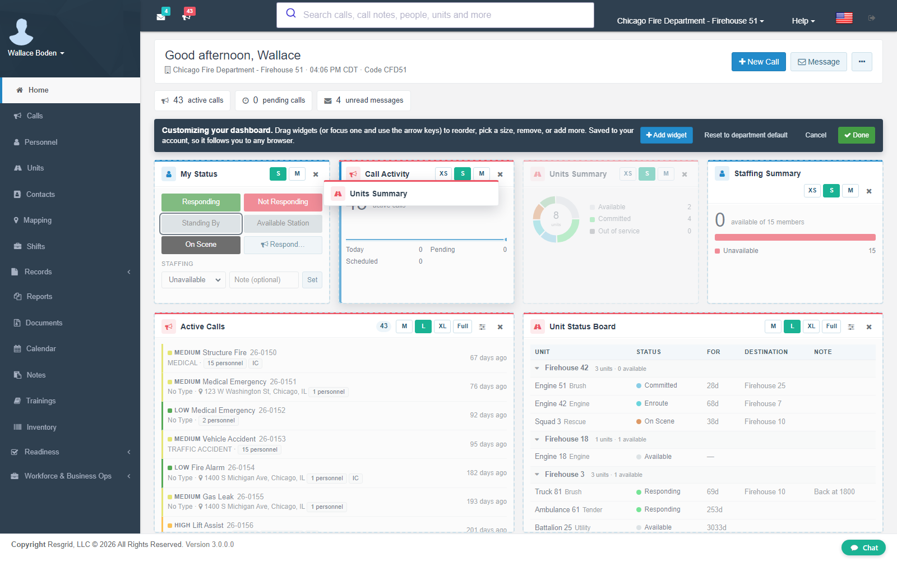

| To | Do this |
|---|---|
| **Move** a widget | Drag it by its handle and drop it before or after another widget. On a touch screen, press and hold, then drag. With the keyboard, Tab to the widget and use the **arrow keys**. |
| **Resize** it | Pick a size chip, or press **+** / **−** on a focused widget. Only the sizes that suit the widget are offered. |
| **Remove** it | The remove button, or **Delete** on a focused widget. **Undo** in the notice puts it back. |
| **Add** widgets | **Add widget** opens the gallery (below). |
| **Change its settings** | Widget menu → **Settings** (see below). |
| **Start over** | **Reset to department default** replaces the board with your department's default — the template that applies to you, or the built-in default. |
| **Keep your changes** | **Done**. *Dashboard saved. It follows you to any browser you sign in on.* |
| **Throw them away** | **Cancel** puts back the board you had before you pressed Customize. |

### Sizes

The board is a 12-column grid that packs widgets tightly, so one layout works from a wall screen to a phone.

| Size | Width on a wide screen | Height | Typical use |
|---|---|---|---|
| **XS** | 3 of 12 columns | 1 row | One number |
| **S** | 3 columns | 2 rows | A number with a trend, My Status |
| **M** | 4 columns | 2 rows | A short list |
| **L** | 6 columns | 3 rows | A list, table or chart |
| **XL** | 8 columns | 3 rows | A map, a wide table |
| **Full** | 12 columns | 4 rows | Personnel Status Board |

On narrower windows the grid drops to 8, then 6 columns (small sizes take half the width, large ones the full width); on a phone every widget is one full-width column in board order.

### The widget gallery

**Add widget** opens a drawer with every widget you are allowed to use, grouped by **category** — Operations, Personnel, Map & weather, Communications, Planning, Readiness, Records, Business Ops, Incident Back Office, Intelligence, Administration — with a tab for each category and **All**, and a **search** box. Each card shows the widget's description and **Add** (or **Added** if it is already on the board). A few widgets *can add more than one* — two Unit Status Boards filtered to different stations, for example, or several personal notes.

A board holds up to **40 widgets**.

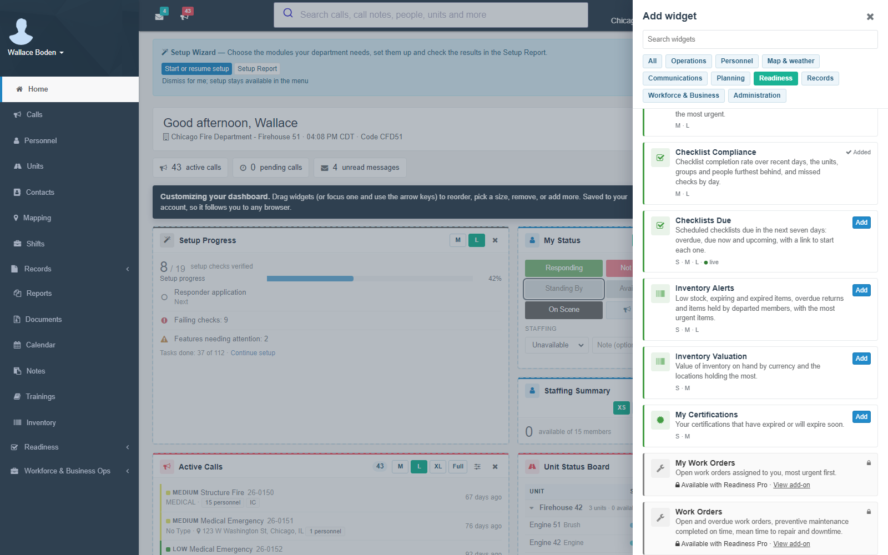

### Widget settings

Widget menu → **Settings** opens the widget's own options — for example the maximum number of rows, which priorities or unit types to include, a station or group filter, how many days ahead, 12- or 24-hour time, or which map layers to show. Lists that let you pick several items include everything when nothing is picked. The dialog also tells you whether the widget updates live or how often it refreshes. **Apply** saves the settings with your board.

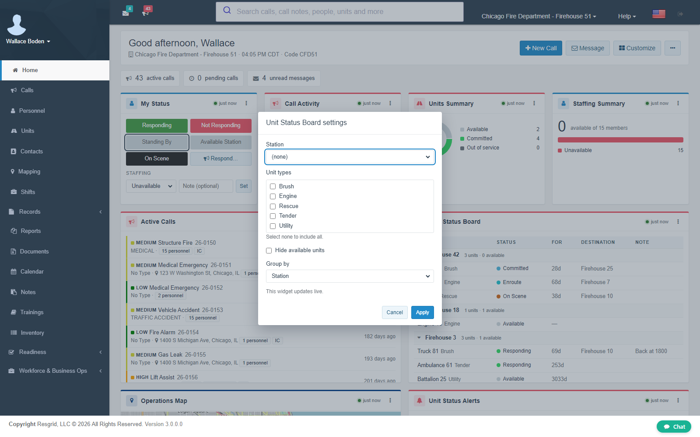

### Density

**⋯ → Density**: **Comfortable** (default) or **Compact** (shorter rows and tighter lists, more on screen). Density is saved with the board.

### Boards

You can keep up to **5 boards** — for example *Home*, *Incident*, *Admin*. **⋯ → Add board** creates one, starting from your department default; tabs above the widgets switch between them. In Customize mode the pencil renames the current board and the bin deletes it (the *Home* board cannot be deleted). Each board has its own widgets, sizes, settings and density.

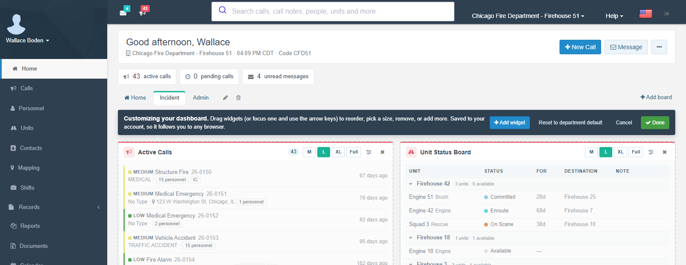

### Wall display

**⋯ → Wall display** turns the page into a station screen: the sidebar, top bar and footer disappear, text is larger, and widgets keep refreshing while the page is visible. **Exit wall display** returns to normal. Wall display does not change your session or idle time-out, and it never shows protected data. For an unattended station display that stays signed in, use the [Big Board](../apps/big-board).

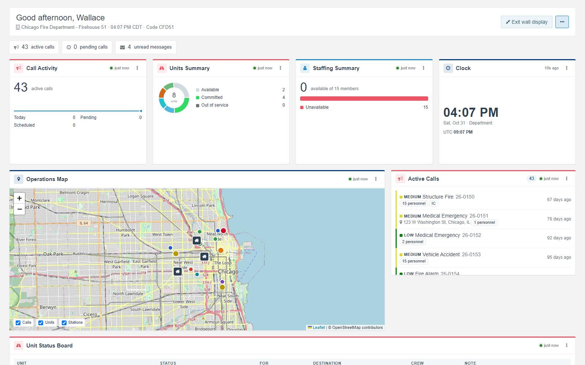

## How saving works

- Your boards are stored **on the server, per member and per department**. Sign in on another computer, tablet or browser and the same boards appear. If you belong to several departments, each department has its own boards.
- Until you save for the first time you have no saved board: you see your department's default, and if an administrator changes that template you see the change too. Your first save makes the board yours; later template changes no longer touch it (use **Reset to department default** to pick them up).
- If the same board is changed in another window while you are editing, a banner says *Your dashboard was changed in another window.* — choose **Keep mine** or **Load latest**. A dashboard left open in another tab picks up a newer saved layout when you return to it.
- Widgets you lose access to — a permission change, a module switched off, an add-on that lapsed — stay in your layout but are not shown. When access comes back they reappear where you left them.

## Department defaults

Which board a member sees before they customize is decided in this order:

1. **Their own saved board**, if they have saved one.
2. The first **role or group template** that matches them — a template for one of their [personnel roles](personnel) or for their [group](groups-stations). When several match, the lowest **priority** number wins (then the name).
3. The department's **default template**, if an administrator has marked one.
4. The **built-in default** for their audience.

Templates are created by department admins: see [Dashboard templates](dashboard-templates).

### Built-in defaults

The audience is worked out from permissions: **Administrator** = department admin; **Dispatcher / Officer** = can create calls, or is a group admin; **Member** = everyone else. Every widget the member cannot use is simply left out and the board closes the gap, so the same default works for departments with and without each module.

| # | Member | Dispatcher / Officer | Administrator |
|---|---|---|---|
| 1 | My Status (S) | My Status (S) | Setup Progress (L) |
| 2 | Inbox (S) | Call Activity (S) | My Status (S) |
| 3 | My Shifts & Trades (S) | Units Summary (S) | Call Activity (S) |
| 4 | Checklists Due (S) | Staffing Summary (S) | Staffing Summary (XS) |
| 5 | Active Calls (L) | Active Calls (L) | Units Summary (XS) |
| 6 | Upcoming Events (L) | Unit Status Board (L) | Active Calls (L) |
| 7 | My Trainings (M) | Operations Map (L) | Unit Status Board (L) |
| 8 | My Certifications (M) | Unit Status Alerts (L) | Certification Expiry (M) |
| 9 | Chat (M) | Awaiting Resources (M) | Checklist Compliance (M) |
| 10 | Personnel Status Board (Full) | Pending & Scheduled (M) | Plan & Add-ons (M) |
| 11 | | Weather Alerts (M) | Workflow Health (M) |
| 12 | | Personnel Status Board (Full) | Security Posture (M) |
| 13 | | | Records Overview (M) |
| 14 | | | Work Orders (M) |
| 15 | | | Accounts Receivable (M) |
| 16 | | | Active Incidents (M) |
| 17 | | | Personnel Status Board (Full) |

Each default is laid out in rows that fill the full width (four S cards, three M, two L, or an L beside two S over two XS), so a department that has every module sees no gaps. Add-on widgets come last (the Administrator board ends with Work Orders, Accounts Receivable and Active Incidents), so a department without an add-on only loses cards at the end. Dispatchers see their unread message count in the header strip rather than an Inbox card.

Nothing from the classic page is lost by default: every audience keeps **My Status** (the old Actions and Staffing Level panels) and the **Personnel Status Board** (the old personnel table). The old *Department Info* box's department ID and code are always in the header band; the *Department Info* widget (which adds the text-to-call number) is optional.

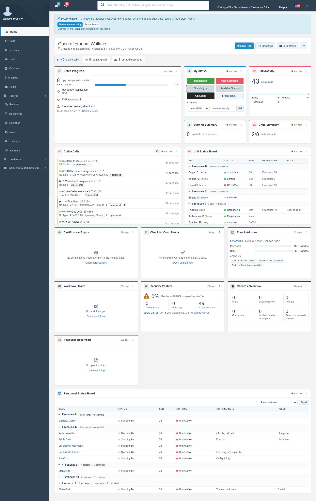

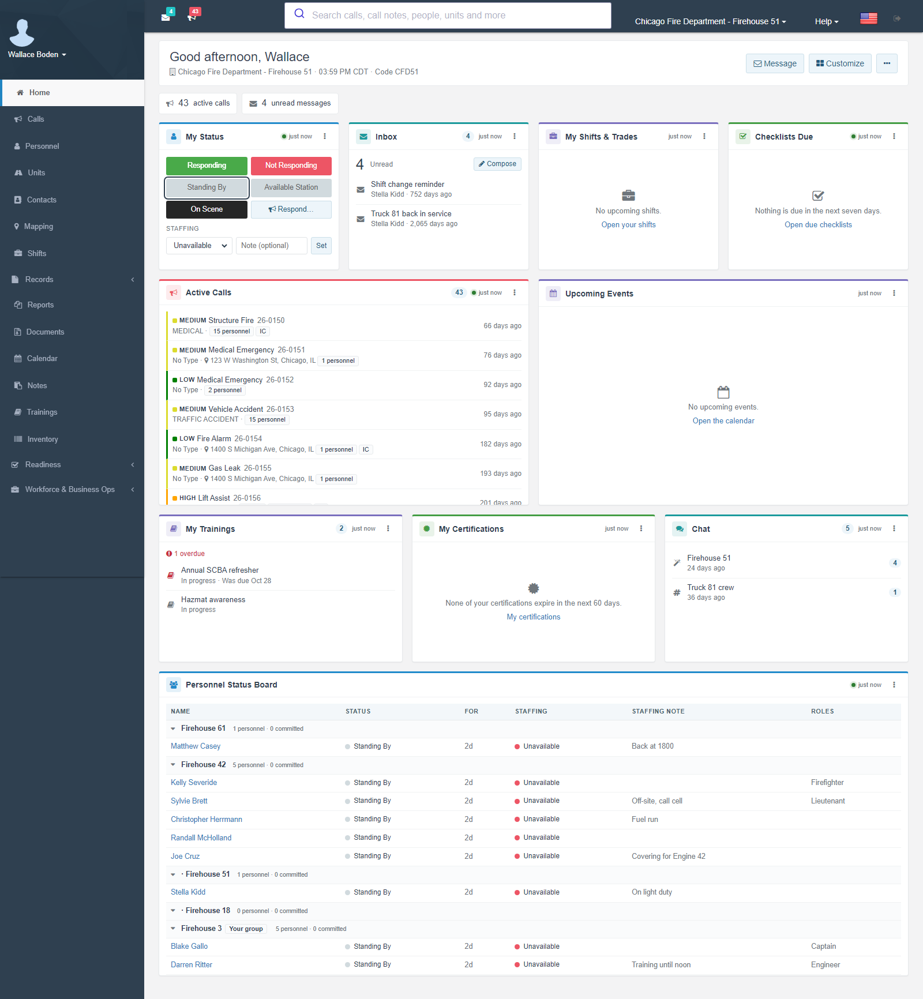

## Widget catalog

Every widget shows only what its viewer could see on the module page itself — the same permissions, module switches, group and dispatch-area limits, personnel visibility rules, and the same rules for disabled, hidden and deleted members and deleted units. *Who can see it* lists what must be true for the widget to appear in your gallery; a widget whose module is switched off under **Department Settings → Module Settings** is never offered. *Updates* is **Live** for widgets that refresh the moment something changes (they also refresh on a timer as a fallback); the others refresh on the interval shown while the page is visible.

### Operations

| Widget | What it shows | Who can see it | Updates |
|---|---|---|---|
| **Active Calls** | Dispatched active calls in your dispatch area, newest first, with priority, units and personnel sent, and incident command. Settings: rows, priorities, group. | Members who can view calls | Live |
| **Call Activity** | Active, today, pending, scheduled and awaiting-resources call counts with the last seven days. | Members who can view calls | Live |
| **Pending & Scheduled** | Calls saved but not dispatched yet and scheduled calls waiting for their dispatch time. Settings: rows, show pending, scheduled or both. | Members who can view calls | Live |
| **Awaiting Resources** | Active calls still waiting for a run card resource, what is missing and the units available now. | Members who can create calls, when [run cards](run-cards) and run card conditions are on | Live |
| **My Check-in Timers** | Your check-in timers on the calls you were dispatched to, with time left until your next check-in. | Members who can view calls | Live |
| **Call Volume** | Calls per day by type and priority, with the median response time. Settings: 7, 30 or 90 days. | Members who can view reports, Reports module on | Every 15 min |
| **Active Incident Commands** | Open incident commands with their call, incident commander and assigned resources. | Members who can view incident command | Live |
| **Unit Status Board** | Units by station or type with their status, time in status, destination, crew and status note. Settings: station, unit types, hide available, group by. *Can add more than one.* | Members who can view units | Live |
| **Units Summary** | How many units are available, committed or out of service. | Members who can view units | Live |
| **Unit Status Alerts** | Units that have been in a status longer than the department's status timers allow. | Members who can view units | Live |
| **Route Deviations** | Routes in progress and route deviations not yet acknowledged. | Members who can view [routes](routes) | Every 2 min |

### Personnel

| Widget | What it shows | Who can see it | Updates |
|---|---|---|---|
| **My Status** | Set your status and staffing level, or respond to a call or station — the classic page's Actions and Staffing Level panels. | Everyone | Live |
| **Personnel Status Board** | Everyone's status and staffing by group, with staffing notes — the classic personnel table. Settings: groups, hide unavailable, sort by department order, name or status. | Everyone (rows follow the personnel visibility rules) | Live |
| **Personnel Status Summary** | How many people are responding, on scene, available or unavailable. | Members who can view personnel | Live |
| **Staffing Summary** | Staffing levels across the department and by group, with who is on duty. | Members who can view personnel | Live |

### Map & weather

| Widget | What it shows | Who can see it | Updates |
|---|---|---|---|
| **Operations Map** | Live map of active calls, units, personnel and stations, with points of interest and map layers. Settings: which layers, zoom. | Members who can view calls, Mapping module on | Live |
| **Saved Visualization** | One of your saved [map visualizations](mapping), such as a call heat map or coverage overlay. | Members who can view calls, Mapping module on | Every 15 min |
| **Weather** | Current conditions and the next few days' outlook for your department. Settings: imperial or metric. | Everyone, when the installation has a weather service key | Every 15 min |
| **Weather Alerts** | Active [weather alerts](weather-alerts) for your department's areas, most severe first. Settings: minimum severity, items. | Members who can view weather alerts | Every 5 min |
| **Clock** | Department time, UTC and your local time. Settings: 12 or 24 hour, seconds, which clocks. | Everyone | Every second |

### Communications

| Widget | What it shows | Who can see it | Updates |
|---|---|---|---|
| **Inbox** | Your unread messages, newest first. | Members who can read messages, Messaging module on | Every 2 min |
| **Chat** | Chat channels with unread messages and urgent messages waiting for your acknowledgement. | Members who can use [chat](chat), when chat is on | Live |
| **Moderation Queue** | Open chat flags waiting for review. | Department admins, when chat is on | Every 5 min |
| **Communication Tests** | Recent [communication test](communication-tests) runs with delivery and response rates by channel. | Department and group admins | Every 15 min |
| **Push-To-Talk** | Your department's Push-To-Talk channels and how many seats are in use. | Members who can use voice, with the **PTT** add-on | Every 5 min |

### Planning

| Widget | What it shows | Who can see it | Updates |
|---|---|---|---|
| **Upcoming Events** | The next days of your department calendar, with your sign-up and check-in status. Settings: days, event types, items. | Members who can view the calendar, Calendar module on | Every 5 min |
| **Today's Shifts** | Today's shifts with staffing against requirements and who is on duty by group. | Members who can view shifts, Shifts module on | Every 5 min |
| **My Shifts & Trades** | Your upcoming shifts and trade requests sent to you. | Members who can view shifts, Shifts module on | Every 5 min |
| **Shift Approvals** | Shift signups and trades waiting for your approval. | Members who can view shifts; only shift approvers see items | Every 5 min |
| **Staffing Coverage** | The coming days' shift staffing, approved or automatic, with unstaffed shifts highlighted. | Members who can view shifts; figures for shift supervisors only | Every 15 min |
| **My Trainings** | Trainings assigned to you that you haven't completed yet. | Members who can view trainings, Training module on | Every 15 min |
| **Recent Documents** | The newest documents in your department's library. Settings: category, items. | Members who can view documents, Documents module on | Every 15 min |
| **Department Notes** | The newest department notes. Settings: category, items, hide expired. | Everyone, Notes module on | Every 5 min |
| **Pre-plans Due for Review** | Contacts whose pre-plan review date has passed. | Members who can view contacts | Every 15 min |
| **Quick Links** | Departments sharing data with yours, plus your own links. | Everyone | Hourly |
| **My Note** | A personal note only you can see. *Can add more than one.* | Everyone | — |

### Readiness

| Widget | What it shows | Who can see it | Updates |
|---|---|---|---|
| **Checklists Due** | Scheduled checklists due in the next seven days: overdue, due now and upcoming, with a link to start each one. | Everyone, when [Checklists](checklists) is on | Live |
| **Checklist Compliance** | Checklist completion rate over recent days, the units, groups and people furthest behind, and missed checks by day. | Members who can view checklist results, Checklists on | Every 15 min |
| **Work Orders** | Open and overdue work orders, preventive maintenance completed on time, mean time to repair and downtime. | Members who can view work orders, with the **Readiness Pro** add-on | Every 5 min |
| **My Work Orders** | Open work orders assigned to you, most urgent first. | Everyone, with the **Readiness Pro** add-on | Every 5 min |
| **Inventory Alerts** | Low stock, expiring and expired items, overdue returns and items held by departed members, with the most urgent items. | Everyone, Inventory module on | Every 15 min |
| **Inventory Valuation** | Value of inventory on hand by currency and the locations holding the most. | Department admins, Inventory module on | Hourly |
| **Certification Expiry** | Expired, expiring, suspended and pending-verification certifications across the department, with the most urgent. | Department admins and members who can view certifications | Hourly |
| **My Certifications** | Your certifications that have expired or will expire soon. | Everyone | Hourly |

### Records

All Records widgets need the [Records](records/overview) module switched on and activated, and permission to view records ("Records users" below); some need more.

| Widget | What it shows | Who can see it | Updates |
|---|---|---|---|
| **Records Overview** | Drafts, records awaiting review, returned records, overdue obligations and open public records requests. | Records users | Every 5 min |
| **My Records Work** | Unfinished records you own and record work assigned to you. | Records users | Every 5 min |
| **NERIS Reports** | Incident reports by filing stage: incomplete, awaiting review, submitted, accepted and rejected. | Records users, when NERIS filing is set up | Every 15 min |
| **Quality Review** | Records waiting for quality review, yours first. | Members who can review records, Quality Review on | Every 5 min |
| **Prevention** | Occupancy reviews, inspections, violations, hydrants, permits, community risk reduction and investigations for the prevention modules you use. | Records users, when any prevention module is on | Every 15 min |
| **Hydrants** | Hydrants out of service and due for testing, with the out-of-service hydrants on a map. | Records users, Hydrants on | Hourly |
| **Community Risk Reduction** | Community risk reduction activities and smoke, CO and combination alarms installed this year, and open alarm requests. | Records users, CRR on | Hourly |
| **My Investigations** | Open investigation cases you are working on, by case number and status. | Members who can view restricted records, Investigations on | Every 15 min |
| **Records KPIs** | Overdue records, median time to finalize and review, return rate and records by month. | Records users, Analytics on | Hourly |
| **Legal Holds** | Active preservation holds on records and the newest placed. | Members who can manage legal holds | Hourly |
| **Deployment Reports** | Open deployment records from external resource orders. | Records users | Every 15 min |
| **Recent Logs** | Logs written in recent days, by type, with the newest entries. | Departments still on [Logs](logs) (Records not activated), members who can view logs | Every 15 min |

### Business Ops

| Widget | What it shows | Who can see it | Updates |
|---|---|---|---|
| **Deployments** | Open deployments, the ones you are rostered on first, with status and days deployed. Managers see every deployment; members the ones they are on. | Everyone, when [Deployments](business-ops/deployment-finance) is on (free) | Every 15 min |
| **Time Reports** | Daily time reports waiting for approval, and approved reports not yet billed. | Members who can approve time reports, Deployments on (free) | Every 15 min |
| **Accounts Receivable** | Open invoice balances by age, overdue totals by currency and drafts not yet sent. | Members who can view invoicing, when [Invoicing](business-ops/invoicing) is on; read-only figures after the **Business Ops** add-on lapses | Every 15 min |
| **Online Payments** | Whether customers can pay invoices online right now, and the state of the connected payment account. | Department admins who can manage invoicing, when online payments are on | Every 15 min |
| **Bids** | Bids by status, and submitted bids about to expire. | Members who can view bids, with **Business Ops** | Hourly |
| **Contracts** | Active service contracts, those ending soon, and compliance documents that have expired or are about to. | Members who can view contracts, with **Business Ops** | Hourly |
| **Cal OES MARS** | Cal OES MARS items waiting for action, oldest first, and the agency readiness check for managers. | Everyone, with **Business Ops** and Cal OES MARS on | Every 15 min |
| **Field Costing** | The latest field cost runs with their loaded cost, contribution margin and missing inputs. | Members who can view internal costs, with **Business Ops** | Hourly |
| **Pay Data Completeness** | How complete California pay data reporting is for the last reporting year: responses collected, open runs and exceptions. | Members who can view pay data reporting, with **Business Ops** and Advanced Data Protection enabled | Hourly |

### Incident Back Office

All need the [Incident Back Office](incident-back-office/overview) module switched on and permission to view it ("Incident Back Office users" below). After the **Incident Back Office** add-on lapses the figures stay visible read-only.

| Widget | What it shows | Who can see it | Updates |
|---|---|---|---|
| **Active Incidents** | Open incidents with their current operational period and the position you hold. | Incident Back Office users | Every 5 min |
| **Incident Desk** | One incident's operations, logistics or finance desk at a glance, with arrivals and departures by time window. Settings: incident (or the most recent), desk. *Can add more than one.* | Incident Back Office users | Every 5 min |
| **Incident Resources** | An incident's resources by kind and support status. | Incident Back Office users | Every 5 min |
| **Check-in Queue** | People waiting to be enrolled on an incident, and enrolled participants not yet checked in. | Members who can view incident participants | Every 2 min |
| **Incident Costs** | An incident's cost to date against its budget, the daily burn rate and the forecast at completion. | Members who can view incident costs, business desk on | Every 15 min |
| **Coordination Boards** | Your coordination boards with stale lanes and active partner shares, most recently updated first. | Members who can view coordination boards, coordination on | Every 5 min |

### Intelligence

| Widget | What it shows | Who can see it | Updates |
|---|---|---|---|
| **Assistant** | Ask the Resgrid assistant about your department without leaving the dashboard. | Everyone, when the Assistant and chat are on, with the **Enhanced AI** add-on | — |
| **AI Dispatch Triage** | Calls created from inbound email and text messages that still need a dispatcher's review, with the AI's confidence and age. | Members who can create calls, when AI dispatch is on, with **Enhanced AI** | Every minute |

### Administration

| Widget | What it shows | Who can see it | Updates |
|---|---|---|---|
| **Department Info** | Your department's ID, code and text-to-call number. | Everyone | Hourly |
| **Setup Progress** | Admin Assist setup progress: checks verified, setup tasks done and the next one to do. | Department admins, when [Admin Assist](help-setup) is available | Hourly |
| **Plan & Add-ons** | Your subscription plan, how much of its limits you use, the add-ons you hold or can add, and the renewal date. Billing figures for the managing member only. | Department admins | Hourly |
| **Workflow Health** | Workflow runs over the last day: pending, running and failed runs, and the workflows failing most. | Members who can view workflows and workflow runs | Every 5 min |
| **Data Protection** | Advanced Data Protection state, the step-up window and migration progress. | Department admins, where Advanced Data Protection is offered | Hourly |
| **Import & Migration** | Department Import progress: open workspaces, data sets needing review and running imports. | Department admins, when [Import & Migration](import-and-migration/overview) is on | Every 5 min |
| **Security Posture** | How many members use an authenticator or passkey, single sign-on and SCIM state, and active sessions. | Department admins | Hourly |

## Add-on widgets and locked cards

Widgets for paid add-ons appear only when the add-on is active (Incident Back Office and invoicing widgets also keep showing read-only figures after a lapse). **Members never see upsell**: a widget for an add-on your department does not have is simply not in their gallery.

**Department admins** see those widgets in the gallery as **locked** cards — greyed, with a lock, *Available with …* and **View add-on**, which opens the add-on's billing page:

| Add-on | Its widgets | View add-on opens |
|---|---|---|
| **PTT** | Push-To-Talk | Subscription & Billing |
| **Advanced Data Protection** | Data Protection | Subscription & Billing |
| **Readiness Pro** | Work Orders, My Work Orders | Readiness Pro billing |
| **Business Ops** | Accounts Receivable, Online Payments, Bids, Contracts, Cal OES MARS, Field Costing, Pay Data Completeness | Business Ops billing |
| **Enhanced AI** | Assistant, AI Dispatch Triage | Enhanced AI billing |
| **Incident Back Office** | Active Incidents, Incident Desk, Incident Resources, Check-in Queue, Incident Costs, Coordination Boards | Incident Back Office billing |

A locked card cannot be added. Only add-ons your installation offers are shown. See [Subscription & Billing](subscription-billing).

## Advanced Data Protection on the dashboard

In most departments nothing changes. In a department enrolled in [Advanced Data Protection](data-protection), the dashboard follows the same rules as the rest of Resgrid:

- **Almost everything is unaffected.** Counts, statuses, call numbers and types, unit and personnel names, map pins, dates and titles are operational data and are never protected.
- **Four widgets can carry a protected value**, and it is **hidden by default**: the message subject in **Inbox** (*Protected message*; sender, age and the unread count still show), the status note in **Unit Status Board** and the staffing note in **Personnel Status Board** (a shield where a note exists), and a person contact's name in **Pre-plans Due for Review** (the company name shows when there is one). **Workflow Health** never shows run error details on the dashboard.
- **Verify to reveal.** When a widget on your board has a protected value your permissions cover, the header shows **Protected data hidden — Verify to reveal**. It opens the same verification as every other page (authenticator code, passkey, Responder approval or your single sign-on provider). After verifying, those widgets reload with the values and a **Revealed** badge; every reveal is recorded in the department's audit log. Reveal covers the whole page — there is no per-widget reveal — and ends when the department's verification window expires (15 minutes by default) or when you press **Conceal**.
- **Your role decides what you can reveal.** Message subjects and status / staffing notes need **View protected operational data** — by default department and group admins. Contact names need **View protected contact data** — by default department admins. A value your role does not cover shows a plain shield with *Your role can't view this*, before and after verifying; if nothing on your board is revealable you are never asked to verify.
- **Members and their own messages.** With the default permissions a regular member cannot read the subjects of their own messages in the Inbox widget, even after verifying — exactly as on the Inbox page. Administrators who want members to read them can grant *View protected operational data* to more roles under [Security & Permissions](security-permissions).
- **Wall display never reveals.** Entering wall display conceals anything revealed and hides the Verify chip.
- While revealed, those widgets refresh on live events or **Refresh** only, at most every 2 minutes. A widget that needs verification before it can show anything at all reads *Protected data. Verify to view.*

<!-- screenshot: dashboard/protected.png — ADP-enforced department, department admin, before verifying: header chip "Protected data hidden — Verify to reveal"; Inbox widget showing "Protected message" in place of subjects; Personnel Status Board with shield markers in the staffing note column; crop to the header and those two widgets. (Optional second capture after Verify: the same widgets with the "Revealed" badge and the Conceal button.) -->

## Live updates and refresh

The dashboard opens one live connection for the whole page. Widgets marked **live** refresh within a couple of seconds of a change — new, updated or closed calls; unit and personnel status; staffing; unit crew changes; unit status alerts; run card requirements; incident command; checklists; chat — and a burst of changes (twenty units changing status at once) is combined into one refresh. If the connection drops, widgets show the amber *reconnecting* marker and fall back to their timer, and everything refreshes when it reconnects. Widgets without live events refresh on their interval while the page is visible; a hidden browser tab pauses refreshing and catches up when you come back. **Refresh** in a widget's menu reloads it now.

## Phones and tablets

The dashboard works in a phone browser: one column in board order, the pulse strip hidden, and drag by press-and-hold in Customize mode. The mobile apps have their own home screens; see [Apps](../apps/responder).

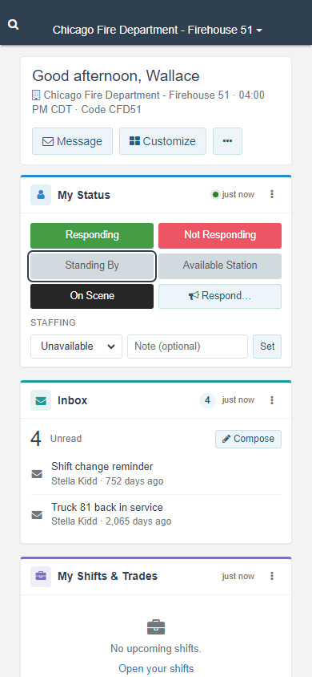

## Accessibility and languages

- Everything can be done with the keyboard: Tab to a widget, then arrows to move it, **+** / **−** to resize and **Delete** to remove in Customize mode; focus is always visible and screen readers announce moves and changes.
- Colour carries meaning only (status, severity, trend), and status colours are your department's own [custom status](custom-statuses) colours.
- Animations respect your device's *reduce motion* setting.
- The dashboard is translated into every Resgrid language. In **Arabic** the whole board is mirrored right-to-left, including the arrow keys used to move widgets.
- Printing gives a single-column copy without menus.

## Classic dashboard

The classic dashboard is the home page when `Dashboard.Modern` is off, or when a member chooses **Use the classic dashboard**. It is a live roster with everyone's status and staffing, your own quick-action buttons, and the department's vital signs.

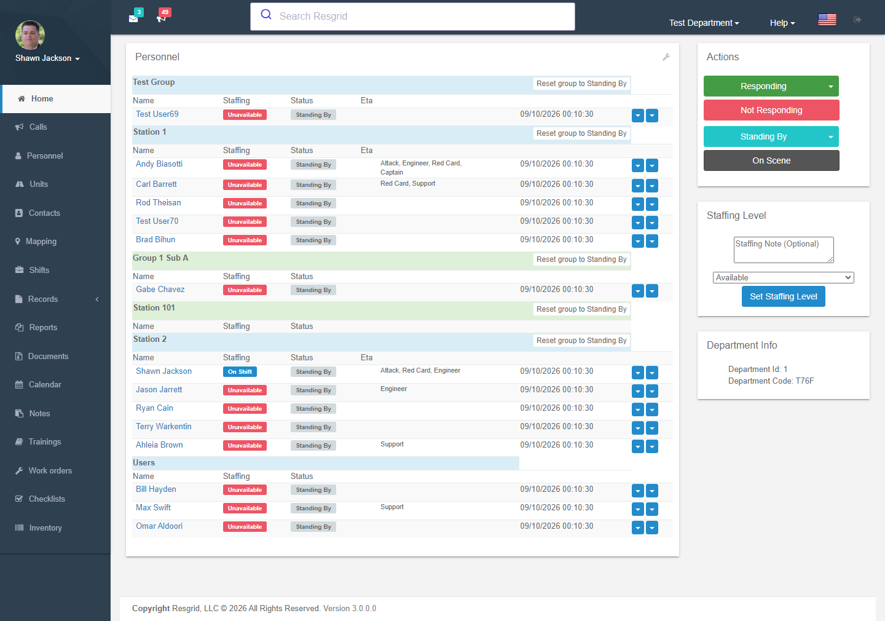

| Panel | What it shows |
|---|---|
| **Personnel** | Every member you are allowed to see, grouped by station/group (or sorted by name — *Department Settings → Sorting*). Each row: name, **staffing** (Available / Unavailable / On shift …), **status** (Standing by / Responding / On scene …), ETA, roles, the time of the last change, and two dropdowns to change the person's status or staffing. **Reset group to Standing By** clears a group after an incident. |
| **Actions** | Your own status buttons — Responding, Not responding, Standing by, On scene, or your department's custom statuses. Statuses that need a destination (a station or an active call) open a picker. |
| **Staffing level** | Set your own staffing with an optional note. |
| **Department info** | Department ID and code (members need the code to join from the apps), text-to-call number, plan warnings. |
| **Top bar** | Unread messages and active-call counts; the active-calls icon lists the top calls with quick links. |

Everything updates in real time through the eventing hub — no refresh needed. On the new dashboard the same pieces are the **Personnel Status Board**, **My Status** and **Department Info** widgets.

### Personnel status vs staffing

| | Status ("what am I doing right now") | Staffing ("can I be counted on") |
|---|---|---|
| Defaults | Standing By, Not Responding, Responding, On Scene, Available Station, Responding to Station, Responding to Scene | Available, Delayed, Unavailable, Committed, On Shift |
| Custom | [Custom personnel statuses](custom-statuses) — colour, text, whether a destination is required, whether it counts as *responding* | [Custom staffing levels](custom-statuses) |
| Changed by | The member (apps, web, text, Assistant), officers with permission, dispatch (auto-set on shift dispatch), scheduled status changes | The member, officers, [staffing schedules](profile-account#staffing-schedules), the daily **staffing reset** in Department Settings |

Tip: **staffing** feeds availability counts and low-availability [notifications](notifications); **status** feeds the call page and the Big Board.

### Editing profiles from the dashboard

Clicking a name opens the person; administrators can **edit the profile** (name, email, phone numbers and carrier, group and roles, addresses, language, time zone, notification options, department admin / disabled / hidden flags). See [Personnel](personnel) and [Profile & Account](profile-account).

### Tutorial and setup report

First-time administrators see a **dashboard tutorial** overlay on the classic page (the new dashboard shows a short *Welcome to your new dashboard* note instead); **Help → Setup report** lists what is still unconfigured (no units, no stations, unverified contacts …).

## Setup examples

| Department | Suggested setup |
|---|---|
| **Volunteer fire / EMS** | Turn the new dashboard on and keep the built-in defaults at first. Then publish an *Everyone* default with My Status, Active Calls, Upcoming Events, Checklists Due and the Personnel Status Board; sort personnel by group and enable the daily staffing reset so stale *Unavailable* flags clear. |
| **Career fire / EMS** | A *Dispatcher* role template with Call Activity, Active Calls (XL), Unit Status Board, Operations Map, Awaiting Resources and Unit Status Alerts; a *Company officer* template adding Today's Shifts, Shift Approvals and Checklist Compliance; members keep the built-in Member board. |
| **Dispatch centre / multi-agency** | A wall-display board per console: Active Calls (Full), one Unit Status Board per station, Operations Map (XL), Pending & Scheduled. Keep the [Big Board](../apps/big-board) for screens that must stay signed in unattended. |
| **SAR / CERT** | Staffing is the key signal: a default with My Status, Staffing Summary, Personnel Status Board (hide unavailable), Upcoming Events, Weather Alerts, My Certifications and Inbox. |
| **Emergency management / EOC** | An *EOC staff* group template with Active Incidents, Incident Desk (one per desk), Check-in Queue, Incident Costs, Coordination Boards, Weather Alerts and Weather. |
| **Records-heavy / prevention bureau** | A *Records* role template with Records Overview, My Records Work, Quality Review, NERIS Reports, Prevention and Hydrants. |
| **Security / business** | Custom statuses such as *On patrol*, *At post*, *Break*; a default with My Status, Active Calls, Unit Status Board grouped by type and Inventory Alerts, plus Accounts Receivable on the managers' template. |

## Technical reference

| Item | Value |
|---|---|
| Routes | `/User/Home/Dashboard` (`?classic=true` once, `?firstRun=true`); JSON endpoints under `/User/Dashboard/`: `Bootstrap`, `WidgetData?instance=&board=`, `WidgetPreview`, `SaveLayout`, `ResetLayout`, `AddBoard`, `DeleteBoard`, `SetClassic`, `Pulse`; templates `Templates`, `EditTemplate?id=`, `TemplateTargets`, `SaveTemplate`, `DeleteTemplate` (POSTs need the `RequestVerificationToken` header) |
| Controllers | `HomeController.Dashboard` (chooses the new view `DashboardModern.cshtml` or the classic `Dashboard.cshtml`), `DashboardController` (policy `Department_View`) |
| Feature flag | `Dashboard.Modern` (`FeatureFlagKeys.DashboardModern`), seeded **off** by M0307 |
| Tables | `UserDashboards` (one row per board per member per department: JSON layout, schema version, row version, the template it came from, the classic switch) and `DepartmentDashboardTemplates` (name, description, audience 0 everyone / 1 personnel role / 2 group, target, priority, department default, JSON layout) — migration **M0307** (SQL Server and PostgreSQL); both purged with the department |
| Limits | 40 widgets and 64 KB per layout, 5 boards per member, 25 templates per department |
| Permissions | Each widget re-checks its module's own policy, module switch, feature flag, add-on and role on every data request (a widget you cannot use returns 403); templates are department-admin only; no new permission |
| Widget catalog | Server-side `DashboardWidgetCatalog` (`Resgrid.Services/Dashboard`), one provider per widget key (`IDashboardWidgetDataProvider`); built-in defaults in `DashboardBuiltInLayouts` |
| Web component | `rg-dashboard` (`Areas/User/Apps`, React custom element; `mode="board"` or `mode="template"`) |
| Realtime | One eventing-hub connection; topics `calls`, `unitStatus`, `unitRoles`, `unitAlerts`, `personnelStatus`, `personnelStaffing`, `requirements`, `incidentCommand`, `checklists`; `chat` over the chat hub only when a chat widget is on the board |
| Data protection | Reveal uses the platform step-up (`_AdpRevealScripts`, header `X-Resgrid-Protected-Grant`); protected fields `messages.subject`, `unitstates.note`, `userstates.note`, `contacts.firstname` / `lastname`; nothing revealed is cached |
| Audit | Template saves and deletes: system audit type `DashboardTemplateChanged` (47) |
| Strings | `HomeDashboard` (page) and `DashboardWidgets` (widgets) resource families, all ten languages |
| Design | `int-Coordination/docs/architecture/home-dashboard-redesign-plan.md` |
