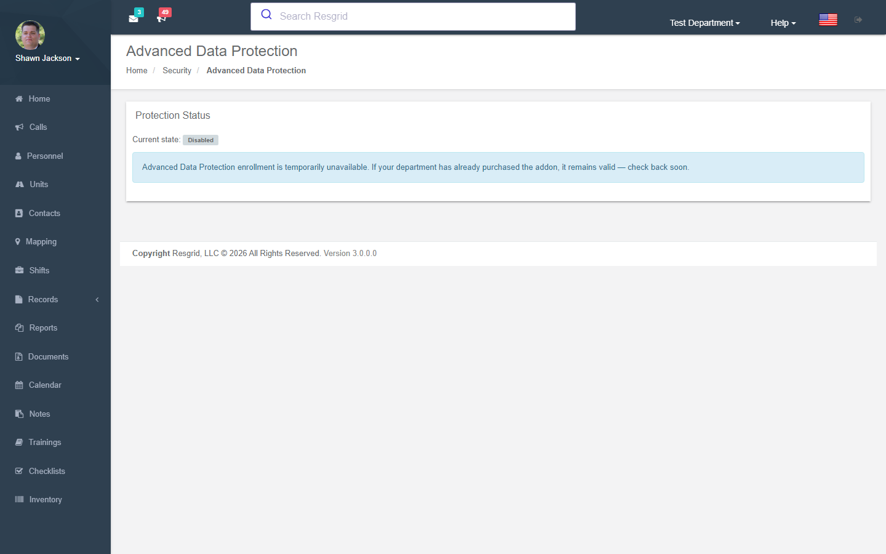

# Advanced Data Protection (ADP)

**Advanced Data Protection** encrypts the sensitive content of your department's data — call names, natures, notes and addresses; call notes and attachments; contact details; member sensitive data; and the protected fields of Records, Checklists, Work Orders and Inventory — with **keys owned by your department** and held in a hardened key service. Once enrolled, protected values stay hidden until a signed-in member confirms who they are with a **second factor**, and they remain encrypted in exports, notifications and reports.

:::caution Not a compliance program by itself
ADP is one control inside a HIPAA / privacy / ePCR compliance program that your agency still owns. It does not, on its own, make you compliant.
:::

**Department dropdown → Security & Permissions → Data Protection** (`/User/DataProtection`).

<AcademyVideo id="19-adp" />

## What is protected — and what is not

| Protected (encrypted) | Stays plaintext |
|---|---|
| Call names, natures, notes, addresses; call notes and attachments; contact details and notes; member sensitive data (personal info, emergency contacts); Records narratives, participants and restricted fields; checklist answers and evidence; work-order text and files; inventory holders and notes; protocol case answers and step notes on calls; wellness and health record details ([details](#protocols-training-e-sign-and-wellness)). | System identifiers, call numbers, priorities, statuses, timestamps, unit names and department structure — the platform needs these to route and display work. |

### While protected

- **Search, reporting, exports, integrations and offline access** cannot see protected content (Records narrative search is withdrawn; export columns are written as `REDACTED` unless an egress acknowledgement is recorded).
- **Big Board** shows a reduced *protected incident* shell instead of call details.
- **Workflows** receive redacted payloads by default. Administrators can approve a specific [Protected Workflow](protected-workflows) to send selected fields to one pinned HTTPS destination; every such disclosure is recorded in a hash-chained audit log.
- **Text, email, push and voice notifications** send generic content by default (*"A protected dispatch is available — sign in to Resgrid"*). Relaxing a channel is a separate, acknowledged policy change.
- **If encryption is briefly unavailable** when a unit status is saved (the protection service cannot be reached), the status is still recorded and every dashboard, Big Board and Dispatch console still updates, but the app that sent it is told the save failed. The live update carries only the status itself — no note or position — so workflows and integrations never receive the unencrypted values.
- Resgrid support cannot read protected values without an explicit, audited, department-approved support grant. Key loss is recoverable only through the documented recovery process.

## How members see protected data

When a page contains protected content it shows a **Protected** banner and a **Verify and open** button. The member enters a code from their **authenticator app** (see [Account security](account-security)); the data is revealed for a window your department configures (default 15 minutes; values over 60 require a recorded reason). Every protected read is audited — the audit holds no values itself.

**Home dashboard.** The [home dashboard](dashboard#advanced-data-protection-on-the-dashboard) uses the same verification. Its widgets are built on operational data, so almost nothing on it is protected; the four exceptions — message subjects in *Inbox*, status notes in *Unit Status Board*, staffing notes in *Personnel Status Board* and person contact names in *Pre-plans Due for Review* — are hidden until the member uses **Verify to reveal** in the header, and only for members whose role holds the matching *View protected …* permission. Wall display never reveals.

Under **Verification prompt** the managing member can switch the prompt off per application (web site, Dispatch console, Responder, Unit, Incident Command, API integrations). Leave it on wherever you can; switching it off on a dispatch console during an incident may be acceptable, on a phone that can be lost much less so.

## Enrolling

Prerequisites: a **paid plan**, the **ADP add-on** (yearly; purchased by the managing member from **Subscription & Billing → Advanced Data Protection**), the platform enrollment gate open, and the managing member enrolled in an **authenticator**.

The **Enrollment Wizard** has six steps:

1. **What ADP covers** — read the scope and limitations.
2. **Acknowledgements** — eleven statements the managing member must tick (scope, plaintext metadata, server-side processing, step-up window, Big Board reduction, workflow redaction, notification defaults, search/report limits, migration and disable behaviour, key-loss recovery, not-HIPAA-compliance). Acknowledgements are recorded with a version stamp.
3. **Preflight checks** — managing member, paid plan, active add-on, gate open, department state, protection service reachable, managing member MFA.
4. **Migration size estimate** — a read-only **sizing scan** counts rows and estimates how many overnight windows the migration needs.
5. **Overnight migration window** — choose the quiet hours (local time zone) during which migration runs. While a window is running **no new calls, status changes, staffing changes or scheduled tasks run**; viewing continues; you can abort an active window at any time. Consent to the pause is required.
6. **Confirm and queue** — requirements are re-verified server-side and the department joins the migration queue (departments migrate one at a time). You receive an email when each night's window opens and closes.

The page then shows **migration progress** (rows processed, current table, anomalies needing attention) and finally **Advanced Data Protection is active**.

## Turning it off

Cancel the add-on on the subscription page. Protection stays active until the end of the current billing period, then an overnight migration decrypts the data back to standard storage (**offboarding**). Until that date the managing member can **revoke offboarding**. Re-enabling later requires purchasing the add-on again and a new enrollment.

## Protected Workflows

The **Protected Workflows** section of this page turns on the one deliberate exception to workflow redaction. It needs a versioned warning acknowledgement, a fresh verification, and the **Configure Protected Data Delivery** permission. You can also require a second administrator to approve each protected workflow. See [Protected Workflows](protected-workflows) for setup, the approval rules and a Dataverse example.

## Emergency contacts

The Data Protection page also hosts the member's **emergency contacts** for this department (name, relationship, phone, alternate phone, email, notes, primary flag), stored under the department's protection settings.

## Protocols, training, e-Sign and wellness

ADP covers only the private parts of these modules. Everything the system runs on stays readable without a grant.

| Module | Protected | Operational (stays readable) |
|---|---|---|
| **Protocols on calls** | A call's protocol case record (the caller's answers in words), the dispatcher's override and removal reasons, and the notes on [step-through](/web-app/protocols/decision-engine) steps. | The determinant (run cards, dispatch texts and analytics read it), the protocol and version cited, the step states and times. |
| **Protocols and training content** | Nothing. | Protocol and course content, acknowledgments, assessment scores, transcripts, certifications, statuses and every id. |
| **e-Sign** | The outside signer's name (and the printed and witness names of an in-person capture) on Records signatures: inspections and evidence custody transfers. | The signer role, the masked contact, the name snapshot on the signature list. Customers, vendors and outside evaluators signing a Business Ops, readiness or training document are not under ADP. |
| **[Wellness and exposure tracking](workforce-pro/wellness.md)** | Exposure details (substance, narrative, protective equipment, decontamination, health details, screening plan), exposure case notes, injury details, restrictions and treatment, clearance restrictions. Reading them needs **View protected personnel data** (34). | The member, the call, the category, dates, case stage, duty and clearance status, OSHA codes. |

What members see while ADP is on:

- **On a call**: the case record asks for verification first (*This case is protected by Advanced Data Protection. Verify your identity to view protected data, then try again.*). On the step-through page the notes read `REDACTED` until you verify; the page then shows them as written.
- **Wellness**: *Some details are protected by your department's Advanced Data Protection and are not shown here.*, and *Protected* in place of each value.
- **Knowledge answers**: the question never leaves Resgrid. Members get the matching sources instead of a written answer (*Your department uses Advanced Data Protection, so your question stays in Resgrid. These sources match it.*), and the question is not kept. Documents are not used as knowledge sources.
- **AI features that send content to a model are off**: knowledge practice, AI course drafts and flashcards, protocol AI drafts, translations and suggestions, the drafting aids and the explanations of course recommendations. Each one says that ADP keeps the department's content local. This applies as soon as the department is queued for enrollment and lasts until offboarding has finished decrypting.
- **Documents**: a protected document stays in Documents. It cannot be moved into a protocol, and its text cannot be read for protocol search.
- **Workflows**: the [protocol, training and e-Sign triggers](workflows#protocols-training-e-sign-and-knowledge-triggers) never carry protected values, so they need no redaction.

## Imports and ADP

[Import & Migration](import-and-migration/overview) works in an enrolled department. Protected fields in an import — a person's ID number, department notes and home address, and a certification's number, area and issuer — are written through the same protection layer as the Resgrid screens, so they are encrypted from the moment they are saved, never stored in plaintext first. Uploaded files are always stored encrypted, and with ADP they are kept only **72 hours** after a successful import by default (instead of 7 days). Resgrid support never sees protected values through Import & Migration, whatever support access you grant. An import and an ADP migration window never run at the same time: each waits for the other to finish.

## Setup examples

| Department | Recommendation |
|---|---|
| **EMS / fire-based EMS** | Enrol. Keep the verification prompt on everywhere except the dispatch console. Default notification egress (generic content). |
| **Fire (no PHI)** | Optional; useful where call notes contain personal information from callers. |
| **Security / private** | Enrol if incident reports name individuals; pair with restricted record fields. |
| **Emergency management** | Usually unnecessary unless shelter registrations or vulnerable-population data are stored. |

## Technical reference

| Item | Value |
|---|---|
| Routes | `/User/DataProtection/{Index,SizingScan,MigrationProgress}`, `/User/Subscription/{BuyAdpAddon,ManageAdpAddon}` |
| Flag | `Security.DepartmentProtectedDataEnrollment` — operator-managed global admission gate for **new** enrollments only |
| Permissions | `ManageDepartmentDataProtection` (31), `ViewProtectedCallData` (32), `EditProtectedCallData` (33), `ViewProtectedPersonnelData` (34), `ViewProtectedContactData` (35), `ViewProtectedOperationalData` (36), `ExportProtectedData` (37), `ConfigureProtectedDataEgress` (38), `BreakGlassProtectedData` (39) |
| State | `DepartmentDataProtectionPolicies.State` (durable); migration and offboarding run by workers in the department's window |
| Grant | `IProtectedGrantContext` / `__ResgridProtectedGrant` form field carries the step-up grant on writes |
| Protected Workflows | Toggle and two-person rule on `DepartmentProtectedDataEgressPolicies`; releases and the disclosure chain in `WorkflowProtectedReleases` / `ProtectedWorkflowDisclosures`; broker workload purpose `protected-workflow` |
| Protocols, e-Sign, wellness | Catalog 37 (exposure log) and 38 (health records), Personnel family; catalog 39: `CallProtocols.CaseJson`, `AnswersJson`, `OverrideReason`, `RemovedReason` and `CallProtocolStepNotes.Note` (Calls family, M0403), and the outside signer names of Records signatures (`SignatureRequestSigners.ExternalName`, `SignatureRecords.ExternalSignerName`, `SignatureCaptures.PrintedNameEncrypted` / `WitnessNameEncrypted`, Records family). Model calls for knowledge and AI drafting are refused whenever the department's state is anything but *Disabled*. |
| Design | `int-Coordination/docs/architecture/department-protected-data-implementation-plan.md` |
