# Department Settings

Everything about *how your department works* lives under the **Department menu** (your department's name, top-right). This page covers the **Department Settings** pages themselves; other menu items have their own pages (Groups, Types, Custom Statuses, Templates, Protocols, Workflows, Security …).

Only **department administrators** see these pages. Every change is audited.

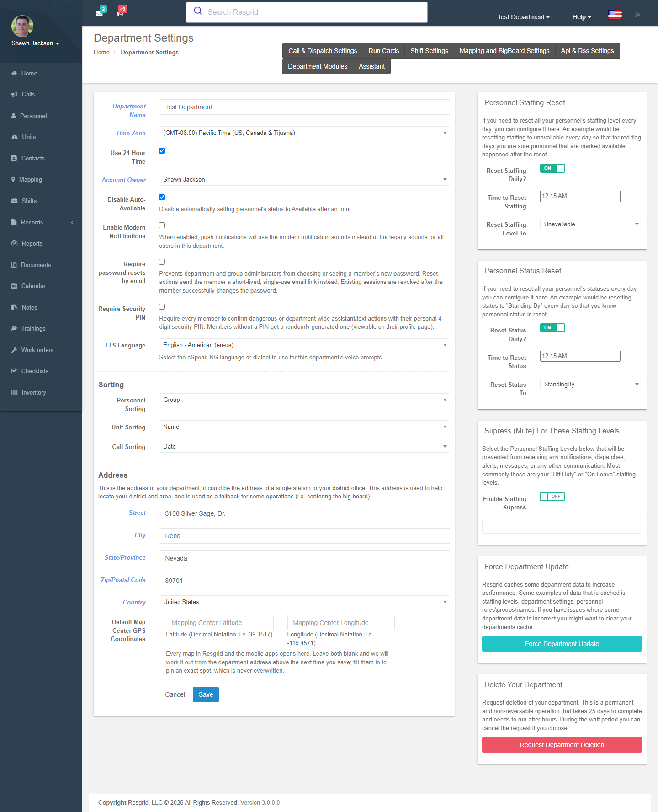

<AcademyVideo id="02-department-settings" />

<AcademyVideo id="06-dispatch-settings" />

<AcademyVideo id="02-security" />

## General settings

`/User/Department/Settings`

| Setting | What it does |
|---|---|
| **Department name** | Shown everywhere, including notifications and prints. |
| **Organization type** | What kind of organization you are (volunteer fire, community paramedicine, security and patrol, multi-discipline response …), first chosen at sign-up. Change it here at any time. It is a description only: every template, Records pack, checklist and module stays available whatever you pick. If you do several kinds of work, pick the closest match and tick every sector in the [operating profile](help-setup#operating-profile), which drives setup suggestions. See [Organization types](#organization-types). |
| **Time zone** | All times in the web site, apps, reports and schedules are shown in this zone. |
| **Use 24-hour time** | Clock format. |
| **Managing user** | The account owner — the only person who can change billing, purchase add-ons, enrol in data protection or delete the department. |
| **Disable auto-available** | By default a member's status returns to *Available* an hour after they set something else; tick to stop that. |
| **Personnel / unit / call sorting** | Default, first name, last name or group ordering on lists and the dashboard. |
| **Suppress (mute) for these staffing levels** | Members in the ticked staffing levels (e.g. *Unavailable*, *Off duty*) receive no dispatch notifications. The list also offers each staffing [meaning](custom-statuses#status-meanings), such as *Any "Off Duty" status*, which mutes every level with that meaning, built-in or your own. |
| **Enable modern notification sounds** | Use the newer alert tones in the apps for everyone. |
| **Require security PIN** | Force every member to confirm dangerous assistant / text actions with their 4-digit PIN. |
| **Require password reset via email** | Administrators can no longer set a member's password; reset sends the member a single-use link. |
| **TTS language** | Voice / dialect for voice dispatch prompts. |

### Organization types

The list is grouped:

| Group | Types |
|---|---|
| Fire and rescue | Volunteer Fire · Career Fire · Combination Fire · Wildland Fire · Search and Rescue · HAZMAT |
| EMS and health care | EMS · Private Ambulance and Interfacility Transport · Hospital and Health System · Community Paramedicine and Mobile Integrated Health · Crisis and Mental Health Response |
| Emergency management and community response | Emergency Management · Public Safety · CERT · Disaster Response · Relief Organization · Multi-Discipline Response |
| Security and events | Security · Event and Venue Operations |
| Industrial and utilities | Industrial Emergency Response · Oil and Gas · Power · Chemical · Nuclear · Other Industrial |
| Contractors and field services | Emergency Response Contractor · Drone and Aerial Survey · Repair Services · Delivery Services · Bus and Shuttle |
| Other | Other Public · Other Private · Other |

What the type does **not** do: it never hides or limits Records template packs, checklist, command board, status or certification templates, modules, the dashboard or Admin Assist suggestions. Every department can use all of them. What it is used for: the workflow variable `{{ department.type }}` and, for Resgrid operators, feature-flag targeting.

A department whose type came from an older sign-up list keeps it; the page shows it as the first option until you choose another.

### Personnel staffing reset / status reset

Automatically reset everyone's **staffing** (e.g. to *Available*) or **status** (e.g. to *Standing By*) at a time of day on chosen weekdays — typical for volunteer departments where people forget to clear *Unavailable*.

### Department address and map centre

The department's own address (a station or district office) is used to locate the district and as a fallback map centre. **Default map centre GPS coordinates** pin where every map opens; leave blank to derive it from the address.

## Department profile

`/User/Department/Profile` — description, **short name**, **logo** (PNG/JPEG ≤ 2 MB, re-encoded with metadata removed), public profile settings for [Connect](connect), and **Use branding in emails** (call, message, report and workflow emails carry your logo and name; account and billing emails stay Resgrid-branded). The logo also heads [record prints](records/settings#print-layout).

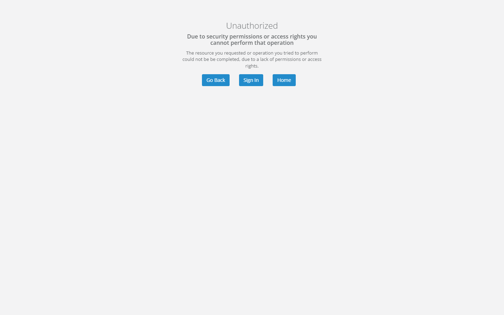

## Module settings

`/User/Department/ModuleSettings` — switch modules on or off for the whole department: Messaging, Mapping, Shifts, Logs / Records, Reports, Documents, Calendar, Notes, Training, Inventory, **Checklists**, **Maintenance** (work orders), **Business Operations** (invoicing, contractor billing, Cal OES MARS, workforce — the pages also need the [Business Ops add-on](business-ops/overview)). Switching a module off hides it from the menu and the apps; data is kept.

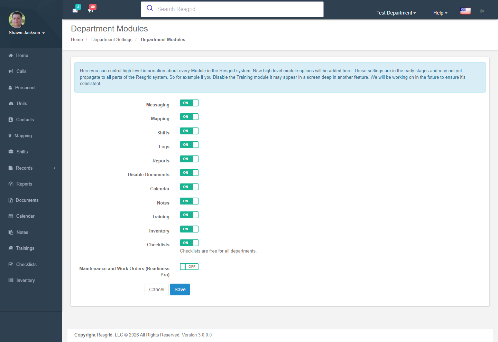

## Terminology

`/User/Department/Terminology` (**Department settings → Terminology**, also **Rename modules and record types** on Module settings) — use your department's own words. A name set here replaces Resgrid's name for that module or record type in the navigation, on page titles, wherever record types are listed and in the Responder, Unit, IC and Dispatch apps, for every member and in every language. Only the label changes: permissions, links and integrations are not affected. Leave a box empty to keep Resgrid's name.

| Section | Names |
|---|---|
| **Modules** | Calls, Personnel, Units, Contacts, Mapping, Shifts, Records, Logs, Reports, Documents, Calendar, Notes, Trainings, Inventory, Readiness, Work Orders, Checklists, Workforce & Business. Shown in the navigation, as the title of the module's main page and in the apps' menus; sentences elsewhere that mention a module keep Resgrid's wording. |
| **Record types** | Run, Training, Work, Meeting, Coroner, Callback, Unit activity, NERIS incident report — the built-in Records and Logs types, wherever a type is chosen, listed, printed or exported. To add a type of your own, such as Public Education, create a [record definition](records/settings). |

A name is up to 50 characters; invisible characters are removed and runs of spaces become one. A longer name is not saved and stays in its box for correcting (*Your other names were saved.*). Department administrators only. The apps read the names through `GET /api/v4/Config/GetTerminology`. [Import & Migration](import-and-migration/configure#names) can set them too, together with the rest of a migration's configuration.

## Call & dispatch settings

`/User/Department/DispatchSettings`

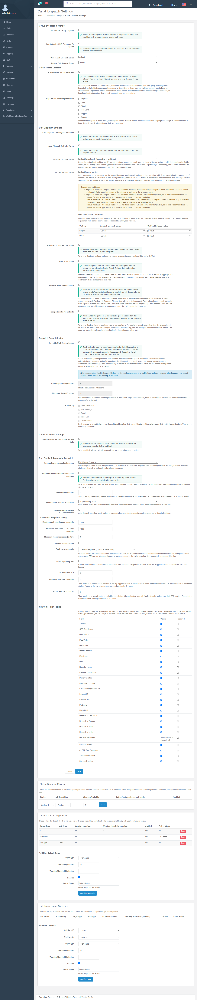

| Section | Settings |
|---|---|
| **Group dispatch** | **Use shift for group dispatch** — dispatching a group sends only to the people signed up for today's shift. **Set status for shift personnel on dispatch** — automatically set them to a chosen status (default *Responding to scene*). |
| **Unit dispatch** | **Also dispatch to assigned personnel** (the crew staffed on the unit) and/or **Also dispatch to entire group** (the unit's station). **Personnel on unit set unit status** — when a unit reports a status, its crew are set to *On unit*. |
| **Default call statuses** | The status personnel / units are set to when **dispatched** and when **released** from a call; per-unit-type overrides for types with custom statuses. The release status only moves units still working the call: a unit already back in service, out of service, unavailable or on a break (by its status's [base type](../configuration/custom-statuses)), or working another open call, keeps its status. **Close call when last unit clears** closes an active call on its own when its last dispatched unit reports back in service or out of service; see [Closing a call automatically](dispatch-calls#closing-a-call-automatically). **Transport destination checks** asks for a reason when a unit's Transporting or At Hospital status goes to a destination other than its call's, and notes the change on the call; see [Transport destinations](dispatch-calls#transport-destinations). The unit statuses are chosen by meaning; see [Unit status on dispatch and release](#unit-status-on-dispatch-and-release). |
| **Rest period** | Deprioritise a unit or person for N minutes after a dispatch so the same resources are not sent back-to-back. |
| **New call form fields** | Which built-in fields and sections the call forms show, and which must be filled in before a call can be created; see [New call form fields](#new-call-form-fields). |
| **Unit status timers** | Highlight a unit on the Big Board when it has sat in a status too long (e.g. dispatched > 4 min without departing). Dispatchers can acknowledge, mute or annotate the alert from the Big Board's Unit Alerts widget — see [Big Board](../apps/big-board). **Reason when acknowledging** makes that note required: *Optional* (default), *Required for alerts*, or *Required for warnings and alerts*. Timers key on a status's [meaning](custom-statuses#status-meanings): a status with no meaning is never timed, so the page warns when units are dispatched to one, or when a status set in use has options without a meaning. |
| **Run cards & automatic dispatch** | Selection mode, auto-dispatch, minimum staffing, move-ups, closest-unit tuning (**rank closest units by** fastest response or shortest distance — see [Run Cards](run-cards#fastest-response-or-shortest-distance), maximum location age, radius, include stale, order by driving ETA, shortlist size, **in-quarters turnout** and **mobile turnout** in seconds), station coverage minimums — see [Run Cards](run-cards#how-closest-unit-mode-measures-a-unit). Turnout is added to travel time when units are ranked: in-quarters turnout for units in an *In Quarters* status or with no GPS position, mobile turnout for units ranked from their GPS. Both default to 0 (rank by distance only). |
| **Check-in timers** | Auto-enable on new calls, default timer configs and per-type/priority overrides — see [Call Check-in Timers](call-checkin-timers). |

### New call form fields

Choose which fields and sections the call forms show (**Visible**) and which must be filled in before a call can be created or an edit saved (**Required**). The rules apply to **New Call**, **Update Call** and **Add Archived Call**, to the Omni app, and through the API. A department that sets nothing sees every field, with nothing required.

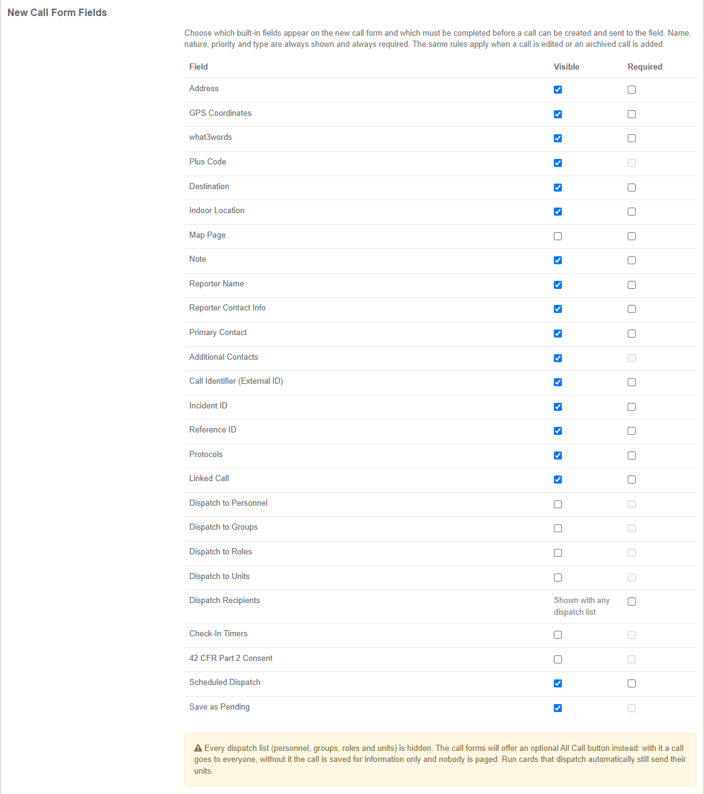

| Field | Hide | Require | Notes |
|---|---|---|---|
| **Address**, **GPS Coordinates**, **what3words** | Yes | Yes | The location section shows while any of the three does. A pin is needed to satisfy *GPS Coordinates*; an address alone does not. |
| **Plus Code** | Yes | No | Only finds the location and is not saved on the call: require *GPS Coordinates* instead. |
| **Destination**, **Indoor Location** | Yes | Yes | |
| **Map Page** | Yes | Yes | |
| **Note** | Yes | Yes | An empty editor does not count as a note. |
| **Reporter Name**, **Reporter Contact Info** | Yes | Yes | |
| **Primary Contact** | Yes | Yes | Only required where there are contacts to pick from. |
| **Additional Contacts** | Yes | No | |
| **Call Identifier (External ID)**, **Incident ID**, **Reference ID** | Yes | Yes | |
| **Protocols**, **Linked Call** | Yes | Yes | |
| **Dispatch to Personnel**, **Dispatch to Groups**, **Dispatch to Roles**, **Dispatch to Units** | Yes | No | Each recipient list (a tab or the Units section of the form) can be hidden on its own. |
| **Dispatch Recipients** | — | Yes | Required means at least one recipient, from any list. Shown while any list is; a pending call and an archived call skip it. |
| **Check-In Timers** | Yes | No | Hidden, a new call follows the department's *Auto-enable on new calls* [check-in timer](call-checkin-timers) setting. |
| **42 CFR Part 2 Consent** | Yes | No | Hidden, a new call is saved without consent on file. |
| **Scheduled Dispatch** | Yes | Yes | Never required when editing a call or adding an archived one. |
| **Save as Pending** | Yes | No | |

Always shown and always required: **Name**, **Nature of the call**, **Priority** and **Type**. The forms also leave out what there is nothing to pick from: the **Template** button without [call templates](templates), the contact pickers without [contacts](contacts), and **Type** without [call types](types-configuration#call-types).

**Hiding every dispatch list.** Unticking all four lists shows a warning on this page, and the call forms show an optional **All Call** button in place of the lists (see [Who gets dispatched](dispatch-calls#who-gets-dispatched)). Left off, a new call is informational and pages nobody; switched on, it goes to everyone in the department. Run cards that dispatch automatically still send their units. [Admin Assist](help-setup) lists this as a warning, **New calls have no dispatch lists**, until at least one list is shown again; if your department means to work this way, record an [accepted exception](help-setup#follow-up-on-findings) on the finding.

**Editing a call.** A hidden field is not on the edit form, so the call keeps what it already holds for it; the same for the recipients of a hidden list. A required field is checked on the call as the edit leaves it.

**Older apps.** The Dispatch, Responder, Unit and IC apps know only some of these rules: they hide their whole recipient picker only when every list is hidden, and do not show All Call. A call created from them with nobody picked goes to nobody; their *Everyone* choice still pages the whole department.

### Unit status on dispatch and release

**Unit Call Dispatch Status** is set on every unit dispatched to a call. **Unit Call Release Status** is set on the units still working a call when it is closed, they are taken off it, or they are [released from it](dispatch-calls#releasing-a-unit-or-person-from-a-call). Both are chosen by **meaning**, not by a status name, so one setting works for every unit type: each unit gets the first active option (by order) of its own status set with that meaning. Its own set is the custom status set of its unit type, or the built-in unit statuses when the type has none.

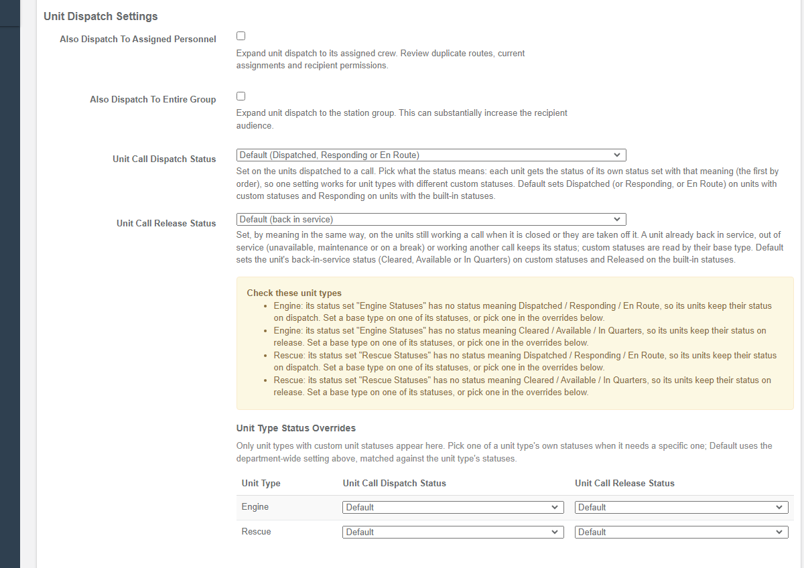

| Choice | Dispatch | Release |
|---|---|---|
| **Default** (the setting until you change it) | Units with custom statuses get their *Dispatched* option, else *Responding*, else *En Route*. Units on the built-in statuses get *Responding*. | Units with custom statuses get their *Cleared* option, else *Available*, else *In Quarters*. Units on the built-in statuses get *Released*. |
| **Leave the unit's status unchanged** | Dispatch never changes the unit's status. | Release never changes the unit's status. |
| A **status meaning**, such as *Dispatched* or *En Route* | Each unit with custom statuses gets its own option with that meaning. Units on the built-in statuses get the matching built-in status (*Dispatched* sets *Committed*, *Cleared* sets *Released*, *In Quarters* sets *Available*); a meaning with no built-in match, such as *Transporting*, leaves them unchanged. | Same. |
| **Built-in status: … (saved before status meanings)** | Only shown when the department saved a built-in status before meanings existed. It keeps working: on the built-in statuses it is that status, and on a custom set it is read by its meaning (a saved *Responding* finds the set's Responding option). Pick a meaning to replace it. | Same. |

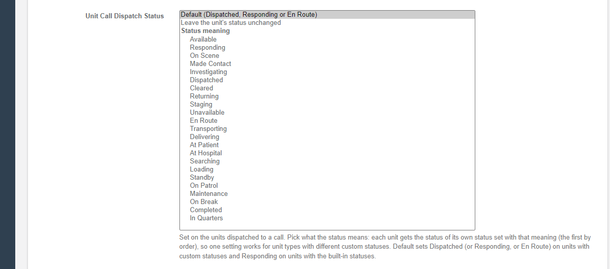

When a unit type's status set has **no option with the meaning**, its units keep their status and the page lists that unit type under **Check these unit types**, for example *Engine: its status set "Engine Statuses" has no status meaning Dispatched / Responding / En Route, so its units keep their status on dispatch.* Fix it by giving one of the set's options that meaning on [Custom Statuses](custom-statuses#status-meanings), or by picking a status for that unit type in the overrides. The list also names a set with **several options** with the meaning; the first by order is used, so check that it is the one you want. [Admin Assist](help-setup) raises unit types with no matching option as **Unit types cannot take the dispatch or release status** and names them.

**Unit Type Status Overrides** still win: a unit type with its own dispatch or release status there gets that status, and isn't checked against the department-wide choice. Only unit types with custom statuses appear there.

The release status still skips units that are already back in service, out of service, unavailable or on a break, or working another open call (see [Closing a call automatically](dispatch-calls#closing-a-call-automatically)).

| Department | Dispatch | Release |
|---|---|---|
| Fire, one unit status set per apparatus type | **Default**, with a *Dispatched* or *Responding* option in every set | **Default**, with a *Cleared*, *Available* or *In Quarters* option in every set |
| Volunteer fire whose released units go back to the station | **Default** | **In Quarters**, so release sets *In Quarters* even when the set also has an *Available* option |
| EMS whose set has *Alerted* (Dispatched) and *Mobile* (En Route), where crews never press *Alerted* | **En Route**, so dispatch sets *Mobile* | **Available** (*Radio Available*) |
| Crews set every status themselves | **Leave the unit's status unchanged** | **Leave the unit's status unchanged** |
| Mixed: engines on a custom set, utility vehicles on the built-in statuses | **Default**, or **Responding** when the engines' set has a Responding option | **Default** |

:::note Example
One department's unit status set had no meanings. Its units showed as *Available* while they were in its *Dispatched* status, and closing a call set them to *Returning*. Giving the options meanings and choosing **Default** (or a meaning) for dispatch and release fixed both.
:::

## Call import settings

`/User/Department/CallSettings`

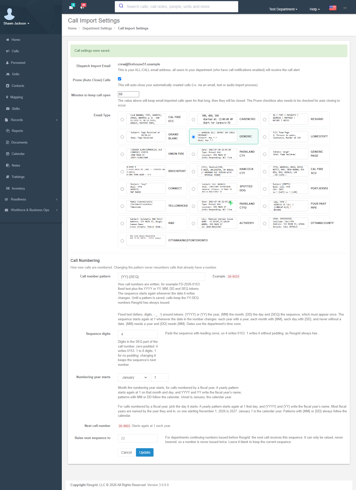

| Setting | What it does |
|---|---|
| **Dispatch import email** | Your department's *all-call* address, shown on the page. Anything mailed to it becomes a call dispatched to everyone with call notifications on. Forward your CAD pages here. See [Call import](../configuration/call-import). |
| **Email type** | The parser for your dispatch center's email: Generic, Resgrid, Generic Page, Connect, Four Part Pipe, Active911, R&R, OttawaCounty, OttawaKingstonToronto, Parkland Cty / Cty2, CAL FIRE ECC / SCU, Brockport, Hancock Cty, Carencro, Grand Blanc, Union Fire, Lowestoft, Spotted Dog, PortJervis, Yellowhead, plus Generic with AI enrichment for departments with Enhanced AI. Generic reads any email: subject as name, body as nature. See [Email types](../configuration/call-import#email-types). |
| **Prune calls / minutes to keep open** | Auto-close email/text/audio-imported calls after N minutes (checked hourly). |
| **Mail server** | Not on this page. Resgrid does not poll an outside mailbox; have your CAD or mail server forward dispatches to the dispatch import email instead. See [Call import](../configuration/call-import). |
| **Call numbering** | How new calls are numbered, and the next number. See [Call numbering](#call-numbering). |

### Call numbering

Every new call gets a number, shown in front of its name on the call list, the call, dispatches and reports. Out of the box the numbers are the two-digit year and a count that starts again each year: `26-1`, `26-2` … `26-153`. Set your own format to match your CAD or your state reporting, and carry on numbering you started before Resgrid.

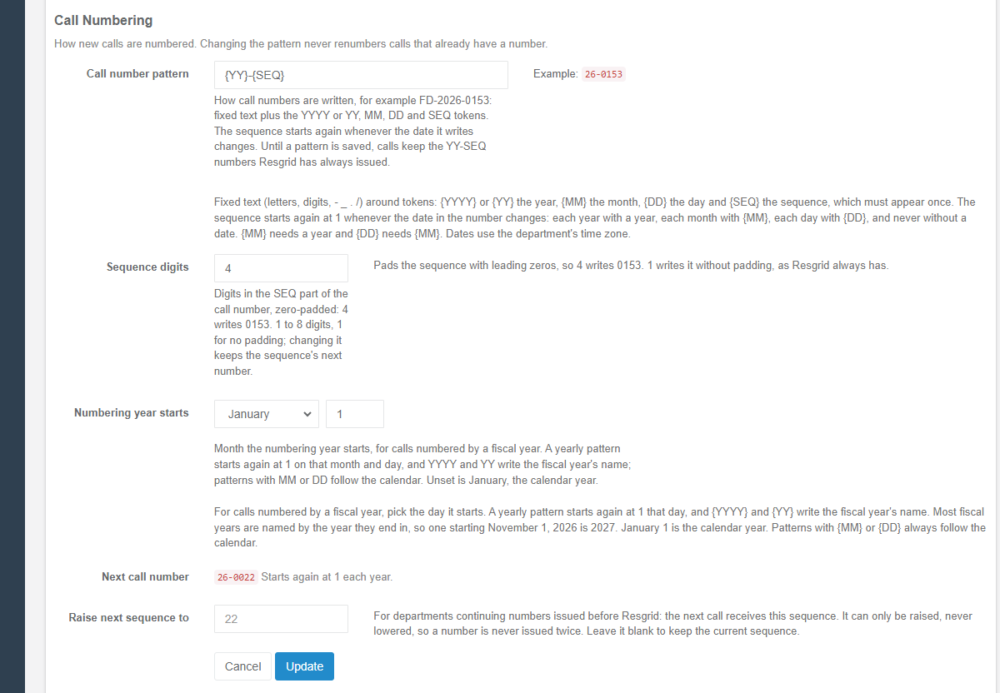

| Setting | Meaning |
|---|---|
| **Call number pattern** | Fixed text around tokens, up to 40 characters. Letters, digits, `-`, `_`, `.`, `/` and `:` are kept as written. The example next to the box shows a sample number as you type. Default `{YY}-{SEQ}`. |
| **Sequence digits** | Pads the sequence with leading zeros, 1 to 8. `4` writes `0153`; `1` writes it without zeros, as the default numbers are. |
| **Numbering year starts** | The month and day your numbering year starts, and which year names it. January 1 (the default) is the calendar year. See [Fiscal year numbering](#fiscal-year-numbering). |
| **Next call number** | The number the next call logged now receives, and when the sequence starts again. |
| **Raise next sequence to** | Optional. The sequence the next call receives. See [Raising the next number](#raising-the-next-number). |

The numbers are saved with the other Call Settings when you press **Update**.

#### Pattern tokens

| Token | Writes |
|---|---|
| `{YYYY}` or `{YY}` | The year, `2026` or `26`. With a fiscal year start, the fiscal year's name. |
| `{MM}` | The month, `01` to `12`. Needs a year token. |
| `{DD}` | The day of the month, `01` to `31`. Needs `{MM}`. |
| `{HH}` | The hour the call was logged, `00` to `23`. Needs `{DD}`. |
| `{MIN}` | The minute, `00` to `59`. Needs `{HH}`. (`{MM}` is the month.) |
| `{SEQ}` | The sequence number. Required, exactly once. |

Each token can be used once. Dates and times are when the call was logged, in your department's time zone. The sequence **starts again at 1 whenever the date in the number changes**: every year with a year token, every month with `{MM}`, every day with `{DD}`. A pattern with no date never starts again. The hour and minute are written into each number but **never start the sequence again**, so a pattern with a time counts the day's calls: two calls logged in the same minute still get different numbers.

| Pattern | Digits | Example | Starts again |
|---|---|---|---|
| `{YY}-{SEQ}` (default) | 1 | `26-153` | Each year |
| `FD-{YYYY}-{SEQ}` | 4 | `FD-2026-0153` | Each year |
| `{YYYY}{MM}{DD}-{SEQ}` | 3 | `20261006-012` | Each day |
| `{DD}-{MM}-{YYYY}-{HH}:{MIN}-{SEQ}` | 1 | `16-11-2026-19:53-14` (the day's 14th call, logged at 19:53) | Each day |
| `{SEQ}/{YY}` | 5 | `00153/26` | Each year |
| `E{SEQ}` | 6 | `E000153` | Never |

- Changing the pattern **never renumbers** calls that already have a number.
- A new pattern **starts its own sequence** at 1. To carry on from earlier numbers, raise its next number in the same or a later save.
- Going back to an earlier pattern carries on after the highest number already issued with it.
- A pattern that is not valid is not saved, and its message says why. The pattern stays in the box for correcting; the rest of the page still saves.
- Two calls logged at the same moment never share a number. A number that was issued is not issued again, even if its call is deleted.

#### Fiscal year numbering

Some departments number calls by a fiscal year, their own or a county's or state's they report to, instead of the calendar year. Set **Numbering year starts** to the month and day that year begins. A yearly pattern then starts again at 1 on that day, at midnight in your department's time zone, and `{YYYY}` and `{YY}` write the fiscal year's name.

Choose which year names it:

- **Named by the year it ends in** (the default, and the usual fiscal-year convention). A year starting November 1, 2026 is 2027, so with `{YY}-{SEQ}` the first call on November 1, 2026 is `27-1`.
- **Named by the year it starts in.** The same year is 2026, so that call is `26-1`.

| Year starts | Named by | Call logged | `{YY}-{SEQ}` |
|---|---|---|---|
| January 1 (default) | Calendar year | January 1, 2027 | `27-1` |
| November 1 | Year it ends in | October 31, 2026 | `26-…` (FY2026 continues) |
| November 1 | Year it ends in | November 1, 2026 | `27-1` |
| November 1 | Year it ends in | January 15, 2027 | `27-…` (no restart on January 1) |
| July 1 | Year it starts in | July 1, 2026 | `26-1` |

- The year start only applies to patterns that start again each year. A pattern with `{MM}` or `{DD}` always writes the calendar date and starts again each month or day.
- Call numbering and [record numbering](records/settings#numbering) each have their own year start, so dispatch can follow the calendar year while incident reports follow a fiscal year.
- February 29 can't be used as a start day, since not every year has one.
- Changing the year start never renumbers calls. If the new year's name matches numbers already issued (for example, moving to a November year named by the year it starts in, part way through the same calendar year), the sequence continues from the highest of those numbers instead of starting again, so no number is issued twice.
- A raised next number typed before the year start changes in the same save is not applied. Save the year start first, then raise the number for the new sequence.

#### Raising the next number

A department moving to Resgrid part way through a year can carry on its numbering. After issuing `FD-2026-0001` through `FD-2026-0153` in your old system, enter `154` in **Raise next sequence to** and press **Update**. The next call is `FD-2026-0154`.

- The next number can only be **raised**, never lowered, so a number is never issued twice. Saving asks for confirmation first.
- A number below the one the next call already receives is refused, with a message naming that number. The pattern and the other settings still save.
- The raise applies to the sequence shown on the page. If you change the pattern in the same save, the raise is not applied; raise it again against the new pattern.
- A raise applies to the current period only. A yearly pattern starts again at 1 next year; a daily pattern starts again tomorrow.
- **Regenerate Call Numbers** on [Add archived call](dispatch-calls) renumbers the calls of the archived call's year in logged order with your pattern, starting each sequence at its raised number. With a fiscal year start that is the fiscal year the call falls in. It does nothing when the pattern has no year.

## Document numbering

`/User/Department/DocumentNumbering` (department menu **Document Numbering**) sets how Resgrid numbers **work orders**, **invoices**, **bids** and **daily time reports**, and when their numbering year starts. Call numbers are set under [Call numbering](#call-numbering), and Records numbers (including records requests, occupancies, inspections, permits, investigations and evidence) on [Records Settings](records/settings#numbering).

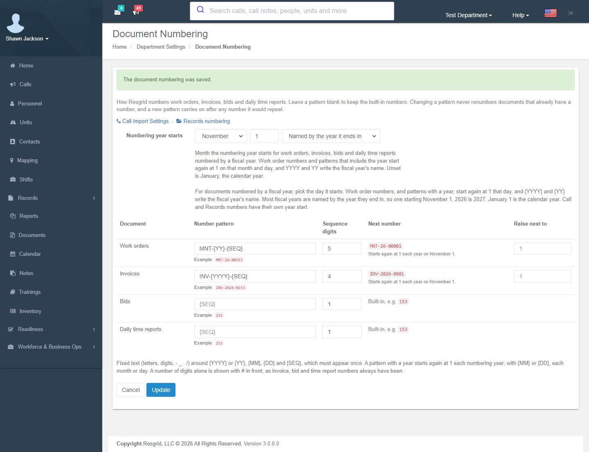

| Document | Built-in numbers | Example |
|---|---|---|
| Work orders | `WO-{YYYY}-{SEQ}`, 6 digits, starting again each numbering year | `WO-2026-000019` |
| Invoices | A plain count that never restarts | `#1042` |
| Bids | A plain count that never restarts | `#7` |
| Daily time reports | A plain count that never restarts | `#3` |

| Setting | Meaning |
|---|---|
| **Numbering year starts** | The month and day the numbering year starts, and whether it is named by the year it ends in (the default) or starts in. January 1 is the calendar year. Work order numbers, and any pattern with a year, start again at 1 that day. |
| **Pattern** | Leave it blank to keep the built-in numbers. Otherwise fixed text around `{YYYY}` or `{YY}`, `{MM}`, `{DD}` and `{SEQ}`, the same tokens as [call numbers](#pattern-tokens) except the time (`{HH}`, `{MIN}` and `:` are for call numbers only). The example under the box shows a sample as you type. |
| **Digits** | Pads the sequence with leading zeros, 1 to 8. |
| **Next number** | For a custom pattern, the number the next document receives and when the sequence starts again; for the built-in numbers, a sample. |
| **Raise next to** | For a custom pattern, carry on numbering from another system. It can only be raised. |

| Goal | Pattern | Digits | First number |
|---|---|---|---|
| Invoices restart each fiscal year (year starts July 1) | `INV-{YYYY}-{SEQ}` | 4 | `INV-2027-0001` on July 1, 2026 |
| Maintenance numbers with the short year | `MNT-{YY}-{SEQ}` | 5 | `MNT-26-00001` |
| Bids numbered by month | `B{YYYY}{MM}-{SEQ}` | 3 | `B202611-001` |
| Keep invoice numbers, but padded | `{SEQ}` | 5 | `01043` after `#1042` |

- Changing a pattern **never renumbers** documents that already have a number.
- A new pattern carries on after any number it would otherwise repeat: a padded `{SEQ}` continues after `#1042`, and `WO-{YYYY}-{SEQ}` with 4 digits continues after `WO-2026-000019`.
- A number of digits alone is shown with `#` in front, as invoice, bid and time report numbers always were; any other number is shown as issued.
- Work order numbers follow the numbering year even with the built-in pattern, so a July fiscal year writes `WO-2027-000001` on July 1, 2026.
- A pattern that is not valid, or could write a number longer than 50 characters, is not saved; that document keeps its numbering and the message names it. February 29 can't be a year start.
- Invoice, bid and time report records keep their plain number for ordering and the API (`InvoiceNumber`, `BidNumber`, `ReportNumber`); the number as issued is `DisplayNumber` in the API, workflow templates (`invoice.display_number`, `bid.display_number`, `deployment.report_display_number`), PDFs, emails, file names and search.

## Terminology

`/User/Department/Terminology` (department menu **Terminology**, also linked from Module settings and Records Settings) lets you use your department's own words. Type a name next to anything you want to rename; leave the box empty to keep Resgrid's name (shown greyed in the box). Names can be up to 50 characters.

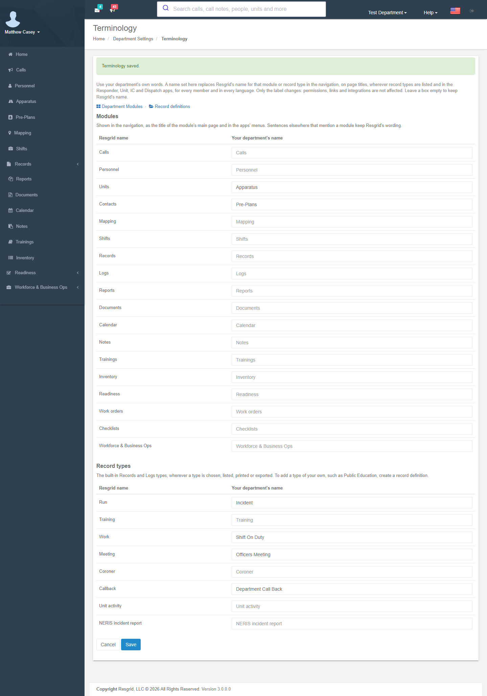

| Section | What you can rename | Where the name shows |
|---|---|---|
| **Modules** | Calls, Personnel, Units, Contacts, Mapping, Shifts, Records, Logs, Reports, Documents, Calendar, Notes, Trainings, Inventory, Readiness, Work Orders, Checklists, Workforce & Business | The left menu and the title of the module's main page |
| **Record types** | Run, Training, Work, Meeting, Coroner, Callback, Unit activity, NERIS incident report | Everywhere a record or log type is chosen, listed, printed or exported: the Records queue and **New** menu, record pages and prints, Records Settings, analytics, list exports, legacy Logs and log reports, the **Reports** menu on a call, record reminders and notifications, and Field Records in the apps |

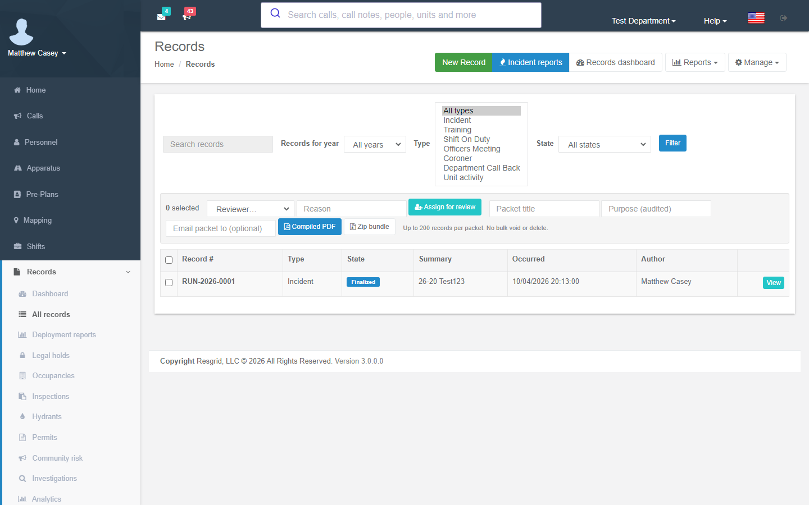

For example, a department can call Run **Incident**, Work **Shift On Duty** and Meeting **Officers Meeting**. To add a type of your own, such as **Public Education** or **Equipment / PPE Inspections**, create a [record definition](records/definitions) instead.

- The name you set shows for every member, in every language.
- Only the label changes. Permissions, links, API values, workflow template keys such as `record.type_key`, and export template codes stay the same, so integrations keep working.
- Sentences elsewhere that mention a module in passing keep Resgrid's wording.
- The [Responder](../apps/responder#department-terminology), [Unit](../apps/unit#department-terminology), IC and [Dispatch](../apps/dispatch#department-terminology) apps use the same names in their menus, tabs, screen titles and Field Records. They load them when the app starts or someone signs in and keep the last names they received while offline, so a change made here shows the next time the app starts. The apps read them from `GET /api/v4/Config/GetTerminology`.
- An empty box always means Resgrid's own name in the member's language; the department's word is the same in every language.

## Text messaging

`/User/Department/TextSettings` — the department's **SMS number** (provision one by country and area code, plan permitting), **text-to-call** (inbound texts create calls) with its format parser, **text commands** (members text `responding`, `available` …), source numbers for outbound SMS. See [Text messaging configuration](../configuration/text-messaging).

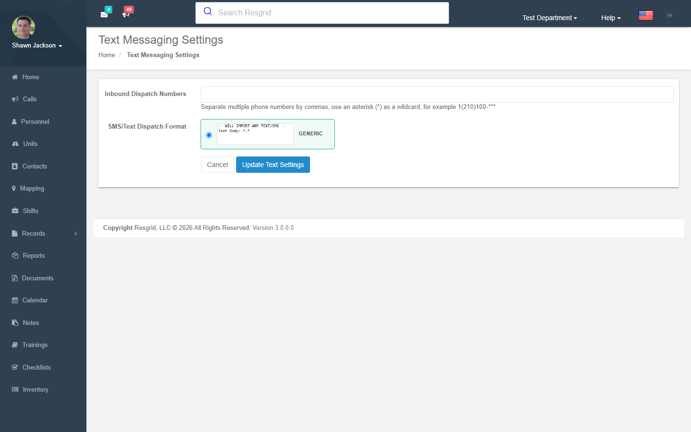

## Unit settings

`/User/Department/UnitSettings` — unit-level behaviour such as location TTL and status defaults per unit type.

## Shift settings

`/User/Department/ShiftSettings` — **Allow signups for multiple groups** (members can sign up for shifts at stations other than their own).

## Mapping & Big Board settings

`/User/Department/MappingSettings` — for personnel and units: **TTL in minutes** for locations shown on maps (0 = show forever) and **allow a status with no location to hide the previous location**. See [Mapping](mapping).

### Map style

**Map Style** picks the base map every map in your department shows — the website and the Dispatch, Responder, Unit, IC and Big Board apps on iOS, Android and web. Under the heading the page lists, read-only, what your Resgrid installation uses: the **base map** (Mapbox, or the server's own maps), **routing** (Valhalla, Mapbox, Google, OSRM or a straight-line estimate) and whether **live traffic** is available.

| Setting | Choices | Notes |
|---|---|---|
| **Day map style** | Automatic (Streets); **Mapbox styles:** Streets, Outdoors (terrain), Light, Dark, Satellite, Satellite with Streets, Navigation Day, Navigation Night; **Community styles:** see below | Used on the website, and in the apps when the device is in light mode. |
| **Night map style** | Automatic, or any of the styles above | Used by the apps when the device is in dark mode. **Automatic** follows the day style: road maps go Dark, Navigation Day goes Navigation Night, and Outdoors, the satellite styles and every community style stay as they are. The website always shows the day style. |

**Community styles** are the designer maps from the [Mapbox gallery](https://www.mapbox.com/gallery)'s community templates: American Memory, Basic, Basic Overcast, Blueprint, Bubble, Cali Terrain, Decimal, Finland Topo, Frank, Ice Cream, Lè Shine, Mineral, Minimo, Moonlight, Neon Glow, North Star, Pencil, Standard Oil Company, Mapbox Streets Japan and Unicorn. Several are artistic and show little street detail (Bubble, Neon Glow and Unicorn especially), so check the preview before using one for dispatch. Two gallery styles that Mapbox does not publish for use by other accounts (NASA's Black Marble, Water World) are not offered.

**Only the styles the installation can draw are listed.** On a Mapbox installation that is every style above. On an installation that draws its own maps (self-hosted tiles), the list is headed *This server's styles*: the community styles are not offered, and the satellite styles only when the server provides satellite imagery; a style without its own counterpart on the server shows the server's standard day or night map. A style your department chose earlier that the installation can no longer draw stays in the list, marked *(not available on this server)*, so saving the page never changes it without you noticing.

Previews of both styles, centred on your department, appear under each picker. The Resgrid server draws them the way it will draw your maps (Mapbox, the server's style server, or its map tiles), so what you see is what members get. Apps pick up a change the next time they load their configuration (sign-in or app restart). If website maps cannot follow the style — no Mapbox token for the website and no [MapLibre web maps](mapping#base-map) — they keep the standard map and the style applies in the apps only; the page says so. The **Department Mapbox Override** (your own Mapbox style and public `pk.` token) takes precedence everywhere: the website and all the apps then render your custom style (in light and dark mode) on your token.

The apps also receive the Mapbox token to use from the server when they load their configuration: your department's override token, or else the token your Resgrid installation configures for that app. Each app checks the token with Mapbox once, stores it on the device, and falls back to the token built into the app when none is sent or the token is invalid, expired or revoked — so a token can be rotated without an app update.

| Department type | Suggested style |
|---|---|
| Wildland fire, SAR | Outdoors (terrain contours), or Satellite with Streets |
| Structure fire, EMS, transport | Navigation Day / Navigation Night for driving, or Streets |
| Dispatch centre wall displays | Light or Dark to keep pins and polygons high-contrast; Moonlight or Decimal for a minimal backdrop |
| Marine / coastal rescue | North Star (nautical chart look) |

### Your own map providers

Your department can use its own accounts with map providers instead of Resgrid's. Your provider is always tried first. When it fails, times out or can't answer a particular request, Resgrid's own providers answer it, so maps, routes and drive times keep working. A failing key of yours never affects other departments.

Keys are stored encrypted and are never shown again: the page only says that one is saved. Leave a key field blank to keep the saved key. Set a part back to **Resgrid default** to stop using your account for it and remove its keys.

| Part | Choices | What you enter |
|---|---|---|
| **Routing provider** | Mapbox, Google, Valhalla, OSRM | Mapbox: a token with Directions, Matrix and Optimization access. A secret `sk.` token is fine, because it never leaves the Resgrid server. Google: a key with the Directions and Distance Matrix APIs, or the Routes API (Google Cloud projects created after March 2025). Valhalla or OSRM: your server's `https` address, and for Valhalla an optional key sent as an `X-Api-Key` header or a Bearer token (hosted Valhalla services such as SimpleRouting use Bearer) |
| **Live traffic layer** | Mapbox Traffic, traffic tile URL | Mapbox: a public `pk.` token. Tile URL: an `https` image tile address with `{z}`, `{x}` and `{y}`, for example TomTom traffic flow tiles |
| **Address lookups** | Google, Mapbox, LocationIQ | An API key |

Your routing provider is used for route plans and their directions, Live and Station Routing, run card and closest-unit drive times, and in-app navigation. In-app navigation needs Mapbox or Valhalla. The map provider summary at the top of **Map style** shows "(your account)" next to routing and traffic when yours is in use.

Points to know:

- **Your server must be public.** A Valhalla or OSRM address must use `https` and be reachable on the public internet. Resgrid refuses private and internal addresses.
- **Traffic keys are visible.** The traffic token, or a traffic tile URL and any key in it, is sent to your members' browsers and apps. Restrict that key to traffic tiles, and to your domains where the provider allows it.
- **Address lookups are shared.** They use your key when someone in your department works in the website or the apps. Background work, such as calls created from email or text messages, uses Resgrid's providers. Resgrid remembers looked-up addresses for 30 days, so an address anyone has looked up recently is answered without calling a provider.

### Navigation

Defaults for turn-by-turn navigation in the Resgrid Unit app. The page notes when in-app navigation (`Navigation.InApp`, see [Feature Flags](../reference/feature-flags)) is not on for your department yet; the defaults are saved anyway and apply once it is.

| Setting | Default | Notes |
|---|---|---|
| **Spoken guidance** | On | Directions are read aloud. Crews can still turn it off on their device |
| **Distance units** | Follow the device | Or miles and feet, or kilometres and metres |
| **Arrival radius** | 50 m | How close a unit must get to count as arrived (10–1000 m) |
| **Offer On Scene on arrival** | On | On arrival at a call, navigation offers to set the unit On Scene |
| **Avoid by default** | None | Tolls, highways, ferries, unpaved roads. Crews can change them for a trip |

### Route deviations

How [Routes](routes#deviations) judge timing. These apply today, whatever app the unit uses.

| Setting | Default | Notes |
|---|---|---|
| **Record late arrivals and long stops** | On | A deviation is recorded when a unit arrives at a stop later than planned, or stays longer than its estimated time |
| **Deviation threshold** | 15 minutes | How late, or how far over the stop time, before it counts (1–1440) |

### Offline maps

What the Resgrid apps download so their maps work without a network. The page notes when offline maps (`Maps.Offline`) are not on for your department or installation yet; the settings are saved anyway.

| Setting | Default | Notes |
|---|---|---|
| **Maximum response area** | A 40 km circle around the department map centre | The area the apps download at full detail ([below](#drawing-the-response-area)) |
| **Included data** | All | Custom maps, indoor maps, map layers, points of interest, hydrants |
| **Downloads** | Over Wi-Fi only | Or over any network, or only when the user starts them |
| **Calls outside the area** | On, 3 km | The map around a call outside the area is downloaded too (1–25 km) |
| **Routes outside the area** | On, 500 m | The map along a planned route where it leaves the area, this far either side (50–5000 m) |
| **Check for updates every** | 24 hours | How often the apps look for changed maps (1–720) |
| **Out of date after** | 7 days | Downloaded maps not refreshed for this long are marked out of date (1–365) |
| **Use downloaded maps when online** | Off | Inside the area, use the downloaded base map even with a network, to save mobile data |

#### Drawing the response area

Draw the area on the map with the polygon and rectangle tools; several shapes are fine (a main district and a detached island, say). You can instead paste a GeoJSON Polygon or MultiPolygon from your GIS tool into the box under the map. **Clear area** goes back to the default circle.

Every change is measured: under the map a bar shows the download size against the installation's limit (500 MB unless your installation sets another), and the area in km². An area over the limit is refused when you save, with nothing on the page saved, so you can shrink it and save again. An area you saved before stays accepted even if a later map update makes it larger than the limit. If the installation has no base map for offline packs yet, the page shows the area in km² and says the size cannot be measured.

## API settings

`/User/Department/Api` — view or **provision** the department **API key** (used by integrations and the apps' department login), and the **RSS active-call feed key**. Regenerating a key invalidates the old one immediately.

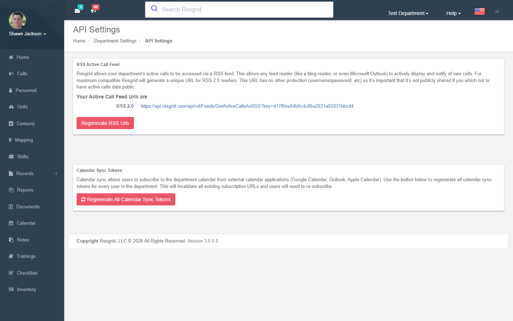

## Invites

`/User/Department/Invites` — send email invitations (comma-separated addresses); pending invites can be resent or deleted. Invitees create their own account and land in your department.

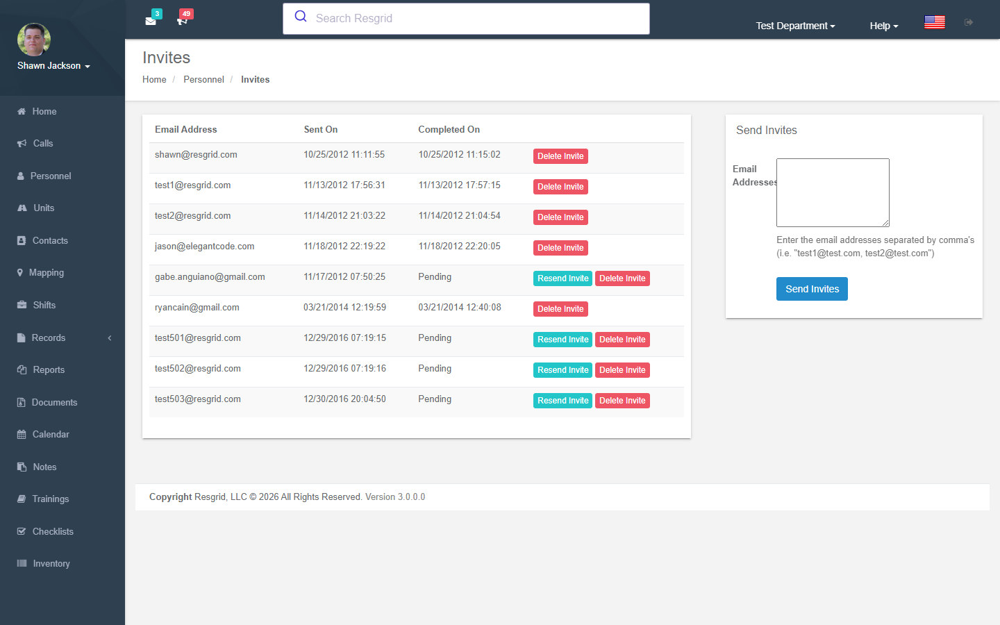

## Setup wizard

Setup is no longer a pop-up on this page. **Department menu → Admin Assist** (the first item in the menu) opens the **Setup Wizard**, a nine-step journey, with **Setup Report**, **Explore Resgrid & Addons** and **Admin AI** beside it; an unfinished setup also shows a prompt on the dashboard. The wizard does not save settings itself. Its steps link to the pages above and the other setup screens: make the change there, use **Return to setup and verify**, then **Verify again**. `/User/Department/SetupWizard` now redirects to Admin Assist. See [Help & Setup](help-setup).

Step 2 of the journey asks you to confirm the address and time zone on [General settings](#general-settings) and to fill in the **Department operating profile** (`/User/Department/OperatingProfile`): operating packs, workforce mix, dispatch model, operating hours, languages and accessibility, and links to approved local policies. The profile only suggests modules to review; see [Department operating profile](help-setup#operating-profile).

## Delete department

`/User/Department/DeleteDepartment` — the managing user can schedule deletion; it cancels subscriptions, marks the department for deletion and can be **cancelled** until processed.

## Setup examples

| Department | Settings worth changing from the defaults |
|---|---|
| **Volunteer fire** | Staffing reset daily 06:00 → Available; email import from county CAD (pick the matching format); *Also dispatch to entire group* on unit dispatch; modern sounds on. |
| **Career fire** | Use shift for group dispatch; set status on shift dispatch; unit status timers 4/8 minutes; run cards auto-dispatch; call numbers in the department's incident format, e.g. `FD-{YYYY}-{SEQ}` with 4 digits, raised to continue the year's numbers when moving to Resgrid. |
| **EMS** | Default call statuses: dispatched → *Responding*, released → *Available*; rest period 10 min; where turnout times are regulated (e.g. Belgian ambulances), in-quarters turnout 120 s and mobile turnout 30 s; require password reset via email; daily call numbers such as `{YYYY}{MM}{DD}-{SEQ}` where run sheets are filed by day. |
| **SAR** | Disable auto-available; New Call form: make *what3words* / coordinates visible; longer location TTL (240 min). |
| **Emergency management** | Modules: turn off Shifts and Inventory if unused; 24-hour time; text commands off. |
| **Security / business** | Branding in emails; text-to-call from client alarm centres; suppress notifications for *Off duty*. |

## Technical reference

| Item | Value |
|---|---|
| Controller | `DepartmentController` |
| Routes | `/User/Department/{Settings,Profile,ModuleSettings,DispatchSettings,CallSettings,TextSettings,UnitSettings,ShiftSettings,MappingSettings,Api,Invites,OperatingProfile,DeleteDepartment,ClearDepartmentCache}`; `/User/Department/SetupWizard` redirects to `/User/AdminAssist/SetupWizard` (see [Help & Setup](help-setup#technical-reference)) |
| Policy | `Department_Update` (administrators); managing-user checks for billing, ADP and deletion |
| Storage | `Department` row (organization type in `Department.DepartmentType`, text from `DepartmentTypeCatalog`) + `DepartmentSettings` rows keyed by `DepartmentSettingTypes` (e.g. 32 = ModuleSettings, 58–60 = run-card dispatch, 70–77 = Records settings, 115 = CallNumberingConfig: `Pattern`, `SequenceWidth` and the numbering year start `YearStartMonth` / `YearStartDay` / `YearLabel`, 117 = DocumentNumberingConfig: numbering year start and one pattern per document kind, 118 = DepartmentTerminology: the department's own names as `{Key, Text}` pairs, e.g. `module.units` / `record-type.run`). Custom document sequences live in `DocumentNumberSequences` (M0268). Call number sequences live in `CallNumberSequences`: one row per department and sequence (the text the pattern writes around `{SEQ}`), holding the last number issued and any raised next number |
| Unit dispatch / release status | Settings 50 (`UnitCallDispatchStatusToSet`) and 51 (`UnitCallReleaseStatusToSet`), read as a `StatusTarget`: -1 or unset = Default, -2 = leave unchanged, 1000 + an `ActionBaseTypes` value = that meaning (e.g. 1006 Dispatched, 1023 In Quarters), 0–999 = a built-in `UnitStateTypes` value saved before meanings (read by its meaning on custom sets). Resolved per unit by `StatusTargetResolver.ResolveUnit` (first active option by order; default chains Dispatched → Responding → En Route and Cleared → Available → In Quarters). Per-unit-type overrides are a separate setting and take precedence |
| Cache | Settings cached up to a day; **Clear department cache** enqueues a cache-clear event |
| Data endpoints | `GetStationsForGrid`, `GetRecipientsForGrid`, `GetDepartmentTypes` (organization type values), `GetCallEmailTypes`, `GetCallTextTypes`, `GetAvailableNumbers?country=&areaCode=`, `ProvisionNumber`, `GetSubscriptionLimitWarning`, `GetPrinterNetPrinters?key=` |
