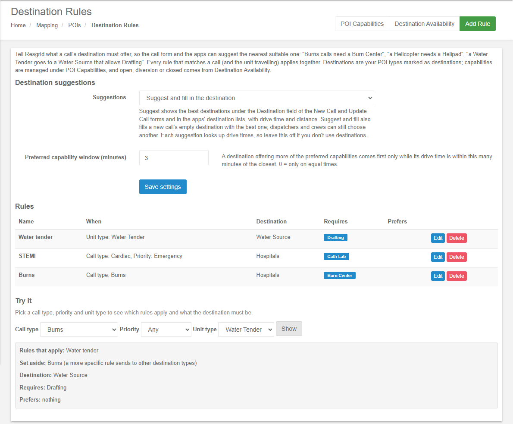
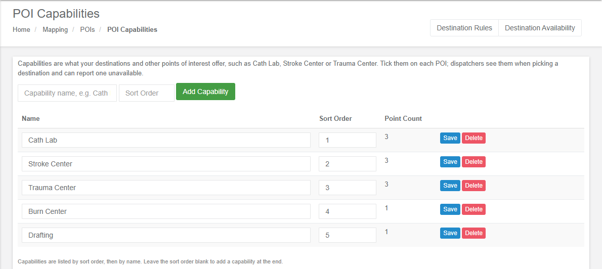
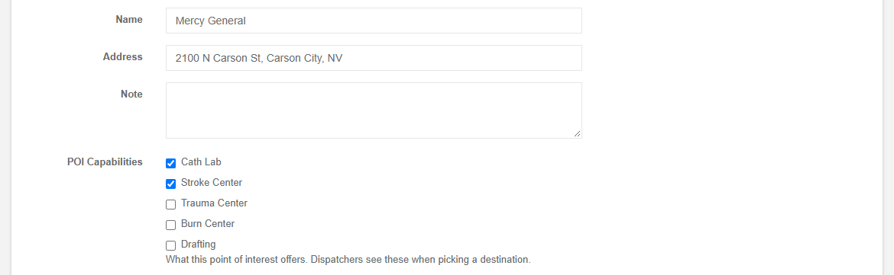
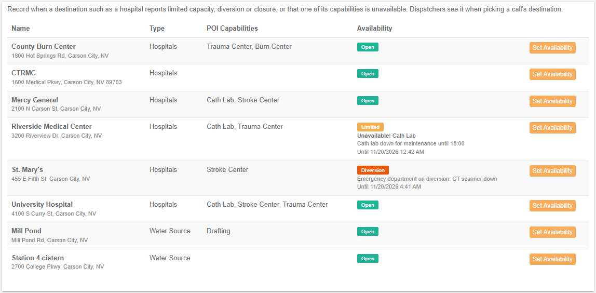
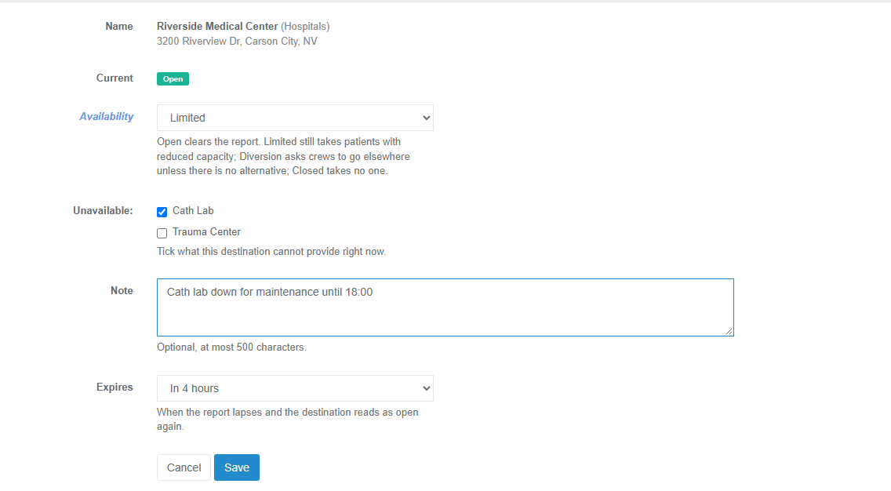
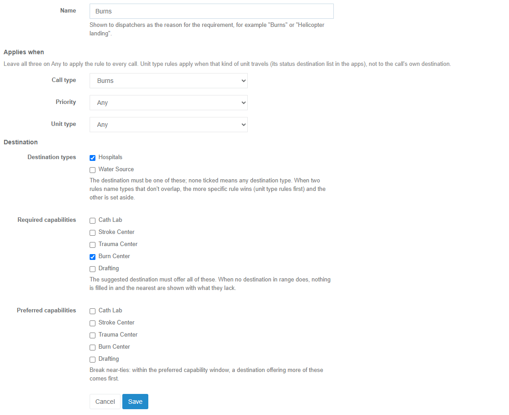
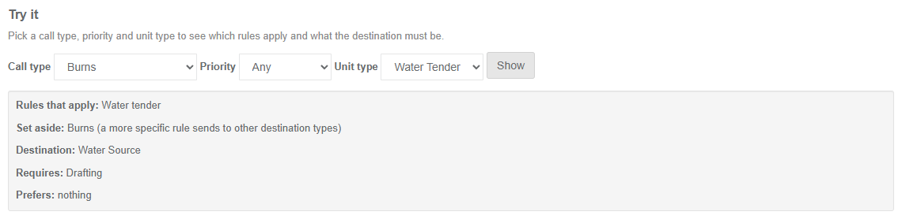
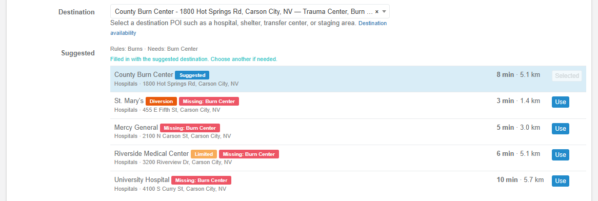

# Destinations

A **destination** is a place a call's patient, people or load are taken to: a hospital, a shelter, a water source, a helipad, a transfer centre. Destinations are your own [points of interest](mapping#points-of-interest-pois) whose POI type is marked **Is Destination**.

This page covers four things that work together:

- **What each destination offers** ([POI capabilities](#poi-capabilities)): *Cath Lab*, *Stroke Center*, *Burn Center*, *Helipad*, *Drafting*.
- **Whether it can take anyone right now** ([destination availability](#destination-availability)): a hospital on diversion, a closed emergency department, the cath lab down.
- **What a call or a unit needs** ([destination rules](#destination-rules)): "Burns calls need a Burn Center", "a Helicopter needs a Helipad", "a Water Tender goes to a Water Source that allows Drafting".
- **The best destination from where the incident is** ([destination suggestions](#destination-suggestions)): the call form and the apps list the nearest suitable destinations with drive time and distance, and can fill in the best one.

Nothing here stops a dispatcher or crew from choosing another destination. Capabilities, availability and rules only inform the choice, and rank the lists.

## Where to find it

| Page | Menu path | Who can open it |
|---|---|---|
| **POI Capabilities** | **Mapping → Manage POIs → POI Capabilities** | Department admins |
| **Destination Availability** | **Mapping → Manage POIs → Destination Availability**, or the **Destination availability** link under the Destination field of New Call and Update Call | Department admins and members who can create calls (dispatchers) |
| **Destination Rules** | **Mapping → Manage POIs → Destination Rules** | Department admins |
| **Suggested destinations** | Under the **Destination** field of [New Call and Update Call](dispatch-calls#locations-destinations-and-routes) | Anyone who can create or edit calls, once suggestions are on |
| **Destinations** (Dispatch app) | Side menu → **Destinations** | Dispatch app users; setting availability needs permission to create calls |

The three web pages link to each other from the buttons at the top. Admin Assist lists them as *POI capabilities*, *Destination availability* and *Destination rules* in the Mapping area.

**Before you start:** mark the POI types that are destinations. **Mapping → Manage POIs → Add POI Type** has an **Is Destination** box ("To denote a potential destination for a unit/person. For example an office, rally point, hospital, access point, etc."). Only POIs of destination types are listed on Destination Availability, offered as a call's destination, and suggested.

## POI capabilities {#poi-capabilities}

Capabilities are what your destinations and other points of interest offer. For hospitals that is typically *Cath Lab*, *Stroke Center*, *Trauma Center*, *Burn Center* or *Maternity Unit*; the same list works for any POI type: a shelter that takes pets, a helipad that can be used at night, a water source that allows drafting.

### Managing the list

**Mapping → Manage POIs → POI Capabilities** lists the department's capabilities:

| Column | Shows |
|---|---|
| **Name** | The capability, editable in place. Up to 100 characters; two capabilities cannot have the same name (ignoring case). |
| **Sort Order** | Capabilities are listed by sort order, then by name, everywhere they show. |
| **Point Count** | How many POIs offer it. |

- **Add Capability** adds one (*Capability name, e.g. Cath Lab*). Leave the sort order blank to add it at the end.
- **Save** on a row renames or re-sorts it.
- **Delete** asks *Delete the capability "…"? It is removed from every POI that offers it (…) and from every availability report.* A [destination rule](#destination-rules) that named it keeps working without it and is flagged *Needs attention* on the Destination Rules page.

### Ticking capabilities on a POI

**Add POI** and **Edit POI** show the department's capabilities as checkboxes under **POI Capabilities** ("What this point of interest offers. Dispatchers see these when picking a destination."). With no capabilities yet, the form says *No capabilities have been defined yet.* with a **Manage capabilities** link.

A **Capabilities** column in an [import file](mapping#importing-pois) tags each imported POI (also named *Specialties* or *Services*; several values separated by `;`, `,` or `|`; a KML placemark's ExtendedData works too). A name the department does not have yet is added to the list.

### Where capabilities show

- The POI type's **List** tab (**Mapping → Manage POIs → View**) has a **POI Capabilities** column.
- The web call form's **Destination** picker shows them after the name, with any availability other than open: *UZ Gent — Cath Lab, Trauma Center (Diversion)*.
- Destination Availability, the [suggestions](#destination-suggestions) and the Dispatch app's **Destinations** screen.
- In the apps, the destination step of a status, the call form's destination picker and the POI screens can be narrowed to one capability at a time, and rank what is left nearest first ([Transport destinations](dispatch-calls#transport-destinations)).

## Destination availability {#destination-availability}

When a hospital reports capacity overload, a closed emergency department or one service down, record it on the destination. Dispatchers and crews then see it wherever they pick a destination, and the lists rank it after the destinations that can take the patient.

| Availability | Meaning |
|---|---|
| **Open** | Taking everything it offers. Choosing Open clears the report. |
| **Limited** | Still takes patients with reduced capacity. Tick what it cannot provide right now. |
| **Diversion** | Asks crews to go elsewhere unless there is no alternative (emergency department diversion). |
| **Closed** | Takes no one. |

Nothing is refused: a crew with no alternative can still go to a destination on diversion or closed.

### The Destination Availability page

**Mapping → Manage POIs → Destination Availability** lists every destination POI by type and name:

| Column | Shows |
|---|---|
| **Name** | The destination, with its address. |
| **Type** | Its POI type. |
| **POI Capabilities** | What it offers. |
| **Availability** | Its status, what is unavailable, the note and *Until …* when the report expires. |

With no destination POIs yet it says *There are no destination POIs yet. Mark a POI type as a destination to list its POIs here.* Department admins also see **Destination Rules**, **POI Capabilities** and **POIs** buttons. A destination type's **List** tab has **Set availability** on each row too.

### Setting availability

**Set Availability** on a row opens:

| Field | What to enter |
|---|---|
| **Current** | The report in force and when it was set (*Set …*). |
| **Availability** | Open, Limited, Diversion or Closed. |
| **Unavailable:** | The capabilities it cannot provide right now (the ones the destination offers, plus any already reported). *This destination has no capabilities ticked.* when it offers none. |
| **Note** | What was reported, at most 500 characters. |
| **Expires** | **No expiry (until changed)**, **In 1 hour**, **In 2**, **4**, **8**, **12** or **24 hours**; or **Keep current (…)** when the report already has an end time. |

Saving shows *Availability of … set to …*. A report past its expiry reads as **Open** everywhere, without anyone changing it.

**Who can set it:** department admins and members who can create calls. In the apps:

- **Dispatch app:** **Destinations** in the side menu, **Set availability** on each destination (see [the Destinations screen](#destinations-screen-in-the-dispatch-app)).
- **IC app:** on the destination's own screen (map marker → **View POI Details** → **Availability** → **Set availability**).
- **Unit and Responder apps** show it (badges on the POI cards and in the destination lists, and the POI's **Availability** box) but do not change it.

The apps' sheet offers the same statuses and lengths (*Until changed*, *1 h* … *24 h*) and needs a connection: it is never queued offline.

### How availability is used

- **Badges.** Every destination list (web call form, apps' call forms, status destination lists, POI screens) shows *Limited*, *Diversion* or *Closed*; the apps add *Unavailable now* when the capability being looked for is down.
- **Ranking.** Destinations that can take the patient come first, those on diversion after them, and closed ones (or those reporting the needed capability down) last. See [how suggestions are ranked](#how-suggestions-are-ranked).
- **Statuses.** A unit status sent to a destination on diversion or closed says so to the crew.

## Destination rules {#destination-rules}

Destination rules tell Resgrid what a call's destination must offer, so the call form and the apps can suggest the nearest suitable one. Every rule that matches a call (and the unit travelling) applies together.

### The Destination Rules page

**Mapping → Manage POIs → Destination Rules** has three parts:

1. **Destination suggestions**: the **Suggestions** setting and the **Preferred capability window (minutes)** (see [Destination suggestions](#destination-suggestions)), saved with **Save settings**.
2. **Rules**: one row per rule, most specific first.
3. **Try it**: check which rules apply to a call.

| Column | Shows |
|---|---|
| **Name** | The rule. *Needs attention: N of its types or capabilities were deleted and are ignored.* or *Never applies: every destination type it named was deleted.* when something it used is gone. |
| **When** | *Every call*, or *Call type: …*, *Priority: …*, *Unit type: …* (*(deleted)* for one removed since). |
| **Destination** | The destination types it allows, or *Any destination type*. |
| **Requires** | Capabilities the destination must offer. |
| **Prefers** | Capabilities that break near-ties. |

**Add Rule** is shown once at least one POI type is a destination (otherwise: *No POI type is marked as a destination yet. Mark one as a destination under Mapping, POIs before adding rules.*). **Edit** and **Delete** are on each row. With no rules: *No destination rules yet. Without rules every destination is suggested, nearest open one first.*

### Adding or editing a rule

| Field | What to enter |
|---|---|
| **Name** | Required, up to 100 characters. Shown to dispatchers as the reason for the requirement, for example *Burns* or *Helicopter landing*. |
| **Applies when: Call type, Priority, Unit type** | Leave all three on **Any** to apply the rule to every call. Set one or more to narrow it; every condition set must hold. **Unit type** rules apply when that kind of unit travels (its status destination list in the apps), not to the call's own destination. |
| **Destination types** | The destination must be one of these; none ticked means any destination type. |
| **Required capabilities** | The suggested destination must offer all of these. |
| **Preferred capabilities** | Within the [preferred capability window](#the-setting), a destination offering more of these comes first. A capability that is also required counts as required only. |

A rule must name at least one destination type or capability (*Choose at least one destination type or capability.*). A call type, priority or destination type deleted since the rule was saved stays selected as *(deleted)*, so saving cannot quietly widen the rule to *Any*; saving is refused (*A call type, priority, unit type, destination type or capability you chose no longer exists. Check the choices and save again.*) until you choose a replacement.

### How rules stack

When a call (and possibly a unit) needs a destination, Resgrid takes every rule whose conditions all hold, most specific first:

1. **Unit type rules first**, then rules with more conditions, then by name.
2. **Required and preferred capabilities add up** across the rules that apply.
3. **Destination types narrow each other.** The first rule with types sets them; each later rule with types keeps only the types both allow.
4. **A rule that would leave no destination type is set aside**, with the reason *a more specific rule sends to other destination types*. A Water Tender on a Burns call goes to a water source with drafting, not nowhere.
5. **A rule naming no types always applies**, adding its capabilities to whatever the other rules allow.
6. **Deleted things drop out.** A capability or destination type deleted since (or a POI type no longer marked as a destination) is ignored. A rule whose every destination type is gone is set aside (*its destination types were deleted*). A rule whose call type, priority or unit type was deleted never matches.

For example, with these rules:

| Rule | When | Destination | Requires |
|---|---|---|---|
| Burns | Call type: Burns | Hospital | Burn Center |
| STEMI | Call type: Cardiac, Priority: Emergency | Hospital | Cath Lab |
| Water tender | Unit type: Water Tender | Water Source | Drafting |

| Situation | Result |
|---|---|
| A Burns call's destination | *Burns* applies: a hospital with a Burn Center. |
| An Emergency Cardiac call's destination | *STEMI* applies: a hospital with a Cath Lab. |
| A Water Tender's status destination on a Burns call | *Water tender* comes first (unit type). *Burns* names Hospital, which shares nothing with Water Source, so it is set aside: a water source with drafting. |
| A Medium-priority Cardiac call | No rule applies: any destination, nearest open one first. |

:::tip Give capability-only rules a destination type
A rule with no destination type applies to every unit on the matching calls. A *Pediatric* rule that requires a Pediatric ED but names no type would also ask a Water Tender's water source for a Pediatric ED, and find none. Tick **Hospital** on it and it is set aside for the tender instead.
:::

### Try it

**Try it** answers "which rules apply to this call, and what must the destination be?" without creating a call. Pick a **Call type**, **Priority** and **Unit type** and press **Show**:

- *Rules that apply*: the rules, most specific first;
- *Set aside*: rules that matched but were set aside, each with its reason;
- *Destination*: the destination types left, or *Any destination type*;
- *Requires* and *Prefers*: the capabilities, or *nothing*.

When no rule matches it says *No rule applies: any destination type, nothing required.* **Any** stands for a call or unit that does not match any rule's condition for that field, so only rules that leave that field on Any apply. Leave **Unit type** on Any to see what the call form uses for the call's own destination.

## Destination suggestions {#destination-suggestions}

With suggestions on, Resgrid ranks the department's destinations for the call (and the unit travelling) from the incident location: those that meet the [rules](#destination-rules) first, with drive time and distance, and marks the best one **Suggested**.

### The setting

At the top of **Destination Rules**:

| Setting | Options |
|---|---|
| **Suggestions** | **Off** (the default): nothing is suggested and no drive times are looked up. **Suggest destinations**: the best destinations show under the Destination field of New Call and Update Call and in the apps' destination lists. **Suggest and fill in the destination**: as Suggest, and a new call's empty destination is filled with the best one (and, in the Unit app, a unit's transport destination when nothing else is assigned); dispatchers and crews can still choose another. |
| **Preferred capability window (minutes)** | 0 to 30, default **3**. A destination offering more of the preferred capabilities comes first only while its drive time is within this many minutes of the closest. 0 = only on equal times. |

Each suggestion looks up drive times from the installation's routing provider, which is why the setting starts **Off**: leave it off if your department does not use destinations.

### How suggestions are ranked

1. **The allowed destinations.** Only destination types the rules allow (all of them when no rule names types).
2. **Tiers.** Each destination falls in one of four tiers, and a lower tier always comes first:

   | Tier | The destination |
   |---|---|
   | **Ready** | Offers every required capability, none of them reported unavailable, and is Open or Limited. |
   | **On diversion** | As Ready, but on **Diversion**. |
   | **Lacking** | Misses a required capability, or reports one unavailable. |
   | **Closed** | Reports **Closed**. |

3. **Drive times for the shortlist.** The 5 destinations nearest in a straight line that are Ready or on diversion get a routed drive time and road distance; when fewer than 5 qualify nearby, the nearest of the others fill the shortlist. For a unit, its own [travel mode](units#travel-mode) and vehicle limits apply.
4. **Inside a tier**, routed destinations go by drive time, except that those within the preferred capability window of the tier's fastest go by how many preferred capabilities they offer (and can provide now) first. Destinations without a drive time follow, by straight-line distance.
5. **Suggested** is the first destination, if it is Ready or on diversion. When none is, nothing is suggested or filled in, and the list shows the nearest with what they lack.

A department with no rules gets the fastest open (or limited) destination of the routed shortlist: the nearest few in a straight line are the ones given a drive time, so a destination further out that happens to be quicker by road is not compared.

### On the web call form

On **New Call** and **Update Call**, once the call has a location, a **Suggested** row appears under the **Destination** field. It updates when the call type, priority or location changes.

- The first line says why: *Rules: …* · *Needs: …* · *Prefers: …*.
- Up to 5 destinations, each with its name, a **Suggested** badge on the best one, its availability (*Limited*, *Diversion*, *Closed*; hover it for the note), *Missing: …* and *Unavailable now: …* for required capabilities, green labels for the preferred capabilities it offers, its type and address, and the drive time and road distance (*12 min · 8.4 km*, or *8.4 km straight line* without a drive time).
- **Use** puts that destination in the Destination field; the one in the field shows **Selected**.
- *No destination nearby offers everything required; the nearest are shown.* when nothing qualifies, and *No destination of the required kind was found.* when there is none of an allowed type.
- If the lookup fails: *Destination suggestions are unavailable right now.* with **Try again**. The Destination picker works either way.

**Suggest and fill in the destination** fills **New Call**'s Destination with the suggested one, saying *Filled in with the suggested destination. Choose another if needed.* It keeps following the type, priority and location until the dispatcher takes over, and takes its own fill back out when nothing qualifies any more. It never:

- replaces a destination the dispatcher picked, chose with **Use** or cleared by hand;
- replaces a destination that was on the form when it opened (for example after a failed save);
- fills over a [destination location](dispatch-calls#locations-destinations-and-routes) (an address, point or what3words), including one filled from the end of the call's route.

**Update Call** only suggests; it never fills. **Add Archived Call** has no suggestions. Unit type rules never apply on the call form: they are for the unit's own status destination.

### In the apps

**Call forms** (Dispatch, IC, Unit and Responder apps, new and edit call) show a **Suggested destinations** panel under the destination when **Point of interest** is chosen and the call has a location: the same requirement line, the 5 best with drive time and distance (*12:30 min · 8.4 km*), badges and **Use** / **Selected**. With *Suggest and fill in*, a new call's empty destination is filled the same way as on the web, never over a destination address or point, a route, or a destination someone chose.

Above the list, the panel (and the status destination list) says which rules applied and what they ask for (*Rules: Burns · Types: Hospitals · Needs: Burn Center*), and names any rule set aside with the reason (*Set aside: Burns (a more specific rule sends to other destination types)*). While new suggestions load after the type, priority or location changes, the old list is not shown; if the lookup fails, a short error with **Retry** replaces it, and a destination the panel had filled for the old details is taken back out. A destination cleared by hand stays cleared, even after switching the destination to an address and back. An older server that does not report the suggestions setting is treated as Off.

**Unit status destinations.** When a crew (or a dispatcher setting a unit's status) picks a destination for a status that offers points of interest, the list follows the rules for the call and the unit's type, ranked from the unit's last position (else the call's location), with *Suggested*, *Missing: …*, *Unavailable now: …* and *Assigned to call* tags. Choosing a capability chip switches to the nearest destinations offering it; **All** goes back. The status starts on, in order:

1. the hospital the unit already reported transporting to;
2. the call's assigned destination POI;
3. with **Suggest and fill in**, the suggestion, for a Transporting or At Hospital status or a status whose destination is points of interest only;
4. otherwise the call.

While the suggestion is on its way the summary shows *Finding the suggested destination...* and the save button waits, for up to 8 seconds; after that, or if the lookup fails, the status can be saved as it stands. With **Suggest destinations** the suggestion is only marked, never pre-selected. With *Hold to Set Status*, a hold saves straight away only to a reported or assigned destination; a suggestion always shows the list for the crew to confirm. Choosing a destination that lacks a required capability says so (*… does not offer what is required: …*) but is allowed.

### Destinations screen in the Dispatch app

**Destinations** in the Dispatch app's side menu has three tabs, refreshed each time it opens:

| Tab | Shows |
|---|---|
| **Availability** | Every destination with its type, address, availability badge, capabilities (struck through when down), note and end time, and **Set availability**. Search, *All* / *Not open* chips, type and capability chips, and a count line *Open · Limited · Diversion · Closed*. The tab's badge counts the destinations that are not open. |
| **Capabilities** | Each capability with how many destinations offer it and where it is unavailable now. Press one to list those destinations on the Availability tab. |
| **Rules** | Read only: the suggestions setting and window, and each rule with when it applies, the destination types, what it requires and prefers, and *Refers to deleted items (N); fix it on the web.* when needed. |

## Transport destination checks

When a unit's Transporting or At Hospital status goes to a destination other than its call's, the apps say *Differs from the call's assigned destination*. With **Transport destination checks** on ([Dispatch Settings](department-settings#call--dispatch-settings), setting 126, off by default) the crew must give a reason and Resgrid notes the change on the call. See [Transport destinations](dispatch-calls#transport-destinations).

## Setup examples

| Organization | How to set it up |
|---|---|
| **EMS** | POI type *Hospital* marked as a destination, with capabilities *Cath Lab*, *Stroke Center*, *Thrombectomy*, *Trauma Center*, *Burn Center*, *Maternity Unit* and *Pediatric ED* ticked on each hospital (or imported from a *Capabilities* column). Rules, each with destination type Hospital: *STEMI* (Cardiac, Emergency) requires Cath Lab; *Stroke* requires Stroke Center and prefers Thrombectomy; *Burns* requires Burn Center. Dispatchers set **Diversion** with a 4-hour expiry when a hospital calls in. **Suggest and fill in** so New Call starts on the right hospital; Transport destination checks on for the reason. |
| **Air ambulance** | POI type *Helipad* (destination) with capability *Night landing*; rule *Helicopter* (Unit type: Helicopter) with destination type Helipad. The helicopter's status destination list offers helipads only; ground ambulances keep hospitals. |
| **Fire (water supply)** | POI type *Water Source* (destination) with capabilities *Drafting*, *Hydrant fill*, *All-weather access*; rule *Water tender* (Unit type: Water Tender) with destination type Water Source, requiring Drafting and preferring All-weather access. Mark a dry pond **Closed** until it refills. |
| **Search and rescue** | Destination types *Trailhead* and *Landing zone*; capabilities *Vehicle access*, *Helicopter LZ*; a rule for the team's evacuation calls requiring Vehicle access. Suggestions on **Suggest destinations** only, so the incident commander chooses. |
| **Emergency management** | Destination type *Shelter* with capabilities *Pets allowed*, *Medical needs*, *Wheelchair accessible*; rules by call type (*Evacuation - medical* requires Medical needs). Mark a full shelter **Closed** with a note; **Limited** with *Pets allowed* unavailable when the pet area is full. |
| **Interfacility transport** | Destination types *Hospital* and *Dialysis centre*; capability *Bariatric*. A rule for Bariatric transfer calls requiring it. Recurring transfers keep their fixed destination; suggestions help one-off calls. |

## Technical reference

| Item | Value |
|---|---|
| Pages | `MappingController`: `GET /User/Mapping/PoiCapabilities`, `POST SavePoiCapability` (`poiCapabilityId`, `name`, `sort`), `POST DeletePoiCapability` (department admins); `GET Destinations`, `GET/POST SetPoiAvailability` (`poiId`, `returnTo=Type`; department admins or `CanCreateCall`). `DestinationRulesController`: `GET /User/DestinationRules/Index`, `GET/POST Edit?id=`, `POST Delete`, `POST SaveSettings` (`mode`, `preferredWithinMinutes`), `GET Preview?callTypeId=&priority=&unitTypeId=` (Try it) — all department admins; `GET Suggest?latitude=&longitude=&priority=&type=` (the call form, `Call_View`, 5 results). Writes need the anti-forgery token |
| Views and scripts | `Views/Mapping/{PoiCapabilities,Destinations,SetPoiAvailability,_PoiAvailabilityBadge}`, `Views/DestinationRules/{Index,Edit}`, `Views/Dispatch/_DestinationSuggestions` (New Call fills, Update Call suggests); `resgrid.mapping.destinationrules.js`, `resgrid.dispatch.destinations.js` (400 ms debounce, an answer reused for a minute) |
| Strings | `Resgrid.Localization.Areas.User.Mapping.Mapping` (capabilities, availability) and `.DestinationRules` |
| Storage | M0315: `PoiCapabilities` (`Name` ≤ 100, `Sort`), `PoiCapabilityAssignments` (POI ↔ capability, unique per pair), `PoiAvailabilities` (one row per POI: `Status` 1 Limited, 2 Diversion, 3 Closed; `UnavailableCapabilityIds`, `Note` ≤ 500, `SetByUserId`, `SetOn`, `ExpiresOn`; Open deletes the row, an expired row reads as Open). M0317: `DestinationRules` (`Name` ≤ 100, `CallTypeId`, `CallPriority`, `UnitTypeId`, comma-separated `PoiTypeIds`, `RequiredCapabilityIds`, `PreferredCapabilityIds`). No foreign keys; deletes and the department purge remove the rows |
| Settings | 126 `TransportDestinationChecks` (bool). 127 `DestinationSuggestions` = `DestinationSuggestionConfig` (ProtoBuf): `Mode` (`DestinationSuggestionModes` 0 Off, 1 Suggest, 2 SuggestAndFill; missing row = Off), `PreferredWithinMinutes` (default 3, 0–30). v4 `Config/GetConfig` carries `TransportDestinationChecks` and `DestinationSuggestionMode` |
| Rules | `DestinationRuleResolver` (Resgrid.Model): `Matches`, `Order` (unit type rules, then `ConditionCount`, then name), `Resolve` → `DestinationRequirements` (`PoiTypeIds` null = any, `RequiredCapabilityIds`, `PreferredCapabilityIds`, `AppliedRules`, `SetAsideRules` with `TypesRemoved` / `TypeConflict`). `IDestinationRulesService` (`SaveRuleAsync` checks every id belongs to the department; `BuildContextAsync` matches the call type by id or name and the unit's type by name) |
| Ranking | `INearestDestinationService`: `GetNearestDestinationsAsync` (one capability; can provide, then diversion, then the rest) and `SuggestDestinationsAsync` (tiers `DestinationTiers` Ready 0, Diversion 1, Lacking 2, Closed 3; shortlist `DefaultShortlistSize` 5 routed through `IGeoService.GetTravelEstimateAsync` with the unit's travel and vehicle profile; preferred window inside a tier; `SuggestedPoiId` only for Ready or Diversion; at most 50 results). Availability rules in `PoiAvailabilityRules` (`Current`, `StatusOf`, `CanProvide`; `MaxExpiry` 7 days) |
| v4 API | `GET Mapping/GetPoiCapabilities`; `GET Mapping/GetPois?destinationOnly=` and `GetPoi` (with `CapabilityIds`, `Capabilities`, `AvailabilityStatus`, `UnavailableCapabilityIds`, `AvailabilityNote`, `AvailabilitySetOnUtc`, `AvailabilityExpiresOnUtc`); `GET Mapping/GetNearestDestinations?latitude&longitude&capabilityId&unitId&take`; `GET Mapping/GetSuggestedDestinations?latitude&longitude&type&priority&callId&unitId&take`; `GET Mapping/GetDestinationRules` (read only, with names and `MissingReferenceCount`); `POST Mapping/SetPoiAvailability` (`Call_Create`). See [Maps & Routing API → Destinations](../api/maps-and-routing#destinations) |
| Apps | Omni capability `calls.destinationAvailability` (Dispatch and IC set availability). Dispatch app screen `/destinations` (`pois/screens/destinations.tsx`); call form panel `suggested-destinations-panel.tsx` (5 shown, 400 ms debounce); status destination list `status-picker.tsx` (`SUGGESTION_WAIT_MS` 8000) |
| Admin Assist | Capabilities *POI capabilities*, *Destination availability* and *Destination rules* (Mapping area); setting *Destination suggestions* |
