# Dispatch & Calls

**Calls** are the incidents, jobs, events and tasks your people respond to. Dispatching a call tells the right people and units about it — by push notification, text, email and voice — tracks who is responding and who is on scene, collects notes, photos and files, and closes with a disposition that feeds your records and reports.

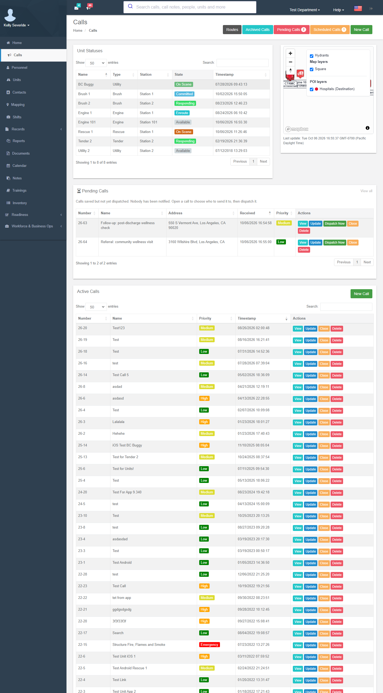

<AcademyVideo id="05-calls" />

<AcademyVideo id="06-dispatch-settings" />

## Where to find it

**Left menu → Calls.** The Calls page shows:

- **Unit statuses** — every unit with its current state and when it changed.
- **Active calls** — open calls with number, name, priority and time, plus **View**, **Update** and **Close** buttons.
- A **map** of active calls and units.
- **Pending calls** — a panel above Active calls, shown while any call is waiting for a dispatcher (see [Pending and scheduled calls](#pending-and-scheduled-calls)).
- Buttons for **Routes**, **Archived calls**, **Pending calls** and **Scheduled calls** (each with a count badge while calls are waiting) and **New Call**.

## Creating a call

**New Call** (the same form is used by the Dispatch app and by email/SMS import).

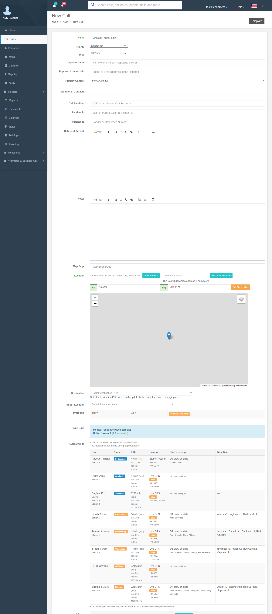

Your department decides which of these fields and sections the form shows and which are required ([New call form fields](department-settings#new-call-form-fields)); a hidden one is simply not on the form. The **Template** button, the contact pickers and **Type** only appear when the department has templates, contacts or call types.

| Field | What to enter |
|---|---|
| **Name** | Short title — this is the headline in every notification (`Structure Fire - 1450 Pine Ridge Rd`). |
| **Priority** | Low, Medium, High, Emergency or your [custom priorities](types-configuration#call-priorities). Priority decides the notification sound, colour and whether the call overrides quiet hours in the apps. |
| **Type** | Fire, Medical, Rescue … from your [call types](types-configuration#call-types). Type drives protocols, run cards, NERIS crosswalk and reporting. |
| **Reporter name / contact info** | Who called it in. |
| **Primary / additional contacts** | Link [Contacts](contacts) (a premises, a client, a company). Contacts with **alert notes** pop up a warning. |
| **Call identifier / Incident Id / Reference Id** | External CAD, parent incident and partner numbers for cross-referencing. |
| **Nature of the call** | The dispatch text; rich text supported. |
| **Notes** | Additional notes. |
| **Map page** | Map-book reference. |
| **Location** | Type an address and **Find Address**, enter a **what3words** address, enter latitude/longitude, or **Set pin on map**. Reverse geocoding fills the address from a pin. A call saved with an address but no pin is geocoded when it is created, so run cards and maps still get a location. **Location from a point of interest** picks the place from any of the department's [points of interest](mapping#points-of-interest-pois) instead (see [Locations, destinations and routes](#locations-destinations-and-routes)). |
| **Destination** | Where the call goes: a destination point of interest such as a hospital, shelter, transfer centre or staging area (from [Mapping → POIs](mapping#points-of-interest-pois)), **or** a destination location that is not a point of interest — an address, coordinates, what3words or a plus code. One destination only. The picker shows each destination's [capabilities and availability](destinations) (*UZ Gent — Cath Lab, Trauma Center (Diversion)*), and with [destination suggestions](destinations#destination-suggestions) on, a **Suggested** row under it lists the nearest suitable ones. |
| **Route** | A pre-defined [route](routes) for the unit working the call to follow. Only shown when the department has a route a call can follow. |
| **Indoor location** | A zone from an [indoor map](indoor-maps). |
| **Protocols** | Matching [dispatch protocols](protocols) are listed; answer their questions to attach guidance. |
| **Call links** | Link related calls. |
| **Personnel / Groups / Roles / Units** | Who to dispatch (see below). Each list can be hidden on its own; with every list hidden the form shows an optional **All Call** button instead. |
| **Call template** | Load a [quick template](templates) to pre-fill the form. |
| **Check-in timers** | Enable [accountability timers](call-checkin-timers) for this call. |
| **Schedule dispatch** | Delay the dispatch to a future time (at least 15 minutes ahead) — the call appears under *Scheduled calls* until then and is sent automatically at that time. |
| **Save as pending** | Save the call without dispatching it: nobody is notified and it waits under *Pending calls* until a dispatcher sends it. Any recipients you tick are kept as the proposed dispatch. Overrides *Schedule dispatch*. |
| **Custom fields** | Any [User Defined Fields](user-defined-fields) configured for calls. |

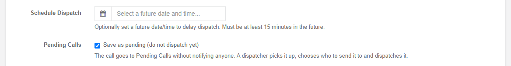

### Locations, destinations and routes

A call has a **location** (where it starts), an optional **destination** (where it goes) and an optional pre-defined **route** in between. The same fields are on **New Call**, **Update Call** and **Add Archived Call**, so pending and scheduled calls have them too, and [recurring calls](scheduled-calls#locations-destinations-and-routes) pass them on to every call they create.

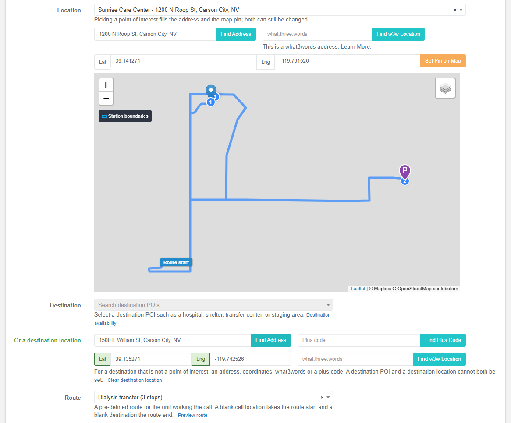

**Location from a point of interest.** Under the location fields, pick one of the department's points of interest, of any type (a station, a nursing home, a school), grouped by type. Picking one fills the address and the map pin; both can still be changed. The call remembers which point of interest it came from, and a blank address or pin is filled from it when the call is saved. The picker is on the form only when the department has points of interest and the form shows the address or the GPS coordinates.

**Destination.** Either a **destination point of interest** (as before) or, under **Or a destination location**, a place that is not one:

| Destination location | How |
|---|---|
| **Address** | Type it and **Find Address** to look it up and place the destination marker. |
| **Latitude / Longitude** | Type the point (with a decimal point, in any language). |
| **what3words** | Type the three words and **Find w3w Location**. The words are kept on the call. |
| **Plus code** | Type it and **Find Plus Code**. A plus code only finds the point and is never saved, as for the call location. |

A call has one destination: picking a destination point of interest clears and disables the destination location, and filling in a destination location disables the point of interest. **Clear destination location** empties it. The destination shows on the call map with its own marker. A destination location the address lookup cannot find says *No location was found for that destination*, and a point that is not a real coordinate is refused when the call is saved.

**Suggested destinations.** With [destination suggestions](destinations#destination-suggestions) on, a **Suggested** row under the destination point of interest lists the best destinations from the call's location (those meeting the department's [destination rules](destinations#destination-rules) for the call's type and priority first), with drive time and distance; **Use** picks one. With *Suggest and fill in the destination*, New Call fills an empty destination with the best one, never over a destination you chose or a destination location (including one from the route's end). Update Call only suggests. The **Destination availability** link under the field opens [Destination availability](destinations#destination-availability) for dispatchers.

**Route.** **Route** lists the department's [route plans](routes#route-plans) a call can follow: **Active** plans that have somewhere to start and somewhere to end (a station or explicit point, else the first and last stop; a plan with a single stop and nothing else does not count). Each shows its number of stops. Picking a route:

- fills a **blank call location** with the route's start and a **missing destination** with the route's end. What you already entered is never overwritten, and the server does the same when the call is saved (also for calls created through the API);
- draws the route line and its numbered stops on the call map (a dashed line in stop order when the route has not been generated yet);
- shows **Preview route** for members who may open [Routes](routes).

The route is for the unit working the call: in the [Unit app](../apps/unit#call-routes), setting the call as the active call starts the route and its navigation. **No route** removes it. A route that is paused, archived or deleted after the call was saved stays on the call, marked *(no longer available)* on **Update Call** (*Deleted route* once the plan is gone), so saving another change keeps it; a new call is only offered routes it can follow. The route has no [New call form fields](department-settings#new-call-form-fields) rule: it is on the form whenever there is a route to pick.

### Who gets dispatched

Tick any combination of the lists your department shows:

| Target | Effect |
|---|---|
| **Personnel** | Named members. The grid shows ETA to the call, current status, staffing and roles. |
| **Groups** | Every member of a station or group. With **Dispatch shift instead of group** on (Department Settings), only members signed up for today's shift are dispatched. |
| **Roles** | Every member holding a role (e.g. *Driver*, *Paramedic*). |
| **Units** | Apparatus and their crews. |

If [Run Cards](run-cards) are enabled, the recommendation for the call's priority/type is pre-filled here (or dispatched automatically). The recommendation panel refreshes when you change the priority or type and again as soon as the call is placed (Find Address, what3words, a map click or dragging the pin), so you can pick the type first and the location second. Units it recommends show their distance and, in closest-unit mode, their response time in minutes.

**When the department hides every list.** The form shows **All Call** in place of the lists. Leave it off to save an **informational call**: it is created and listed like any other call, but pages nobody (run cards that dispatch automatically still send their units). Switch it on to send the call to everyone in the department. On **Update Call**, All Call adds everyone to the call's recipients; left off, the call keeps the recipients it has.

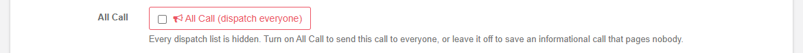

A call only goes to everyone when someone chooses that: **All Call** here, *Everyone* in the apps, or `"0"` through the API. A call created with nobody picked (for example from an older app whose picker the department hid) pages nobody.

### Nearest units

Once the call has a location, the **Nearest Units** table lists every unit you may see (a unit can be a team, an apparatus or an individual):

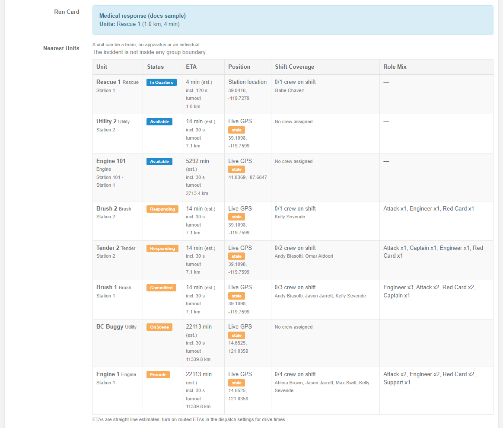

| Column | Shows |
|---|---|
| **Unit** | Name, unit type, station and service area, and a badge when the call is inside the unit's own (or parent) boundary. |
| **Status** | Current status, green when available. |
| **ETA** | Time to the call. When the department sets [turnout times](run-cards#how-closest-unit-mode-measures-a-unit) it is the full response time, with *incl. N s turnout* underneath. *est.* marks a straight-line estimate; without the mark it is a routed drive time (Dispatch Settings → *Order by driving ETA*, see below for which units get one). Distance in km below. |
| **Position** | *Live GPS* or *Station location*. A unit in an **In Quarters** status, or with no GPS position, is placed at its station. A GPS position older than the maximum location age is marked **stale**. |
| **Shift / Role mix** | Crew on shift and the roles they hold. |

Available units come first, in the order the department ranks closest units (Dispatch Settings → [Rank closest units by](run-cards#fastest-response-or-shortest-distance)): by response time by default, so the fastest unit is at the top, or by straight-line distance. A stale position is flagged on the row but does not push the unit down the list. Units with no position at all, and unavailable units, come last.

**Drive times.** With **Order by driving ETA** on, Resgrid looks up road drive times the same way a run card does:

- **Who gets one:** the **ETA shortlist size** best available units of *each unit type* (so ambulances and MUGs are each looked up, not just the nearest units overall), plus the closest responders.
- **Shared positions:** units at the same position, such as two ambulances in quarters at one station, share one lookup. A call makes at most 25 lookups.
- **Order within a type:** units with a looked-up drive time come before units with only an estimate, as in a run card. The first unit of each type is the one a closest-unit run card would pick for it, unless the run card skips it for staffing or a rest period.
- **Order across types:** the types are merged by response time (or distance).
- **The note** under the table says how many positions were looked up.

In *Shortest distance* mode the drive times are still shown, but they don't change the order.

**Travel modes and road closures.** Each unit is measured the way it travels ([travel mode](units#travel-mode)), and routed times go around or through the department's active [road closures](mapping#road-closures):

- A unit that cycles, walks or flies shows a **bicycle**, **walker** or **plane** icon and the mode's name under its time. Driving units show nothing extra and rank exactly as before.
- A cycling or walking unit's drive time is routed on cycle routes or footpaths. Units at the same position share a lookup only when they travel the same way, so a foot team and an ambulance at one station are each looked up.
- An air unit's time is the straight line at its air speed. It is never routed, so it carries no *est.* mark and uses none of the lookups.
- When road closures added time to a unit's route (a slowdown, or a detour the routing provider could not take), the row shows **+N min for road closures**; hover it for the closure names. A route that went around closures without added time shows *N road closure(s) avoided*.
- The note under the table names the closures the drive times account for.

Responders are always measured as driving. The [Dispatch app's](../apps/dispatch) unit picker ranks units the same way.

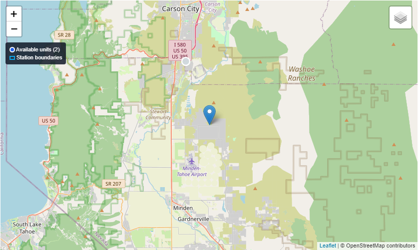

The call map draws only the **available** units and personnel, colored by their status, so it shows who can be sent. Busy and unavailable resources are left off the map but stay in the dispatch lists with their status, so a dispatcher can still pick one to reassign. **Update Call** and the [Dispatch app's](../apps/dispatch) New Call and Edit Call maps work the same way.

Where the installation has live traffic, the New Call, Update Call and Add Archived Call maps show it from the start; the car button on the map turns it off, and your choice is remembered on this device ([Live traffic](mapping#live-traffic)).

Press **Create Call**. Notifications go out immediately through the queue: push to the apps, SMS, email and voice according to each member's [notification preferences](profile-account) and [contact verification](../configuration/contact-verification) status. Notification text is generic when the department is enrolled in [Advanced Data Protection](data-protection). A call saved as pending or scheduled for later sends nothing until it is dispatched, and opens on the *Pending calls* page instead of the Calls dashboard.

## Working an active call

**View** opens the call page.

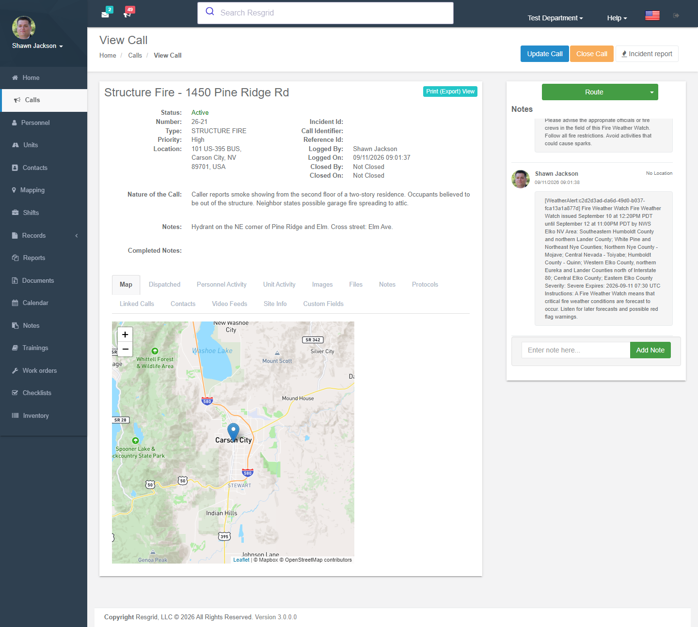

| Panel | What you can do |
|---|---|
| **Call details** | Everything entered above, with the dispatch audio if the call came from a radio/TTS source. **Location POI** names the point of interest the location was picked from; **Destination** shows the destination point of interest, or the destination location's address, coordinates and what3words; **Route** names the call's route (a link to it for members who may open Routes, *Deleted route* when the plan is gone). |
| **Route runs** | On a call with a route: each unit that started it, newest first, with its status (In progress, Paused, Completed, Cancelled …), stops done of the total and when it started and ended. Members who may open Routes can click the unit to open the run on [Routes](routes#monitoring-active-routes). *No unit has started this route yet* until one does. The call exports list them too. |
| **Map** | Call location, responding personnel and units live, route lines. Live traffic is available from the car button. |
| **Dispatched personnel / units** | Who was dispatched, their current status and timestamps (responding, on scene …). A unit navigating to the call in the Unit app shows its **live arrival time** beside its name; the time greys out when the unit has not reported for a minute and disappears when navigation ends. You see it only for units whose location you may see. **Unit Times** (top of the page, next to Print) opens the [Call Unit Times report](reports#call-unit-times-report) for the call: each unit's key times and its full status history until it was back in service. **Release** beside a unit or person stands them down from the call while it stays open; see [Releasing a unit or person from a call](#releasing-a-unit-or-person-from-a-call). |
| **Notes** | Add notes (with your location if allowed); **flag** a note for follow-up with a reason. |
| **Images and files** | Attach photos, documents, audio and video up to 10 MB; flag inappropriate items for [moderation](chat#moderation). |
| **Check-in timers** | PAR / rehab / IC / hazmat countdowns with **Check In** buttons and history. |
| **Incident report** | Start the [NERIS incident report](records/incident-reports) or a [Run record](records/authoring). |
| **Export** | Printable call export, PDF, and a shareable anonymous export link. |

**Update** changes any field, adds or removes dispatch targets (only the differences are applied) and can **rebroadcast** the notification. A unit or person [released from the call](#releasing-a-unit-or-person-from-a-call) stays on its record and is not ticked on the form; ticking them again sends them back. When the department uses [Run Cards](run-cards), a **Run card** panel above the dispatch lists shows what the call's run card still needs at its current alarm level, after the units and people already on the call; it follows the priority, type and location on the form, so changing them before saving updates it. **Select recommended** ticks those units and people in the lists; nothing is ticked on its own, so saving another change never adds resources, and nothing is sent until you save. **Close** asks for a **close state** (Completed, Cancelled, Unfounded, False alarm …) and closing notes. Tick **Send notification** to tell everyone on the call that it is closed: the personnel, groups and roles it was dispatched to (Responder app, text and email per their notification settings), its units (Unit app) and the incident command team — commander, people holding incident roles, and the people and units on the command board (Incident Command app). The notice names the call and how it was closed; the closing notes are not sent. Closed calls move to **Archived calls** and can be **re-opened**.

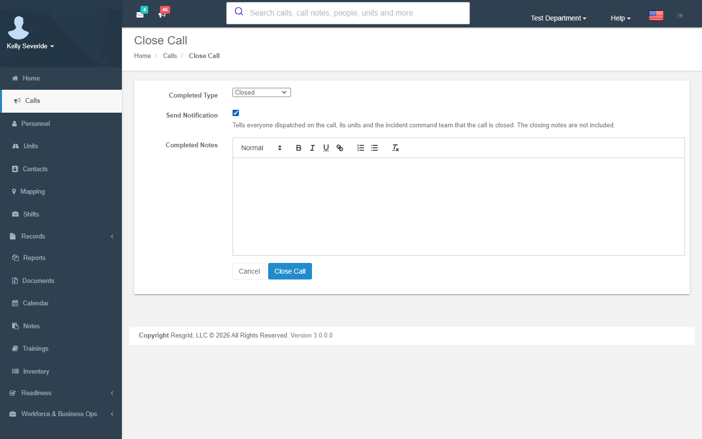

A call that is being run under an **active incident command** cannot be closed from here, the API, the chatbot or the auto-close job: close the command first. In the Incident Command app, **End Command** has an **Also close the call** option (with its own *Notify everyone on the call* switch) that closes the call right after the command; offline, both are queued and the call closes only once the command has.

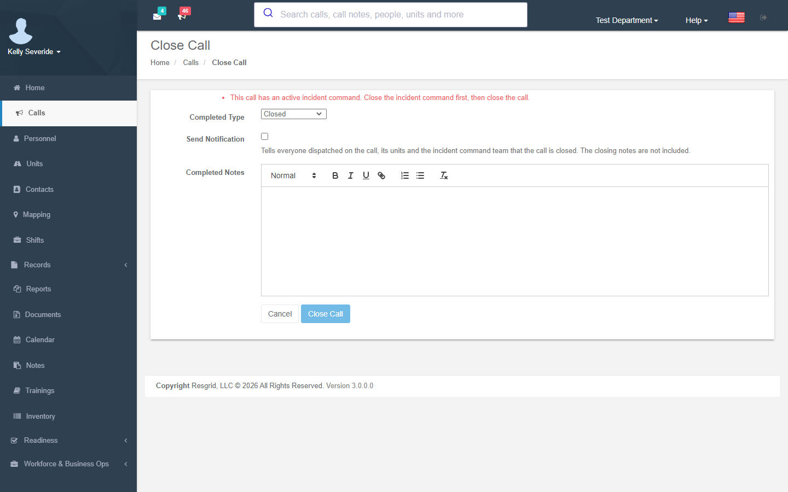

### Closing a call automatically

With **Close call when last unit clears** on ([Dispatch Settings](department-settings#call--dispatch-settings), off by default), an active call closes on its own when the last unit dispatched to it goes from working the call to back in service or out of service: a status whose [base type](../configuration/custom-statuses) is Available, In Quarters, Cleared, Completed or On Patrol, or Unavailable, Not Responding or Maintenance. An ambulance going *On Scene, Departing to Hospital, Arrived Hospital, Radio Available* closes the call when it reports *Radio Available*, as long as every other unit on the call has also cleared.

The call stays open for the dispatcher to close when:

- another unit on the call is still working it (returning, transporting, at the hospital), or has not reported a status since it was dispatched. A unit [released from the call](#releasing-a-unit-or-person-from-a-call) doesn't count, whatever it is doing now;
- the call has an active incident command, or no unit was dispatched to it (only units count, not personnel, groups or roles);
- the status has no base type, or the unit was not working the call (an available unit going out of service closes nothing);
- the status was set by Resgrid itself (dispatch and release statuses), or is an offline status replayed later.

The call is closed as **Closed** with a note naming the last unit, by the member who set that status. Release statuses are applied as on any close (units that cleared keep their statuses), the **Call Closed** workflow trigger fires, and nobody is notified. Calls where units skip statuses (no patient found, false alarm, patient deceased on scene) are still closed by the dispatcher.

Closing a call, by hand or automatically, never overrides a unit someone took out of service: the [release status](department-settings#call--dispatch-settings) only moves units still working the call.

**Delete** soft-deletes a call with a reason (it can be restored by support).

### Releasing a unit or person from a call

Sometimes a resource is no longer needed but the call goes on. The ambulance arrives first and stands the MUG (the emergency physician car) down before it gets there, or a second engine is turned back because the first has it in hand. **Release** takes that one unit or person off the call without closing it, so they are free for the next call.

Where to find it:

- **View Call** (web): a **Release** button beside each unit and person on the call.
- **Dispatch app** (Omni): the **−** button on a unit or person row while the console is filtered to a call, and on the call's **Dispatched** tab. The Incident Command app's **Dispatched** tab has it too.
- **Unit app** (Omni): **Release from call** on the active call card releases the crew's own unit.

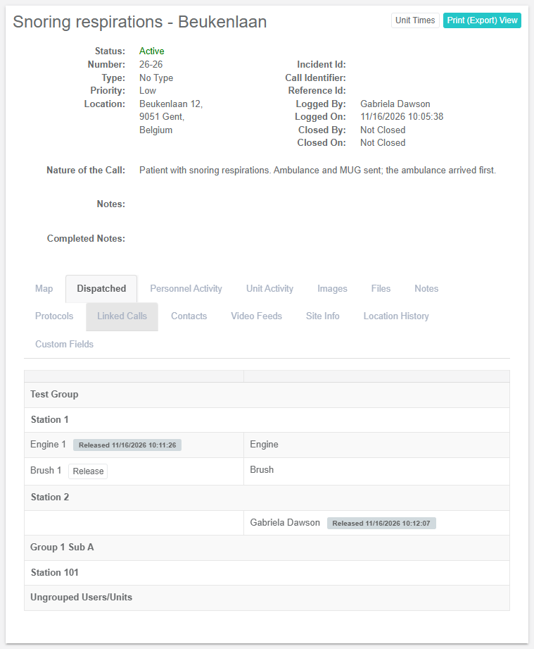

Confirm the release. With **Notify** on (the default), the unit or person gets a *Dispatch Cancelled* notice for the call: the unit's devices, or the person by their notification settings.

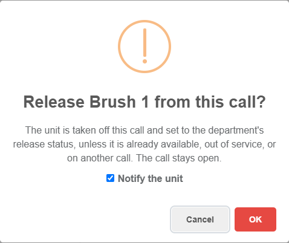

What a release does:

- **Status.** The unit gets the department's [Unit Call Release Status](department-settings#unit-status-on-dispatch-and-release). A person gets the **Person Call Release Status** ([Dispatch Settings](department-settings#call--dispatch-settings)) when one is set, otherwise the department's Available status. As when a call closes, a unit or person keeps their status if they are already back in service, out of service or unavailable, or are working another open call. A MUG crew that already reported *Radio Available* stays *Radio Available*.
- **Off the call.** The unit or person leaves the call's lists: the dispatched resources on View Call, and the *Units on call* and *Personnel on call* lists in the apps. A person reached through a dispatched group or role is left out too, even though the group or role stays on the call.
- **Free for other calls.** From then on Resgrid treats them as off the call:
  - a rebroadcast or [dispatch re-notification](department-settings#call--dispatch-settings) doesn't page them again;
  - they don't get the call-closed notice, and the call's check-in timers no longer wait for them;
  - they no longer count toward the call's [run card](run-cards) requirements, so they can be recommended again;
  - they don't hold the call open for [Closing a call automatically](#closing-a-call-automatically);
  - they drop out of the *calls I'm on* badge and the active calls counts;
  - their next statuses are not put back on the call (see [Which call a status belongs to](#which-call-a-status-belongs-to)).
- **Kept on the record.**
  - The call's history shows that the unit or person was released, and when.
  - The unit's dispatch time stays on the call.
  - The [Call Unit Times report](reports#call-unit-times-report) has a **Released** column.
  - An incident report started from the call fills *canceled en route* for a unit that was released before it arrived.

Who can release:

- **A unit:** anyone who may edit the call, or the unit's own crew (anyone allowed to set that unit's status).
- **A person:** anyone who may edit the call, a department admin, or the person themselves.

Only an open call that has gone out has resources to release. A pending or scheduled call is changed by editing its dispatch list.

**Sending them back.** Tick the unit or person again on **Update** (or the Dispatch app's call edit, or add them as a resource) and save. That is a new dispatch: they are paged and get the dispatch status as usual. A person released from a call comes back only when they are picked by name. Paging their group or role again doesn't bring them back.

### Transport destinations

A call's **Destination** (a hospital or other destination POI, chosen when the call is created or edited) is where its patient or load is taken. When a unit's status has the [base type](../configuration/custom-statuses) **Transporting** or **At Hospital** and the status offers points of interest as destinations, the Omni, Unit and Dispatch apps pre-select the call's destination instead of the call, marked *Assigned to call* in the list. The crew or dispatcher only confirms it. The call's destination must be a destination POI the status offers; otherwise the status starts on the call as before. A call whose destination is a [destination location](#locations-destinations-and-routes) rather than a point of interest has nothing to pre-select, so the status starts on the call; the call's map in the apps can switch to the destination. The Dispatch app does the same when a dispatcher sets a unit's status: it starts on the destination of the call the console is filtered to, or else of the call the unit is working. A unit already transporting to a hospital (its current status is Transporting or At Hospital with that hospital) starts on that hospital instead, so a crew that changed hospital on *Departing to Hospital* keeps it for *Arrived Hospital*.

Choosing another point of interest shows *Differs from the call's assigned destination* with the call's destination, so the dispatcher can confirm the change by radio. In the Omni dispatch console, a unit whose transport status points somewhere other than its call's destination shows the call's destination in red under its row.

With **Transport destination checks** on ([Dispatch Settings](department-settings#call--dispatch-settings), off by default):

- choosing another destination needs a reason, entered as the status note (STEMI for a cath lab, stroke centre, trauma centre, emergency department closed). Arriving at the hospital the unit already reported does not ask again;
- Resgrid adds a note to the call naming the unit, the status, both destinations and the reason, for example *ZW Herzele set Vertrek ZH to UZ Gent, not the call's assigned destination AZ Sint-Elisabeth Zottegem. Reason: STEMI, cath lab*. A unit that then reports *At Hospital* at the same place is not noted again. A status from an app version that predates this setting is saved without asking, and its note says no reason was given.

When the crew asks for a different hospital ("the nearest cath lab"), the destination step's points of interest can be narrowed to one [capability](destinations#poi-capabilities). With the unit's position known they are ranked nearest first: the closest by drive time (the unit's own travel mode and vehicle limits apply), destinations on [diversion or closed](destinations#destination-availability) after those that can take the patient. The call form's destination picker ranks the same way from the call's location.

With [destination suggestions](destinations#destination-suggestions) on, the list follows the department's [destination rules](destinations#destination-rules) for the call and the unit's type (a helicopter to a helipad, a water tender to a water source) and marks the best one *Suggested*. With *Suggest and fill in the destination*, a transport status starts on that suggestion when the unit has reported no hospital and the call has no destination point of interest (see [In the apps](destinations#in-the-apps)).

The call's destination itself does not change: it is the one dispatch assigned, and each unit's status shows where that unit went. A status pointing at a hospital is no longer on the call's record; the [Call Unit Times report](reports#call-unit-times-report) still includes it.

### Which call a status belongs to

Crews often set a status without choosing a call: they tap *On Scene* and carry on. Resgrid then puts the status on the call the unit or person is working, so it shows on that call's record and counts toward its times. In order:

1. **A call they chose** is kept.
2. **The call of their previous status**, while that call is open and the previous status did not clear it. *On Scene* after *Responding* to call 26-153 goes on 26-153, and so does the *Available* that ends it (that records when the unit cleared).
3. **The one open call they are dispatched to**, for a status that is not itself a clear. Calls their last clear already ended are left out:
   - a clear that named a call ended that call;
   - a clear that named no call (back in quarters, available at a station, or no destination at all) ended every call they had been sent to before it. Only a dispatch, or a re-dispatch, after that clear is new work.

   With more than one call left, the status is not linked to any.

A *clear* is a status whose [base type](../configuration/custom-statuses) is Available, In Quarters, Completed, On Patrol, Cleared, Returning, Unavailable, Not Responding or Maintenance, plus the built-in unit statuses Available, Unavailable, Out of Service, Returning, Cancelled and Released and the built-in personnel statuses Available, Not Responding and Available Station.

For example, Medic 12 is dispatched to 26-153, clears *In Quarters* at its station while 26-153 stays open for the engine, then reports *Responding* without picking a call. That status is not put on 26-153. If Medic 12 has been dispatched to 26-160 since it cleared, the status goes on 26-160.

Some statuses are placed differently:

- A person put on a unit by a unit status goes on that unit status's call.
- A unit or person [released from a call](#releasing-a-unit-or-person-from-a-call) is off it: steps 2 and 3 never put a later status back on that call, and the call's record of them ends at the release.
- A [scheduled call](#pending-and-scheduled-calls) counts only once it has gone out or its dispatch time has passed, and a pending call only once it is dispatched. Statuses set before then are not linked to it.
- A status replayed from an app's offline queue skips steps 2 and 3 when it arrives. The call record still shows statuses without a call that a dispatched unit or person set while working it, placed by their own time.

The same rules pick the call a unit's next status starts on in the [Dispatch app](../apps/dispatch#personnel--unit-action-panels).

## Pending and scheduled calls

Two kinds of call can wait before anyone is notified:

- **Pending calls** have no dispatch time. They wait until a dispatcher picks one up, chooses who to send it to and dispatches it — the typical use is follow-up work fed in from another system (a case-management or scheduling system, a referral line) or calls taken now for a team to pick up later.
- **Scheduled calls** have a dispatch time and are sent automatically when it arrives.

Both show as count badges on the **Pending calls** and **Scheduled calls** buttons of the Calls dashboard, and pending calls also get a panel above Active calls (see the screenshot at the top of this page).

**How a call becomes pending:** tick **Save as pending** on New Call (web or the [Dispatch app](../apps/dispatch)), or create it through the API with `"IsPending": true` (see [Technical reference](#technical-reference)). Calls from [intake channels](intake-channels/overview) and the [Private Inbound Dispatch Number](intake-channels/dedicated-number) are always pending, and emailed calls are too when the department's [email call mode](dispatcher-desk#email-call-mode) says so. A pending call is numbered and saved like any other call, but:

- nobody is notified, and dispatch statuses are not applied;
- it does not appear in the active calls lists, on maps, the Big Board or the Responder and Unit apps;
- it does not count as active or archived; it is listed only under **Pending calls**;
- the New Call form's dispatch-list and dispatch-time requirements (Department Settings → *New call form fields*) do not apply to it — the dispatcher chooses recipients when sending it; every other required field still does.

**Pending calls page** (the **Pending Calls** button on the Calls page, or **View all** on the dashboard panel) lists waiting calls oldest first with **View**, **Update**, **Dispatch Now**, **Close** and **Delete**.

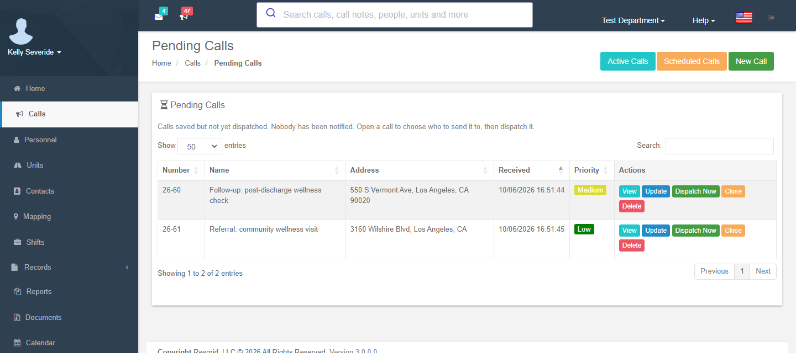

**Working a pending call**

| Action | What happens |
|---|---|
| **View** | The call page shows a *Pending* banner and a **Dispatch Now** button; Re-Open and Strike Alarm are not offered. |
| **Update** | Edit any field and pick who to send it to. Saving keeps it pending and notifies nobody; **Save and Dispatch Now** saves and sends it in one step. |
| **Dispatch Now** | Sends the call to everyone on its dispatch list. If the list is empty you are taken to *Update* to choose recipients first. |
| **Schedule** | Give it a *Schedule dispatch* time on *Update*: it becomes a scheduled call. |
| **Close** | Cancel it (or close it with any close state) without notifying anyone. |

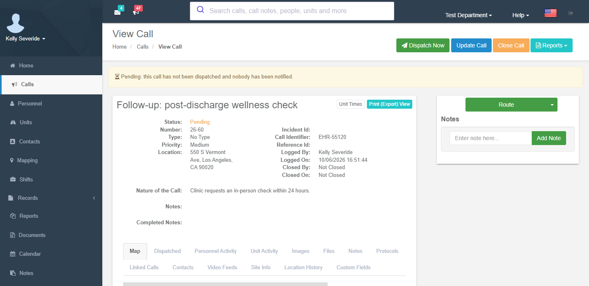

**When a waiting call is dispatched** it becomes an active call, its dispatch time is recorded separately from the time it was received, run card auto-dispatch is applied, notifications go out, and dispatch statuses are set. For a pending call this is also when the **Call Added** [workflow](workflows) trigger fires and the call's incident chat channel is created (when chat is on), not when it was saved.

**Scheduled calls page** (the **Scheduled Calls** button on the Calls page) lists calls waiting for their time, with **View**, **Update**, **Dispatch Now** (send early), **Close** and **Delete**. A scheduled call is sent within five minutes of its time by the scheduled-calls job. Adding or removing recipients before then notifies nobody — the updated list is used when it goes out. Until then the units and people on its list are not on the call: a status they set is not [linked to it](#which-call-a-status-belongs-to), and it is not the call a unit's next status starts on in the Dispatch app. A scheduled call closed before its time is never sent.

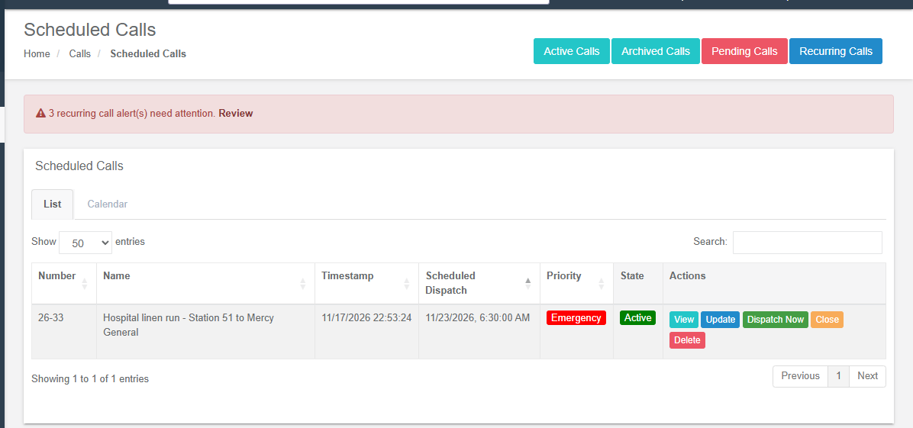

The [Dispatch app](../apps/dispatch) has the same two lists, with tiles on its console.

**On the dispatcher desk.** When the department's [dispatcher desk](dispatcher-desk) is routing work, every pending call is also **offered to a dispatcher on duty** in the Dispatch app, one at a time, with a push notification; if nobody takes it, it waits in the desk's shared queue until someone is free. Scheduled calls come to the desk for review 15 minutes (by default) before they go out, and still go out by themselves at their time. A pending or scheduled call dispatched or closed from this page leaves the desk on its own. See [Routing and offers](dispatcher-desk#routing-and-offers).

**Calls from intake channels** show where they came from in a banner on the call's page (*via Email: Hospital transfer line*), and on the pending calls list. [Spam screening](intake-channels/overview#spam-screening) labels show beside the source (*Enhanced AI: likely not an incident*, *Repeat sender: over the hourly limit*), and while the call is pending, **Dismiss as spam** cancels it without notifying anyone and can block the sender. A call with a text conversation shows the **Text conversation** panel ([Text conversations](intake-channels/dedicated-number#text-conversations)).

### Calendar of scheduled calls

The **Calendar** tab on the Scheduled calls page shows every scheduled call waiting to go out, the calls [recurring calls](#recurring-calls) have created and their runs still to come, waiting for a dispatcher, held or missed, by month, week, day or as a list. See [Scheduled & Recurring Calls](scheduled-calls#the-calendar).

The department [calendar](calendar) has a **Show scheduled calls** box that adds the same entries to it, for members who can see calls.

## Recurring calls

A recurring call is a call dispatched on a schedule — for example interfacility transfers every Tuesday and Thursday at 08:00, 13:00 and 19:00. Resgrid creates each call ahead of its time (or alerts a dispatcher to send it), sends it to the units and people you chose when it is due, leaves off those who are not available, holds the call for a dispatcher when nobody is left, and alerts the dispatchers when something needs fixing. Open **Recurring Calls** from the Scheduled calls page, or press **Repeat** on any call to start one filled in from that call. Everything about them — the form, pausing, alerts, the Dispatch app, workflows and the API — is on [Scheduled & Recurring Calls](scheduled-calls).

## Archived calls

**Archived calls** — closed calls by year, with view and export. **Add archived call** creates a historical call with a custom date and pre-set closed state (optionally recalculating the year's call numbers with your department's [call number pattern](department-settings#call-numbering); not available for a pattern with no year) — useful when importing history or logging a call that happened outside Resgrid. It has the same location point of interest, destination and route fields as New Call. New calls are numbered with that pattern too. Pending calls are never listed here.

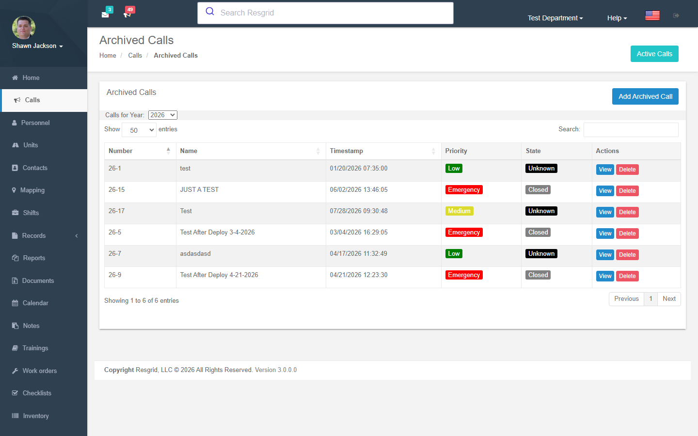

## Other ways calls arrive

| Source | How to set it up |
|---|---|
| **Email** | Send or forward CAD pages to your department's dispatch import address ([Call import settings](department-settings#call-import-settings)); choose the parser format for your CAD. The [email call mode](dispatcher-desk#email-call-mode) decides whether they go out at once or wait as pending calls. |
| **SMS / text** | Text to the department number ([Text messaging](department-settings#text-messaging)). With the [dispatcher desk](dispatcher-desk#texts-and-calls-to-the-desk) on, texts and phone calls from people who are not members go to a dispatcher. |
| **Intake channels** | Emails to an address you choose, messages in a linked Slack, Teams, Telegram, Discord, Google Chat or WhatsApp chat, and signed webhook requests from other systems become **pending calls**, read by a call template or by Enhanced AI ([Intake Channels](intake-channels/overview)). |
| **Private Inbound Dispatch Number** | Your department's own number (add-on): texts become pending calls with a text conversation, and callers who are not members answer spoken questions ([Private Inbound Dispatch Number](intake-channels/dedicated-number)). |
| **Dispatch app** | Same form on tablet or desktop. |
| **API** | `api/v4/Calls/SaveCall` with an API key or OAuth token. Add `"IsPending": true` to queue it under *Pending calls* for a dispatcher instead of dispatching it. |
| **Workflows / Assistant** | Workflow actions and the chat Assistant can create calls when allowed. |
| **Voice** | Automated voice dispatch reads the call out over the phone or radio TTS. |

## Setup examples

| Department | Recommended call configuration |
|---|---|
| **Volunteer fire** | Priorities Low/Medium/High/Emergency; types Fire, Medical, MVA, Rescue, Alarm, Public assist; dispatch to Groups (stations) with *Dispatch shift instead of group* off; email import from county CAD; run cards for structure fires. |
| **Career fire / combination** | Run cards with auto-dispatch; closest-unit mode; check-in timers (PAR every 20 min) on Fire types; NERIS crosswalk for every type. |
| **EMS** | Types by determinant (ALS/BLS/IFT); dispatch to Units; destination POIs for hospitals with their [capabilities](destinations#poi-capabilities), [availability](destinations#destination-availability) and [destination rules](destinations#destination-rules) (STEMI → Cath Lab), suggestions on *Suggest and fill in*; ADP enrolled. When the first crew stands a second resource down (the MUG turned back), **Release** it so it is free for the next call. Regular interfacility transfers as [recurring calls](#recurring-calls) dispatched to the transfer unit. |
| **SAR** | Types Search, Rescue, Recovery, Training; dispatch to Roles (Team leader, K9, Technical rescue); what3words locations; long check-in timers for field teams. |
| **Emergency management** | Types Activation, Weather, Shelter, Resource request; dispatch to Roles (ESF leads) and Groups (EOC sections); scheduled calls for planned activations. |
| **Security / facilities** | Types Alarm, Patrol request, Escort, Medical, Incident; contacts for client sites with alert notes and gate codes; indoor locations. |
| **Behavioral health / crisis teams** | Types Crisis evaluation, Welfare check, Follow-up, Referral; follow-ups pushed from the case-management system as **pending calls** through the API, dispatched by a dispatcher to the closest team; teams as Units with Clinician and Peer seats; check-in timers on field visits; [Advanced Data Protection](data-protection) and the *42 CFR Part 2* consent flag. |
| **Delivery / transit** | Types Delivery, Pickup, Breakdown, Route deviation; dispatch to Units (vehicles); destination POIs, or a destination location for a one-off drop; pick a pre-defined [route](routes) on the call so the unit's crew drives it stop by stop in the Unit app. |

## Technical reference

| Item | Value |
|---|---|
| Controller | `DispatchController` |
| Routes | `/User/Dispatch/{Dashboard,NewCall,ViewCall,UpdateCall,CloseCall,DeleteCall,ReOpenCall,ArchivedCalls,AddArchivedCall,ScheduledCalls,PendingCalls,CallData,CallExport,CallExportEx,CallExportPdf,GetCallDispatchAudio}` (`?callId=`); `DispatchCallNow` (POST, antiforgery, `callId`) |
| Call states | `CallStates`: 0 Active, 1 Closed, 2 Cancelled, 3 Unfounded, 4 Founded, 5 Minor, 6 Transferred, 7 False alarm, **8 Pending**. A scheduled call is Active with `DispatchOn` in the future and `HasBeenDispatched = false`. |
| Pending / scheduled | `IPendingCallsService` (`IsWaitingForDispatch`, `DispatchNowAsync`); scheduled calls sent by the worker `DispatchScheduledCallsTask` every 5 minutes (calls due in the last 15 minutes, active only). Dispatcher desk: `DispatcherDeskCallEventService` puts each pending call on the desk, worker 82 sweeps pending calls and scheduled calls inside `ScheduledCallLeadMinutes` (setting 128); see [Dispatcher Desk → Technical reference](dispatcher-desk#technical-reference). Intake calls: `CallSources` 6 Intake, 7 VoiceIntake; `CallResultData.IntakeScreening`; see [Intake Channels → Technical reference](intake-channels/overview#technical-reference) |
| Recurring calls | See [Scheduled & Recurring Calls → Technical reference](scheduled-calls#technical-reference). |
| Status linking | `ICallStatusAttributionService`: `AttributeUnitStateAsync` / `AttributeActionLogAsync` on save (rules 2 and 3 only for statuses at most five minutes old, `CallStatusAttribution.IsLiveStatus`), stored as `DestinationSource` (`StatusDestinationSources` Explicit, CarryForward, Dispatch, Unit); read-time `Inferred` statuses are never stored. Rules in `CallStatusAttribution` (`CanCarryForward`, `ClearedByPrevious`, `PickDispatchCall`); clears per `CallStatusLinkage.IsClearingUnitState` / `IsClearingPersonnelStatus`. Open dispatches from `ICallDispatchUnitRepository.GetOpenCallUnitDispatchesForUnitAsync` and `ICallDispatchesRepository.GetOpenCallDispatchesForUserAsync` (direct, group and role rows; time = `LastDispatchedOn` else `DispatchedOn`; active calls only, a scheduled call once `HasBeenDispatched` or `DispatchOn` ≤ now). The Dispatch app's starting call is v4 `UnitsInfoResultData.ActiveCallId` (`GetWorkingCallIdsForUnitsAsync` → `UnitCallInvolvement.ResolveWorkingCallId`); null means no single working call, not that the unit is unassigned. |
| Policies | `Call_View`, `Call_Create`, `Call_Update`, `Call_Delete` + `IAuthorizationService.CanUser{Create,Edit,Close,Delete}CallAsync` |
| Permissions | `CreateCall`, `DeleteCall`, `CloseCall`, `AddCallData` |
| Field rules | Department setting 61 `NewCallFieldPolicy` (`NewCallFieldKeys`: `address`, `geolocation`, `what3words`, `pluscode`, `destinationPoi` (covers a destination POI and a free destination; either satisfies it), `indoorLocation`, `mapPage`, `note`, `contactName`, `contactInfo`, `primaryContact`, `additionalContacts`, `externalId`, `incidentId`, `referenceId`, `protocols`, `linkedCall`, `dispatchPersonnel`, `dispatchGroups`, `dispatchRoles`, `dispatchUnits`, `dispatchList`, `checkInTimers`, `part2Consent`, `dispatchOn`, `pendingCall`). `dispatchList` carries the requirement only; its visibility is worked out from the four list keys (`NewCallFieldPolicy.IsVisible`). Enforced by `NewCallFieldPolicyValidator` on the web forms and v4 `SaveCall`/`EditCall`; `GET Calls/GetNewCallFieldPolicy` returns the effective rule of every key that is not shown-and-optional. |
| Events | `CallAddedEvent`, `CallUpdatedEvent`, `CallClosedEvent`; broadcast via `IQueueService.EnqueueCallBroadcastAsync` (push/SMS/email/voice) |
| Destination capabilities | M0315 `PoiCapabilities`, `PoiCapabilityAssignments`, `PoiAvailabilities` (no foreign keys; purged with the department). `IMappingService` capability and availability methods, `PopulatePoiDetailsAsync` on v4 `Mapping/GetPois`, `GetPoi`, `Dispatch/GetNewCallData`, `GetSetUnitStatusData`. v4 `Mapping/GetPoiCapabilities`, `GetNearestDestinations` (`INearestDestinationService`: shortlist of 5 routed, can-provide before diversion before closed), `SetPoiAvailability` (`Call_Create`). Omni capability `calls.destinationAvailability` (Dispatch, IC). Rules and suggestions: M0317 `DestinationRules`, setting 127 `DestinationSuggestions`, web `DestinationRules/Suggest` (partial `_DestinationSuggestions`, script `resgrid.dispatch.destinations.js`), v4 `Mapping/GetSuggestedDestinations`, `GetDestinationRules`. See [Destinations → Technical reference](destinations#technical-reference). |
| Transport destinations | `TransportDestinationRules` (base types Transporting 12 and At Hospital 15; deviation = a POI destination other than `Call.DestinationPoiId`). Setting 126 `TransportDestinationChecks` (v4 config `TransportDestinationChecks`). `ITransportDestinationCheckService.OnUnitStateSavedAsync` runs from `UnitsService.SetUnitStateAsync` (unit reports only) and `FinishUnitStateAsync`; the working call comes from `ICallStatusAttributionService.GetWorkingCallIdForUnitAsync` on the unit's previous status. The note is English, source System. Apps: Omni `resolveAssignedDestinationPoi` / `isTransportDestinationDeviation` (status-destination), console `unitTransportDestinationMismatch`. |
| Locations and routes | M0322: `Calls.LocationPoiId`, `DestinationAddress`, `DestinationGeoLocationData` (`"lat,lon"`, invariant, at most 7 decimals), `DestinationW3W`, `RoutePlanId`; `RouteInstances.CallId`, `StartReachedOn`; `RecurringCalls.DestinationAddress`, `DestinationGeoLocationData`, `RoutePlanId` (no foreign keys). Rules in `CallLocations` (`NormalizeDestination`: a destination POI clears the free destination; `ApplyLocationPoi`; `ApplyRouteEndpoints`: blank location from the route start, missing destination from the route end, never overwriting). `ICallRoutesService`: `GetCallRoutePlansAsync` (active, not deleted, `RoutePlanEndpoints.IsComplete`), `GetEligibleRoutePlanAsync`, `ApplyDefaultsAsync` (run by `CallsService` on save; a lookup failure never stops the save), `StartCallRouteAsync`. Plan ends from `IRoutePlanRoutingService.ResolveEndpointsAsync` (station or explicit point, else first or last stop). Web partials `_CallLocationPoiSelect`, `_CallDestinationLocation`, `_CallRoutePlanSelect`, `_CallRouteRuns`; script `resgrid.dispatch.calllocations.js`. |
| Releasing | M0316: `CallDispatchUnits.ReleasedOn` / `ReleasedByUserId` (the unit's dispatch row stays, marked released) and table `CallPersonnelReleases` (one row per call and member, however they were reached; no foreign keys, purged with the department). `ICallResourceReleaseService` (`ReleaseUnitAsync`, `ReleasePersonnelAsync`, `ClearPersonnelReleasesAsync`); live sets `Call.GetActiveUnitDispatches` / `IsUnitOnCall` / `IsUserReleased`, record = `UnitDispatches`; edits go through `CallDispatchUnitReleases.ApplyUnitList`. Web `Dispatch/ReleaseUnitFromCall`, `Dispatch/ReleasePersonnelFromCall` (POST, antiforgery). v4 `POST Calls/ReleaseUnit`, `POST Calls/ReleasePersonnel`; `GetCallExtraData` lists `ReleasedUnits` / `ReleasedPersonnel` apart from `Dispatches`. Omni capabilities `calls.releaseResources` (Dispatch, IC) and `calls.releaseOwnUnit` (Unit). |
| Closing | `ICallAutoCloseService` (setting 116 `CloseCallWhenUnitsClear`, run from `UnitsService.SetUnitStateAsync` for unit reports only; `UnitCallInvolvement.HasFinishedCall` = Available or Unavailable availability class). Release statuses skip units per `UnitCallInvolvement.KeepsStatusOnRelease` or on another open call. `ICallClosureService`: `GetBlockingIncidentCommandAsync` (an active `IncidentCommand` on the call blocks every close path: web, v4 `CloseCall`, chatbot, auto-close), `NotifyCallClosedAsync` (Send notification; push event code `NC:{callId}` — leads with `N` so it is sent as an ordinary notification, not a critical call alert — opens the call in the apps; Unit app gets the notification sound, never the dispatch tone; IC-app push for the command team) |
| Data endpoints | `GetActiveCallsList`, `GetArchivedCallsList?year=`, `GetScheduledCallsList`, `GetPendingCallsList`, `GetWaitingCallCounts`, `GetCallNotes`, `GetPersonnelForCall`, `GetAllDispatchesForCall`, `GetMapDataForCall`, `GetCallTypes`, `GetCallPriorities`, `GetCallsForSelectList`, `GetCoordinatesFromW3W`, `GetAlertNotesForContact`, `GetDispatchRecommendation`, `GetNearestUnits?latitude=&longitude=`, `CallsYTD`, `CallsTypesInRange`, `CallsStatesInRange` |
| Attachments | 10 MB; images jpg/jpeg/png/gif/bmp; documents pdf/doc/docx/ppt/pptx/xls/xlsx/txt; audio mp3/m4a/ogg/wav; video mp4/m4v/mov/wmv/avi/mpg |
| Soft delete | `IsDeleted`, `DeletedOn`, `DeletedByUserId`, `DeletedReason` |
| Protected data | Name, nature, notes, address and attachments are ADP-protected fields |
| API | `api/v4/Calls/*`. `DispatchList`: `"0"` is everyone and the only way to ask for it; on `SaveCall` a blank list or `"\|"` dispatches nobody, on `EditCall` a blank list keeps the recipients and `"0"` adds everyone. `MapPage` and `ContactId` left out (null) are not held to the field rules. Pending and scheduled: `POST SaveCall` with `IsPending` (empty `DispatchList` = no proposed recipients; `"0"` = everyone; `DispatchOn` ignored), `GET GetPendingCalls`, `PUT DispatchCallNow` `{ "CallId", "DispatchList"? }` (pending or not-yet-sent scheduled call; 400 when it is not waiting or has nobody to send to), `GET GetAllPendingScheduledCalls`, `PUT UpdateScheduledDispatchTime`. Scheduled: `DispatchOn` (department local time) or `DispatchOnUtc` (UTC; wins when both are sent). `POST ReleaseUnit` `{ "CallId", "UnitId", "Notify" }` and `POST ReleasePersonnel` `{ "CallId", "UserId", "Notify" }` release one resource from an open call (400 with the reason when it can't). Locations and routes: `LocationPoiId`, `DestinationAddress`, `DestinationGeolocation`, `DestinationWhat3Words` and `RoutePlanId` on `SaveCall` and `EditCall` (on edit, null keeps and `0` / `""` clears), `RouteInstances` on `GetCallExtraData`, and `Routes/GetCallRoutePlans`, `StartCallRoute`, `ReachRouteStart`; see [API information](../api/information#call-locations-destinations-and-routes). `EditCall` accepts a pending call and notifies nobody; `CloseCall` takes close states 1–7 and `SendNotification`, and returns 400 while an incident command is active. Integrations can use a [department API key](../api/authentication#department-api-keys) instead of a member's login. |
