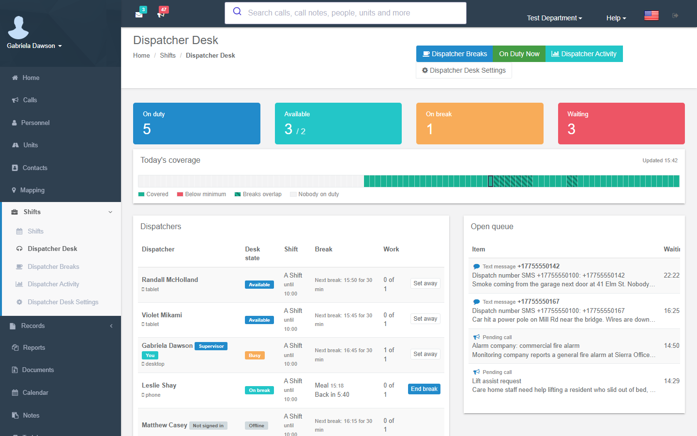
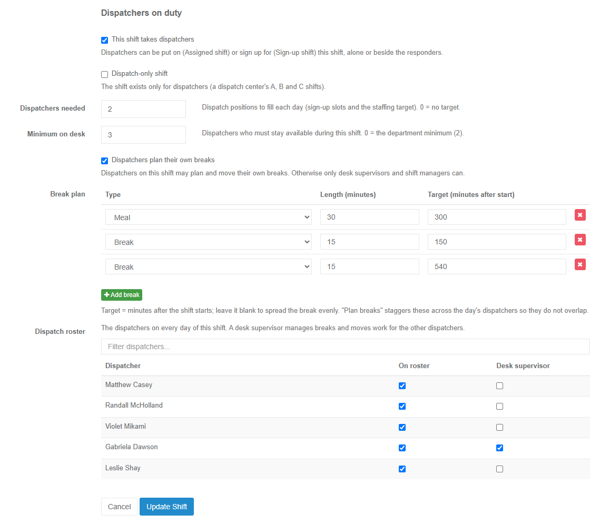
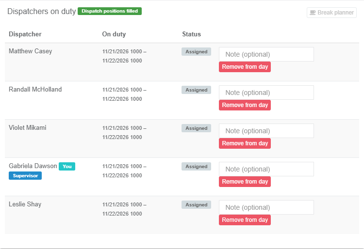
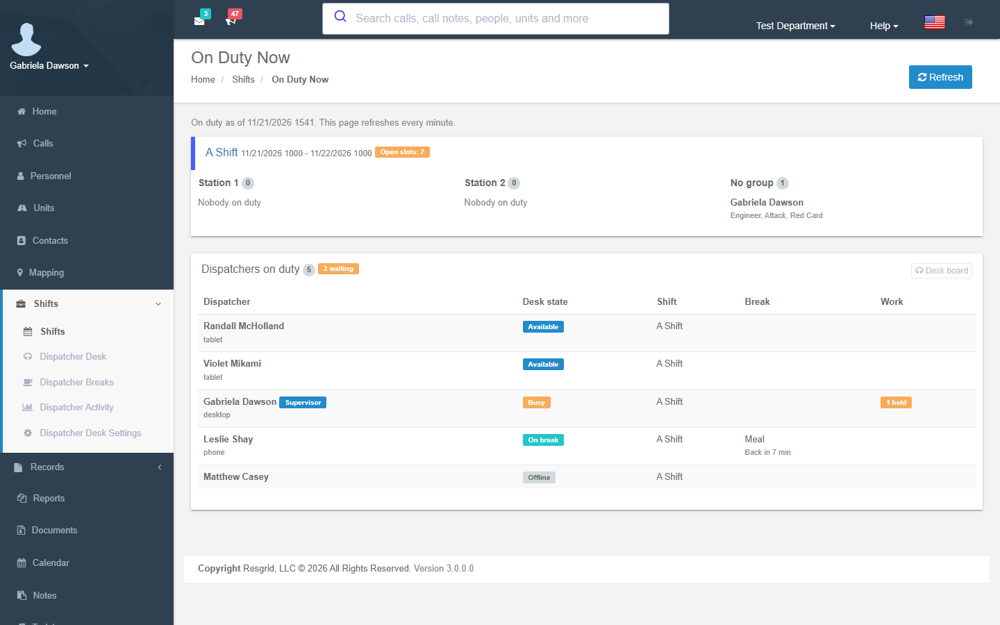
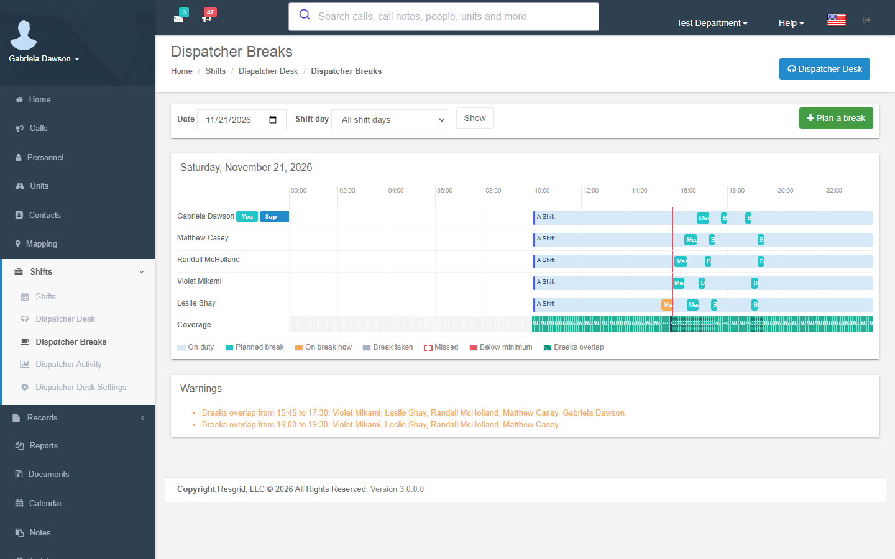
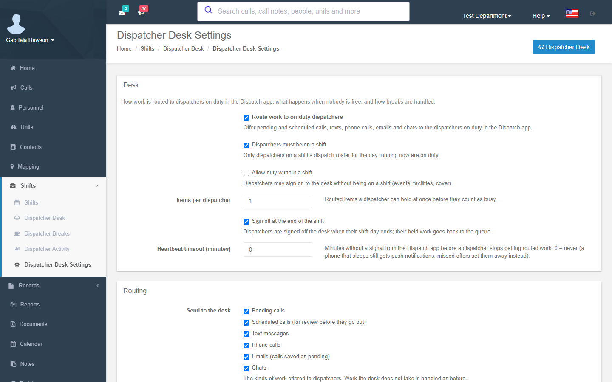
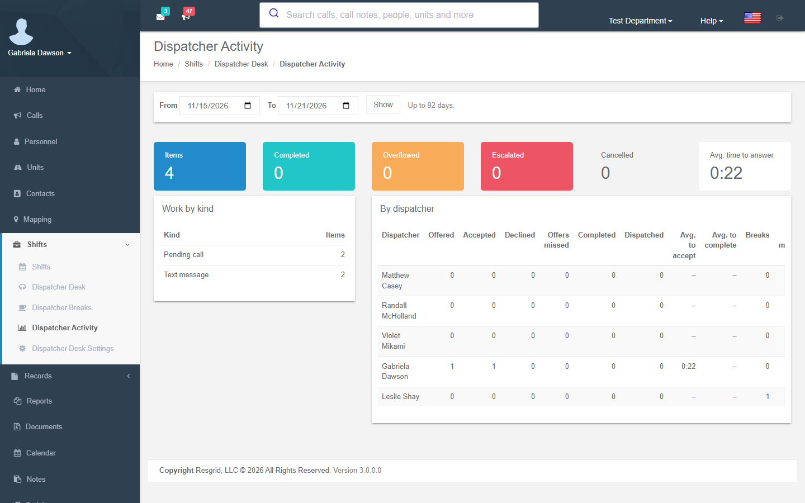

# Dispatcher Desk

The **dispatcher desk** hands incoming work to the dispatchers who are on duty and signed in to the [Dispatch app](../apps/dispatch#dispatcher-desk). Pending calls, scheduled calls coming up, texts, phone calls and emailed calls are **offered to one free dispatcher at a time**. If that dispatcher does not take an offer, it moves on to the next one. Work nobody can take right now waits in a shared queue that every dispatcher on the desk can see.

Because the desk runs in the Dispatch app on a phone or tablet as well as on a desktop, dispatchers do not have to sit at a console. We call this **Dispatcher On-The-Go**: a volunteer dispatcher can cover the desk from home, a supervisor can work it from a vehicle, and a campus officer can carry it on patrol.

The desk also handles **breaks and lunches**. Dispatchers plan their breaks, everyone sees the whole team's breaks on one timeline, the app reminds them when a break is due, and a dispatcher on break gets no desk alerts until they come back.

- **Free.** The desk needs no add-on. Only the optional [Enhanced AI overflow](#overflow) and the [Enhanced AI email mode](#email-call-mode) need Enhanced AI.
- **Off until you turn it on.** Until an administrator ticks **Route work to on-duty dispatchers**, nothing is routed and work is handled the same as before the desk existed. What a call emailed to the department's dispatch address becomes is the separate **Emailed calls** setting: at its default, **Dispatch immediately**, those calls go straight out; **Save as pending** or **Enhanced AI into pending** holds them for a dispatcher instead, and nobody is paged until one sends it (see [Email call mode](#email-call-mode)). Rosters and breaks work either way.
- **Who is a dispatcher:** anyone allowed to sign in to the Dispatch app (the **Dispatch app login** permission on [Security & Permissions](security-permissions#people-calls-and-everyday-modules)). There is no separate desk permission.

## Where to find it

When the desk is available to you, **Shifts** in the left menu becomes a group with two entries, **Shifts** and **Dispatcher Desk**. The other desk pages open from the buttons at the top of the Dispatcher Desk board (or the **Dispatcher Desk** menu on the Shifts page):

| Page | Menu path | Who can open it |
|---|---|---|
| **Shifts** | **Shifts → Shifts** | Everyone who can see shifts, as before. |
| **Dispatcher Desk** (the live board) | **Shifts → Dispatcher Desk** | Dispatchers, shift managers and department admins. |
| **Dispatcher Breaks** (break planner and coverage timeline) | **Shifts → Dispatcher Desk → Dispatcher Breaks**, or **Break planner** on a shift day | Dispatchers, shift managers and department admins. |
| **Dispatcher Activity** (report) | **Shifts → Dispatcher Desk → Dispatcher Activity** | Department admins and desk supervisors. |
| **Dispatcher Desk Settings** | **Shifts → Dispatcher Desk → Dispatcher Desk Settings** | Department admins. |
| **Dispatchers on duty** on a shift | **Shifts → New Shift** (*Dispatchers* tab) or **Edit Shift Details** | Shift managers and department admins. |
| **Dispatchers on duty** on a shift day | The shift day's page | Everyone who can see the shift day. |
| **On Duty Now** | **On Duty Now** on the Shifts page | Everyone who can see shifts. |
| **Dispatcher Desk** in the Dispatch app | Side menu → **Dispatcher Desk** | Dispatchers. See [Dispatch app → Dispatcher desk](../apps/dispatch#dispatcher-desk). |

The desk pages are listed for dispatchers, members who can create shifts and department admins. Members who are none of these see **Shifts** as a single menu entry, as before.

### Who can do what

| Person | Can |
|---|---|
| **Dispatcher** (has Dispatch app login) | Sign in to the desk, take and work offered and waiting work, plan their own breaks when the shift allows it, take breaks, see the board, the team and the timeline, and sign up for dispatch shifts. |
| **Desk supervisor** | Everything a dispatcher can, plus: end someone else's break, set another dispatcher Away or Available, return or hand over anyone's work, plan anyone's breaks, run **Plan breaks**, and open the Activity report. A roster row marks someone as desk supervisor for that shift; they supervise while that shift day is running. |
| **Shift manager** (can create shifts) | Put dispatchers on shifts and shift days, approve or deny dispatcher sign-ups, and see the board and planner. A shift manager whose shift permission covers the whole department also supervises the desk. |
| **Department admin** | Everything, including **Dispatcher Desk Settings**. |

:::tip Limit who counts as a dispatcher
The **Dispatch app login** permission is set to *Everyone* by default, so every member could sign in to the desk and shows up in the roster pickers. Before you turn the desk on, set it to **Admins + selected roles** and tick your *Dispatcher* role.
:::

### Getting started

1. **Decide who dispatches.** Set **Dispatch app login** to your dispatcher role ([Security & Permissions](security-permissions)).
2. **Turn routing on.** On **Shifts → Dispatcher Desk → Dispatcher Desk Settings**, tick **Route work to on-duty dispatchers** and choose what goes to the desk under **Send to the desk** ([Desk settings](#desk-settings)).
3. **Put dispatchers on duty.** Add a dispatch roster to a shift ([Dispatchers on duty](#dispatchers-on-duty)), or, for teams without shifts, tick **Allow duty without a shift** or clear **Dispatchers must be on a shift**.
4. **Plan breaks** (optional). Give the shift a break plan and press **Plan breaks** on the day ([Breaks and coverage](#breaks-and-coverage)).
5. **Sign in.** Each dispatcher opens **Dispatcher Desk** in the Dispatch app and presses **Sign in to the desk**.

## Dispatchers on duty

A dispatcher is **on duty** when both of these are true:

1. They are on a shift's dispatch roster for the shift day running now, and their place on it is approved. A department can relax this (see [Desk settings](#desk-settings)): with **Allow duty without a shift**, dispatchers may sign in without a shift (for an event, a facility or cover); with **Dispatchers must be on a shift** cleared, every dispatcher who signs in is on duty.
2. They are **signed in** to the desk in the Dispatch app.

Only dispatchers who are on duty, signed in, **Available** and not already holding as much work as they can get offers.

### On a shift

Dispatchers can work on a shift of their own (a dispatch center's A, B and C shifts) or beside the responders on the same shift. The roster is kept beside the shift: turning dispatchers on or off never changes the shift's groups, responders or sign-ups.

On **New Shift** (the **Dispatchers** tab: *Dispatchers work the dispatcher desk in the Dispatch app. Choose whether this shift takes dispatchers, how many it needs and how their breaks are planned.*) and **Edit Shift Details**:

| Field | What it does |
|---|---|
| **This shift takes dispatchers** | Dispatchers can be put on this shift (Assigned shift) or sign up for it (Sign-up shift), alone or beside the responders. The other fields appear once it is ticked. |
| **Dispatch-only shift** | The shift exists only for dispatchers (a dispatch center's A, B and C shifts). |
| **Dispatchers needed** | Dispatch positions to fill each day: the sign-up slots and the staffing target. 0 = no target. |
| **Minimum on desk** | Dispatchers who must stay available during this shift. 0 = use the department minimum (shown in the help text). |
| **Dispatchers plan their own breaks** | Dispatchers on this shift may plan and move their own breaks. Otherwise only desk supervisors and shift managers can. |
| **Break plan** | The breaks each dispatcher gets on this shift: **Type** (Break, Meal, Personal, Other), **Length (minutes)** (1 to 240) and **Target (minutes after start)**, or leave the target blank (*Spread evenly*). **Add break** adds a row. With no rows, the department's **Default break plan** is used. The plan places nothing by itself: breaks are put on the day when a supervisor presses [Plan breaks](#plan-breaks-staggering-a-day). Dispatchers plan and move breaks of their own only where **Dispatchers plan their own breaks** is ticked; [taking](#taking-a-break) a break, planned or new, is always theirs to start. |
| **Dispatch roster** | Assigned shifts only: the dispatchers on **every day** of the shift. Tick **On roster** for each dispatcher and **Desk supervisor** for those who manage breaks and move work for the others. Only people with Dispatch app login are listed; someone who has lost it shows **No Dispatch access** and leaves the roster when you save. |

If routing is still off, the section says *Routing work to dispatchers is turned off. Rosters and breaks still work; a department administrator can turn routing on in the dispatcher desk settings.*

### On a shift day

A shift day's page has a **Dispatchers on duty** box when the shift takes dispatchers. It lists each dispatcher with their duty time and a status (**Assigned** or **Signed up**, **Awaiting approval**, **Supervisor**, **You**). The top of the box shows **N dispatch positions open** or **Dispatch positions filled** when the shift has a target, and a **Break planner** button that opens the [break planner](#breaks-and-coverage) for that day.

| Who | What they can do on the day |
|---|---|
| A dispatcher, on a **Sign-up shift** | **Sign up as dispatcher**. When the shift requires approval, the page says *A shift manager approves dispatcher sign-ups on this shift.* and the sign-up waits (*Your dispatcher sign-up is waiting for approval.*). **Withdraw** takes them off the day again. |
| A shift manager | **Approve** or **Deny** a waiting sign-up (with an optional note), **Remove from day**, and **Add a dispatcher to this day** (tick **Desk supervisor** to make them supervisor for the day). |

Taking a standing (every-day) dispatcher off one day leaves them on the rest of the shift's days. Days that are over can no longer be changed.

## On Duty Now page {#on-duty-page}

**On Duty Now** (the button on the Shifts page and on the desk board) lists the responders on duty and, when anyone is on the desk, a **Dispatchers on duty** box with:

- each dispatcher on duty or signed in, their device (phone, tablet or desktop) and a **Supervisor** badge;
- their **Desk state** (Available, Busy, Away with the reason, On break, Offline) and **Off duty** when they are signed in without being on duty;
- their shift, their break (type, *Back in N min* or *Overdue N min*) and their work (*N held*, *N offered*);
- **Only N available (minimum M)** when coverage is below the minimum, and **N waiting** when work is waiting in the queue;
- a **Desk board** button.

The page refreshes itself every minute. For a live view, use the desk board.

## The desk board {#desk-board}

**Shifts → Dispatcher Desk** is the live view of the desk for dispatchers, supervisors and admins. It updates as things happen, and re-reads itself every 15 seconds in case an update was missed (*Updated …* in the corner).

| Part | Shows |
|---|---|
| **On duty / Available / On break / Waiting** | How many dispatchers are on duty, available, on break, and how many items wait in the queue. **Available** shows the minimum beside it and turns red when coverage is below it. |
| **Today's coverage** | A strip across the day in 15-minute slots: **Covered**, **Below minimum**, **Breaks overlap** and **Nobody on duty**. Hover a slot for *time: N available, N on break, N on duty*. |
| **Dispatchers** | Each dispatcher with their **Desk state**, **Shift**, **Break** (current break and time left or overdue, or **Next break:** type and length) and **Work** (*N of M* held of what they can hold). Badges: **Supervisor**, **You**, **Off duty**, **Not signed in**. |
| **Open queue** | Every open item: its kind (Pending call, Scheduled call, Text message, Phone call, Email, Chat), how long it has been **Waiting**, and its state (**Waiting**, **Offered** to someone, **Being handled** by someone), with **Escalated** when it waited too long. |

**Actions on the board**

| Button | Who | What it does |
|---|---|---|
| **Set away** (with an optional reason) / **Set available** | The dispatcher for themselves; a supervisor for anyone signed in | Away dispatchers get no offers. |
| **End break** | The dispatcher for themselves; a supervisor for anyone | Asks *End (name)'s break and make them available?* |
| **Return to queue** | The item's holder, or a supervisor | Puts an offered or held item back in the queue for someone else. |
| **Transfer** | The item's holder, or a supervisor | Offers the item to another on-duty dispatcher with an optional note. *No other dispatcher on duty can take it right now.* when nobody can. |
| **View call** | Anyone | Opens the item's call. |

Dispatchers take and work items in the Dispatch app; the web board is for watching the desk and supervising it. The buttons at the top open the other desk pages: **Dispatcher Breaks** and **On Duty Now** for everyone, **Dispatcher Activity** for department admins and desk supervisors (the **Dispatcher Desk** menu on the Shifts page shows it only to them too), and **Dispatcher Desk Settings** for department admins. While routing is off the board also shows the notice *Routing work to dispatchers is turned off…*.

### Desk states

| State | Meaning |
|---|---|
| **Available** | Signed in and taking work. Gets offers. |
| **Busy** | Available, but holding as much work as **Items per dispatcher** allows (1 by default). Gets no new offers until they finish or return something. |
| **Away** | Signed in but not taking routed work for now: set by the dispatcher or a supervisor, or by the desk after missed offers. |
| **On break** | On a break: no routed work and, by default, no desk alerts. |
| **Offline** | Not signed in to the desk (*Signed off* in the app). |

## Breaks and coverage

A break in Resgrid is a **length, not a time window**. A planned 30-minute lunch at 12:00 can be started at 11:30, and the dispatcher is then due back at 12:00. Each break has a type: **Break**, **Meal**, **Personal** or **Other**.

### The break planner

**Shifts → Dispatcher Desk → Dispatcher Breaks** (or **Break planner** on a shift day) shows one day:

- **Date** and **Shift day** (*All shift days*, or one shift day) with **Show**.
- A timeline with one row per dispatcher (you first): their duty on each shift, and their breaks, colored **Planned break**, **On break now**, **Break taken** or **Missed**. The **Coverage** lane at the bottom marks **Below minimum** and **Breaks overlap** in 5-minute steps.
- **Warnings**: *Breaks overlap from … to …*, *Only N dispatchers available (minimum M) from … to …*, *Nobody would be available from … to …*, *The break falls outside the shift day*, *… started the break N minutes early* (or late), *Work held by … went back to the queue*.

**Plan a break** opens the break form:

| Field | What to enter |
|---|---|
| **Dispatcher** | Whose break it is (supervisors pick anyone; a dispatcher plans their own). |
| **Type** | Break, Meal, Personal or Other. |
| **Length (minutes)** | 1 to 240 (15 by default). |
| **Planned start** | In the department's time zone. *A break is a length: started early, it ends early.* |
| **Note** | Optional, up to 500 characters. |

Click a planned break to change it (**Change break**) or **Remove break**. A break that has started or ended cannot be changed. Saving shows any warning the change causes, such as an overlap or coverage below the minimum.

**Who can plan:** desk supervisors and shift managers plan anyone's breaks. A dispatcher plans and moves their own only on a shift with **Dispatchers plan their own breaks** ticked.

### Plan breaks (staggering a day)

With a shift day picked, supervisors see **Plan breaks**. It places the shift's break plan (or the department's default plan) for **every dispatcher on that day** so the breaks do not overlap where the day allows, keeping the shift's minimum on the desk wherever the day allows for it:

- each break goes as near its target as it can; a blank target spreads the breaks evenly through the dispatcher's duty;
- a break is moved up to 2 hours from its target to avoid overlapping someone else's; only when no such time exists do breaks overlap, and then only as far as the minimum allows;
- no break is placed in the first or last 30 minutes of a dispatcher's duty, and a dispatcher's own breaks are at least 30 minutes apart;
- at any moment, no more dispatchers are on break than the shift's minimum allows; a day whose minimum takes every dispatcher on duty has no room to spare, so its breaks come back in the **Warnings** list for a supervisor to settle;
- when planning part-way through a day, targets already past are placed from now on instead of being dropped;
- breaks already planned or taken are worked around. Tick **Replace planned breaks** to remove the day's planned breaks first (*Remove this day's planned breaks and place the shift's break plan again?*).

The result says *N breaks planned.*

### Taking a break

Breaks are taken in the Dispatch app (see [Dispatch app → Breaks](../apps/dispatch#breaks)):

1. **Reminder.** By default the app reminds the dispatcher 5 minutes before a planned break (*Your Meal starts in 5 min*), then again when it is due (*Your Meal is due now. Tap to take it.*).
2. **Take break.** The dispatcher can start a planned break or **A new break now**, at any time. While they hold work, the break starts only once they tick **Return my work to the queue**, so nothing is left waiting with someone on break.
3. **Coverage check.** If the break would leave fewer dispatchers available than the minimum, the app warns (*This break leaves N available, below the minimum of M.*) and offers **Take break anyway**. With **Prevent breaks below the minimum**, the break is refused and only a desk supervisor can start it.
4. **On break.** No offers, and with **No desk alerts while on break** (on by default) no desk push notifications, sounds or pop-ups. The status bar shows the time left.
5. **Back.** When the length runs out, the app says *Your break is over. Tap "I'm back" to return to the desk.* The dispatcher presses **I'm back**. Waiting work is offered again at once.
6. **Late back.** With **Tell supervisors when a dispatcher is late back from a break** (on by default), the desk supervisors on duty are told (or the department's administrators, when no desk supervisor is on duty). With **Auto return after (minutes)** set, the desk makes the dispatcher available that many minutes after the break's length ran out (*Your break ran past its length, so the desk returned you automatically.*). A supervisor can also **End break** from the board or the team list.

A planned break never started before the dispatcher's duty ends is recorded as **Missed**. Signing off during a break ends it.

## Desk settings

**Shifts → Dispatcher Desk → Dispatcher Desk Settings** (department admins) is one page in five parts. Changes take effect when you press **Save settings** (*The dispatcher desk settings were saved.*).

### Desk

| Setting | Default | What it does |
|---|---|---|
| **Route work to on-duty dispatchers** | Off | Offer pending and scheduled calls, texts, phone calls, emails and chats to the dispatchers on duty in the Dispatch app. Off = nothing is routed; held work stays with its holder until finished, and offers out go back to the queue. |
| **Dispatchers must be on a shift** | On | Only dispatchers on a shift's dispatch roster for the day running now are on duty. Clear it for teams without shifts: every dispatcher who signs in is on duty. |
| **Allow duty without a shift** | Off | Dispatchers may sign on to the desk without being on a shift (events, facilities, cover), optionally until a time they choose. Only matters while **Dispatchers must be on a shift** is ticked. |
| **Items per dispatcher** | 1 | Routed items a dispatcher can hold at once before they count as busy (1 to 10). |
| **Sign off at the end of the shift** | On | Dispatchers are signed off the desk when their shift day ends; their held work goes back to the queue. A dispatcher whose next shift day starts straight away stays signed in. |
| **Heartbeat timeout (minutes)** | 0 | Minutes without a signal from the Dispatch app before a dispatcher stops getting routed work (0 to 1440). 0 = never: a phone that sleeps still gets push notifications, and missed offers set the dispatcher away instead. |

### Routing

| Setting | Default | What it does |
|---|---|---|
| **Send to the desk** | All ticked | The kinds of work offered to dispatchers: **Pending calls**, **Scheduled calls (for review before they go out)**, **Text messages**, **Phone calls**, **Emails (calls saved as pending)** and **Chats (WhatsApp, Slack, Teams, Telegram, Discord, Google Chat)**. Work the desk does not take is handled as before. An email or chat that is not ticked still comes to the desk as a pending call while **Pending calls** is ticked. |
| **Scheduled call review (minutes before)** | 15 | How long before a scheduled call goes out that it comes to the desk for review (1 to 1440). It still goes out by itself at its time. |
| **Offer timeout (seconds)** | 45 | How long an offer waits for the dispatcher to take it before it moves to the next one (15 to 600). |
| **Missed offers before away** | 2 | Offers in a row a dispatcher lets run out before the desk sets them away (0 to 20; 0 = never). |
| **Escalate waiting work after (minutes)** | 3 | How long an item may wait unassigned before every dispatcher and supervisor on duty is alerted (0 to 240; 0 = never). |
| **Conversation window (minutes)** | 30 | Another text or chat from the same sender within this many minutes joins the same conversation (1 to 1440). |
| **Acknowledge texts automatically** | On | The sender gets an automatic reply when their text reaches the desk. Offered or waiting in the queue: *We received your message. A dispatcher will reply here as soon as possible. If this is a life-threatening emergency, call 911.* Overflowed at once (nobody free): *We received your message and passed it to the dispatchers. If this is a life-threatening emergency, call 911.* The number is the deployment's emergency number (`IntakeConfig.EmergencyNumber`, 911 by default), which the voice intake prompts use too. |

### When every dispatcher is busy

*What happens to a live text or phone call when every dispatcher is busy or on break.* See [Overflow](#overflow).

| Setting | Default | Choices |
|---|---|---|
| **Text messages** | Keep it waiting in the queue | **Keep it waiting in the queue**, or **Enhanced AI fills in a pending call** (needs Enhanced AI). |
| **Phone calls** | Enhanced AI voice intake | **Enhanced AI voice intake**, or **Voicemail into a pending call**. Without voice intake the page says *Enhanced AI voice intake is not available; callers leave a message instead.* |
| **Hold callers for (seconds)** | 0 | How long a caller is held for a dispatcher before the overflow takes over (0 to 600; 0 = at once). |

### Emailed calls

*What a call emailed to the department's dispatch address becomes.* **Emailed calls**: **Dispatch immediately** (the default), **Save as pending** or **Enhanced AI into pending**. See [Email call mode](#email-call-mode).

### Breaks and coverage

| Setting | Default | What it does |
|---|---|---|
| **Minimum available** | 1 | Dispatchers who must stay available; planning or starting a break below this warns (0 to 100; 0 = no minimum). A shift's **Minimum on desk** replaces it during that shift. |
| **Prevent breaks below the minimum** | Off | Refuse, instead of warn about, a break that would drop below the minimum, unless a supervisor starts it. |
| **Break reminder (minutes before)** | 5 | Minutes before a planned break the dispatcher is reminded (0 to 120; 0 = only when it is due). |
| **Auto return after (minutes)** | 0 | Make a dispatcher available again this many minutes after their break's length ran out (0 to 480). 0 = never: they stay on break until they come back or a supervisor ends it. |
| **Tell supervisors when a dispatcher is late back from a break** | On | The desk supervisors on duty (or, with none on duty, the department's administrators) are told when a break runs over, and again when auto return makes the dispatcher available. |
| **No desk alerts while on break** | On | While on break a dispatcher gets no desk notifications or alerts, only the reminder that the break is over. |
| **Default break plan** | None | The breaks every dispatcher gets on a shift that has no break plan of its own (up to 10 rows: type, length, target), placed when a supervisor presses **Plan breaks**. |

When Enhanced AI is not available to the department, the Enhanced AI choices are greyed out with *Enhanced AI is not available for this department.* A department that already chose one keeps it, so a lapsed add-on never changes the setting by itself.

## Routing and offers

### What comes to the desk

| Kind | Comes to the desk when |
|---|---|
| **Pending call** | Any call is saved as pending: **Save as pending** on New Call (web or Dispatch app), an API call with `IsPending`, a call from an [intake channel](intake-channels/overview), or an emailed call saved as pending. A pending call edited later stays one item. When you first turn the desk on, pending calls logged in the last 3 days are added. |
| **Scheduled call** | **Scheduled call review (minutes before)** before its dispatch time, so a dispatcher can check it. Nobody has to act: it still goes out at its time. |
| **Text message** | A person who is not a member texts the department's text-to-call number, or anyone texts the department's [Private Inbound Dispatch Number](intake-channels/dedicated-number#text-conversations) (needs **Text messages** ticked too). See [Texts and calls to the desk](#texts-and-calls-to-the-desk). |
| **Phone call** | A person who is not a member calls the department's text-to-call number. |
| **Email** | A call emailed to the department's dispatch address is saved as pending ([Email call mode](#email-call-mode) **Save as pending** or **Enhanced AI into pending**). |
| **Chat** | A message to a chat [intake channel](intake-channels/overview#channel-types) (WhatsApp, Slack, Teams, Telegram, Discord, Google Chat): the pending call intake made from it, with the message shown on the item. Dispatchers work the call; there is no reply or call back from the desk (answer in the chat app). With **Chats** unticked it comes as a **pending call**. |

A call that is dispatched, closed or deleted somewhere else (the web Calls page, another dispatcher's Dispatch app) leaves the desk by itself.

### How an offer works

1. **One dispatcher at a time.** The desk picks the on-duty, signed-in, **Available** dispatcher holding the least work, then the one who has gone longest without an offer. It never offers an item again to someone who declined it or let it run out.
2. **The offer.** The dispatcher's phone or tablet gets a push notification and the Dispatch app shows **Work offered to you** with **Accept** and **Decline** and a countdown (*Answer within …*). The offer lasts **Offer timeout (seconds)** (45 by default).
3. **Declined or missed.** It moves straight on to the next free dispatcher. A dispatcher who misses **Missed offers before away** offers in a row (2 by default) is set **Away**, so the desk stops waiting on a phone left in a pocket.
4. **Accepted.** The dispatcher holds the item and works it until they **Complete** it, **Return to queue** or **Hand over** to someone else. While they hold as much as **Items per dispatcher** allows, they are **Busy**.
5. **Nobody free.** Calls and emails wait in the shared queue. Any signed-in dispatcher can **Take** one from **Waiting** at any time, and the desk offers it as soon as someone is free (back from break, finished their work, signed in) who has not already declined it or let it run out. When nobody else is eligible — a sole on-duty dispatcher who declined the item — it stays in **Waiting** for them to **Take**, and no offer comes back on its own. Live texts go to the [overflow](#overflow) at once, and held phone callers after **Hold callers for (seconds)**.
6. **Waiting too long.** An item that waits unassigned for **Escalate waiting work after (minutes)** (3 by default) alerts every dispatcher on duty who is not on break, and the desk supervisors on duty (or the department's administrators when none is): *Waiting too long*.

The queue is sorted with live callers first: phone calls, then texts and chats, then pending calls, emails and scheduled calls. Within a kind, higher call priority comes first, then the scheduled time, then the oldest.

**Screened intake calls are not offered.** A call from an intake channel that spam screening marked (*Enhanced AI: likely not an incident*, *Repeat sender: over the hourly limit*) waits in the queue for a dispatcher to take; nobody gets a push or a countdown for it. If the label arrives after the offer went out, the offer is taken back without counting as a decline or a miss (*Held for review: screened intake call* in the item's history). See [Spam screening](intake-channels/overview#spam-screening).

## Overflow

**Overflow** is what happens to live work when every dispatcher is busy, away, on break or signed off.

| Work | When nobody can take it |
|---|---|
| **Pending calls, scheduled calls, emails** | Never overflow. They wait in the queue for the next free dispatcher. |
| **Text messages and chats** | Overflow at once (a chat from an intake chat channel already has its pending call, so it just waits). With **Keep it waiting in the queue**, the conversation becomes a pending call (*Text from …*) that waits in the queue. With **Enhanced AI fills in a pending call**, Enhanced AI also fills in the call's type, priority and address while it waits. |
| **Phone calls** | The caller hears *Thank you for calling. A dispatcher will be with you shortly. Please stay on the line.* for **Hold callers for (seconds)**, then goes to the overflow: **Enhanced AI voice intake** asks the caller questions and creates a pending call (falling back to a message when it is not available), or **Voicemail into a pending call** records a message that becomes a pending call with the recording. |

A text to the Private Inbound Dispatch Number never overflows: it already has its pending call, and the AI assistant or the waiting message keeps the texter informed ([Text conversations](intake-channels/dedicated-number#text-conversations)).

Overflowed items count under **Overflowed** in the [Activity report](#activity-report).

## Email call mode

The **Emailed calls** setting decides what a call emailed to the department's **dispatch import email** becomes. It works whether or not the desk is routing work.

| Choice | What happens |
|---|---|
| **Dispatch immediately** (default) | The call from the email is sent out at once, as before. |
| **Save as pending** | The call is saved as a [pending call](dispatch-calls#pending-and-scheduled-calls) for a dispatcher to review and send. Nobody is notified until a dispatcher dispatches it. |
| **Enhanced AI into pending** | As **Save as pending**, and Enhanced AI reads the email into the call (type, priority, address) for a dispatcher to review and send. Needs Enhanced AI. |

- With **Emails (calls saved as pending)** ticked under **Send to the desk**, each held email is offered to a dispatcher as an **Email** item, with the email and an **Open call** button. Otherwise it waits on **Pending calls** like any pending call.
- A follow-up email that updates a call still open updates it, and a pending call is never re-dispatched by it.
- The setting covers the department's dispatch import email only. Groups' and stations' dispatch addresses still dispatch at once, and an [intake channel](intake-channels/overview) always makes pending calls.
- The **Generic with AI enrichment** email type ([Call import](../configuration/call-import#generic-with-ai-enrichment)) enriches every call whatever this setting says.

Use **Save as pending** when your dispatch center emails calls that a person should check first (wrong-district calls, duplicate pages) before your members are paged.

## Texts and calls to the desk

### Texts to the department's text-to-call number

When **Text messages** is ticked, a text to the department's [text-to-call number](../configuration/text-messaging) from **someone who is not a member** becomes a desk conversation:

- **Members keep their text commands.** A member texting `responding` or `available` is handled as before.
- **Dispatch centers keep text-to-call.** Texts from the **Text-to-Call Source Numbers** still create calls.
- **One conversation per sender.** Another text from the same person within **Conversation window (minutes)** joins the conversation.
- **Replies** go to the texter from the number they texted (or the department's number). Replies to the main Resgrid number reach the open conversation too.
- **STOP** opts the texter out as before; it never starts a conversation.
- With **Acknowledge texts automatically**, the texter is told a dispatcher has their message, or, when nobody was free and it overflowed, that it was passed to the dispatchers.

The dispatcher holding it reads and answers the texts in the Dispatch app, adds notes for the desk (never sent), and uses **Create call** to make a call from it. If nobody is free it [overflows](#overflow) into a pending call.

### Texts to the Private Inbound Dispatch Number

A department with the [Private Inbound Dispatch Number](intake-channels/dedicated-number) add-on gets every text to that number as a pending call **and** a text conversation, continued from the main Resgrid number. The desk offers the conversation as a **Text message** item linked to the pending call:

- **Accept** connects the dispatcher: the texter gets *You are now connected with* (the dispatcher's first name)*. Please describe the situation you are having and your location.*, and the AI assistant (if it was asking questions) goes quiet.
- **Return to queue** hands the texter back (to the AI assistant, or waiting for a dispatcher) without texting them.
- **Complete** ends the thread. **Tell the texter** (on by default) sends a closing text; turn it off to end it silently.
- The same thread shows on the call's page, where any dispatcher can take it without the desk ([Text conversations](intake-channels/dedicated-number#text-conversations)).

### Phone calls

When **Phone calls** is ticked, a call to the department's text-to-call number from **someone who is not a member** is put on the desk and the caller is held:

1. The caller hears the hold message while the desk offers the call.
2. The dispatcher who accepts it presses **Answer**. The desk **rings the dispatcher's own phone** (the **Callback number** they gave when signing in, or the mobile number on their profile) and says *Resgrid dispatch call from* (the caller's number)*. Press 1 to connect.* Pressing 1 connects them to the caller. Any phone or tablet with a phone number works; there is no app calling to set up.
3. If the caller hangs up first, the item stays on the desk with **Call back**: the desk rings the dispatcher, who presses 1 to call the caller back from the department's number.
4. If nobody takes the call within **Hold callers for (seconds)**, it goes to the [overflow](#overflow).

Members calling the number keep the voice menu. Calls to the Private Inbound Dispatch Number use [voice intake](intake-channels/dedicated-number#voice-intake) instead.

## Activity report

**Shifts → Dispatcher Desk → Dispatcher Activity** (department admins and desk supervisors) shows the desk's numbers for a date range: **From** and **To**, at most 92 days (*Up to 92 days.*), the last 7 days by default.

| Total | Counts |
|---|---|
| **Items** | Work that came to the desk. |
| **Completed** | Items a dispatcher finished. |
| **Overflowed** | Items that went to the overflow. |
| **Escalated** | Items that waited longer than the escalation time. |
| **Cancelled** | Items no longer needed (handled elsewhere, the caller hung up first). |
| **Avg. time to answer** | From the item coming in to a dispatcher accepting it. |

**Work by kind** counts the items by kind. **By dispatcher** has one row per dispatcher:

| Column | Counts |
|---|---|
| **Offered / Accepted / Declined / Offers missed** | Offers they got, took, turned down and let run out. |
| **Completed / Dispatched** | Items they finished, and of those the ones that went out or became a call. |
| **Avg. to accept / Avg. to complete** | From the offer (or the item coming in) to accepting, and from accepting to completing. |
| **Breaks / Break minutes** | Breaks taken and their total length. |
| **Late back** | Breaks they came back from more than a minute late (hover for the total minutes). |
| **Missed breaks** | Planned breaks never taken. |

With nothing in the range it says *No desk activity in this period.* Desk history is kept for 180 days.

## Setup examples

Step-by-step walkthroughs for each of these are in [Dispatcher Desk Walkthroughs](../setup-guides/dispatcher-desk-scenarios).

| Organization | How to set it up |
|---|---|
| **Volunteer fire (dispatchers on their phones)** | Sign-up shifts *Desk: Evenings* and *Desk: Weekends* with **This shift takes dispatchers**, **Dispatch-only shift**, **Dispatchers needed** 1. Desk on with **Pending calls**, **Scheduled calls**, **Text messages** and **Phone calls**; **Offer timeout** 60 s; **Heartbeat timeout** 0 (phones sleep); **Minimum available** 0 (one dispatcher at a time); **Emailed calls**: **Dispatch immediately** so county pages still go straight out; phone overflow **Voicemail into a pending call**. |
| **Career fire / EMS** | Dispatch-only Assigned shifts A to D (12 hours) with **Dispatchers needed** 3, **Minimum on desk** 2 and a standing roster with one **Desk supervisor**; break plan *Break 15* at 120 min, *Meal 30* at 330 min, *Break 15* at 570 min; **Plan breaks** at the start of each shift; **Items per dispatcher** 2, **Offer timeout** 30 s, **Escalate waiting work after** 2 min; **Prevent breaks below the minimum** on; **Auto return after** 10 min; **Heartbeat timeout** 5 for desktop consoles. |
| **Search and rescue** | No shifts: clear **Dispatchers must be on a shift**, so the coordinator who signs in is on duty; **Offer timeout** 90 s; **Missed offers before away** 3; **Emailed calls**: **Save as pending** so the coordinator vets each request before paging the team; phone overflow **Voicemail into a pending call**. |
| **Multi-agency dispatch center** | Dispatch-only Assigned day and night shifts with two desk supervisors, **Dispatchers needed** 6, **Minimum on desk** 4; a Private Inbound Dispatch Number with its SMS channel on **Enhanced AI**; **Items per dispatcher** 3; **Escalate waiting work after** 2 min; text overflow **Enhanced AI fills in a pending call**; **Prevent breaks below the minimum** on. |
| **Campus or hospital security / facilities** | Clear **Dispatchers must be on a shift**: whoever carries the desk phone signs in; **Items per dispatcher** 3; escorts and lock-ups as scheduled and recurring calls with **Scheduled call review** 15 min; a Private Inbound Dispatch Number on parking permits; a Teams intake channel for facilities requests. |
| **Industrial emergency response** | **This shift takes dispatchers** on the plant's existing crew shifts (not dispatch-only), **Dispatchers needed** 2, **Minimum on desk** 1, the shift supervisor as **Desk supervisor**; **Emailed calls**: **Dispatch immediately** for the alarm system; fire-watch requests from the permit system through a webhook intake channel; **Scheduled call review** 30 min. |
| **Emergency management EOC** | Dispatch-only Sign-up shifts *EOC Call Center: Day* and *Night* with approval, **Dispatchers needed** 4, **Dispatchers plan their own breaks**; **Allow duty without a shift** for spontaneous volunteers; Private Inbound Dispatch Number with texts and voice intake; text overflow **Enhanced AI fills in a pending call**. |
| **CERT / event medical** | A Sign-up shift for the event day (*Marathon net control*), **Dispatch-only**, **Dispatchers needed** 2, **Minimum on desk** 1, break plan *Meal 20* spread evenly; **Offer timeout** 30 s; **Escalate waiting work after** 1 min; **Items per dispatcher** 3. |

## Technical reference

| Item | Value |
|---|---|
| Pages | `DispatcherDeskController` (web, policy `Shift_View`): `GET /User/DispatcherDesk/Index`, `GET Board` (JSON, re-read every 15 s and on realtime events), `POST EndBreak` (`userId`), `SetAway` (`userId`, `reason` ≤ 250), `SetAvailable`, `ReleaseItem` (`itemId`), `TransferItem` (`itemId`, `toUserId`, `note` ≤ 500); `GET Breaks?date=&shiftDayId=`, `GET BreaksData` (5-minute coverage slots), `POST SaveBreak`, `CancelBreak`, `PlanBreaks` (`shiftDayId`, `replace`); `GET/POST Settings` (department admins); `GET Activity?from=&to=` (admins and supervisors, at most 92 days). Writes need the anti-forgery token. Shift pages: `ShiftsController` `POST DispatcherSignup`, `DispatcherWithdraw`, `DispatcherAssign`, `DispatcherRemove`, `DispatcherReview`; the On Duty page `GET OnDuty` |
| Views and scripts | `Views/DispatcherDesk/{Index,Breaks,Settings,Activity}`, `Views/Shifts/{_ShiftDispatchSection,_ShiftDayDispatchers,_OnDutyDispatchers}`, `Views/Shared/_DispatcherBreakPlanEditor`; `resgrid.dispatcherdesk.{common,board,breaks,breakplan}.js`, `dispatcher-desk.css`. Menu: `_Navigation.cshtml` (Shifts group shown to department admins, `CanCreateShift` and Dispatch app users) |
| Strings | `Resgrid.Localization.Areas.User.DispatcherDesk.DispatcherDesk` (11 languages); Omni `dispatcher_desk.*` in `packages/i18n/src/translations/common/*.json` |
| Setting | 128 `DispatcherDeskConfig` (ProtoBuf members 1–29; missing row = desk off, email mode AutoDispatch). `Enabled` false, `RequireShift` true, `AllowUnscheduledDuty` false, `MaxActiveItemsPerDispatcher` 1 (1–10), `OfferTimeoutSeconds` 45 (15–600), `MissedOffersBeforeAway` 2 (0–20), `RoutePendingCalls` / `RouteScheduledCalls` / `RouteText` / `RouteVoice` / `RouteEmail` / `RouteChat` true, `ScheduledCallLeadMinutes` 15 (1–1440), `TextOverflowMode` 0 (`DispatcherTextOverflowModes` 0 PendingQueue, 1 EnhancedAi), `VoiceOverflowMode` 0 (`DispatcherVoiceOverflowModes` 0 EnhancedAiIntake, 1 Voicemail), `VoiceHoldSeconds` 0 (0–600), `EmailCallMode` 0 (`DispatcherEmailCallModes` 0 AutoDispatch, 1 Pending, 2 EnhancedAi), `BreakReminderMinutes` 5 (0–120), `AutoReturnAfterMinutes` 0 (0–480), `MinimumAvailableDispatchers` 1 (0–100), `PreventBreakBelowMinimum` false, `NotifySupervisorsOnOverdueBreak` true, `SuppressAlertsOnBreak` true, `QueueEscalationMinutes` 3 (0–240), `ConversationJoinMinutes` 30 (1–1440), `SignOffAtShiftEnd` true, `HeartbeatTimeoutMinutes` 0 (0–1440), `DefaultBreakPlan` (≤ 10 `DispatcherDeskBreakPlanEntry`: `BreakType`, `DurationMinutes` ≤ 240, `TargetOffsetMinutes` −1 = spread), `AcknowledgeTexts` true. Read through `IDispatcherDeskConfigService`; `Normalize()` clamps every value |
| Storage | M0324 `AddDispatcherDesk` (SQL Server and PostgreSQL): `ShiftDispatchSettings`, `ShiftDispatchers`, `DispatcherBreaks`, `DispatcherPresences`, `DispatcherQueueItems`, `DispatcherQueueEvents`, `DispatcherConversationMessages`. No foreign keys; purged with the department; deleting a shift removes its roster, settings and future breaks. Closed items, their history and messages kept 180 days |
| Enums (append only) | `ShiftDispatcherSources` 1 Assigned, 2 Signup; `ShiftDispatcherStatuses` 0 Active, 1 PendingApproval, 2 Denied; `DispatcherBreakTypes` 1 Break, 2 Meal, 3 Personal, 4 Other; `DispatcherBreakStates` 0–4; `DispatcherPresenceStates` 0 Offline, 1 Available, 2 Away, 3 OnBreak (Busy is derived); `DispatcherQueueItemKinds` 1 PendingCall, 2 ScheduledCall, 3 Text, 4 Voice, 5 Email, 6 Chat, 7 Other; `DispatcherQueueItemStates` 0 Queued, 1 Offered, 2 Accepted, 3 Completed, 4 Overflowed, 5 Cancelled; `DispatcherQueueItemOutcomes` 1 Dispatched, 2 CallCreated, 3 LeftPending, 4 Duplicate, 5 NoActionNeeded, 6 Closed, 7 Referred; `DispatcherQueueEventTypes` 1–19 (18 ConversationClosed, 19 HeldForReview); `DispatcherDeskErrors` 0–22 (sent to clients by name) |
| Services | `IDispatcherDeskConfigService`, `IShiftDispatchersService`, `IDispatcherBreaksService` (`DispatcherBreakPlanner`: 5-minute steps, 30-minute edge margin and own-break gap), `IDispatcherPresenceService` (`CanSuperviseAsync`: department admin, desk supervisor on duty now, or shift management scope `AllGroups`), `IDispatcherRoutingService` (`DispatcherRoutingPolicy.Order`: least loaded, then longest since last offer; `KindPriority` Voice 400, Text/Chat 300, PendingCall 250, Email 200, Other 150, ScheduledCall 100, plus call priority × 10), `IDispatcherConversationService`, `IDispatcherVoiceService`, `IDispatcherDeskNotifier`, `IDispatcherDeskWorkerService`; `DispatcherDeskCallEventService` (pending calls onto the desk), `DispatcherIntakeConversationRouter` (intake threads, `ExternalReference` `IC:{conversationId}`), `IDispatcherEmailCallService` |
| Worker | 82 `DispatcherDesk` (every minute): sweeps pending calls (logged in the last 3 days, at most 50 a tick) and scheduled calls inside the review lead, expires offers, overflows, escalates, break reminders / due / over / auto return / missed, sign-off at shift end, heartbeat timeout, purge |
| Realtime | `EventingTypes` 19 `DispatcherDeskUpdated` (hub `dispatcherDeskUpdated`) and 20 `DispatcherQueueUpdated` (hub `dispatcherQueueUpdated`) to the department group; payloads carry ids and states only, never message text. Intake threads also raise 21 `IntakeConversationUpdated` |
| Push | Desk pushes go to the Dispatch-only Novu subscriber `{code}_Dispatch_User_{userId}` (registered only by the Dispatch app). Event codes `DQ:{itemId}` (opens the item) and `DB:{breakId}` (opens the breaks). `PushSoundTypes` 28 ModernDeskOffer, 29 ModernDeskQueueAlert, 30 ModernDeskMessage, 31 ModernBreakReminder, 32 ModernBreakOver. No desk pushes to a dispatcher on break except "break over" |
| Voice | `DispatcherVoiceController` (`api/Twilio/...`): non-member callers to a department's text-to-call number are held with Twilio `<Enqueue>`; **Answer** rings the dispatcher's callback number (else profile mobile), *Press 1*, then `<Dial><Queue>` bridges. Overflow to voice intake or voicemail. `DispatcherInboundTextHandler` / `DispatcherInboundVoiceHandler` (Twilio and SignalWire) skip members and Text-To-Call source numbers |
| v4 API | `api/v4/DispatcherDesk` (authenticated + Dispatch app login; supervisor checks per action; every POST answers `DispatcherDeskActionResult`, a refusal is `Success` false with the error name): GET `GetDesk`, `GetQueue`, `GetItem?itemId=`, `GetCoverage?from=&to=&slotMinutes=` (ISO UTC, at most 31 days), `GetBreaks?from=&to=`, `GetShiftDispatchers?shiftId=&shiftDayId=`, `GetStats?from=&to=` (supervisors, at most 92 days), `GetConfig`; POST `SignIn`, `SignOff`, `Heartbeat`, `SetAvailable`, `SetAway`, `SetCallbackNumber`, `RegisterDevice`, `UnregisterDevice`, `AcceptItem`, `DeclineItem`, `ReleaseItem`, `TransferItem`, `CompleteItem`, `LinkCall`, `SendMessage`, `AddNote`, `ConnectVoice`, `CallBack`, `SaveBreak`, `CancelBreak`, `StartBreak`, `EndBreak`, `PlanBreaks`, `SignupForDay`, `WithdrawFromDay`, `AssignToDay`, `RemoveFromDay` |
| Permissions | Dispatcher = `PermissionTypes.DispatchAppLogin` (`IDispatchAccessService.CanUseDispatchAsync`); no new permission, feature flag, workflow trigger or add-on. Shift managers = `CreateShift` (`IAuthorizationService.GetShiftManagementScopeAsync`) |
| Apps | Omni capability `calls.dispatcherDesk` (Dispatch variant); routes `/desk` (`?itemId=`, `?breakId=`), `/desk/item/[id]`, `/desk/item/[id]/call`, `/desk/breaks`; feature `packages/features/src/dispatcher-desk`; status bar banner `DeskStatusBar`; desk writes time out after 30 s |
| Admin Assist | Setting *Dispatcher desk* (`setting.DispatcherDeskConfig`, Shifts area) |
