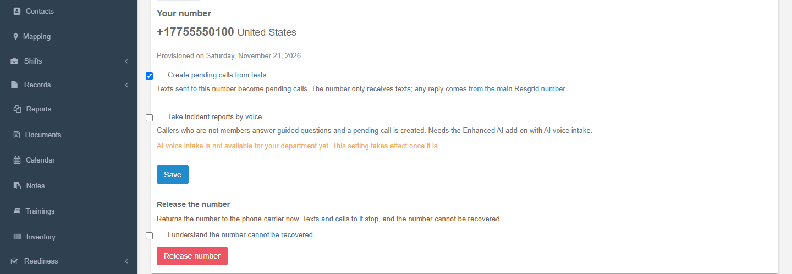
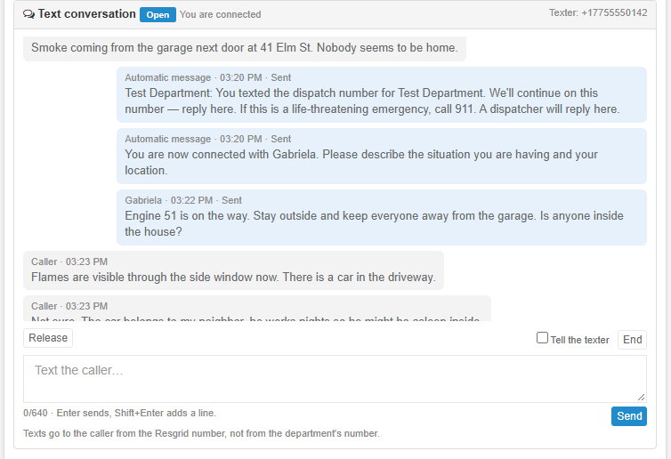

# Private Inbound Dispatch Number

The **Private Inbound Dispatch Number** add-on gives your department **its own phone number**, chosen by you, for the public and partner agencies to text and call:

- **Texts** to it become pending calls for a dispatcher to review, and open a [text conversation](#text-conversations) with the texter that Enhanced AI or a dispatcher carries on.
- **Phone calls** from people who are not members go through [voice intake](#voice-intake): spoken questions whose answers become a pending call (needs Enhanced AI).
- **Members** who call the number reach the usual voice menu.
- **Inbound only.** The number receives texts and calls. Every reply comes from the main Resgrid number, so your department needs no text-message registration of its own.

| Price | Where |
|---|---|
| **US$15 per month** (Stripe) | US and Canadian numbers. |
| **€20 per month** (Paddle) | A number in your department's country, where available. |

The add-on is billed monthly per department, even on an annual plan, and needs an **active paid entity plan**. Like every other intake, it never dispatches anyone by itself: a dispatcher reviews and sends each call.

## Where to find it

- **Department menu → Private Inbound Dispatch Number** (department admins), once it is offered to your department.
- The **Private inbound dispatch number** box on **Department menu → Text Messaging**, with **Manage private inbound dispatch number**, whatever the menu shows.
- The add-on's card on **Subscription and Billing**, which opens the add-on's billing page.

## Buying and lifecycle

### Buying the add-on

The **Add-on** box at the top of the page says where your department stands:

| The page says | What to do |
|---|---|
| *Your department holds the Private Inbound Dispatch Number add-on.* | Choose a number (below). **Manage the add-on** opens its billing page. |
| *Buy the Private Inbound Dispatch Number add-on to choose and provision a number.* | The price is shown with **Buy Private Inbound Dispatch Number**. Checkout runs on Stripe or Paddle and brings you back to this page. Only the department's **managing member** can buy (*Only your department's managing member can buy or cancel add-ons.*). |
| *The Private Inbound Dispatch Number add-on is available with an active entity plan.* | Change your plan first: **View plans** opens the Subscription page. |
| *The Private Inbound Dispatch Number add-on is not available for your department yet.* | It has not been offered to your department yet. |

### Choosing a number

Once the add-on is active, **Choose a number** searches the phone carrier:

| Filter | Use it for |
|---|---|
| **Country** | Only the countries offered to your department. |
| **Area code** | United States and Canada. |
| **Contains** | Digits the number should include; `*` matches any digit. |
| **State / province**, **City**, **Postal code** | Narrow to a place (United States and Canada). |
| **Near the department's address**, **Within** N miles | Numbers close to your department (needs the department's address or map center). |

Results list each **Number**, its **Location** and **Number type** (*Local number* or *Mobile number*). Every result can receive both texts and calls. **Provision** asks *Provision +1… as your department's number?*; the purchase takes a moment (*Refresh this page in a minute.*), then *… is now your department's number.* If the carrier cannot provide it, choose another.

### Your number

Under **Your number**:

| Setting | What it does |
|---|---|
| **Create pending calls from texts** | Texts sent to this number become pending calls (and [text conversations](#text-conversations)). The number only receives texts; any reply comes from the main Resgrid number. |
| **Take incident reports by voice** | Callers who are not members answer guided questions and a pending call is created ([Voice intake](#voice-intake)). Needs the Enhanced AI add-on with AI voice intake; without it the page says *AI voice intake is not available for your department yet. This setting takes effect once it is.* |

Press **Save**. Turning texts or voice on creates the matching [intake channel](overview#channel-types) (*Dispatch number SMS +1…*, *Dispatch number voice +1…*) on **Intake Channels**, where you can set its default priority and call type and its **Allowed senders**. **Processing** is only the SMS channel's to choose: it starts on **Call template**, and **Enhanced AI** lets Enhanced AI read the texts and talk with texters. The voice channel always uses Enhanced AI, which is what takes the caller through the questions.

**Release the number** returns it to the carrier at once. Texts and calls stop and the number **cannot be recovered**: tick *I understand the number cannot be recovered* and press **Release number**.

### If payment stops

The number is held while your department pays for the add-on **and** keeps an active paid plan. Cancelling the plan also cancels paid add-ons. When payment stops (the add-on or plan is cancelled or unpaid):

1. **The same day:** the department's administrators are warned (in-app notification and email, push when enabled), and the page shows *Payment for this number has stopped*, with the dates below.
2. **After 3 days** (a grace period for renewal invoices and card retries): texts and calls to the number stop. The page says *Number on hold*. Texters get a short note from the main Resgrid number, and callers hear *This number is no longer in service for the department.*
3. **15, 5 and 1 days before release:** the administrators are warned again. The page lists which warnings were sent.
4. **30 days after payment stopped:** the number is released to the carrier.

Paying again before the release keeps the number: **Put the number back in service** on the page brings it back. **Release it now** releases a held number straight away.

### Monthly limits

Each department can take up to **2,000 texts** and **100 voice intake calls** a calendar month on its number. Over the text limit, texts still create calls and your administrators are alerted. Over the voice limit, callers hear *This line takes text messages. Please text this number.* Blocked senders and robocalls that never press 1 do not count.

## Text conversations

When someone texts your number:

1. **A pending call is created** straight away, and a **text conversation** opens with the texter (one open conversation per texter).
2. **The welcome** is sent from the main Resgrid number: (department name)*: You texted the dispatch number for* (department name)*. We'll continue on this number — reply here. If this is a life-threatening emergency, call 911.* When nobody automated will answer, it adds *A dispatcher will reply here.* The welcome takes the place of the channel's **Reply to the sender** receipt.
3. **The texter replies to the main Resgrid number.** For 24 hours after the last message, their texts reach the conversation, ahead of member text commands. A second text to your number while the conversation is open joins it too.
4. **Who answers:**

| Who | When |
|---|---|
| **Enhanced AI** (*The AI assistant is asking the texter questions*) | The SMS channel's **Processing** is **Enhanced AI** and your department has AI intake. It asks one question per text, at most 8, then says *dispatch has your information. A dispatcher may text you here.* It never promises a response or an arrival time. |
| **Nobody yet** (*Waiting for a dispatcher to reply*) | Call template processing, no Enhanced AI, or the AI has finished its questions. |
| **A dispatcher** (*Connected with* the dispatcher's name) | A dispatcher takes the conversation, on the call's page or on the [dispatcher desk](../dispatcher-desk#texts-and-calls-to-the-desk). The texter gets *You are now connected with* (first name)*. Please describe the situation you are having and your location.* and Enhanced AI goes quiet. |

5. **It ends** when a dispatcher ends it, the texter texts **STOP** (they are opted out and nothing more can be sent), the call is closed, or nobody writes for 4 hours. The pending call stays.

Every text in the conversation is added to the call's notes (*Text from caller: …*, *Text to caller (Dana): …*), and Enhanced AI re-reads the conversation to keep the call's details current.

### On the call's page

**View Call** and **Update Call** show a **Text conversation** panel on calls that have one:

- the state (**Open** or **Ended**, with the reason: *The texter opted out*, *No messages for a while*, *The call was closed*), who is answering, and the texter's number;
- every message, labeled **Caller**, **AI assistant**, **Automatic message** or **Dispatcher**, with **Sending**, **Sent** or **Not delivered**;
- **Take conversation** connects you (*Another dispatcher is connected to this conversation. Take it over?* when someone else has it); **Release** hands it back; **End** closes it (*End this text conversation? The call stays open.*), with **Tell the texter** to send a closing text;
- a send box (*Text the caller…*, up to 640 characters; *Enter sends, Shift+Enter adds a line.*). *Texts go to the caller from the Resgrid number, not from the department's number.*

The panel works with or without the dispatcher desk; taking or releasing a conversation here also moves it on the desk.

### On the dispatcher desk

With the [dispatcher desk](../dispatcher-desk) routing **Text messages**, each new conversation is offered to an on-duty dispatcher as a **Text message** item linked to its pending call. The dispatcher works it in the Dispatch app: **Accept** connects them, the reply box texts the texter, **Return to queue** hands it back, and **Complete** ends it with **Tell the texter** on or off. See [Dispatch app → Dispatcher desk](../../apps/dispatch#dispatcher-desk).

## Voice intake

When **Take incident reports by voice** is on and your department has AI voice intake:

1. **Members** who call the number reach the usual voice menu.
2. **Everyone else** first hears *Thank you for calling. To leave a request for the dispatcher, press 1 now.* Callers who do not press 1 within 8 seconds hear *We did not hear a request. Please call back or text this number.* and the call ends.
3. After pressing 1, the caller hears *This automated line records your request, and a dispatcher will review it. If this is a life-threatening emergency, hang up and dial 911.* and answers four questions:
   - *Please tell us the emergency or request, then pause.*
   - *Please say the address or location, including the city.*
   - *Please say your name.*
   - *Please say or key in the best number to call you back on, then press pound. To use the number you are calling from, press star.*
4. Each question is asked again if nothing usable was heard. The caller hears *Your request has been recorded and a dispatcher will review it.*
5. A **pending call** is created from the answers, and Enhanced AI fills in the call's type, priority and address for a dispatcher to review.

When voice intake is off or not available, or the monthly voice limit is used up, callers who are not members hear *This line takes text messages. Please text this number.* Blocked callers hear *This line cannot take your call.*

Calls to your **department's text-to-call number** are different: with the dispatcher desk taking **Phone calls**, a dispatcher answers them live ([Dispatcher desk → Phone calls](../dispatcher-desk#phone-calls)).

## Spam screening

The number is public, so it gets [spam screening](overview#spam-screening):

- **Dismiss as spam** on a pending call from the number cancels it, ends its conversation without texting the sender, and blocks the sender's number (texts and calls) for 30 days.
- **Press 1** keeps robocalls out of voice intake and off your monthly limit.
- **3 calls an hour** per sender: more texts from the same number are added as notes to their open call.
- Texts from **short codes** and **alphanumeric senders** are refused.
- **Enhanced AI** labels likely spam *Enhanced AI: likely not an incident*, and the dispatcher desk never offers a labeled call (it waits for a dispatcher to take it).

## Setup examples

| Organization | How to set it up |
|---|---|
| **Volunteer fire** | A local number for non-emergency texts (burn permits, smoke reports). Texts on, voice off; SMS channel on **Call template**; the duty officer takes conversations from the call's page. |
| **Multi-agency dispatch center** | One number for partner agencies and the public's non-emergency texts; SMS channel on **Enhanced AI** so the assistant collects the location before a dispatcher connects; the [dispatcher desk](../dispatcher-desk) offers every conversation to the dispatchers on duty. |
| **Campus security** | A number printed on parking permits and residence hall doors for students to text; **Allowed senders** blank; dispatchers on the desk answer; dismiss pranks as spam. |
| **Emergency management** | A number for residents to report damage after a storm; texts and voice intake on, so callers without a smartphone can leave a report by voice; Enhanced AI fills in the addresses. |
| **Search and rescue** | A number for overdue-hiker reports from families and trailhead signs; voice intake on; the on-call coordinator takes the conversation. |

## Technical reference

| Item | Value |
|---|---|
| Pages | `DedicatedNumberController` (policy `Department_Update`): `GET /User/DedicatedNumber/Index` (search: `country`, `areaCode`, `contains`, `region`, `city`, `postalCode`, near the department), `POST Provision` (`phoneNumber`), `POST UpdateIntake` (`smsIntakeEnabled`, `voiceIntakeEnabled`), `POST Release` (`departmentPhoneNumberId`, `confirmRelease`), `POST Reactivate`. `DedicatedNumberBillingController` (`Index`, `Checkout` with `returnTo` 0 billing page / 1 number page). `IntakeConversationsController`: `GET Thread?callId=` (`Call_View`), `POST Connect` (`conversationId`, `takeOver`), `Send`, `Release`, `Close` (`reason`, `notify`) (`Call_Update`) |
| Strings | `Resgrid.Localization.Areas.User.Department.DedicatedNumber`, `.Dispatch.IntakeConversation`, add-on card in `.Addons.Addons`. The product name stays *Private Inbound Dispatch Number* in English in every language; code identifiers keep *DedicatedNumber* |
| Add-on | `PlanAddonTypes.DedicatedNumber` = 7 (PlanAddons row `3b1c7f0e-5d2a-4c86-9a4e-7f2d1e6b8c40`). `DedicatedNumberAddonConfig`: `StripeMonthlyAmount` 15 (USD), `PaddleMonthlyAmount` 20 (EUR), `StripeCountries` `US,CA`, `PaddleCountries` (operator-configured, each needs a Twilio regulatory bundle in `RegulatoryBundles`), `MonthlyVoiceIntakeLimit` 100, `MonthlySmsIntakeLimit` 2000, `LapseDelayHours` 72, `ReleaseGraceDays` 30, `ReleaseWarningDays` `15,5,1`, `ProvisioningTimeoutMinutes` 30. Needs an active paid entity plan; cancelling the entity plan cancels paid add-ons |
| Storage | M0323 `DepartmentPhoneNumbers` (`DepartmentPhoneNumberStatuses`), `DedicatedNumberBillingAccounts`; M0325 `DepartmentPhoneNumbers.ReleaseWarningsSent` (flags 1 stopped, 2/4/8 the warning stages), `LastReleaseWarningOn`, `IntakeConversations`, `IntakeConversationMessages` (delivery log only; message text lives in call notes) |
| Conversations | `IntakeConfig.ConversationsEnabled` true, `EmergencyNumber` `911`, `ConversationReplyWindowHours` 24, `ConversationIdleCloseMinutes` 240, `ConversationMaxAssistantTurns` 8, `ConversationMaxOutboundLength` 640. Replies go from `NumberProviderConfig.TwilioResgridNumber`. `IntakeConversationStates` 1 Open, 2 Closed; `IntakeConversationHandlers` 1 Assistant, 2 Unassisted, 3 Dispatcher; `IntakeConversationAuthors` 1–4; `IntakeConversationMessageStatuses` 1–4. Realtime `EventingTypes` 21 `IntakeConversationUpdated` (hub `intakeConversationUpdated(callId, {conversationId, state, handler})`). Desk seam `IIntakeConversationRouter` (`DispatcherIntakeConversationRouter`) |
| Voice | `VoiceIntakeSteps` 0 Greeting, 1 Nature, 2 Location, 3 CallerName, 4 Callback, 5 Completed, 6 Abandoned; prompts in `TwilioVoicePromptCatalog` (Piper TTS); speech via Twilio `<Gather input="speech">` (`VoiceSpeechModel` `phone_call`, `VoiceMaxRetries` 2); gate `api/Twilio/VoiceIntakeGate` (`VoiceGateEnabled`, `VoiceGateTimeoutSeconds` 8); sessions kept 48 h. Flag `Ai.VoiceIntake` |
| v4 API | `api/v4/IntakeConversations`: `GET GetForCall?callId=` (`Call_View`; the texter's number is masked without `Call_Update`), `POST Connect {ConversationId, TakeOver?}`, `POST Send {ConversationId, Text}`, `POST Release {ConversationId}`, `POST Close {ConversationId, Reason?, Notify?}` (`Call_Update`). `POST api/v4/IntakeScreening/DismissAsSpam` |
| Worker | 80 `IntakeMaintenance`: idle conversation close, lapse (after 72 h) and release (after 30 days) with the admin warnings, provisioning timeouts, purges |
| Flags | `Intake.DedicatedNumber` (menu entry, add-on card and checkout), `Intake.Channels`, `Ai.Intake`, `Ai.VoiceIntake` |
| Admin Assist | Links here (`/web-app/intake-channels/dedicated-number/`, `#voice-intake`) |
