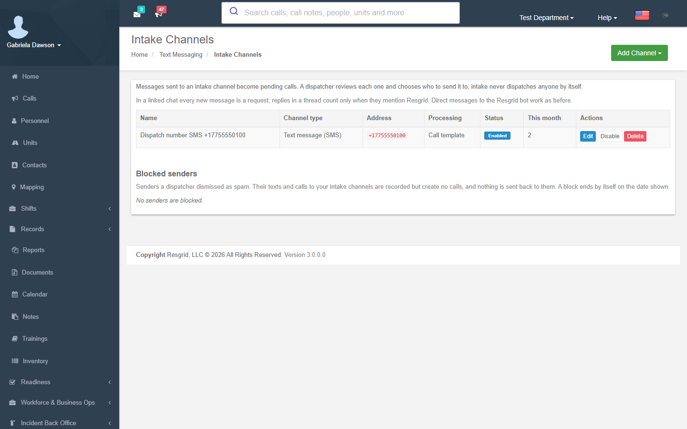
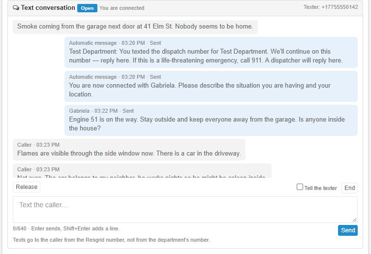

# Intake Channels

**Intake channels** turn requests from outside your department into **pending calls**: an email to an address you choose, a text or phone call to your [Private Inbound Dispatch Number](dedicated-number), a message in a Slack, Microsoft Teams, Telegram, Discord, Google Chat or WhatsApp chat, or a request from another system through a signed webhook. A hospital transfer line, an alarm company, a facilities help desk or a community chat can all send work to your dispatchers this way.

Intake **never dispatches anyone by itself**. Every message becomes a pending call that waits for a dispatcher to review it, choose who to send it to and dispatch it. With the [dispatcher desk](../dispatcher-desk) turned on, those pending calls are offered to the dispatchers on duty.

## Where to find it

**Department menu → Intake Channels** (department admins), or **Manage Intake Channels** on **Department menu → Text Messaging**.

Intake channels are being turned on for departments in stages. Until they are on for yours, the page says *Intake channels are not turned on for your department yet. You can set channels up now; they start creating calls once the feature is turned on.*, and the menu entry may be missing: use the link on Text Messaging.

## How intake works

1. Someone sends a message to the channel's address (an email address, a number, a linked chat, the webhook URL).
2. Resgrid checks the channel is **Enabled**, the sender is allowed (**Allowed senders**) and not blocked, and the sender has not gone over the [hourly limit](#spam-screening).
3. A **pending call** is created straight away from the message, named for the channel (*via Email: Hospital transfer line*), with the channel's **Default priority** and **Default call type**. Nothing is lost if Enhanced AI is down or not purchased.
4. With **Processing** set to **Enhanced AI**, Enhanced AI then reads the message and fills in the call's type, address, priority and a summary ([Enhanced AI intake](#enhanced-ai-intake)).
5. With **Reply to the sender** on, the sender gets a short receipt with the call number. Texts are answered from the main Resgrid number.
6. A dispatcher reviews the pending call on **Calls → Pending calls**, in the Dispatch app, or as an offer on the [dispatcher desk](../dispatcher-desk#routing-and-offers), and dispatches, edits or closes it.

The call's page shows where it came from in a banner (*via Text message (SMS): Dispatch number SMS +17755550100*), and the pending calls list adds the same label.

## Channel types

| Type | Address to enter |
|---|---|
| **Email** | The part before the @. Email sent to that name at your installation's dispatch domain becomes a pending call. It must differ from your department's dispatch email address (which keeps its own [import and email call mode](../dispatcher-desk#email-call-mode)). |
| **Signed webhook** | Nothing to type: Resgrid creates the webhook URL and signing secret when you save. Any system that can send a signed HTTPS request can create calls. See [Webhook channels](#webhook-channels). |
| **Slack** | *Workspace ID/channel ID*, for example `T012ABCDE/C034FGHIJ`. Invite the Resgrid app to the channel with `/invite @Resgrid`, then copy the channel ID from the channel details and the workspace ID from *About this workspace*. |
| **Microsoft Teams** | *Tenant ID/channel ID*. Add the Resgrid app to the team and use *Get link to channel*: the channel ID is the `19:…@thread.tacv2` part and the tenant ID is the `tenantId` value. Mention @Resgrid in the channel to send a request. |
| **Telegram** | The chat ID; group IDs are negative, for example `-1001234567890`. Add the Resgrid bot to the group. With privacy mode on, start a request with `/intake` or mention the bot. |
| **Discord** | The channel ID (turn on Developer Mode, right-click the channel, *Copy Channel ID*). Add the Resgrid app to the server and use `/resgrid` in the channel. |
| **Google Chat** | The space name from the space URL, for example `spaces/AAAAbCdEfGh`. Add the Resgrid app to the space and mention it to send a request. |
| **WhatsApp** | The WhatsApp sender number in international format. Resgrid support registers the sender on Resgrid's Twilio account. |
| **Text message (SMS)** | Your [Private Inbound Dispatch Number](dedicated-number) in international format, for example `+17755550100`. The number creates this channel for you when you turn on texts on it. |
| **Phone call (voice)** | Your Private Inbound Dispatch Number. Callers who are not members are taken through spoken questions by [voice intake](dedicated-number#voice-intake). The number creates this channel for you when you turn on voice intake. |

**Chat channels:** in a linked chat, every new message is a request. Replies in a thread count only when they mention Resgrid. Direct messages to the Resgrid bot work as before.

## Adding or editing a channel

**Add Channel** lists the channel types. Each channel has:

| Field | What to enter |
|---|---|
| **Name** | Shown on the pending calls this channel creates, for example *Hospital transfer line*. |
| **Address** | As in [Channel types](#channel-types). An address another channel (or any department's dispatch email address) already uses is refused. |
| **Processing** | **Call template** reads the message with one of your call email formats, picked under **Template** (Generic by default). **Enhanced AI** saves the message as a pending call, then fills in the call type, address, priority and a summary (needs the Enhanced AI add-on with AI intake). Phone call channels always use Enhanced AI. |
| **Allowed senders** | Comma-separated: phone numbers (with `*` wildcards), email addresses or `@domains`, or platform user IDs. Leave blank to accept anyone who can reach the address. At most 200 entries. |
| **Default priority** | The priority of the calls it creates, or **Department default**. |
| **Default call type** | The call type of the calls it creates, or **None**. |
| **Reply to the sender** | Sends a short receipt with the call number. Texts are answered from the main Resgrid number. Not for phone calls. |
| **Enabled** | Turn the channel off without deleting it. |

The list shows each channel's type, address, processing, status and how many messages it took **This month**, with **Edit**, **Enable** / **Disable** and **Delete** (*Delete this intake channel? Messages sent to its address will no longer create calls.*).

### Webhook channels

After saving a **Signed webhook** channel, its **Webhook URL** link opens the webhook details:

- the URL (`…/api/v4/Intake/Webhook/<token>`);
- the **Signing secret**, shown **only once** (*Copy the secret now… rotate it if it is lost*). **Rotate Secret** creates a new one; the old one stops working at once. Without a secret every request is refused;
- how to sign: header `X-Resgrid-Signature: t=<unix seconds>,v1=<hex HMAC-SHA256 of "t.body" using the secret>`; requests more than 300 seconds old are refused;
- the body: JSON with `message` (required), `subject`, `sender`, `externalId` (a repeat with the same ID never creates a second call), `address`, `latitude` and `longitude`.

A webhook accepts up to 60 requests a minute and bodies up to 64 KB.

## Enhanced AI intake

With **Processing** set to **Enhanced AI** (and the Enhanced AI add-on with AI intake), Enhanced AI reads each message after its pending call is saved:

- It fills in the **call type**, **address**, **priority** and a short **summary** from the message. The dispatcher sees them on the pending call and can change anything.
- It **never dispatches** and never changes who the call goes to.
- On a text conversation to your Private Inbound Dispatch Number, it can also **ask the texter questions**, one per text and at most 8, until a dispatcher connects ([Text conversations](dedicated-number#text-conversations)). It never promises a response or an arrival time, and tells the texter to call the emergency number when something is life-threatening.
- On a phone call to your number, [voice intake](dedicated-number#voice-intake) asks the caller four questions and turns the answers into the pending call (needs AI voice intake).
- A confident reading that the message is not an incident (spam, advertising, a wrong number, a test) labels the call *Enhanced AI: likely not an incident* ([Spam screening](#spam-screening)). The label never changes a call field.

Enhanced AI for intake runs on Resgrid's own self-hosted model. Departments enrolled in [Advanced Data Protection](../data-protection) are skipped: their intake calls are still created, just not read by AI.

Without the add-on, choose **Call template**: the call is built from the message with your template format, and the dispatcher fills in the rest.

## Text conversations

A text to your [Private Inbound Dispatch Number](dedicated-number) does more than create a pending call: it opens a **text conversation** with the texter, continued from the main Resgrid number. Enhanced AI or a dispatcher talks with them while the call is being worked, and everything they write is added to the call's notes. See [Private Inbound Dispatch Number → Text conversations](dedicated-number#text-conversations).

## Spam screening

Public numbers attract spam texts, robocalls and wrong numbers. Spam screening keeps them from becoming work for your dispatchers.

### Dismiss as spam

A **pending** call from an intake channel shows **Dismiss as spam** in its banner on the call's page (and in the Dispatch app's Pending Calls), for anyone who may close the call. With **Also block the sender for 30 days** ticked (the default):

- the call is **Cancelled**; nobody was dispatched and nobody is notified;
- its text conversation is closed **without texting the sender**;
- the sender is blocked for 30 days (*The call was dismissed as spam and the sender is blocked.*). A sender who withheld their number cannot be blocked (*The caller withheld their number, so they could not be blocked.*).

A call that is no longer pending cannot be dismissed this way: close it as usual.

### Blocked senders

The **Blocked senders** list at the bottom of Intake Channels shows each blocked sender, the channel type, who blocked them, when, and **Until** (the date the block ends by itself, or *Until lifted*), with **View call** for the dismissed call. *Senders a dispatcher dismissed as spam. Their texts and calls to your intake channels are recorded but create no calls, and nothing is sent back to them. A block ends by itself on the date shown.*

- A blocked phone number covers both texts and calls.
- Blocks end after 30 days because phone numbers are reassigned. Dismissing the same sender again renews the block; it never shortens one.
- **Unblock** lifts a block at once (*Their messages will create pending calls again.*).
- Members are never held back by the list, and if the list cannot be read, messages are let through so a real request is never lost.
- Blocked messages do not count toward your monthly limits.

### Automatic screening

| Check | What happens |
|---|---|
| **Per-sender limit** | On public phone lines (texts, phone calls and WhatsApp channels with no **Allowed senders**), one sender can create at most 3 calls an hour. Past that, a new message is added as a note to their newest open intake call, with no reply. With none open it still makes a call, labeled *Repeat sender: over the hourly limit*, with no welcome text, no conversation and no acknowledgement. Email, chat and webhook channels (alarm panels and CAD bridges send many incidents from one address) are never limited. |
| **Not a phone number** | A text from a short code or an alphanumeric sender ID is refused: no call, no conversation, no reply. |
| **Press 1 to continue** | A caller who is not a member first hears *To leave a request for the dispatcher, press 1 now.* Most auto-dialers never press 1, so they create no call and do not use up your monthly voice intake. See [Voice intake](dedicated-number#voice-intake). |
| **Enhanced AI label** | With Enhanced AI processing, a confident reading that the message is not an incident labels the call *Enhanced AI: likely not an incident*. Later texts in the conversation can clear it again. |

### Screened calls on the desk

A pending call with any screening label (*Enhanced AI: likely not an incident*, *Repeat sender: over the hourly limit*) is **never offered** on the [dispatcher desk](../dispatcher-desk#routing-and-offers): no push, no countdown. It waits in the desk's **Waiting** queue for a dispatcher to take, and the label shows on the pending call so they can dismiss it as spam or work it.

## Setup examples

| Organization | How to set it up |
|---|---|
| **EMS (interfacility transfers)** | Email channel *Hospital transfer line* (`transfers@…`), **Allowed senders** `@hospital.org`, **Default call type** *IFT*, **Enhanced AI** processing so the pickup address and priority are filled in; **Reply to the sender** on so the hospital gets the call number. |
| **Fire (alarm company)** | Signed webhook channel for the monitoring company's system, **Default call type** *Alarm*, **Call template** processing; their `externalId` stops repeat alarms creating duplicate calls. |
| **Security / facilities** | Microsoft Teams channel *Facilities requests* in the client's team; **Default priority** *Low*; dispatchers pick the requests up from Pending calls. |
| **Search and rescue** | Telegram group of partner agencies; members start a request with `/intake`; **Enhanced AI** to pull the location out of the message. |
| **Community / CERT** | Private Inbound Dispatch Number with texts on, so residents can text non-emergency requests; spam screening defaults; dismiss junk as spam. |
| **Emergency management** | Email channel for partner agencies' resource requests; Slack channel for the EOC's volunteer coordinators. |

## Technical reference

| Item | Value |
|---|---|
| Pages | `IntakeChannelsController` (policy `Department_Update`): `GET /User/IntakeChannels/Index`, `GET/POST Edit?id=&type=`, `GET Webhook?id=`, `POST RotateSecret`, `POST SetEnabled`, `POST Delete`, `POST Unblock`; `POST DismissAsSpam` (`callId`, `blockSender`; `Call_Update` and `CanUserCloseCallAsync`); `GET CallSources?callIds=` (`Call_View`). Views `Views/IntakeChannels/{Index,Edit,Webhook}`; the View Call banner and `_IntakeConversation` panel |
| Strings | `Resgrid.Localization.Areas.User.Department.IntakeChannels`, `Resgrid.Localization.Areas.User.Dispatch.IntakeConversation` |
| Types and modes | `IntakeChannelTypes` 1 Sms, 2 Email, 3 WhatsApp, 4 Slack, 5 Teams, 6 Telegram, 7 Discord, 8 GoogleChat, 9 Webhook, 10 Voice; `IntakeProcessingModes` 1 Template, 2 EnhancedAi; `CallSources` 6 Intake, 7 VoiceIntake |
| Storage | M0323 `IntakeChannels`, `IntakeMessages` (audit and idempotency, kept `MessageRetentionDays` 90), `VoiceIntakeSessions` (kept 48 h); M0325 `IntakeConversations`, `IntakeConversationMessages`; M0326 `IntakeBlockedSenders`. No foreign keys; purged with the department |
| Config | `IntakeConfig` (`RESGRID:IntakeConfig:<Field>`): `Enabled`, `MaxMessageLength` 4000, `MaxWebhookBodyBytes` 65536, `WebhookTimestampToleranceSeconds` 300, `WebhookRequestsPerMinute` 60, `MaxCallsPerSenderPerHour` 3 (0 = off), `SpamBlockDays` 30 (0 = until lifted), `VoiceGateEnabled` true, `VoiceGateTimeoutSeconds` 8, conversation settings (see [Private Inbound Dispatch Number](dedicated-number#technical-reference)) |
| Flags | `Intake.Channels` (per-department rollout), `Intake.DedicatedNumber`, `Ai.Intake`, `Ai.VoiceIntake` (prerequisite `Ai.Enhanced`) |
| AI | Every intake creates the pending call first, then queues enrichment on the `aidispatchtriage` queue (`AiDispatchQueueItem.Channel` 4 IntakeSms, 5 IntakeEmail, 6 IntakeChat, 7 IntakeWebhook, 8 IntakeVoice); self-hosted model only; ADP departments skipped. `LikelyNotIncident` from a confident `isDispatch` false (prompt `ai-dispatch-enrich-v3`) |
| Screening | `IIntakeScreeningService`; `IntakeMessageStates.SenderBlocked` 8 (not counted toward volume), `AddedToCall` 9; refusal `SenderNotPhoneNumber`; screenings `LikelyNotIncident`, `RepeatSender`, `DismissedAsSpam`; withheld caller IDs (ANONYMOUS, RESTRICTED …) never blocked or limited as one sender. Desk: screened calls held, event `HeldForReview` 19 |
| v4 API | `POST api/v4/Intake/Webhook/{token}` (signed); `POST api/v4/IntakeScreening/DismissAsSpam` `{ CallId, BlockSender }`; `CallResultData.IntakeScreening` on `Calls/GetCall`, `GetActiveCalls`, `GetPendingCalls`, `GetCalls`; `api/v4/IntakeConversations/*` (see [Private Inbound Dispatch Number](dedicated-number#technical-reference)) |
| Worker | 80 `IntakeMaintenance`: message and session purges, idle conversation close, expired block purge, number lapse and release |
| Admin Assist | Capabilities in the intake catalog link here (`/web-app/intake-channels/overview/`) |
