# Mapping

The **Mapping** page is the live operational map: every unit and person with a recent location, active calls, stations, hydrants, points of interest and your own map layers. Use it to see who is where, route a unit to a call, and keep reference layers (districts, water sources, staging areas) at hand.

**Left menu → Mapping.** Layers and points of interest are managed from the buttons on the map page; map behaviour (how long a location stays on the map) is under **Department Settings → Mapping**. **Map Icon Legend** explains every pin and its colors ([below](#map-icon-legend)).

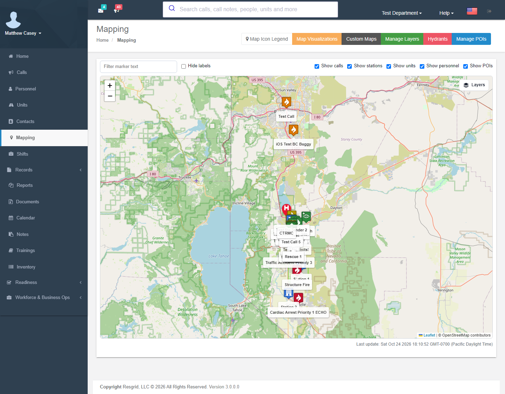

<AcademyVideo id="07-mapping" />

## Map View

The main map view displays an interactive map centered on the department's configured location (GPS coordinates or geocoded department address).

### Base map

Every map on the website draws the department's **map style** from [Department Settings → Mapping](department-settings#mapping--big-board-settings). How it is drawn depends on whether the department has the **MapLibre web maps** feature (`Maps.MapLibreWeb`, see [Feature Flags](../reference/feature-flags)):

| | MapLibre web maps on | Off (the standard web map) |
|---|---|---|
| **Base map** | The department's day style, served by the Resgrid server: Mapbox styles on a Mapbox installation, the server's own maps on a self-hosted one | Raster tiles from the installation's tile server |
| **Drawing tools** | Terra Draw toolbar (layers, geofences, custom map bounds, offline area) | Geoman toolbar |
| **Live traffic** | Available where the installation has a traffic provider ([below](#live-traffic)) | Not available |

Both show the same pins, layers, popups and routes, and every page works with either. If the MapLibre map cannot load its style within 15 seconds, the page falls back to the standard map so dispatch is never left without one.

### Live traffic

Where the Resgrid installation has a live traffic provider, MapLibre maps show a **car button** in the top-right corner. It draws current traffic on the roads, colored by congestion:

| Color | Traffic |
|---|---|
| Green | Free-flowing |
| Yellow | Moderate |
| Orange | Heavy |
| Red | Severe |
| Dark red, dashed | Road closed |

Traffic lines show from street level (zoom 10 and closer) under the street names, one line for each direction of a two-way road, and refresh every few minutes while traffic is shown. The button remembers your choice on this device: turn traffic off once and it stays off on every map until you turn it back on.

Traffic starts **on** for the **New Call**, **Update Call** and **Add Archived Call** maps and the **Dispatch** dashboard map, and **off** on the other main maps (this page, View Call, the unit map, Routes and Live / Station Routing). Small maps such as location pickers have no traffic button.

### Map Data Layers

The `GetMapData` endpoint is the primary aggregation endpoint, supporting these toggleable layers:

| Layer | Flag | Description |
|-------|------|-------------|
| **Stations** | `ShowStations` | Station group locations with geofences |
| **Calls** | `ShowCalls` | Active call locations with priority markers |
| **Units** | `ShowUnits` | Current unit positions |
| **Personnel** | `ShowPersonnel` | Personnel locations (permission-controlled) |
| **POIs** | `ShowPOIs` | Points of interest |
| **Districts** | `ShowDistricts` | Response district boundaries |
| **Custom Maps** | `ShowCustomMaps` | Uploaded floor plans, schematics, and event maps with named zones |

:::note Permission Control
Personnel location visibility is controlled by the `CanSeePersonnelLocations` permission. This is configurable per department in the Security settings.
:::

### Icons by status and priority

Call, unit and personnel pins change with what they are doing, so the map can be read at a glance:

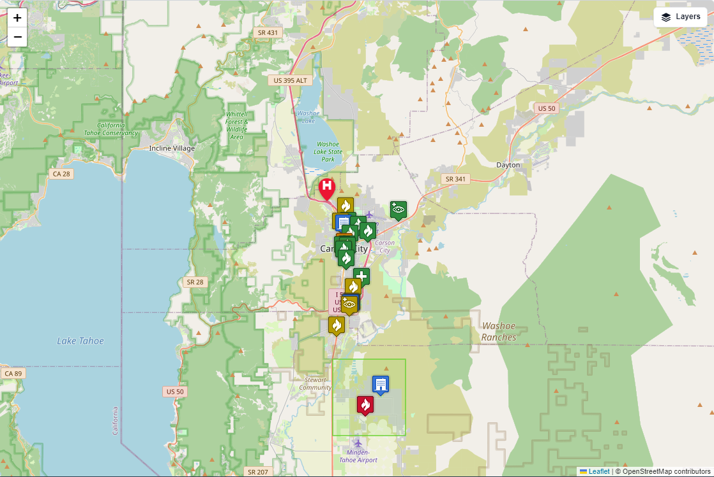

- a **call** pin takes the color of its **priority**;
- a **unit** pin takes the color of its **status**;
- a **member's** pin takes the color of their **status**. A member *On Unit* takes the color of their unit's status. Staffing levels never change a pin.

The color comes from the *meaning* of the status or priority, not its name, so built-in and [custom statuses](custom-statuses) and your own call priorities all land on the same colors:

| Color | Statuses with these meanings |
|---|---|
| Green — *Available* | Available, Cleared, On Patrol, Completed, In Quarters |
| Amber — *Dispatched* | Dispatched |
| Red — *Responding* | Responding, En Route |
| Blue — *On scene* | On Scene, Made Contact, Investigating, At Patient, Searching |
| Purple — *Transporting* | Transporting, Delivering, Loading, At Hospital |
| Teal — *Returning* | Returning |
| Brown — *Staging and standby* | Staging, Standby |
| Slate — *On break* | On Break |
| Charcoal — *Unavailable* | Unavailable, Maintenance, Not Responding |
| Gray — *No meaning or no status* | A status with no meaning whose name suggests none; a unit or member that has set no status |

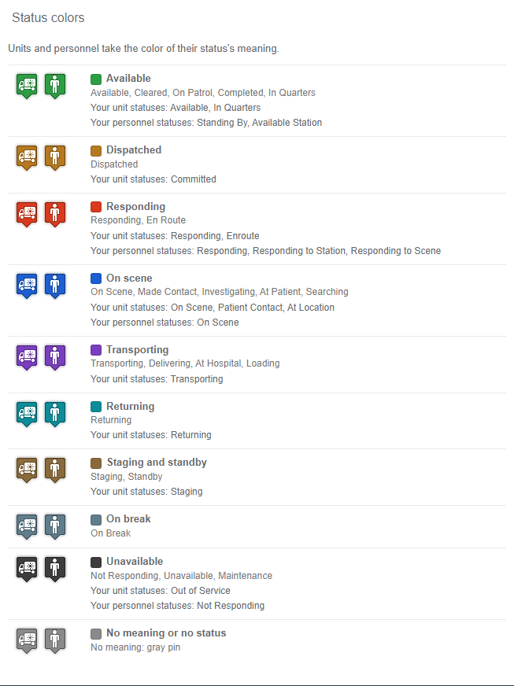

Call priorities: **Low** green, **Medium** yellow, **High** orange, **Emergency** red. A status or priority with no meaning set takes the color its name suggests (a priority named *Emergency*, a status named *Out of Service*), the same suggestion the settings pages make; one whose name suggests nothing shows a **gray** pin, as does a unit or member that has set no status. Set meanings on the [Custom Statuses](custom-statuses) and Call Priorities pages to be sure. The guess only colors the pin: everything else still treats the option as having no meaning.

The built-in pin keeps its picture (the fire, the ambulance, the person) and only its color changes. A type or role with a [custom icon](#custom-map-icons) shows that icon with a small colored badge in its lower right corner, unless an icon was uploaded for that exact status or priority ([status and priority icons](#status-and-priority-icons)). The map redraws a pin within a few seconds of a status or call change.

## Map icon legend

**Mapping → Map Icon Legend** shows every icon the map can show for your department, built from your own call types, priorities, unit types, status sets and roles:

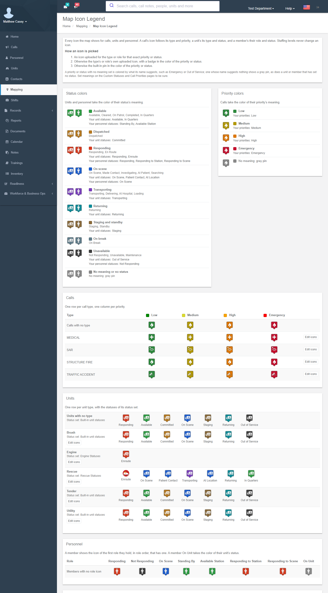

| Section | Shows |
|---|---|
| **How an icon is picked** | The order: an icon uploaded for the exact priority or status, else the type's or role's own icon with a badge, else the built-in pin in the color of the priority or status. |
| **Status colors / Priority colors** | Each color, the meanings it covers, sample unit, person and call pins, and your own unit statuses, personnel statuses and priorities that show in that color. A status or priority listed under gray has no meaning set. |
| **Calls** | One row per call type (and calls with no type), one column per priority. |
| **Units** | One row per unit type (and units with no type) with every status of the type's status set, or the built-in unit statuses. |
| **Personnel** | Members with no role icon, then every role with an icon, in role order, across the department's personnel statuses. |
| **Stations, hydrants and points of interest** | Icons that do not change with status: the icon every station shows, then each station with its own [station icon](#station-icons), the hydrant and each POI type. |

Hover over an icon to see whether it is an icon uploaded for that status or priority, a type icon with a badge, or a built-in pin. Department administrators get an **Edit icons** button on each call type, unit type and role row, which opens its [status or priority icons](#status-and-priority-icons) page, and a **Station icons** button in the stations section. The legend is open to every member who can open the map.

Nothing on the legend is fixed: the names are your own call types, priorities, unit types, status sets, statuses and roles, and the icons are what the map draws for them, including the built-in icon a type picked and every uploaded icon. Rename a priority, add a custom status, give a unit type another built-in icon or upload an icon, and the legend shows it the next time it is opened.

The built-in personnel status **On Unit** is not listed under any color: a member On Unit takes the color of their unit's status, and shows the gray pin only when there is no unit status to follow. Hover its icon on the legend to see this.

The Responder, Unit and IC apps show the same legend from the **legend** button on their maps ([in the apps](#in-the-apps)); app developers can read it from the [Map Icons API](../api/map-icons).

## Map Layers

Map layers are your own shapes on the map: districts, hydrant runs, staging areas, labelled gates, or a whole event imported from a file (a marathon course, a festival site, the vendors along a parade). Members can switch each layer on or off. A drawn layer has one color; an imported layer keeps each shape's own color. Layers with event dates show whether the event is upcoming, running now or over, and are switched on on every map while it runs.

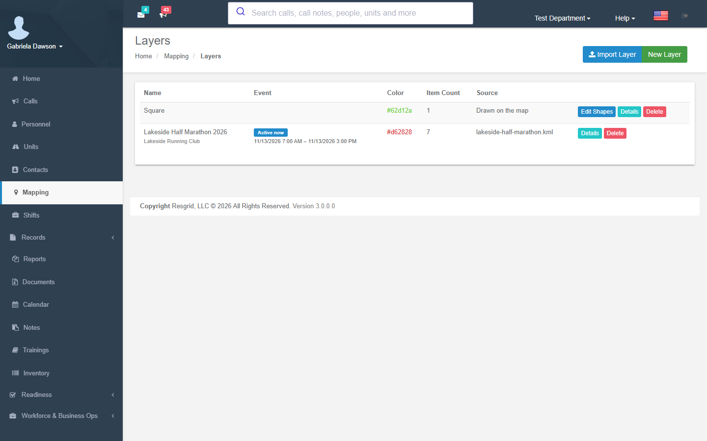

### Creating Layers

**Mapping → Layers → New Layer.**

| Field | Description |
|-------|-------------|
| **Name** | Display name, also the name of every shape in the layer |
| **Is Visible By Default** | The layer is on when a member opens the map |
| **Is Searchable** | The layer's shapes are found by map search |
| **Color** | One color for every shape |
| **Layer Elements** | The shapes, drawn on the map with the toolbar |

Draw with the toolbar in the top-left corner of the map:

| Tool | What it does |
|---|---|
| **Marker** | Places a point |
| **Line** | Draws a line; click each point, double-click to finish |
| **Polygon** | Draws an area; click each corner, click the first corner (or double-click) to close it |
| **Rectangle** | Drags out a rectangle |
| **Circle** | Drags out a circle from its centre |
| **Text** | Click the map, type the text: a label on the map |
| **Cut** | Select a polygon first, then draw the part to remove: cuts a hole, or splits the shape in two |
| **Rotate** | Select a shape, pick the tool, then drag on the map to turn the shape |
| **Select** | Click a shape to select it; drag it to move it, drag its points to reshape it |
| **Delete** / **Clear** | Removes the selected shape / every shape |

New points snap to the corners and edges of shapes you already drew, so neighbouring districts share a border without gaps. With a text label selected, the **Text** tool edits its text.

A shape with a hole, or one cut into several parts, can be selected, deleted and cut again, but not reshaped point by point; draw it again if its outline must change. On the standard web map (MapLibre web maps off) the toolbar is the Geoman toolbar, with the same tools.

### Importing a Layer (KML, KMZ, GeoJSON)

**Mapping → Layers → Import Layer.** Upload a `.kml`, `.kmz`, `.geojson` or `.json` file (Google My Maps and Google Earth export KML/KMZ; most GIS tools export KML or GeoJSON), name the layer, and add the event's details: start and end (in the department's time zone), organizer, and the coordinator's name, phone and email.

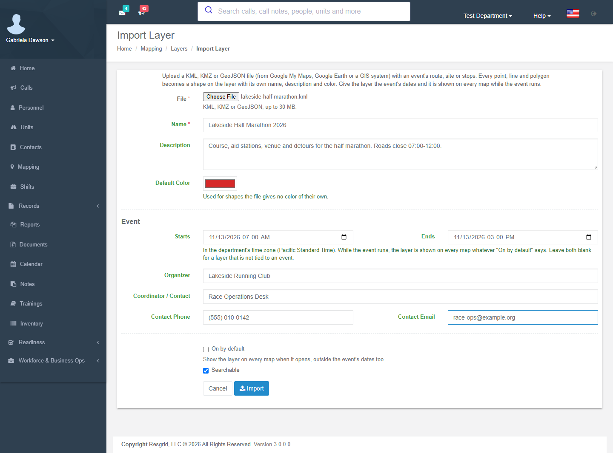

Every point, line and polygon in the file becomes a shape with its own name, description, color and folder; multi-part shapes are split and polygons keep their holes. Places that only have an address (no coordinates) are left out, and the import says how many: import those as [POIs](#importing-pois) instead, which locates them from their address. POI import takes KML, KMZ and CSV only, so put those places in a KML or KMZ file, or list them in a CSV with an address column, before importing them — a GeoJSON file has to be converted first. See [Importing a Layer](../configuration/mapping-layers#importing-a-layer-kml-kmz-geojson) for the file rules and limits.

While the event runs, the layer is switched on on every map (web, Omni and the mobile apps), whatever **Is Visible By Default** says. Clicking a shape opens its name, folder and description:

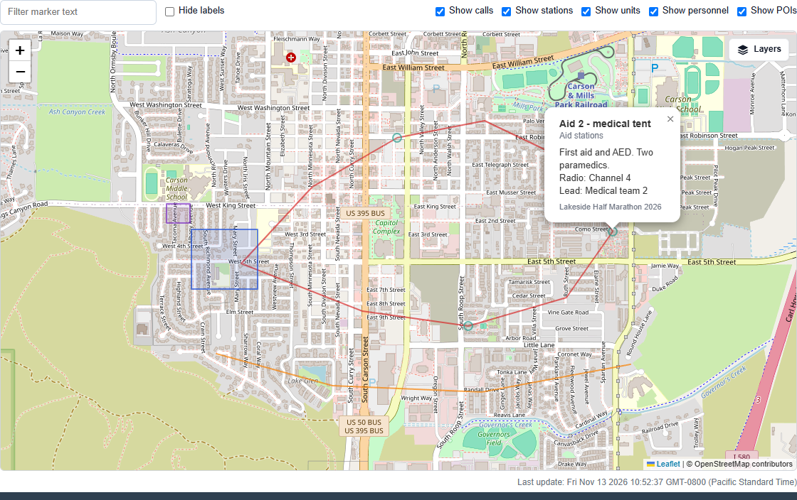

### Editing Layers

**Edit Shapes** (drawn layers) opens the same page with the layer's shapes on the map. Circles, circle markers and text labels come back as they were drawn, and a polygon keeps its holes. Saving before the map has finished loading keeps the shapes the layer already had.

**Details** (every layer) edits the name, description, default color, event dates, organizer and contact, and can **replace the file**: a new file replaces every shape and keeps the details. An imported layer has no shape editor, because the editor would give every shape the layer's name and color.

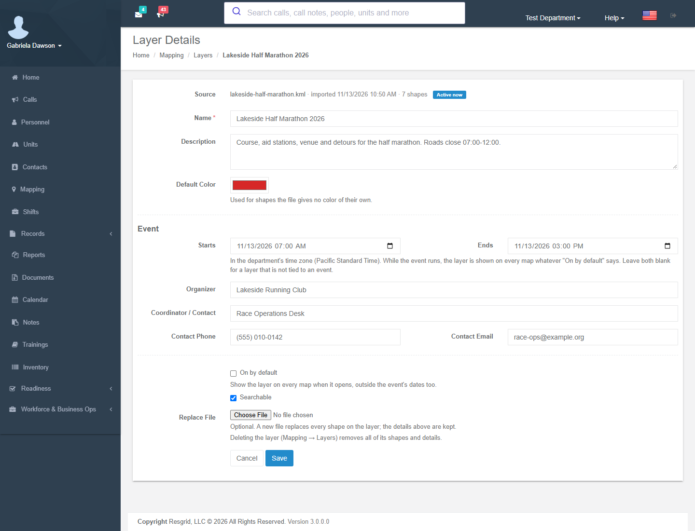

### Deleting Layers

Deleting a layer removes it from every map, together with everything it held: its shapes, description, organizer and contact details. The emptied layer is kept in the database marked deleted (soft delete).

## Points of Interest (POIs)

Points of interest are the fixed places your people need on the map: hospitals, shelters, water sources, staging areas, Knox boxes, client sites. Each belongs to a **POI type** (its category, marker and color). **Mapping → Manage POIs** lists the types, with **View**, **Add**, **Import** and **Delete** on each row and the department's recent [imports](#importing-pois) below. Department admins manage POIs.

### POI Types

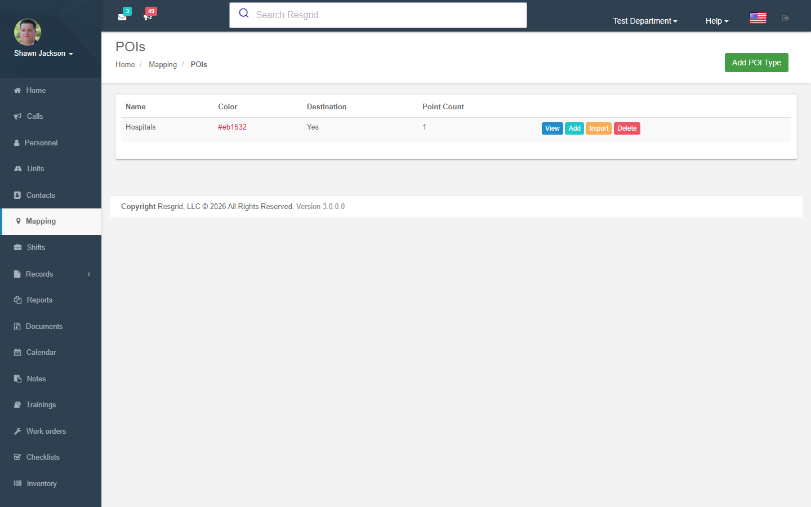

Create categories for points of interest with custom markers and images. A POI type can also have its own [custom icon](#custom-map-icons), set when you add the type or on its **View** page (Information tab); it replaces the marker on the map and in the apps. Tick **Is Destination** on types that calls and units go *to* (hospitals, shelters, water sources): their POIs become [destinations](destinations).

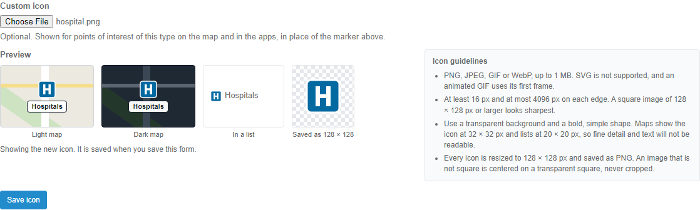

### Individual POIs

**Add** on a type's row adds one place: **Latitude** and **Longitude** (required), **Name**, **Address**, **Note**, and the [capabilities](destinations#poi-capabilities) it offers when the department has any.

### Importing POIs {#importing-pois}

Departments usually start from a list they already have: a spreadsheet of hospitals or client sites, a Google My Maps layer, a GIS export. **Import** on a POI type's row (**Mapping → Manage POIs**) opens **Import POIs** with that type chosen; pick another **Type** there if needed, choose the file and press **Import POIs**. Every place in the file is added to that type.

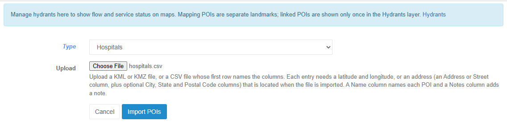

**Who can import:** department admins, and members who may manage prevention data (hydrant managers). Hydrant managers cannot open **Manage POIs**: they use **Import map POIs** on the [Hydrants](records/hydrants) page, choose the POI type on the import page, and follow their own imports there. **Cancel** takes them back to Hydrants.

**Files.** A `.kml`, `.kmz` or `.csv` file of up to 10 MB. Each entry needs a latitude and longitude, or an address that is located when the file is imported.

- **KML and KMZ** are read the way Google Earth reads them, so files from most converters work: the older KML 2.0 and 2.1 formats, files with no KML namespace, and zipped KML saved as `.kml` (or plain KML saved as `.kmz`). Each placemark becomes a POI at its point (a line or area at its center), named by its name or, when that is empty (QGIS, ogr2ogr), by a *name*, *title* or *label* field. The first 5 network links in the file are followed.
- **Google My Maps layers placed by address** have no coordinates: their placemarks are located from the address columns they carry, else from their address.
- **CSV** needs a first row that names the columns. Comma, semicolon and tab separators are detected, as are Excel's encodings, and a semicolon file may use decimal commas (`41,59`). At most 10,000 rows per file.

**Columns** are recognized by name, ignoring case, spaces and punctuation (*Street Address 1* is *streetaddress1*). Other columns are ignored. In a KML file the same names are read from each placemark's ExtendedData.

| Column | Names recognized |
|---|---|
| Name | name, title, label, poi name, site name, location name, place name, facility name. A row without a name is named by its address |
| Latitude, Longitude | latitude, lat, y, point y, y coord · longitude, lon, lng, long, x, point x, x coord |
| Address | address, address 1, address line 1, street, street 1, street address, street address 1; joined with **City** (city, town, municipality, locality), **State** (state, province, state province, state or province), **Postal code** (postal code, postcode, postal, zip, zip code; `60611.0` is read as `60611`) and **Country** (country) |
| Full address | full address, formatted address, complete address: used as it is, instead of the parts |
| Note | note, notes, comment, comments, remarks, description |
| Capabilities | capabilities, capability, specialties, specialities, specialty, speciality, services: several names separated by `;`, `,` or a vertical bar. Each is matched to the department's [POI capabilities](destinations#poi-capabilities) ignoring case; a name the department does not have yet is added |

A CSV needs latitude and longitude columns or an address column. A row with neither a usable position nor a street address is skipped: a city or postal code alone would put the POI in the middle of town. A position out of range (usually latitude and longitude swapped) or `0,0` (a converter's "not located") counts as no position, so the row is located from its address when it has one.

**The upload is checked straight away.** A file that cannot be imported is refused on the page with the reason, for example:

| Message | Cause |
|---|---|
| *File type (.xlsx) cannot be imported as POIs: upload a KML, KMZ or CSV file.* | Any other file type: save a spreadsheet as CSV first |
| *The first row of the CSV must name the columns, with latitude and longitude columns or an address column … Columns found: …* | No recognized position or address column |
| *The CSV has more than 10000 rows. Split it into smaller files and import each one.* | Too many rows |
| *Line N of the CSV could not be read: check for an unmatched double quote.* | A broken quote |
| *None of the N entries in the file have valid coordinates or an address (check that latitude and longitude are not swapped or blank).* | Every row was skipped |
| *The file is not valid KML: …* / *The KMZ file is damaged or is not a zip archive.* | A damaged file |

A file over 10 MB is refused too (*The file is too large: it must be smaller than 10 MB.*), and so is an upload with no type chosen (*Choose the POI type to import into.*).

**The import runs in the background.** Accepted files are queued (*… was queued for import (N entries). Imports run in the background and usually start within a minute; their progress is listed below.*), so a spreadsheet of a few thousand addresses never times out the page. The **Imports** panel at the bottom of **Manage POIs** (and of the import page) lists the last 10 imports: the department's for admins, a hydrant manager's own otherwise. While an import is running the panel updates itself every 10 seconds; **Refresh** reloads the page you are on.

<!-- SHOT: /img/web-app/mapping/poi-imports-panel.png | Imports panel on Manage POIs: one import Locating addresses with a retry line, one Complete with its report lines -->

| Column | Shows |
|---|---|
| **File** | The file name and the POI type it went to. |
| **Uploaded** | When, in the department's time zone. |
| **Status** | **Queued**, **Locating addresses**, **Saving POIs**, **Complete** or **Failed**. |
| **Result** | While running, *N entries to import.*; when done, the report below. |

The panel updates itself every 10 seconds while an import runs (in a tab you are looking at), and the page reloads once when the last one finishes, so the type's POI count includes the new points.

**Address lookup.** Entries without a position are located from their address by the installation's geocoder:

- up to **5,000** different addresses per import; the rest are not tried (import them in another file);
- an address the geocoder could not find is reported, never asked again;
- an address the geocoder did not answer for (an outage, a rate limit) is tried again after 2, 10 and 30 minutes (*The address lookup service did not answer for N entries; they will be tried again after …*) before it is reported.

**The report** of a finished import lists:

| Line | Means |
|---|---|
| *N of M entries imported.* | POIs saved, of every entry in the file. |
| *N were located from their address; check their positions on the map.* | Geocoded entries. |
| *N were skipped because they have neither coordinates nor an address.* | Skipped rows. |
| *N were not imported because their address could not be located:* | The first 10 names, then *and N more.* Correct those addresses, or add latitude and longitude, and import just those entries. |
| *N were not imported because the address lookup service did not answer, even after retrying:* | Usually temporary: import just those entries again later. |
| *N were not imported because address lookup is not set up on this server:* | Add latitude and longitude columns and import them again. |
| *N were not imported because the file has more addresses than one import looks up:* | Over the 5,000-address limit. |

An import whose worker stopped carries on where it was, after the last POI it saved. One that fails three times is marked **Failed** (*The import failed 3 times and was given up. POIs it saved before failing were kept.*), as is one whose POI type was deleted while it waited. Reports are kept for 90 days. Where [hydrants](records/hydrants) are on, the import page reminds you that hydrants are managed separately on the Hydrants page.

### Viewing POIs by Type

**View** on a type's row opens it with three tabs: **Map** (only that type's POIs), **Information** (name, destination, color and the type's [icon](#custom-map-icons)) and **List** (name, address, note, [capabilities](destinations#poi-capabilities), latitude and longitude, with **Edit** and **Delete** on each). The list of a destination type also shows each POI's [availability](destinations#destination-availability), with **Set availability**.

### Removing POIs {#removing-pois}

Imported the wrong file, or the same one twice? The **Remove POIs** panel above a type's **List** removes many POIs at once (department admins).

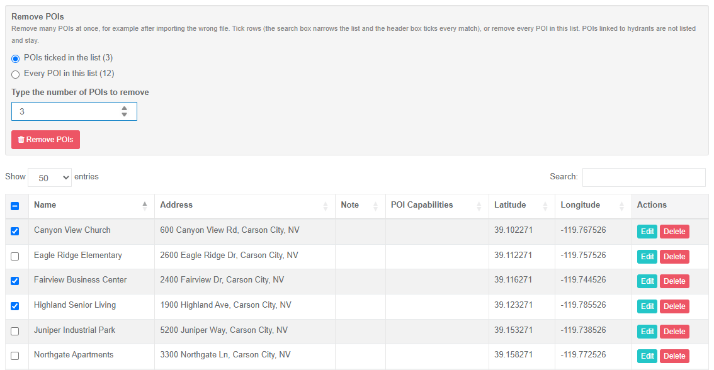

1. Choose **POIs ticked in the list** and tick the rows (the search box narrows the list, and the header box ticks every match), or **Every POI in this list**. Each option shows how many it removes.
2. **Type the number of POIs to remove**, the count shown for your choice.
3. Press **Remove POIs** and confirm *Remove N POIs? This cannot be undone.*

A typed number that does not match is refused (*Type N to confirm, the number of POIs this removes.*), as is one left blank. POIs linked to [hydrants](records/hydrants) are not listed and stay. The result says *N POIs removed.*

### POI capabilities

What each point of interest offers (*Cath Lab*, *Stroke Center*, *Helipad*, *Drafting*), managed under **Mapping → Manage POIs → POI Capabilities** and ticked on each POI or imported from a *Capabilities* column. See [POI capabilities](destinations#poi-capabilities) on the Destinations page.

### Destination availability

A destination POI can be marked **Limited**, **Diversion** or **Closed** for a while, with the capabilities it cannot provide right now, from **Mapping → Manage POIs → Destination Availability** or the Dispatch app. See [Destination availability](destinations#destination-availability), and [Destination rules](destinations#destination-rules) and [suggestions](destinations#destination-suggestions) for ranking destinations by what a call needs.

## Live Routing

**Live Routing** (from your current position) and **Station Routing** (from a station) show the drive to a call: the route line, the distance and time, and turn-by-turn directions. The route comes from the Resgrid server's routing provider (Valhalla, Mapbox, Google or OSRM, as the installation is set up), with the provider's attribution under the directions; the browser never calls a routing service itself.

- **Live Routing** starts at your browser's location (the browser asks for permission).
- **Station Routing** starts at the station's address or GPS coordinates and ends at the call's location.

## Custom Maps

Custom Maps allow departments to upload building floor plans, venue layouts, schematics, and satellite imagery, draw named polygon zones on those images, and use zone names as call locations. See the dedicated [Custom Maps](custom-maps) documentation for full details.

On the main map view, use the **Custom Maps** layer control (alongside Layers, POIs, and Geofences) to toggle custom map overlays. When one or more custom maps are enabled, a **Building Selector** sidebar appears for switching between maps and floors.

## Custom map icons

Departments can replace the built-in map icons with their own images, so an ambulance, a MUG, a PIT, a first responder car and a bicycle team are told apart at a glance instead of by reading names. Icons can be set for:

| What | Where you set it | Where the icon shows |
|---|---|---|
| **Unit types** | **Department → Types → Unit Types**, new or edit | Beside units of the type in the Units list, the dispatch dashboard unit grid, New Call and View Call, the Types table, and on unit pins on the map; in the apps' unit lists and pickers and on their map pins |
| **Call types** | **Department → Types → Call Types**, new or edit | Beside the call type in the active and archived call grids and the Types table, and on call pins on the map; in the apps' call cards and call screens and on their map pins |
| **POI types** | **Mapping → Points of Interest**: on **Add POI Type**, or the type's **View** page (Information tab) | On every point of interest of the type on the map, and in the apps' POI lists and map pins |
| **Personnel roles** | **Personnel → Manage Roles**: **Add Role** or **Edit** | On the map pin of each member, by [role order](#personnel-role-icons-and-role-order); beside the role on the Roles page; on personnel cards in the apps |
| **Stations** | **Groups → Station icons** (one icon for all stations, and any station's own), or a station's **New Group** / **Edit Group** page | On station pins on the map, the map visualizations and the [Map Icon Legend](#map-icon-legend); on station pins in the apps |

A type or role without its own icon keeps what it showed before: the built-in map icon chosen on the type, the POI marker, or the standard person pin.

### Station icons

A station shows **its own icon**, else **the icon for all stations**, else the built-in station pin. Upload one icon for all stations to restyle every station at once (for example your service's emblem), and give a station its own where it should look different, such as an ambulance post next to fire stations.

**Groups → Station icons** (also linked from the Map Icon Legend and from a station's Edit Group page) lists *All stations* first, then every station group, with what each shows on the map and its uploaded icon. Choose a file and press **Upload** on a row; **Remove** returns the row to the next icon in that order. A station's own icon can also be chosen on its **New Group** or **Edit Group** page, with the same preview as the type pages. The same [image rules](#choosing-an-image) apply.

Station icons never change with status. Deleting a station group removes its icon. The Station icons page needs the permission to edit the department; a station's own icon can also be set by whoever can edit that group.

### Choosing an image

The picker lists these rules next to the file input:

| Rule | Detail |
|---|---|
| Format | PNG, JPEG, GIF or WebP. SVG is not accepted, and an animated GIF uses its first frame |
| File size | Up to 1 MB |
| Dimensions | At least 16 px on the longest edge and at most 4096 px on each edge. A square image of 128 × 128 px or larger looks sharpest |
| Background | Transparent. An image with an opaque background shows as a filled square on the map |
| Design | A bold, simple shape. The map draws the icon at 32 × 32 px and lists at 20 × 20 px, so fine detail and text will not be readable |
| What is stored | Every icon is resized to 128 × 128 px and saved as PNG, with the file's metadata removed. An image that is not square is centered on a transparent square; nothing is cropped |

### Preview and checks

As soon as you choose a file, the page checks it and shows a preview of the stored image on a light map and a dark map (with the name label the map shows under a pin), in a list row, and as the saved 128 × 128 image. The previews use the name typed on the form.

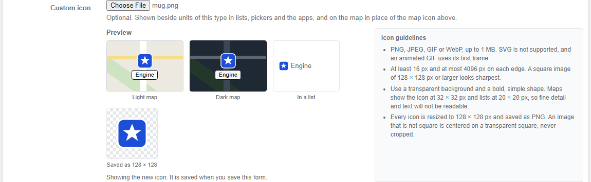

Some files are accepted with a warning, so you can decide whether to use a better image:

- the image is smaller than 128 × 128 px and will be enlarged (it may look blurry);
- the image is not square and will be centered on a transparent square;
- the image has no transparent background and will show as a filled square.

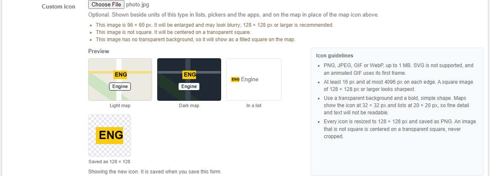

A file that cannot be used is refused before anything is uploaded, the file input is cleared and the reason is shown under it. The server repeats the same checks when the form is saved, so a file that gets past the browser is still refused with the same message.

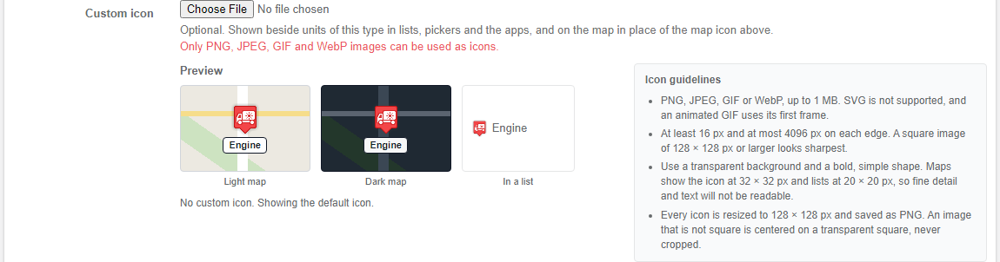

| Message | Cause |
|---|---|
| Only PNG, JPEG, GIF and WebP images can be used as icons. | Any other file type, including SVG, BMP, TIFF and HEIC |
| The icon file must be 1 MB or smaller. | The file is over 1 MB (the size of the chosen file is shown) |
| The icon must be at least 16 px on its longest edge. | The image is too small (its size is shown) |
| The icon must be 4096 px or smaller on each edge. | The image is too large (its size is shown) |
| The file could not be read as a PNG, JPEG, GIF or WebP image. | A damaged file, or one whose contents do not match its name |

The icon is saved together with the rest of the form. Before you save, the preview says *Showing the new icon*; after saving, the edit page shows the current icon and a **Remove the custom icon** box. Ticking it and saving removes the icon, and the type or role goes back to its default. Choosing a new file replaces the old icon.

### Personnel role icons and role order

A person can hold several roles, so their map pin uses the icon of **the first role they hold, in the department's role order, that has an icon**. People whose roles have no icon keep the standard person pin.

Set the order on **Personnel → Manage Roles**: drag the rows, or use the up and down arrows, then click **Save order**. Only department administrators see the order controls. Until a department saves an order, roles are listed by name and that is the order used. A role added after the order was saved goes to the end.

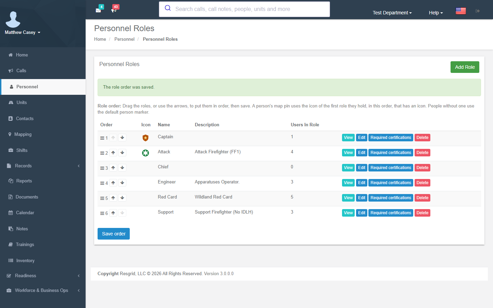

For example, with the order *Officer*, *Paramedic*, *Firefighter*, where Officer and Paramedic have icons:

| Member's roles | Map pin |
|---|---|
| Officer, Firefighter | Officer icon |
| Paramedic, Firefighter | Paramedic icon |
| Officer, Paramedic | Officer icon (Officer is first) |
| Firefighter | Standard person pin (Firefighter has no icon) |

See [Personnel Roles](../configuration/personnel-roles#role-order-and-map-icons).

### Status and priority icons

A call type can also have an icon for each **priority**, and a unit type or role an icon for each **status**. While that priority or status holds, the map shows it instead of the type's own icon. Use them when a color alone is not enough, for example an ambulance drawn with its lights on while transporting.

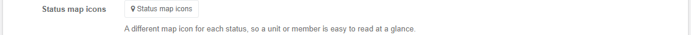

Open **Department → Types**, edit a unit type or call type and choose **Status map icons** or **Priority map icons**; for a role, **Personnel → Manage Roles → Edit → Status map icons**. The **Edit icons** buttons on the [Map Icon Legend](#map-icon-legend) open the same page.

The page lists the type's statuses (the options of the unit type's status set, the built-in unit statuses, or the department's personnel statuses for a role) or the department's priorities, with:

| Column | Shows |
|---|---|
| **Status** / **Priority** | The option and its own color. |
| **Map color** | The color its meaning gives, or *No meaning or no status* (gray). |
| **Default** | What shows without an upload: the type's own icon with the badge of that color, or the built-in pin in that color. |
| **Uploaded icon** | The icon uploaded for it, if any. |

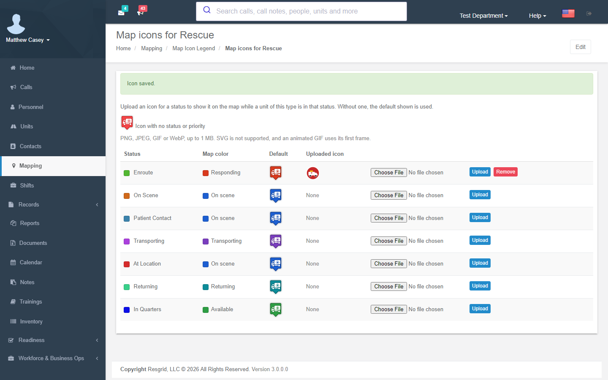

Choose a file and press **Upload** on a row; **Remove** returns that row to the default. The same [image rules](#choosing-an-image) apply. Removing or replacing the type's own icon keeps its status and priority icons; deleting the type removes them all. An icon is tied to the option it was uploaded for: when a unit type moves to another status set, upload icons for the new set's options.

Unit and call type icons need the permission to edit department types, as on the Types pages; role icons need the permission to edit roles.

### In the apps

The Unit, Responder, IC, Dispatch and BigBoard apps draw the same pins as the web map: uploaded icons, status and priority icons, badges, and the built-in pins in the color of the status or priority, on phones and tablets, in the browser and in the desktop (Electron) apps, at the same 32 × 32 px as the web map. If an icon cannot be loaded, the pin falls back to its built-in image. Older app versions keep showing the plain built-in pins and any uploaded status or priority icons.

The Responder, Unit and IC apps also have the [map icon legend](#map-icon-legend). Tap the round **legend** button (an *i*) on the map to open it as a sheet over the map:

| App | Where the legend button is |
|---|---|
| Responder | Top right of the Map tab |
| Unit | Bottom right of the main map, above the recenter button |
| IC | Bottom right of the main map, above the layers button, and bottom right of an incident's command map |

The sheet has the same sections as the web page (status and priority colors with your own statuses and priorities, calls, units, personnel, stations and points of interest), draws every icon exactly as that app's map does, and loads fresh each time it is opened, so it follows any change to your types, statuses, priorities or icons. The Calls, Units and Personnel headings use your [terminology](department-settings#terminology) when you have renamed those modules. A few things follow what the app's map shows:

- In Responder, members who can't see personal information don't see personnel pins on the map, so their legend leaves out the Personnel section too.
- Hydrants are listed only while the map is showing hydrants. The apps draw hydrants with a generic pin, on the map and in the legend.
- On IC's command map the legend is the whole department's, although that map shows only the incident's resources. Unit and call type icons also show in the apps' unit lists, pickers and call cards, and the Responder, IC and Dispatch personnel lists show each person's role icon. In Dispatch, role icons also show beside each role and person in the dispatch recipient picker and on the role chips of a person's screen. Icons are served from the Resgrid API with a long cache lifetime, so after the first load they show even on a slow connection.

### Technical reference for custom icons

| Item | Value |
|---|---|
| Storage | `TypeIcons` (M0285): one row per type or role, `TypeKind` 1 unit type, 2 call type, 3 POI type, 4 personnel role (M0286), 5 station (`TypeId` the station group, 0 the icon for all stations); the PNG bytes, size and checksum. `IconKey` (an unguessable 32-character key) is copied to `UnitTypes`, `CallTypes`, `POITypes` and `PersonnelRoles`; station keys are read from `TypeIcons` only (cached per department, cleared on every change), never copied to `DepartmentGroups`. No foreign keys: type, role and group deletes and the department purge remove the rows |
| Station icons | Page `GET /User/Mapping/StationIcons`, `POST UploadStationIcon` / `RemoveStationIcon` (`groupId` 0 for all stations; department edit permission); Groups New/Edit post `IconFile` / `RemoveCustomIcon` for station groups. `MapIconResolver.ForStation`: own, else all stations, else `Station.png` |
| Status and priority icons | `TypeIcons.Variant` (M0289): null for the type's own icon, `p{priority}` on a call type, `s{built-in status}` or `o{custom status option id}` on a unit type or role. Pages `GET /User/Mapping/StatusIcons?kind=&typeId=`, `POST UploadStatusIcon` / `RemoveStatusIcon`; the department's slots are cached and cleared on every change |
| Icon choice | `MapIconResolver` (shared by the v4 map, the legend and the icon pages): the upload for the exact priority or status, else the own icon with a badge, else the built-in pin in the style of the meaning (`MapIconStyles`) |
| Styled pins and badges | Drawn by the server from the built-in artwork: web `GET /TypeIcons/Pins/{base}-{style}`, API `GET /api/v4/TypeIcons/Pins/{base}-{style}` (32 × 37 PNG); a badge is `?s={style}` on an icon URL. Both carry `v=` (the palette version) and are cached for a year |
| Role order | `PersonnelRoles.SortOrder` (M0286, default 0); ties order by name. Saved by `POST /User/Personnel/SetRoleOrder` (department admins, `Role_Update`) through `IPersonnelRolesService.SetRoleOrderAsync`; ids from another department are ignored |
| Icon URLs | Web `GET /TypeIcons/{key}`, API `GET /api/v4/TypeIcons/{key}`: anonymous, `Cache-Control: public, max-age=31536000, immutable`, `ETag`. Every upload gets a new key, so a changed icon gets a new URL |
| Upload rules | `TypeIconRenditions`: PNG, JPEG, GIF (first frame) or WebP; ≤ 1 MB (checked before the file is read); 16 to 4096 px (from the header, before decoding); resized to 128 × 128 on a transparent canvas and re-encoded as PNG without metadata. Rejections are `TypeIconRejections` values with localized messages |
| Pages | Unit and call type new/edit (`TypesController`), POI type add and `SetPOITypeIcon` (`MappingController`), role add/edit and Roles (`PersonnelController`); shared partial `_TypeIconPicker`, scripts `resgrid.types.iconpicker.js` and `resgrid.personnel.roleorder.js` |
| v4 API | `IconUrl` on map markers (`GetMapDataAndMarkers` and `GetUnitMapData`: calls 0, units 1, personnel 3, POIs 4), plus `PinIconUrl` (the styled built-in pin) and `IconStyle` (`available` … `unavailable`, `low` … `emergency`, `unknown`) on call, unit and personnel markers; `ImagePath` stays the plain built-in icon for older apps; `IconUrl` also on station markers (2), call types, POI types, POIs and POI layers; `TypeIconUrl` / `TypeMapIcon` on units, unit statuses, calls, call dispatches and recipients (unit rows; role rows carry the role's icon as `TypeIconUrl`); `RoleIconUrl` on personnel; `IconUrl` and `SortOrder` on roles. `GET /api/v4/Mapping/GetMapIconLegend` returns the legend for the apps: status and priority styles (color, pin URLs, the department's statuses and priorities in each), call, unit and personnel rows (the "none" row first, `Id` null) with each priority's or status's `IconUrl` / `PinIconUrl` / `ImagePath` / `IconStyle` (and `FollowsUnitStatus` on the built-in On Unit status), the POI types, and the station icons (`Stations`: all stations first, then stations with their own). The web page and the API are built from the same `MapIconLegendBuilder`. See the [Map Icons API](../api/map-icons) |
| Admin Assist | Capabilities *Custom map icons* and *Map icon legend* (mapping area), plus the unit types, call types, POIs and personnel roles entries |

## Map visualizations

**Mapping → Visualizations** turns your call history, responses and unit movement into map overlays: call heat maps ("where are our hot zones?"), counts per area, response times by area, calls far from a station, where units and members went, and recorded paths. Start from the built-in library, adjust it, and save your own versions.

<!-- Screenshot pending: /img/web-app/mapping/visualizations.png (library + call hot zones heat map) and visualizations-customize.png (Customize tab). Needs a dev database migrated to M0288. -->

**Where to find it:** the **Visualizations** button at the top of the Mapping page, or search "heat map" in the omnibar. Anyone who can view calls can open it.

### The library

The library lists ready-made visualizations. Those that match your [operating profile](help-setup#operating-profile) (its sectors, and a volunteer or combination workforce) are shown first; every visualization stays available to every department, and **Show all** lists every one by category.

| Category | Visualizations |
|---|---|
| **Call demand** | Call hot zones (heat map, 12 months) · Busiest areas (hexagon grid with counts) · Calls by type · Main call type by area · Calls by priority · Call outcomes · Time of day · Weekday vs weekend · Seasonal patterns |
| **Response performance** | Response time by area (90th percentile) · Response time bands · Time to first responding by area · Time committed by area |
| **Coverage** | Calls outside station coverage (distance bands and 1.5 / 2.5 / 5 mile rings) · Workload by station area · Where responders come from |
| **Units and personnel** | Where units go · Demand by unit type · Personnel response footprint |
| **Community risk** | Repeat locations (3+ calls at the same place) · False alarm hot spots |
| **Tracking** | Unit movement (last 24 hours) · Patrol coverage · Search coverage · Incident footprint (one call: paths, status positions and where responders came from) |

Click a dot to see the call and open it, or **Show this call's footprint** to switch to the Incident footprint for that call.

### Customizing

The **Customize** tab changes what the map shows. The map updates as you edit.

- **When:** a rolling window (last 24 hours to last 5 years) or fixed dates, plus days of the week and hours of the day (in your department's time zone).
- **Which calls:** call types, priorities, outcomes, home station or group, units involved, and a minimum number of calls at the same location. Or pick **one call** to show only that call.
- **Layers** (up to 6, drawn in order): each layer has its **data** (calls, unit responses, personnel responses, responder origins, unit status positions, unit paths, personnel paths), how to **show** it (heat map, dots, hexagon grid, paths), what to **color by** (call type, priority, outcome, home station, time of day, hour, day, weekday or weekend, month, year, unit, unit type, unit's station, person, status, response time band, distance band, repeat count) and a **measure** (count, minutes to first on scene, minutes to first responding, minutes until closed, units dispatched, personnel responded, distance to station, calls at the location). A hexagon grid combines its cells' values with a count, total, average, median, 90th percentile or maximum; colored by a category, each cell shows its most common category. Colors, opacity, heat radius and intensity, cell size and dot size are set per layer.
- **Stations and distances:** show stations, draw coverage rings, choose kilometers or miles, and set the distance and response time bands.

Below the map: calls in view, how many have a location, median and 90th-percentile time to on scene (when a layer uses response times), a weekday-by-hour chart and the most common call types. **Download CSV** exports the visible layers' points and paths.

### Saving and sharing

**Save as new** keeps the current visualization in **My visualizations**, visible only to you. Department admins can tick **Share with the whole department** so it appears under **Shared with the department** for everyone who can view calls; only department admins can change or delete a shared visualization. **Copy link** copies a link that opens the saved visualization (or library entry) directly.

Only the settings are saved, never the data. Each person who opens a visualization sees it with their own permissions: calls outside their dispatch scope, and members or units whose locations they may not see, are left out (the page says so).

### What the numbers mean

- **Response time** is from the call being logged to the first unit setting an on-scene status (custom statuses count through their base type). **First responding** is the first responding or en route status. Calls with no such status are left out of the times. Times over 24 hours are treated as bad data.
- **Distance to station** is straight-line distance to the nearest station with a location (a unit response uses the unit's own station). Rings are straight lines too, not drive times.
- **Repeat locations** group calls within about 11 m of each other.
- **Home station** follows the call summary rules: the station geofence containing the call, otherwise the station that most of the dispatched units and members belong to.

### Limits

| Limit | Value |
|---|---|
| Longest date range | About 5 years |
| Calls read for one view | 100,000 (the newest; the page says when more matched) |
| Points per layer | 75,000 |
| Paths | At most 7 days; for one call, from 15 minutes before it was logged to 15 minutes after it closed |
| Status positions and responder origins | At most the last 12 months of the range |
| Saved visualizations | 250 per department |

### Technical reference for visualizations

| Item | Value |
|---|---|
| Page | `MapVisualizationsController` (`/User/MapVisualizations`, `Call_View`); query `?id=`, `?template=`, `?callId=`. React element `rg-map-visualizer` (Leaflet, canvas heat and dot layers, client-side hexagon binning) |
| Endpoints | `GET Bootstrap`, `POST Data` (runs a definition), `POST Save`, `POST Delete`, `GET CallDetail`, `GET SearchCalls`; writes need the anti-forgery header |
| Storage | `MapVisualizations` (M0288): name, description, `DefinitionJson`, `TemplateKey`, `IsShared`, creator and updater. No foreign keys; removed by the department purge |
| Definition | `MapVisualizationDefinition` (filters, layers, options) with stable string keys in `MapVisualizationKeys`; `MapVisualizationDefinitionValidator` clamps and repairs every definition on read and save |
| Library | `MapVisualizationLibrary` (25 templates; recommended by operating profile archetype and workforce, never by organization type) |
| Data | `IMapVisualizationService.RunAsync`: thin call read, `ICallGroupAssignmentService` for home stations, `ICallStatusAttributionService` and `CallUnitTimesCalculator` for unit and personnel times (in slices of at most a year and 2,500 calls), unit status history, action logs, and unit and personnel location history (document database; indexes `ix_unitlocations_department_timestamp`, `ix_personnellocations_department_timestamp`) |
| Visibility | `IDispatchScopeService` for calls; `CanUserView{Unit,Person}ViaMatrixAsync` and the location variants for units, members and their locations |
| Admin Assist | Capability *Map visualizations* (mapping area) |

## Road closures

**Mapping → Road Closures** keeps the roads and areas that are closed or slowed for a time: a marathon course, road works, a flooded underpass, a police cordon, a bridge out of use. Dispatch measures units around full closures and through partial ones, so the closest-unit pick and the drive times dispatchers see follow the roads as they are today.

**Where to find it:** the **Road Closures** button at the top of the Mapping page, or search "road closure" in the omnibar.

### Who can see and change closures

| Who | Can |
|---|---|
| Anyone who can view calls | Open the Road Closures page and see every closure with its details |
| Department admins and members who can create calls (dispatchers) | Add, edit, switch off and on, and delete closures |

### The closures list

The page shows the closures on a map, with a table below it:

| Color on the map | Closure |
|---|---|
| Red | Full closure in effect |
| Orange | Partial closure in effect |
| Blue, dashed | Scheduled: in effect at a later time |
| Grey, dashed | Ended or switched off |

**Current and upcoming** (the default) shows closures in effect now and those still to come; **All closures** adds the ones that have ended or are switched off. Click a closure's name to zoom the map to it.

| Column | Shows |
|---|---|
| **Closure** | Name, type of closure, full or partial, and the reason |
| **Status** | *In effect*, *Scheduled*, *Ended* or *Switched off* |
| **When** | For a closure in effect, when its current time ends (*Until further notice* when it has no end); otherwise its next time. *Until switched off* for a closure with no times. A closure with several times also shows how many |
| **Stops** | Icons for the traffic it stops: vehicles, bicycles, pedestrians |
| **Closed by** | Who closed the road |

Closures in effect are listed first, then scheduled ones by their next start, then ended and switched-off ones. Department admins and dispatchers also see **New Closure** at the top and **Edit**, **Switch off** / **Switch on** and **Delete** on each row. Switching a closure off keeps it but takes it out of routing straight away; deleting it cannot be undone.

### Adding or editing a closure

**New Closure** (or **Edit** on a row) opens a page with four parts: where, details, when, and who and why.

**Where.** Draw the closure on the map with the toolbar:

- **Closed roads as lines** drawn along the road. A line covers the road it follows (anything within about 15 m of it). Crossing it at a junction is still allowed: a route has to run along the line for 40 m or more to count as using the closed road.
- **Closed areas** as polygons or rectangles. An area closes every road inside it.

One closure can hold several lines and areas. The toolbar is Terra Draw on MapLibre maps and Leaflet-Geoman on the standard map (see [Base map](#base-map)); **Clear drawing** removes everything drawn. **GeoJSON (advanced)** shows the drawing as GeoJSON. Paste a shape there to load it on the map, for example a closure published by the city's GIS: a Polygon, MultiPolygon, LineString, MultiLineString, Feature or FeatureCollection, up to 5,000 points. Only the outline of an area counts; holes in it are ignored.

**Details.**

| Field | Description |
|---|---|
| **Name** | Required. How dispatchers will know it, for example *City marathon - Main Street* |
| **Type of closure** | Event, Road works, Incident, Police, Weather, Hazard on the road, Bridge, tunnel or crossing, or Other |
| **Closure** | **Full closure**: no through traffic, routes go around it. **Partial closure (slowdown)**: open but slow (a lane closed, traffic control, a crowd), routes may use it at reduced speed |
| **Speed inside (% of normal)** | 5–95, default 50. For a partial closure, how fast traffic still moves through it. For a full closure, the speed a unit makes when the call or the unit's starting point is inside the closure and it has to go in |
| **Detour time (minutes)** | 0–120, default 5. Full closures only: added to a route that still crosses the closure because the routing provider cannot avoid it |
| **Stops** | Vehicles, Bicycles, Pedestrians; vehicles by default, at least one. A marathon course can close the road to vehicles while foot teams still cross it |
| **Switched on** | Off keeps the closure but never uses it for routing |

**When.** A closure is in effect during each of its closure times, entered in department time:

- **Add a time** adds a **From** / **To** row. Leave **To** blank for *until further notice*.
- With no times at all, the closure is in effect until it is switched off or deleted.
- **Repeat** adds a time on each chosen day between a **First day** and a **Last day**, from **Daily from** to **Daily to** (every day is ticked to start with). A *Daily to* earlier than *Daily from* runs past midnight: 22:00 to 06:00 every night for a week adds 7 times. Each time keeps its hours across a daylight-saving change.
- **Remove** deletes one time and **Remove all times** clears the list. A closure can have at most 400 times.

Times may overlap: the closure is in effect while any of them is.

**Who and why.** **Reason**, **Closed by** (police, the city, an event organiser), **Authority** (the authority responsible for the closure or that issued the permit), **Contact**, **Contact details** (phone, radio channel or email) and **Notes**. These are for dispatchers and crews; they don't change routing.

### How routing uses closures

Road closures apply to the closest-unit ranking of [run cards](run-cards#travel-modes-and-road-closures) (conditional run cards included), the [Nearest Units](dispatch-calls#nearest-units) list on New Call and Update Call, the Dispatch app's picker, the Awaiting Resources estimates on the [Dashboard](dashboard), and to routes from the v4 Routing API: in-app navigation and the website's Live Routing and Station Routing.

- Only closures that are switched on and in effect at the moment of the lookup count, and only for the trip's [travel mode](units#travel-mode): a closure that stops vehicles has no effect on a foot team. Air units fly a straight line and never meet a closure.
- **Full closures** near the route are avoided as far as the installation's routing provider can (table below). A route that still crosses one is charged the closure's **detour time** and marked as crossing it.
- **Partial closures**, and a full closure that the call or the unit's starting point is inside, are driven through: the time spent inside is slowed to the closure's speed (at 50 %, the time inside doubles).
- The [Nearest Units](dispatch-calls#nearest-units) list notes which closures its drive times account for, and run card results add a note for each closure.
- Closures change routed times only. Straight-line estimates ignore them, so in dispatch ranking they affect the units that get a drive-time lookup (**Order by driving ETA** on, within the **ETA shortlist size**, see [Run Cards](run-cards#fastest-response-or-shortest-distance)).
- Matrix (bulk) drive-time lookups and [route plans](routes) don't use closures.

| Routing provider | Full closures |
|---|---|
| **Valhalla** | Routed around: drawn areas and closed road lines are avoided exactly |
| **Mapbox** | Driving routes are told to avoid points along closed road lines; a route that still enters a closed area is re-routed up to twice, avoiding where it went in. Walking and cycling routes cannot avoid closures |
| **Google**, **OSRM** | Cannot avoid closures: the route keeps going through, is charged the detour time and is marked as crossing the closure |

Partial closures slow a route the same way with every provider.

### Examples

| Situation | How to set it up |
|---|---|
| **Marathon on Sunday morning** | Lines along the course; Event; Full closure; Stops: Vehicles; one time 07:00–14:00. Ambulances are routed around the course, and go in at the closure's speed only for a call on the course itself; bike and foot teams still cross it. |
| **Night-time road works for a week** | A line along the road; Road works; Full closure; Repeat from Monday to Sunday, daily 22:00 to 06:00 (7 times). |
| **Lane closure on a bridge** | A line along the bridge; Road works; Partial closure; Speed inside 30 %. |
| **Flooded underpass** | An area around it; Weather; Full closure; no times. Switch it off when the water is gone. |
| **Christmas market in the town square** | An area; Event; Full closure; Stops: Vehicles and Bicycles; a time for each market day. |

### Technical reference for road closures

| Item | Value |
|---|---|
| Pages | `RoadClosuresController`: `GET /User/RoadClosures/Index` (`?filter=all`), `New`, `Edit?id=`; `POST Save`, `SetEnabled`, `Delete` (anti-forgery token). Viewing needs `Call_View`; managing needs department admin or the permission to create calls. Script `resgrid.mapping.roadclosures.js` |
| Storage | `RoadClosures` (M0314): `Name`, `ClosureType` (`RoadClosureTypes` 0 other, 1 event, 2 road works, 3 incident, 4 police, 5 weather, 6 hazard, 7 bridge/tunnel/crossing), `Severity` (0 full, 1 partial), `SpeedPercent` (default 50), `DetourMinutes` (default 5), `AppliesTo` (mask 1 driving, 2 cycling, 4 walking; default 1), `GeometryJson`, `WindowsJson` (UTC), `IsEnabled`, reason, closed by, authority, contact, contact details, notes, creator and updater. No foreign keys; removed by the department purge |
| Shape | `RoadClosureShape`: Polygon, MultiPolygon, LineString, MultiLineString, Feature or FeatureCollection; outer rings only; at most 5,000 points. A line covers 15 m either side, a route must run along it for 40 m to count, and routes are measured every 10 m |
| Times | `RoadClosureWindow` (`StartsOn`, `EndsOn`; null end = until further notice), at most 400 per closure, entered in department time and stored in UTC. State (`RoadClosureStates`): 0 in effect, 1 scheduled, 2 ended, 3 switched off; no windows = in effect while switched on |
| Routing | `IRoadClosureService.GetRoutingClosuresAsync` (switched on, in effect now, for the trip's mode; never for air) fills `RouteRequest.Closures`. `RoadClosureRouting.Plan` keeps closures within 2 km of the trip (30 % of its length, up to 20 km) and hands full ones to the provider: areas to Valhalla (`exclude_polygons`), road points to Valhalla (up to 200) and Mapbox driving profiles (up to 50, `exclude=point`). `Apply` measures the route line against each closure and adds the slowdown and, for a full closure still crossed, the detour time; up to 2 re-routes push a point-excluding route out of a closed area. The route cache key includes each closure's id and last change, so an edit applies on the next lookup |
| Caching | The department's closures are cached for a day and cleared on every save, switch and delete |
| Dispatch | `IGeoService.GetTravelEstimateAsync` (closest-unit and conditional run cards, awaiting resources, the nearest-units board). Board rows carry `TravelMode`, `RoadClosureDelaySeconds` and `RoadClosures`; the board note and run card notes name the closures |
| v4 API | `GET /api/v4/RoadClosures/GetRoadClosures?activeOnly=` (`Call_View`); `RoadClosureDelaySeconds` and `RoadClosures` on `Routing/GetRoute` and `GetCallRoute`. See the [Maps & Routing API](../api/maps-and-routing#road-closures) |
| Admin Assist | Capability *Road closures* (mapping area) |

## Setup examples

| Department type | How to set it up |
|---|---|
| **Fire** | POI types: Hydrants (or use the Records hydrant layer), Knox boxes, Dry hydrants/draft sites, Staging areas; layers: district boundaries (KML from the county GIS), water main map. Visualizations: Call hot zones and Response time by area for standards-of-cover reviews; Calls outside station coverage with 1.5 / 2.5 / 5 mile rings; Weekday vs weekend and Where responders come from for volunteer staffing; share them with the department. |
| **EMS** | POI types: Hospitals (with ED phone numbers in the description), Landing zones, Nursing homes, imported from the regional hospital list as a CSV with a *Capabilities* column; destinations on calls point at hospital POIs, with [capabilities, availability and destination rules](destinations#setup-examples). Custom icons for unit types such as Ambulance, MUG, PIT, First Responder and Bicycle Team, and for roles such as Paramedic and Nurse, with Paramedic ordered above EMT so a paramedic's pin shows the paramedic icon. Visualizations: Response time bands (set the bands to your contract times), Repeat locations for frequent-caller and community paramedicine follow-up, Time committed by area. |
| **SAR** | Layers: trail systems, search segments (GeoJSON from CalTopo/SARTopo), cell coverage; POI types: trailheads, huts, helispots. Location TTL 240+ minutes. Visualizations: Search coverage over the mission window and the Incident footprint of the search call. |
| **Emergency management** | Layers: flood zones, evacuation zones, shelters; POI types: shelters, PODs, fuel sites, sandbag stations. Visualizations: Seasonal patterns, and Call hot zones filtered to weather call types. |
| **Security** | POI types: Client sites, Gates, Cameras; personnel location TTL 15 minutes so stale markers drop. Visualizations: Patrol coverage (7-day unit position heat map) and Repeat locations for problem sites. |
| **Delivery / transit** | Depots and customer sites as POIs; routes drawn with the Routes module; vehicle trackers for live positions. |

## Technical reference

`MappingController`; routes `/User/Mapping/{Index,Layers,NewLayer,EditLayer,POIs,AddPOIType,AddPOI,EditPOI,ViewType,ImportPOIs,PoiImportsPanel,DeletePOIs,PoiCapabilities,Destinations,SetPoiAvailability,LiveRouting,StationRouting}`; data via `api/v4/Mapping/GetMapDataAndMarkers` and `GetMayLayers` (web component `rg-map`). Visualizations: see [Map visualizations](#map-visualizations). Permissions `CanSeePersonnelLocations`, `CanSeeUnitLocations` (group-lockable). Map provider (Mapbox / Leaflet-OSM / Google) is an installation setting; the department picks its Mapbox base map style (day and night) under [Mapping & Big Board settings](department-settings#mapping--big-board-settings).

### Data Endpoints
| Endpoint | Purpose |
|----------|---------|
| `GetMapData` | All map markers and geofences based on flag settings |
| `GetTypesMapData` | Map data for a specific POI type |
| `GetPoisForType` | POI list for a specific type |
| `GetCustomMaps` | Active custom maps with floor metadata for the overlay control |

### POI imports and removal

| Item | Value |
|---|---|
| Pages | `GET /User/Mapping/ImportPOIs?poiTypeId=`, `POST ImportPOIs` (`fileToUpload`, `TypeId`; anti-forgery token): department admins or the *Manage prevention data* permission (`CanImportPois`). `GET PoiImportsPanel` (the `_PoiImports` partial; `resgrid.mapping.pois.js` polls it every 10 s while `data-active` is true). `POST DeletePOIs` (`poiTypeId`, `scope` `Selected` / `All`, `poiIds`, `expectedCount`; department admins), from the List tab of `ViewType` (`resgrid.mapping.viewType.js`) |
| Limits | 10 MB upload; `.kml`, `.kmz`, `.csv`; 10,000 CSV rows (`PoiImportFileReader.MaximumRows`); 5,000 geocoded addresses per import (`PoiImportService.MaximumGeocodedAddresses`), 4 lookups at a time; bulk removal in batches of 50,000 (`MappingService.MaxBulkPoiDelete`) |
| Reading | `PoiImportService.ReadFile`: CSV through `PoiImportFileReader` (header names, delimiter detection, encodings); KML/KMZ through `KmlProvider` and `KmlDocumentReader` (namespace-agnostic; at most 5 network links, public addresses only); address-only placemarks read from ExtendedData, else `<address>` |
| Running | Worker 79 `PoiImportTask` (every minute, up to 20 imports per tick, one run at a time): `PoiImportService.ProcessNextAsync`. Statuses `PoiImportStatus` Queued, Locating, Saving, Complete, Failed. Unanswered lookups retried after 2, 10 and 30 minutes; a run with no heartbeat for 15 minutes is resumed; given up after 3 failed runs; finished imports deleted after 90 days |
| Storage | `PoiImports` (M0313: counts, `RowsJson` while running, `UnlocatedJson` with up to 100 rows of each kind for the report, claim and heartbeat); `Pois.PoiImportId`, `Pois.PoiImportRow` (each saved POI's row, so a resumed import carries on after it). Capability names become `PoiCapabilities` / `PoiCapabilityAssignments` (M0315) |

Capabilities, availability, destination rules and suggestions: see [Destinations → Technical reference](destinations#technical-reference).

### Interactions with Other Modules
| Module | Interaction |
|--------|-------------|
| **Calls** | Call locations displayed as markers; zone names used as call locations from custom maps |
| **Groups** | Station locations and geofences displayed |
| **Units** | Unit positions shown (from GPS tracking); zone-entry notifications triggered |
| **Personnel** | Personnel locations shown (permission-controlled); plotted on indoor floors when positioning data available |
| **Department** | Map center, zoom, and refresh settings |
| **Security** | Personnel location visibility permission Visualizations: Patrol coverage (7-day unit position heat map) and Repeat locations for problem sites. |
| **Custom Maps** | Uploaded floor plans and zone overlays; see [Custom Maps](custom-maps) |
