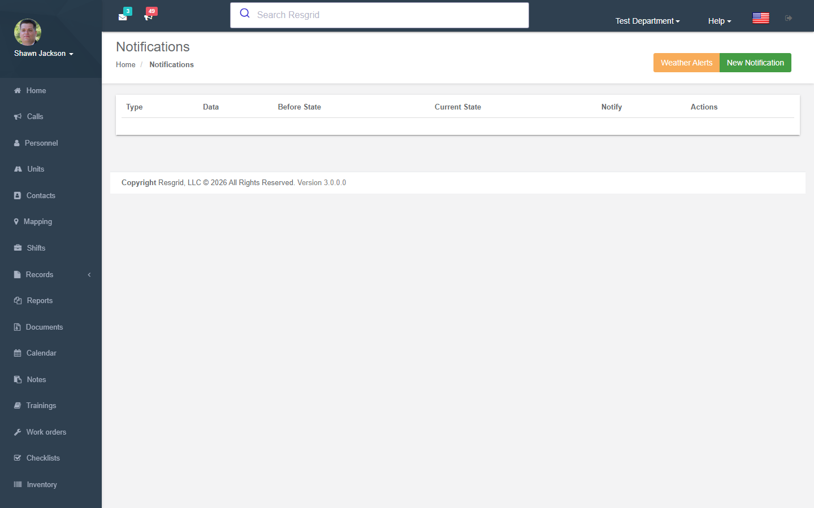
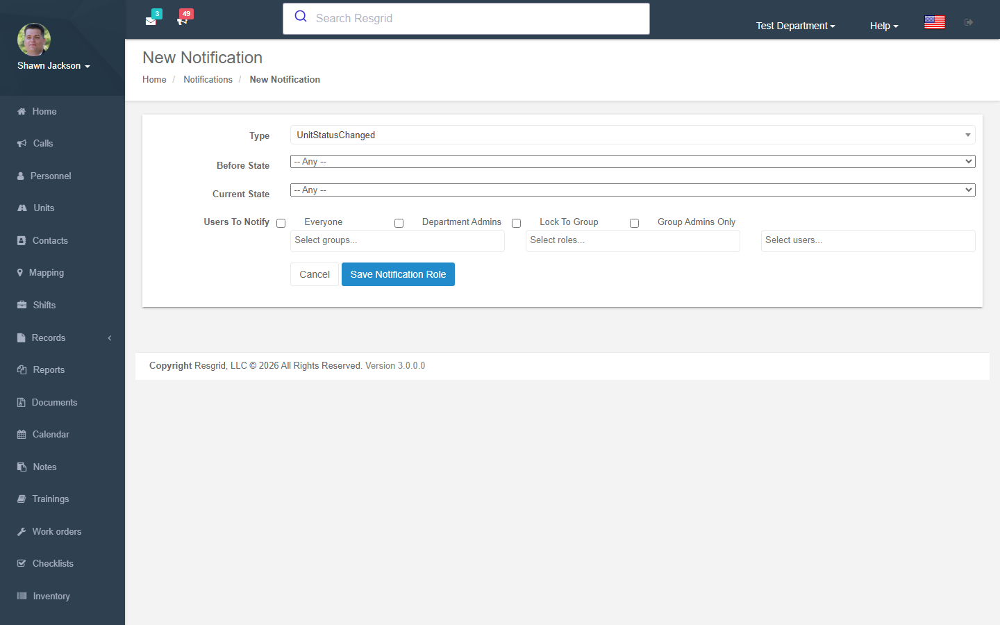

# Notifications

**Notifications** are the department's automatic alerts about *readiness* rather than incidents: *fewer than two drivers available*, *Engine 1 out of service*, *a member's staffing changed*, *inventory low*, *checklist missed*. Each notification picks an event, a threshold and who to tell (everyone, a group, a role, specific people), and delivers through push, SMS and email.

**Department menu → Notifications.** Personal notification *preferences* (which channels you receive) are on your [profile](profile-account).

<AcademyVideo id="06-communication" />

## Notification List

Displays all configured notification rules with resolved human-readable descriptions of:
- Who is notified
- What triggers the notification
- Threshold values

## Creating Notifications

### Notification Targeting

Notifications can target:

| Target | Description |
|--------|-------------|
| **Everyone** | All department members |
| **Department Admins** | Only administrators |
| **Selected Group Admins** | Admins of specific groups |
| **Specific combinations** | Custom mix of roles, groups, and individual users |

### Notification Event Types

| Event Type | Description | Configuration |
|------------|-------------|---------------|
| `RolesInGroupAvailabilityAlert` | Alert when available personnel with a specific role in a group drops below threshold | Role, Group, Lower/Upper limits |
| `UnitTypesInGroupAvailabilityAlert` | Alert when available units of a type in a group drops below threshold | Unit Type, Group, Lower/Upper limits |
| `RolesInDepartmentAvailabilityAlert` | Alert when available personnel with a role department-wide drops below threshold | Role, Lower/Upper limits |
| `UnitTypesInDepartmentAvailabilityAlert` | Alert when available units of a type department-wide drops below threshold | Unit Type, Lower/Upper limits |

### Threshold Configuration

| Field | Description |
|-------|-------------|
| Lower Limit | Alert when count drops below this value |
| Upper Limit | Alert when count exceeds this value |

### Current State Data

When creating a notification, the system captures the current state of relevant resources (staffing levels, unit states) for comparison when evaluating triggers.

### Matching statuses by meaning

Rules on a personnel status, staffing level or unit status change, and the *current states* an availability alert counts, can pick a specific status or a **meaning**. The meanings are listed after your statuses as *Any "On Scene" status*, *Any "Off Duty" status* and so on. A meaning matches every status with that [meaning](custom-statuses#status-meanings), built-in or your own, in every status set. One rule then covers unit types with different custom statuses, and keeps working when you rename a status or add one with the same meaning. A status with no meaning only matches a rule that names it.

| Rule | Pick |
|---|---|
| Tell the chief when any unit goes out of service | Unit status changed to *Any "Unavailable" status* (and *Any "Maintenance" status*) |
| Count available engines whatever their set calls it | Current states *Any "Available" status* and *Any "In Quarters" status* |
| Watch members going off duty | Staffing changed to *Any "Off Duty" status* |

## Deleting Notifications

Removes a notification rule by ID.

## Display Resolution

The notification list performs extensive resolution to display human-readable information:
- Role IDs → Role names
- Group IDs → Group names
- User IDs → User names
- Event type codes → Descriptive text
- Unit type IDs → Unit type names

## Notices from Protocols, Training, e-Sign and approvals

Protocols, Training and the LMS, certifications backed by training, dispatch case reviews, e-signatures and approval chains send their own notices to the people involved. They are not rules on this page: you cannot add, change or remove them here, and they are not offered as event types.

| Notice | When | Who gets it |
|---|---|---|
| **Protocols to acknowledge** / priority bulletin | A version that must be read and signed is published, or the member joins its audience; a priority bulletin is issued. Several at once arrive as one notice. | Members of the audience |
| Acknowledgment due / overdue / escalated | On the due date, 3 days after it, and an escalation 7 days after it. | The member; the escalation goes to the admins of the member's group and its parent groups (the department admins when there are none) |
| **Protocol to review** | A version is submitted for approval. | The approvers of the step |
| Protocol review reminders | 30 days and 7 days before the scheduled review, and when it is overdue. | The protocol's owners |
| **Dispatch case reviewed** | A reviewer sends a case review; the dispatcher acknowledges or replies. The notice never includes the score or comments. | The dispatcher; the reviewer for a reply |
| Learning requirement assigned / due soon / overdue | A requirement or onboarding path starts to apply; a set number of days before the due date; when it is overdue. Optional completion alert. Only members with an LMS seat. | The member; on overdue also the group admins (when the requirement says so) and any people it names |
| Training requirement enforced / met / refused | Enforcement expired a certification, or was undone; a sweep refused to act. | The member; department admins for a refusal |
| Class reminder / class roster change | Hours before a class starts; enrolled, waitlisted, declined, promoted from the waitlist, removed or cancelled. | The enrolled member (the whole roster for a cancellation). External learners get e-mail only. |
| Skill evaluation / task book | An evaluation passed or did not pass; a task book was started, a task signed, certification requested, certified or expired. | The evaluated member or trainee and the department admins, as the skill settings say |
| Certification issued, renewed or changed by training | A requirement set, course or path issued or renewed a certification; a void withdrew or restored one. | The holder |
| Certification requirements due | Before a certification expires (and once in the grace period) while its requirement set is not complete. | The holder |
| Training hours submission | Received, accepted as self-reported, approved, not accepted (with the reason), or more information needed. | The member |
| Submission waiting for review | Each submission, or one summary a day at 07:00 department time. | The member's reviewers, never the member |
| Recorded completion | An instructor recorded a completion for the member, or voided one. | The member |
| **Signature needed** | It is the member's turn to sign; reminders after 24 hours and then every 48 hours, at most three, never after the request expires. | The signer (the requester for an in-person or open step) |
| Signature request closed | Signed by everyone, declined, expired or withdrawn. | The requester and the member signers, except whoever did it |
| Approval waiting / escalated | An approval step's turn starts (a delegate stands in for an approver on leave), or it escalates. | The approvers or the escalation target, never the submitter |
| Approval decided | Approved, rejected with the reason, or expired. | The submitter |

[Wellness and exposure tracking](workforce-pro/wellness.md#notifications) sends its own restricted notices the same way.

**Delivery.** Each notice goes out as push and e-mail (and text, for members who turned text notifications on and verified their number), through the member's own channel switches. It is written in the language of the member's profile and shows dates in the department's time zone. Members who are deleted, disabled or hidden never get them. Members whose current staffing level is muted under **Department Settings → Supress (Mute) For These Staffing Levels** (with **Enable Staffing Supress** on) get none of them. There are no quiet hours.

**How a member turns them off.** On **Edit Profile**, the **Notification Options** card has **Email** and **Push** switches. They are the only member controls and turn off every notice above at once, along with other system notifications. There is no switch per notice type.

**How an administrator tunes them:**

| Area | Where | Setting |
|---|---|---|
| Acknowledgments | **Acknowledgment settings** (`/User/ProtocolAcknowledgments/Settings`) | **Days to acknowledge** (blank: 30). The 3-day overdue and 7-day escalation steps are fixed. |
| Learning requirements | The requirement | **Warn this many days before the due date**; **Tell the member's group admins when the member is overdue**; **Also tell these people**; **Also tell them when a member completes or renews it** |
| Enforcement | **Enforcement** (`/User/LmsRequirements/Enforcement`) | **Default warning for new requirements (days before due)** |
| Classes | The class | **Reminder (hours before; 0 for none)** |
| Skills | **Skill notices** (`/User/LmsSkills/Settings`) | **Deliver notices**: Immediately, Daily digest, Weekly digest or Off; **Digest time (department time)**; **Weekly digest day**; whether the evaluated members and the department admins are told |
| Certifications backed by training | The certification's requirement set | **Tell members (push and email)**; **Remind holders this many days before expiry** (0 turns it off). Notices about a void are always sent. |
| Hours submissions | **Training record settings** → **Reviewer notices** | **A notice for each submission**, **One summary a day**, or **No notices (inbox and home page only)** |
| Approvals | **Approval chain** (`/User/Approvals/EditChain`) | Escalation **Hours (blank: never)** and who it escalates to; **Expires after (days)** |
| Signatures, case reviews | — | No settings |

See [Protocols](/web-app/protocols/), [Training](/web-app/trainings/) and [e-Sign](/web-app/signatures/) for the pages behind each setting.

## Setup examples

| Department type | How to set it up |
|---|---|
| **Volunteer fire** | *Role availability below N* for Driver/Operator (2) and Interior FF (4) → officers; *Unit status changed to Out of service* → chief and mechanic. |
| **EMS** | *Unit availability below 1* per station → supervisor; *Inventory alerts* → logistics role. |
| **SAR** | *Personnel staffing changed* summary → coordinator daily; *Group availability below N* for Technical team. |
| **Emergency management** | *Weather alert* notifications by zone; *Document added* to the EOP category → all section chiefs. |
| **Security** | *Unit status changed* (patrol out of service) → operations centre; *Checklist missed* → site supervisor. |

## Technical reference

`NotificationsController`; routes `/User/Notifications/{Index,New,Delete}`; model `DepartmentNotification` (event type, threshold, target group/role/users, channels); evaluated by the notification worker on status/staffing/unit/inventory/checklist events. Status values in a rule (`BeforeData`, `CurrentData`) are tokens (`StatusMatch`): a status value, `b` + a base type for a meaning (e.g. `b20` Maintenance), or `-1` for any; the editor loads them from the Custom Statuses JSON endpoints with `includeMeanings=true`.

The [member notices](#member-notices) are `EventTypes` marked `[NotMapped]` (so the event picker leaves them out), sent through `CommunicationService.SendNotificationAsync`: 57–59 protocol acknowledgments and bulletins (push codes `PA:`, `PB:`), 61–63 learning requirements (`LR:`), 64–65 classes (`CL:`), 66–67 signatures (`SG:`), 68–69 wellness (`EI:`, `DS:`), 70–71 skills and task books (`SK:`), 73–74 approvals (`AP:`), 76 dispatch case reviews (`PQ:`), 77–78 certifications backed by training (`CR:`), 79–81 hours submissions, reviews and recorded completions (`LS:`, `LV:`, `LC:`). Protocol review requests use `PR:`. Workers: 84 protocol reviews, 85 reviewer daily summary, 86 acknowledgment reminders, 90 signature reminders, 93 learning requirements, 94 certification requirements, 95 class reminders, 96 skill notices, 97 approval escalations.

### Interactions with Other Modules
| Module | Interaction |
|--------|-------------|
| **Personnel Roles** | Role-based availability alerts |
| **Groups** | Group-level availability alerts |
| **Units** | Unit type availability alerts |
| **Custom Statuses** | Current state data references custom states |
| **Department Settings** | Notification delivery channels |
| **Contact Verification** | Notification delivery is gated by each user's contact verification status per channel |
