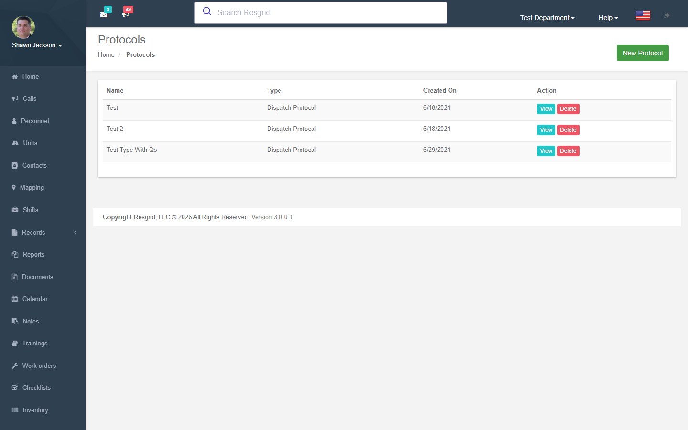

# Protocols

**Protocols** is your department's library of the guidance members are expected to follow: dispatch protocols with scripted questions, SOPs and SOGs, policies, clinical guidelines, procedures and checklists, and reference material. Each protocol has **versions**: authors write a draft, approvers review and sign it, and it is published now or on a set date. Calls, acknowledgments and reports always point at the exact version that was in force.

Protocols are **free**, including versions, approvals, audiences, read-and-sign acknowledgments, priority bulletins, case flows on calls, dispatch case review, public pages and the community exchange. A few extras need an add-on:

- **Enhanced AI** add-on (with knowledge answers turned on): [knowledge answers](./knowledge-answers.md), [practice cards, practice scenarios and AI drafts](./flashcards-and-practice.md), and the AI protocol suggestion on calls.
- **LMS** add-on: question-bank quizzes on acknowledgments, weekly scenario questions and the proof-of-compliance report ([Acknowledgments and bulletins](./acknowledgments-and-bulletins.md#with-the-lms-add-on)).

**Where to find it:** **Department menu → Protocols** (department administrators), or `/User/Protocols`. Members usually arrive from a notification, the **Must read** card on Home, **Search**, a protocol's QR code or a link on a call. Every member can open the library; what they see is set by each protocol's [audience](#audiences).

The protocol screens are in all 10 Resgrid languages. The non-English text is a first machine-translated pass.

<AcademyVideo id="10-knowledge" />

## The Protocols pages

The strip under the page title holds the module's sections. Which ones you see depends on your rights.

| Tab | What it is for | Who sees it | Page |
|---|---|---|---|
| **Library** | Find, read and manage protocols | Everyone | This page |
| **My acknowledgments** | Protocols and bulletins you are asked to read and sign | Everyone | [Acknowledgments and bulletins](./acknowledgments-and-bulletins.md) |
| **Review queue** | Versions waiting for approval | Authors, approvers, admins | [Review and approval](#review-and-approval) |
| **Categories** | The category tree and each category's approval steps | Authors, approvers, admins | [Categories](#categories) |
| **Compliance** | Who has read and signed each version | Manage Protocol Acknowledgments, approvers, admins | [Acknowledgments and bulletins](./acknowledgments-and-bulletins.md#compliance) |
| **Bulletins** | Priority bulletins | Authors, approvers, admins (approvers issue them) | [Acknowledgments and bulletins](./acknowledgments-and-bulletins.md#priority-bulletins) |
| **Case reviews** | Dispatch case review queue, sampling, reports | Review Dispatch Cases, admins | [Dispatch case reviews](./dispatch-case-reviews.md) |
| **My case reviews** | Reviews of calls you dispatched | Everyone | [Dispatch case reviews](./dispatch-case-reviews.md#my-case-reviews) |
| **Sharing** | Community exchange, templates, public pages, open format | Everyone (parts by right) | [Community exchange](./community-exchange.md), [Translations, print and sharing](./translations-print-and-sharing.md) |
| **Analytics** | Use on calls, determinants, acknowledgments, searches that found nothing | Authors, approvers, admins | [Analytics](#analytics) |
| **PDF book** | The library or a category as one PDF | Everyone (what they can read) | [Translations, print and sharing](./translations-print-and-sharing.md#pdf-book) |
| **New Protocol**, **Bulk upload**, **Import** | Create protocols | Authors, admins | [Create a protocol](#create-a-protocol), [Document protocols](./document-protocols.md), [Import and export](#import-and-export) |
| **Settings** | Signature levels, review cycle, retention, dispatch texts | Department admins | [Protocol settings](#protocol-settings) |

## Who can do what

Every member can read protocols. Everything else comes from four department permissions on **Department menu → Security & Permissions** ([Security & Permissions](../security-permissions.md)). Each can be given to department admins, group admins, selected roles or everyone; with no setting, only department admins hold it. Department admins always hold every protocol right.

| Permission (id) | Lets a member |
|---|---|
| *(none)* | Read published protocols in their audience, acknowledge, suggest changes, ask questions, favorite, print and use the PDF book |
| **Author Protocols** (128) | Create protocols, edit library fields, triggers, questions and audiences, write and submit drafts, upload documents, import, start translations, disable and enable, clone templates, import from the community exchange |
| **Approve Protocols** (129) | Approve and reject versions (with a signature), publish and schedule them, record "reviewed, no change", retire and delete protocols, save categories, issue and countersign priority bulletins, approve translations, manage public pages, contribute protocols to the community exchange |
| **Manage Protocol Acknowledgments** (130) | Read the compliance grid and export it, change a protocol's acknowledgment settings, read the proof-of-compliance report |
| **Review Dispatch Cases** (134) | Sample calls, score dispatch cases and read the case review reports |

Authors, approvers and admins are the library's **managers**: they see drafts, versions in review and every protocol whatever its audience. Members see only published protocols in their audience. Members who work dispatch always read **Dispatch** protocols, whatever the audience.

## Protocol kinds

The kind decides whether a protocol can be suggested on calls and whether members acknowledge it by default.

| Kind | Use it for | Suggested on calls | Acknowledgment on by default |
|---|---|---|---|
| **Dispatch protocol** | Matched to calls by type, priority and time, with key questions and an optional [case flow](./decision-engine.md#case-flows) | Yes | No |
| **SOP / SOG** | A standard operating procedure or guideline | No | Yes |
| **Clinical guideline** | Clinical guidance for patient care | No | No |
| **Policy** | A department policy members are expected to acknowledge | No | Yes |
| **Procedure or checklist** | A step-by-step procedure; it can be suggested on calls and [stepped through](./decision-engine.md#step-through-and-sop-checklists) | Yes | No |
| **Reference** | Maps, contacts, tables | No | No |
| **Priority bulletin** | Created only from the **Bulletins** tab ([Priority bulletins](./acknowledgments-and-bulletins.md#priority-bulletins)) | No | When marked must-read |

## The library

The library page shows:

- **Tiles:** **Published**, **In review** (managers), **Due for review (30 days)** and **Used on calls (30 days)**. Select a tile to filter the list.
- **Categories:** the category tree with a count per category; **All protocols** clears it. A category includes its sub-categories.
- **Favorites** and **Recently opened** (your own).
- **Ask your department's knowledge** when the department has [knowledge answers](./knowledge-answers.md).
- **Search and filters:** **Search protocols** (name, code, number or tags), kind, status, **Review due** (**Due within 30 days**, **Overdue**), and for managers owner and audience (**Everyone**, **Restricted audience**). Members can filter by **Published** and **Disabled** only.

Each row shows the **Code** (and number), the name with its kind, category and *Restricted audience* when it has one, the **Status**, the **Version** in force with its effective date (*Not published* before the first publish), the **Owner**, **Review due** (or *No review cycle*), **Calls (30 days)** and the actions you are allowed: **Open**, **New version** or **Edit**, **Enable** / **Disable**, **Retire** and **Delete**. A published protocol with a newer version on the way shows *Next version: Draft* (or *In review*, *Approved*).

A search that finds nothing is counted (by search words and day, never by who searched) in [Analytics](#analytics) as a possible gap.

### Statuses

| Status | Meaning |
|---|---|
| **Draft** | Never published, or a new version is being written (managers see the draft) |
| **In review** | A version was submitted and waits for its approval steps |
| **Approved** | Every step approved; waiting for an approver to publish it |
| **Scheduled** | Approved and set to take effect on a later date |
| **Published** | A version is in force |
| **Disabled** | Kept in the library, but never suggested on calls or attached to them |
| **Retired** | No longer in force; its versions stay for the calls and history that cite them |
| **Deleted** | Removed from the library and from new calls; calls that used it still show it |

A version itself is **Draft**, **In review**, **Approved**, **Published**, **Superseded** (a newer version took its place), **Retired** or **Legacy text** (text attached to calls before versions existed).

## Reading a protocol

Open a protocol to read the version in force. The page shows:

- the title with its status, code, number and kind, and the buttons you may use: **Add to favorites**, **Print view**, **QR code**, **Translations**, **Compliance**, **Acknowledgment settings**, **New version**, **Edit**, **Copy as new**, **Upload new version**, **Enable** / **Disable**, **Retire** and **Delete**;
- your outstanding acknowledgment, with **Read and sign** ([Acknowledgments](./acknowledgments-and-bulletins.md));
- **Outline:** the headings of the text, linked;
- **Protocol Text** with its version label. Another version shows *You are reading 1.0. The version in force is 2.0.* When an approved translation exists in your language it is shown instead ([Translations](./translations-print-and-sharing.md#translations));
- where the content came from, for templates and community exchange imports (**Source**, **Licence**);
- **Details:** code, number, kind, category, owner, audience, **In force** and **Expires** dates, whether acknowledgment is required, **Review due**, **Last reviewed**, tags, calls in the last 30 days, and *Excluded from AI*, *Licensed content* or *On hold* when set;
- tabs **Versions**, **Triggers**, **Questions**, **Attachments**, **Usage** (managers: the most recent calls that cite it) and **Signatures** (approvals and review stamps of the version shown).

On **Versions**, each version has **Show**, **Compare** and **PDF** (a PDF of that version, sealed when document sealing is set up), and managers get **Open the review** and **Discard draft**.

### Suggest a change or ask a question

Any member who can read a protocol can use **Suggest a change or ask a question** at the bottom of the page: choose **Suggestion** or **Question**, the **Section** (or **The whole protocol**), write the **Message** and select **Send**. It reaches the protocol's owner and is kept with the next draft. Managers see every thread under **Suggestions and questions** and can **Reply** and **Resolve**; a member sees their own.

### Preview as member

While a draft is open, **Preview as member** shows the draft exactly as members will read it once it is published.

## Create a protocol

**New Protocol** (Author Protocols) opens a short wizard. Nothing is published: the protocol is created as a draft and opens in the editor. To start from an uploaded PDF or Word file instead, see [Document protocols](./document-protocols.md); to start from a Resgrid starter set, see [Templates](./translations-print-and-sharing.md#template-library).

1. Select **New Protocol** in the library header (or the tab of the same name).
2. **Kind:** choose the kind (for example **Dispatch protocol** or **SOP / SOG**) and select **Next**.

3. **Basics:** enter the **Protocol Name** and **Protocol Code** (up to 16 letters, digits, spaces and `. _ / -`, stored in upper case, for example `CP-10` or `SOG-204`). Optionally set:
   - **Number:** your own number, such as `SOG-204`. Left empty, the department's protocol number pattern issues one (**Department → Document Numbering**);
   - **Category**, **Owner** (who keeps it current: review reminders and member suggestions go to them), **Review interval (days)** (empty means no review cycle) and **Tags**;
   - **Exclude from AI** (keep it out of every AI index and answer), **Licensed content** (third-party content under license: never shared outside the department or made public) and **Legal hold**;
   - **Description** (up to 500 characters of text).
4. **Content:** write the **Protocol Text**. Use headings: they make the outline and the anchors review comments point at. Tick **Members must acknowledge this version** if members must read and sign it (on by default for policies and SOGs). Add files under **Add files** if needed.
5. **Triggers** (Dispatch and Procedure kinds only): set the **Activation Question Weight** and add triggers and questions. See [Triggers and key questions](./decision-engine.md#triggers).
6. **Audience:** **Everyone in the department**, or **Only members of these groups, roles, shifts, unit types or certifications**.
7. **Review:** check what you entered, add a **Change summary** if you like, and select **Create draft**.

The editor opens with *The protocol was created as a draft. Finish it here, then submit it for review.* New protocols are written in the block editor.

## Edit a protocol

**Edit** (Author Protocols) opens the full-page editor. It has two kinds of changes:

- **Take effect when you save:** name, code, description, kind, number, category, owner, review interval, tags, the AI and licensing flags, **Disabled**, triggers, questions, the activation weight, audience and attachments. Changing the kind to one other than Dispatch or Procedure clears the triggers and questions.
- **Go into a new version:** the protocol text (and, for Dispatch protocols, the [case flow](./decision-engine.md#case-flows)). The callout at the top says which: *Version 1.0 is in force. Changing the text and saving starts a new draft version.*, or *You are editing the draft (Draft), last saved by Rosa Delgado on ... The text in force does not change until this version is approved and published.*

While you type, the draft is saved every 30 seconds (*Draft saved*). If someone else saved the protocol or its draft after you opened it, your save is refused with who changed it and when; reload the page and make your changes again.

The editor's sections:

| Section | What is in it |
|---|---|
| **Basics** | Name, code, **Activation Question Weight** (Dispatch and Procedure), **Disabled**, kind and the library fields |
| **Content** | **Description**, **Protocol Text** (block editor, rich text, or the uploaded document) and **Members must acknowledge this version** |
| **Triggers**, **Questions** | When the protocol is suggested on a call, and the questions that decide whether it applies ([Decision engine](./decision-engine.md)) |
| **Case flow (decision graph)** | Dispatch protocols only ([Case flows](./decision-engine.md#case-flows)) |
| **Audience** | Who may read it |
| **Attachments** | Up to 10 files per save, 30 MB each and 60 MB together, at most 25 per protocol: images, PDF, Office documents, text and video. If a save fails, choose the files again. **Remove** takes a file off on save |
| **Submit for review** | **Change summary** (required to publish; kept with the version) and, with Enhanced AI, **Draft change summary** |

Finish with **Save Protocol**, or **Save and submit for review** to send the draft to the review queue at once.

### Content blocks

The block editor builds a protocol from blocks. Headings make the outline; ordered steps and contact medical control gates can be [stepped through on a call](./decision-engine.md#step-through-and-sop-checklists); every block gets a stable anchor that review comments and AI citations point at.

1. Open **Edit** on the protocol.
2. Under **Protocol Text**, use **Add a block** and choose a block type.
3. Fill in the block's fields. Use **Move up**, **Move down** and **Remove block** to arrange them, and **Scope of practice (certification types)** to tag a block for certain certifications.
4. Select **Refresh preview** to see the blocks exactly as members will read them (**Preview as members will read it**).
5. Select **Save Protocol**.

| Block | Fields |
|---|---|
| **Heading** | **Heading text**, **Heading level** (**Section**, **Subsection**, **Minor heading**) |
| **Paragraph**, **Rich text** | Text (rich text has **Bold**, **Italic**, **Bulleted list**, **Numbered list**) |
| **Ordered steps** | Steps (**Add step**, **Remove step**) |
| **Caution**, **Warning** | **Title (optional)**, **Text** |
| **Contact medical control** | **Who and how to contact** |
| **Table** | Cells, **First row is a header** (**Add row**, **Add column**) |
| **Image**, **Video link** | **Web address (https)**, **Caption**, **Description for screen readers** |
| **Attachment** | **Protocol attachment** (one of the protocol's files) |
| **Link** | **Link to** a related protocol, point of interest, inventory item, checklist, training or web page |
| **Medication** | **Drug**, **Indication**, **Concentration**, **Dose per kg**, **Maximum single dose**, **Maximum total dose**, **Route of administration**, **Repeat interval**, inventory item, **Notes** |
| **Adult / pediatric variants** | Variant groups (**Add variant**, **Variant name**) |

**Doses are shown exactly as written.** Resgrid never calculates a dose. Every medication block shows *Doses are shown as authored. Nothing is calculated.* and, when your department has set one, a link to its own dosing tool (**Open the department's dosing tool**). The link is set in [Knowledge settings](./knowledge-answers.md#knowledge-settings), which needs the Enhanced AI add-on.

Protocols written before blocks are **rich text**. The editor shows *This draft is rich text. Convert it to blocks to add steps, cautions, medications and other structured content; published versions are not changed.* Select **Convert to blocks** to convert the draft.

## Audiences

By default a protocol is for **Everyone in the department**. Choose **Only members of these groups, roles, shifts, unit types or certifications** and pick any mix of groups (stations), roles, shifts, unit types and certification types. A member in any of them can read it.

The audience applies everywhere a protocol can be read: the library, the apps, Search, acknowledgments and knowledge answers. Dispatchers always read Dispatch protocols, and authors and approvers read every protocol. An acknowledgment is owed only by the audience ([Acknowledgments](./acknowledgments-and-bulletins.md)).

## Review and approval

A version moves **Draft → In review → Approved → Published** (or **Scheduled**). Only a draft's text can change. Once submitted the text is locked (*This version is in review or approved, so its text is locked. Withdraw it to edit the text again.*).

### Send a draft for review

1. Open the protocol and select **Edit** (or **Edit the draft** in the callout).
2. Finish the text and write a **Change summary**.
3. Select **Save and submit for review**. The message is *The version was submitted for review.*

The approvers of the first step are notified. A draft with no text cannot be submitted, and a Dispatch protocol's case flow must be valid ([Case flows](./decision-engine.md#case-flows)).

### Approval steps

Each [category](#categories) can name its approval steps: roles or members, in order. With no steps, one step that any holder of **Approve Protocols** can decide. Deciding a step always needs **Approve Protocols**: a step that names a member is decided by that member, a role step by a member of that role (department admins can decide any role step), and a step with no one named by any approver. Nobody approves two steps of the same review.

### Review a version

The **Review queue** tab lists the versions waiting, with *3 versions are waiting for your approval.* when some steps are yours. Select **Review** on a row.

The review page shows, in order:

1. **Changes since 1.0**: a word-level redline against the version in force (or **First version**), with the change summary and **Show the full text**.
2. **Review comments**: pick a **Section** (or **The whole protocol**), write a **Comment** and select **Add comment**. Comments can be answered (**Reply**) and must be **Resolve**d before anyone can approve.
3. **Approval steps**: each step with **Pending**, **Approved**, **Rejected** or **Withdrawn**.
4. **Approve this version**: the statement you sign (*I approve this revision of protocol SOG-101 "Mayday" (content ...) for publication, as step 1 of 2 of its review.*) and **Sign and approve**, or **Sign with passkey**.
5. **Reject**: a **Reason** and **Reject**. The version goes back to its authors as a draft.
6. **Publish** (when every step is approved) and **Withdraw to draft** (approvers, or the member who submitted it).

An approval is an electronic signature bound to the exact content: it needs a fresh identity check (your second factor, or a passkey). When the department requires it ([Protocol settings](#protocol-settings)), only **Sign with passkey** works. If the text no longer matches what was signed, the version must be reviewed again. See [e-Sign](/web-app/signatures/) for signature levels.

### Publish a new version

1. On a published protocol, select **New version** (library row or protocol page). A draft opens from the version in force.
2. Change the text, write the **Change summary** and select **Save and submit for review**.
3. The approvers review and sign each step as above.
4. When every step is approved, an approver opens **Review** and fills in **Publish**:
   - **Version number:** **Minor (next decimal)** (1.0 → 1.1) or **Major (next whole number)** (1.1 → 2.0). A minor version carries signed acknowledgments forward; a major one asks the audience to acknowledge again.
   - **Change summary** (required).
   - **Effective on:** leave empty to publish now. A later date and time (in the department's time zone) schedules the version; it takes effect automatically.
   - **Expires on:** optional; the version leaves force at that time.
5. Select **Publish**. The new version is **Published** (or **Scheduled**: *Version 2.0 is scheduled to take effect on ...*) and the version before it becomes **Superseded**.

The first published version is 1.0. Publishing sends acknowledgment requests to the audience when **Members must acknowledge this version** is ticked, and every call attached afterwards cites the new version. Calls already made keep the version they cited.

### Compare versions

1. On the protocol page, open the **Versions** tab and select **Compare** on a version (or open the **Compare versions** page from the review).
2. Choose **From** and **To** and select **Compare**.
3. The redline shows **Added text** and **Removed text** with *12 words added* and *4 words removed*, or *The text is the same.*

Members can compare published versions; managers can also compare drafts and versions in review.

### Review cycle: reviewed, no change

A protocol with a **Review interval (days)** has a **Review due** date. Its owner is reminded 30 and 7 days before and when it is overdue, and the library flags it.

When a review finds the protocol still correct, the owner or an approver uses **Reviewed, no change** on the protocol page: *Record that the version in force was reviewed and is still correct. The next review date moves; no new version is made and nobody acknowledges it again.* Select **Sign the review** (or **Sign with passkey**). The signed review stamp is listed under **Signatures**.

## Disable, retire, copy and delete

| Action | Who | Effect |
|---|---|---|
| **Disable** / **Enable** | Authors | A disabled protocol stays in the library but is not suggested on calls or attached to them |
| **Copy as new** | Authors | A new draft protocol copied from this one |
| **Retire** | Approvers | Out of force; its versions stay for the calls and history that cite them |
| **Delete** | Approvers | Leaves the library and new calls; calls that used it keep showing it |
| **Discard draft** | Authors | Deletes an unsubmitted draft's text. Submitted and published versions are kept and cannot be deleted |

## Categories

The **Categories** tab organizes the library in nested categories and sets who approves each one's versions. Authors can view it; saving needs **Approve Protocols**.

1. Open **Categories**.
2. Under **Add a category**, enter a **Name**, and optionally a **Parent category**, a **Kind** (or **Any kind**) and a **Sort order**.
3. Under **Approval steps**, pick roles or members in order (they also need **Approve Protocols**). Leave it empty for one step that any member with Approve Protocols can decide (*One step, any approver*).
4. Select **Save category**.

A category that still holds protocols cannot be deleted.

## Protocol settings

**Settings** (department administrators) sets signature levels, review cycles and retention for the whole library. Saving may ask you to confirm your second factor.

| Setting | What it does |
|---|---|
| **Approvals and review stamps must be signed with a passkey** | Approvals and review stamps always need a fresh identity check; this requires a passkey |
| **Read-and-sign acknowledgments need a fresh identity check (L2) instead of the signed-in session (L1)** | Members confirm their second factor to acknowledge |
| **Put the determinant and the protocol name in dispatch push, text and voice messages** | Off by default. Responders see the call's determinant and protocol after the call name |
| **Default review interval (days)** | New protocols start with this review interval; 0 means no review cycle |
| **Language protocols are written in** | Members with no approved translation in their language read this one; block labels such as *Caution* are written in it. Empty means English |
| **Retention** | Days each kind keeps superseded and retired versions before they may be purged; 0 keeps them. A version a call cites, and anything on legal hold, is never purged |
| **Legal hold on the whole library** | While on, no version is purged |

## Import and export

**Import** (Author Protocols) brings protocols in from a JSON export of another Resgrid library, or a file written in the same open format.

1. Open **Import**.
2. Under **Protocol export file (JSON)**, choose a file of up to 10 MB and 500 protocols.
3. Select **Import**.

Every protocol is created as a **draft** for review and publishing; nothing is published by an import. Priorities, call types, categories, groups, roles and shifts are matched to your department's by name. The result lists what was created, what was **Imported with changes** and what was **Not imported**. Protocols can also come in with the [department import wizard](../import-and-migration/overview.md).

**Export** in the library header (managers) downloads the library as JSON. For the documented open format, a single HTML file or the PDF book, see [Open format and export](./translations-print-and-sharing.md#open-format-and-export).

## Analytics

The **Analytics** tab (authors, approvers and admins) shows how protocols are used. Choose **From** and **To** and select **Apply**; **CSV** downloads the figures.

- Tiles: **Calls with a protocol**, **Determinant override rate**, **Median time on protocol**, **Acknowledgment compliance** and **Searches that found nothing** (with the open [knowledge gaps](./knowledge-answers.md#knowledge-gaps)).
- **Usage by protocol:** calls, calls by version, how the protocol got onto the call (trigger, dispatcher, AI, removed), override rate, determinants, minutes on protocol and acknowledgment compliance.
- **Determinant distribution** from the [case flows](./decision-engine.md#case-flows).
- **Protocol gaps:** library searches that found nothing, by search words.

## Setup examples

| Organization | How to set it up |
|---|---|
| **Fire** | Categories *Fire SOGs*, *Hazmat*, *Policies*; approval steps *Captain*, then the chief. SOGs with acknowledgment on, audience by shift for shift-specific SOGs, review interval 365 days. Clone the Fire SOG starter set from **Templates** |
| **EMS** | **Clinical guideline** protocols in the block editor with medication and adult / pediatric blocks, owner the EMS lieutenant, the medical director as a named approval step, passkey required for approvals. Dispatch protocols per chief complaint with a [case flow](./decision-engine.md) |
| **Search and rescue** | **Procedure or checklist** protocols for callout, missing-person intake and team check-in; audience by certification for technical rope work |
| **Industrial / HAZMAT** | **Procedure** protocols for chemical release, confined space standby and lockout/tagout, stepped through on calls; legal hold during an incident investigation |
| **Law enforcement / security** | **Policy** protocols (use of force, evidence handling) with acknowledgment on and a short review interval; post orders as **Reference** with a restricted audience per site |
| **Business / continuity** | **Policy** and **Procedure** protocols for continuity activation and evacuation; the workplace policies starter set; acknowledgment on for every employee |
| **Canada / EU** | Write in the department's language and set **Language protocols are written in**; add approved translations for other languages members read ([Translations](./translations-print-and-sharing.md#translations)) |

## Technical reference

| Item | Value |
|---|---|
| Pages | `ProtocolsController` (area User): `GET /User/Protocols/Index`, `View/{id}?versionId=&preview=`, `New`, `Edit/{id}`, `ReviewQueue`, `Review/{versionId}`, `Compare/{id}?from=&to=`, `Categories`, `Settings`, `Import`, `Export?ids=`; `POST` `Copy`, `StartDraft`, `SaveDraft` (autosave), `ConvertToBlocks`, `DiscardDraft`, `Submit`, `Withdraw`, `Approve` / `ApproveWithPasskey`, `Reject`, `Publish`, `RecordReview` / `RecordReviewWithPasskey`, `Retire`, `SetDisabled`, `Delete`, `SaveCategory`, `DeleteCategory`, `Favorite`, `Comment`, `ResolveComment` |
| JSON for the call forms | `GetProtocolsForCall` (priority, type or call type id, logged time, call id, nature, location, POI), `GetProtocolsForPrioType` (kept for older pages; same matcher), `GetProtocol`, `GetTextForProtocol` (name and text, or *No protocol text.*), `GetProtocolAttachment` (the only way attachment files leave, after a read check) |
| Policies | `Protocol_View` (every member), `Protocol_Create` and `Protocol_Update` (Author Protocols), `Protocol_Approve` and `Protocol_Delete` (Approve Protocols); claim action `Assign` (Manage Protocol Acknowledgments) |
| Permissions | `AuthorProtocols` 128, `ApproveProtocols` 129, `ManageProtocolAcknowledgments` 130, `ReviewDispatchCases` 134 |
| Department setting | 134 `ProtocolLibrarySettings` (passkey for approvals, step-up for read-and-sign, default review interval, content language, determinant in dispatch texts, retention per kind, legal hold) |
| Feature flags | None for Protocols. AI parts: `Ai.Enhanced` and `Ai.Knowledge` ([Knowledge answers](./knowledge-answers.md)); LMS parts: `Training.Lms` ([Feature flags](../../reference/feature-flags.md)) |
| Workers | 84 protocol lifecycle (scheduled versions take effect, expiry, review reminders at 30 and 7 days and overdue, retention purge); 86 file text, acknowledgment reminders; 83 audience changes; 89 knowledge index |
| Workflow triggers | 230 *Protocol version published*, 231 *Protocol retired*, 232 *Protocol version expired*, 233 *Protocol review due*, 234 *Protocol review overdue* ([Workflows](../workflows.md)) |
| Kinds and statuses | `ProtocolKinds` 0 Dispatch, 1 Sog, 2 ClinicalGuideline, 3 Policy, 4 Procedure, 5 Reference, 6 Bulletin; `ProtocolStatuses` 0 Draft, 1 Published, 2 Retired; `ProtocolVersionStatuses` 0 Draft, 1 InReview, 2 Approved, 3 Published, 4 Superseded, 5 Retired, 6 Legacy |
| Limits | Code 16 characters, description 500 characters of text, number 32 characters; attachments 30 MB each, 10 per save, 60 MB per save, 25 per protocol; import 10 MB and 500 protocols |
| v4 API | `Protocols/GetAllProtocols`, `GetProtocol`, `GetFile`, `GetProtocolsForCall`, `SaveProtocol`, `UpdateProtocol`, `SetDisabled`, `GetVersions`, `GetVersion`, `SaveDraft`, `SubmitVersion`, `ApproveVersion`, `RejectVersion`, `PublishVersion`, `RecordReview`, `GetReviewQueue`, `GetVersionSignatures`; `ProtocolContent/GetOfflineManifest`, `GetStaleness`, `GetVersionContent` |
| Migrations | M0333 soft delete, M0336 foundation, M0337 snapshots, M0342 library and versions, M0343 version backfill (every older protocol got a published 1.0) |
| Strings | `Resgrid.Localization.Areas.User.Protocols.Protocols` |
