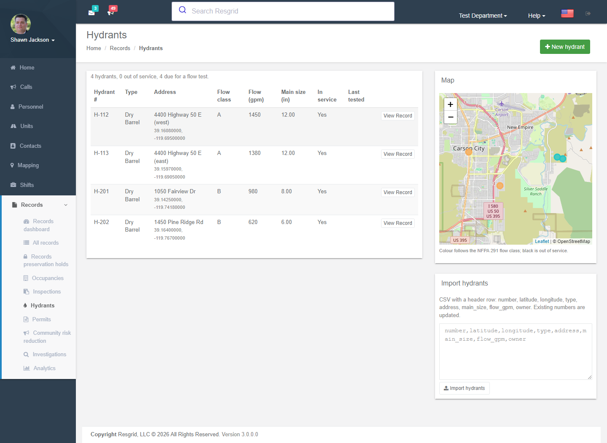
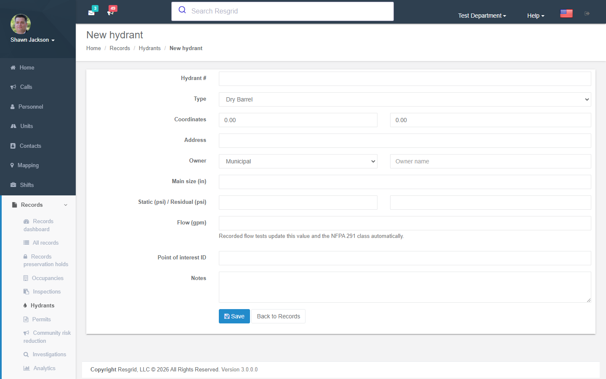
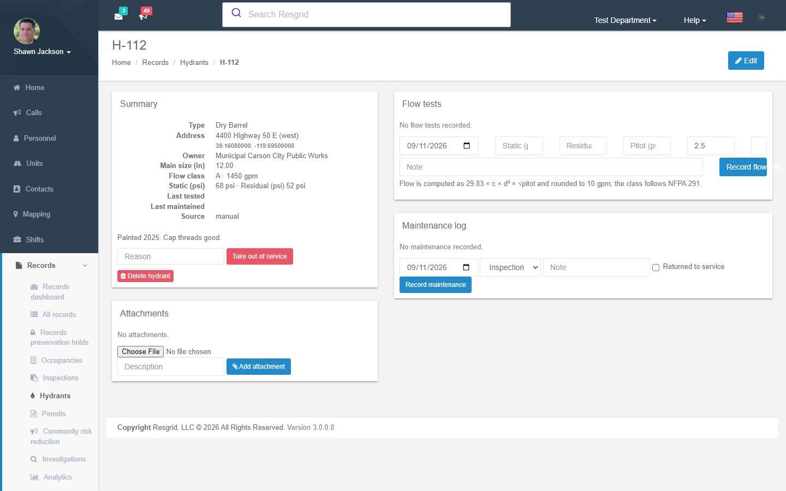

# Hydrants & Water Sources

Track every hydrant and water source in your district: location, owner, main size, flow tests with the **NFPA 291 flow class**, maintenance history and in/out-of-service status — shown on a colour-coded map and available to the apps and dispatch.

Feature flag: `Records.Prevention.Hydrants`. Menu: **Records → Hydrants**.

<AcademyVideo id="14-records" />

## The hydrant list and map

The header shows *N hydrants, N out of service, N due for a flow test*. The **Map** colours each hydrant by flow class (black = out of service). Filter, search by number or address, or open one for details.

## Adding hydrants

**New hydrant** or **Import hydrants** (CSV with a header row: `number, latitude, longitude, type, address, main_size, flow_gpm, owner` — existing numbers are updated).

Files exported from another system import as they are:

- `hydrant_type`, `flow_rate` and `location_address` are read as `type`, `flow_gpm` and `address`.
- Flow is in gallons per minute unless the value says `L/min`.
- `flow_rating_color` (also `flow_color`, `cap_color` or `bonnet_color`) sets the flow class of hydrants with no flow. It accepts the NFPA 291 colours (`light blue`, `green`, `orange`, `red`), the class letters `AA`–`C`, or a `#hex` colour. When a flow is known, the flow decides the class.
- `status` (also `hydrant_status`, `service_status`, `operational_status` or `in_service`) takes hydrants out of service or returns them to service.
  - Values such as `active`, `in service`, `operational` or `yes` mean in service.
  - Values such as `out of service`, `temporarily out of service`, `inactive`, `broken`, `needs repair` or `no` mean out of service.
  - The status as written becomes the out-of-service reason, for example *status: Broken*.
  - A hydrant that is already out of service keeps its own reason and date.
  - The import result says how many hydrants were set out of service and how many returned to service.
- A type the import does not recognize is saved as *Other*. A flow or flow colour it cannot read is left blank. A status it does not recognize leaves the service state unchanged. All of these are listed after the import with how many rows held each value.
- Any other column (status, zone, inspection dates…) is skipped and listed after the import.

| Field | Notes |
|---|---|
| **Hydrant #** | Your identifier; unique per department. |
| **Type** | Dry barrel, wet barrel, standpipe, draft site, tank, cistern … |
| **Address / Coordinates / Point of interest** | Position; can be linked to a map POI. |
| **Owner / Owner name** | Municipal, private, utility. |
| **Main size (in)** | Water main diameter. |
| **Flow (gpm), Static / Residual (psi)** | The last known values. Recording a flow test updates them automatically. |

## Flow tests and maintenance

On the details page:

- **Record flow test** — enter static pressure, residual pressure, pitot pressure and outlet diameter. Flow is computed as `29.83 × c × d² × √pitot`, rounded to 10 gpm, and the NFPA 291 class (AA / A / B / C) is set from it.
- **Record maintenance** — date, kind (flush, paint, repair, replace cap …) and note.
- **Take out of service / Return to service** — with a reason; out-of-service hydrants are black on every map and flagged to crews.

Analytics reports hydrants **tested in the last 12 months**, **in service** and **by flow class**.

## Setup examples

| Department | Notes |
|---|---|
| **Municipal fire** | Import from the water utility's GIS export; schedule annual flow tests by district; use *Owner* to distinguish private hydrants. |
| **Rural / wildland** | Add draft sites, cisterns and tanks as water sources with their capacity in the notes; flow tests optional. |
| **Industrial site** | Plant hydrants and monitors keyed to the site grid; maintenance log for the fire-water system. |

## Technical reference

| Item | Value |
|---|---|
| Routes | `/User/RecordHydrants/{Index,Details,Edit}` |
| Model | `RmsHydrant`, `RmsHydrantFlowTest`, `RmsHydrantMaintenance` |
| Flag / permission | `Records.Prevention.Hydrants`; `RecordsPreventionAdmin` to edit |
| Apps | Hydrant layer is available to the Unit and Responder maps and to the dispatch call map. |
