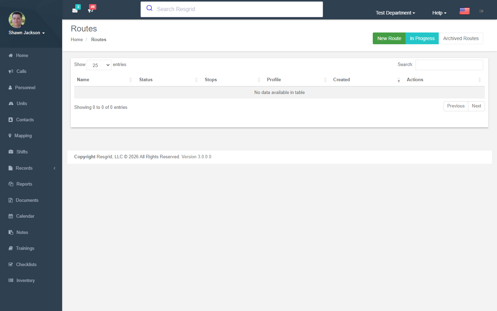

# Routes

The Routes module provides route planning, execution tracking, and deviation monitoring for units (vehicles/apparatus). It allows departments to define multi-stop routes, schedule them on a recurring basis, track real-time execution by units, and detect deviations from planned paths. The system integrates with Mapbox for route geometry and turn-by-turn navigation.



**Navigation:** Department Menu → Routes

<AcademyVideo id="07-mapping" />

## Overview

The Routes system is built around six core concepts that work together to plan and execute routes:

```
Route Plan + Stops + Schedules → Start Route (Instance) → Execute Stops → End / Cancel
```

- A **Route Plan** is the reusable blueprint defining the path, stops, and settings
- **Route Stops** are the ordered waypoints within a plan
- **Route Schedules** define when a plan recurs automatically
- A **Route Instance** is the live execution record created when a unit starts a route
- **Route Instance Stops** track per-stop execution state (check-in, check-out, skipped)
- **Route Deviations** record when a unit strays from the planned path

## Route Plans

Route Plans are the core reusable definitions for a route. They belong to a department and can optionally be assigned to a specific unit.

**Navigation:** Routes → Route Plans

### Plan List

The plan list displays all route plans for the department with:

- Plan name and description
- Assigned unit (if any)
- Status badge (Draft, Active, Paused, Archived)
- Route color swatch
- Quick links to view, edit, and delete

### Creating a Route Plan

Click **New Route Plan** to open the creation form.

| Field | Required | Description |
|-------|----------|-------------|
| Name | Yes | Display name for the route (max 250 characters) |
| Description | No | Optional description of the route's purpose |
| Status | Yes | Draft, Active, Paused, or Archived |
| Assigned Unit | No | Restricts the plan to a specific unit |
| Route Color | No | Hex color used for map rendering |
| Start Latitude / Longitude | Conditional | Explicit start point: an address, what3words, typed coordinates or a click on the map (or use a station) |
| End Latitude / Longitude | Conditional | Explicit end point (or use a station) |
| Use Station as Start / End | No | Start or end at a station |
| Start Station / End Station | No | Shown with the checkbox: **The unit's station** (the assigned unit's home station), or a named station |
| Routing Profile | Yes | **Driving**, **Driving with traffic** (only where the installation's routing has live traffic), **Truck (vehicle size)**, **Walking** or **Cycling** |
| Avoid | No | Tolls, highways, ferries, unpaved roads |
| Optimize Stop Order | No | Reorder stops automatically for efficiency |
| Geofence Radius (meters) | No | Default proximity radius for automatic stop check-in |

**Truck** routes around roads the assigned unit is too tall, wide or heavy for, using the unit's [vehicle size](units#vehicle-size-and-weight). The form shows the unit's size and which limits your installation's routing applies: Valhalla applies all of them, Mapbox height, width and weight only, Google and OSRM none. With no vehicle size set for the unit, Truck routes like Driving.

The distance, time and line of the route are worked out by the Resgrid server when the plan is saved, through the installation's routing provider; they are not typed in.

### The route editor

New and Edit show the stops in a list and on a map, with a **live route preview**: every change (a stop added, moved or reordered, the profile, the roads to avoid, the start or end) redraws the route line within a second. The preview is not saved until you save the plan.

| In the stop list | Meaning |
|---|---|
| **Leg** | Distance and drive time from the previous point (the start, or the previous stop) |
| **Arrival** | Time from the start to this stop, including the estimated time at earlier stops |
| Totals above the list | Total distance and drive time, and the time with stops; *straight-line estimate* when the routing provider gave no route |

- **Reorder** stops by dragging their rows, or with the arrow buttons.
- **Move** a stop by dragging its marker on the map.
- On **Edit**, these changes are saved straight away and the stored route is regenerated; on **New**, they are saved with the plan.

### Optimize order

On **Edit**, **Optimize order** (three or more stops) asks the routing provider for the best order of the stops with the start and end kept where they are. A window shows the current and proposed order side by side, with the distance and time each takes and what the proposal saves. **Use this order** renumbers the stops and regenerates the route; closing the window changes nothing.

### Route Stops

Each plan contains an ordered list of stops added from the plan editor.

| Field | Required | Description |
|-------|----------|-------------|
| Stop Order | Yes | Integer position in the sequence (1, 2, 3, …) |
| Stop Type | Yes | Manual, Scheduled Call, Station, or Waypoint |
| Address | No | Human-readable address for the stop |
| Latitude / Longitude | Yes | Geographic coordinates of the stop |
| Arrival radius (meters) | No | Per-stop override of the plan-level geofence radius; blank uses the plan's |
| Priority | Yes | Normal, High, Critical, or Optional |
| Planned Arrival Time | No | Expected arrival time |
| Planned Departure Time | No | Expected departure time |
| Estimated Dwell (minutes) | No | How long the unit is expected to remain at the stop |
| Contact | No | Linked contact for service-delivery stops |
| Call | No | Linked Resgrid Call (for Scheduled Call stop types) |
| Notes | No | Free-form notes |

:::tip Stop Types
- **Manual** — A general-purpose stop at any location
- **Scheduled Call** — Links the stop to an existing Resgrid Call
- **Station** — A department station or group
- **Waypoint** — A path waypoint without a service interaction
:::

### Route Schedules

A plan can have one or more schedules that automatically create route instances on a recurring basis.

| Field | Required | Description |
|-------|----------|-------------|
| Recurrence Type | Yes | None, Daily, Weekly, Bi-Weekly, Monthly, or Custom |
| Recurrence Cron | Conditional | Cron expression (Custom recurrence only) |
| Days of Week | Conditional | Comma-separated days (Weekly / Bi-Weekly recurrence) |
| Day of Month | Conditional | Specific day number (Monthly recurrence) |
| Scheduled Start Time | No | Time-of-day for the route to begin |
| Effective From | No | Date the schedule becomes active |
| Effective To | No | Date the schedule expires |
| Active | Yes | Whether the schedule is currently enabled |

### Editing and Deleting Plans

- **Edit** — Modify plan metadata, add/remove/reorder stops, and manage schedules inline
- **Delete** — Soft-deletes the plan (`IsDeleted = true`); historical instances are preserved

## Executing Routes

### Starting a Route

From the Route Plans list or the unit view, click **Start Route** and select the plan and unit. This creates a **Route Instance** with status **In Progress** and initializes a pending execution record for every stop in the plan.

### Stop Execution

As a unit progresses through the route, each stop can be acted on in three ways:

| Action | Description |
|--------|-------------|
| **Check In** | Records arrival GPS coordinates and timestamp at the stop |
| **Check Out** | Records departure, computes dwell time, and advances the stop counter |
| **Skip** | Marks the stop as skipped and requires a reason |

Check-in can occur in three ways:

- **Manual** — Dispatcher or driver taps Check In
- **Geofence** — System automatically checks in when the unit's GPS position comes within the stop's geofence radius
- **QR Code** — Driver scans a QR code at the stop location

:::note Geofence Auto-Check-In
When a unit's GPS position is reported, the system uses the Haversine formula to determine whether the unit is within a stop's geofence radius. If within range, the system automatically records a check-in. Each stop can define its own radius; otherwise the plan-level default is used.
:::

### Routes on calls

A dispatcher can put a route plan on a call ([Locations, destinations and routes](dispatch-calls#locations-destinations-and-routes)), so the unit working the call drives it. A plan can go on a call when it is **Active** and has somewhere to start and somewhere to end: its start and end station or point, else its first and last stop (a plan with one stop and nothing else cannot). A call with no location starts at the route's start, and one with no destination ends at the route's end.

When the crew makes the call their active call in the [Unit app](../apps/unit#call-routes), the unit's run of the route starts, linked to the call. It works like any other run, with two differences:

- **It leads to the route's start first.** When the plan starts at a station or a point (rather than at its first stop), navigation first goes from where the unit is to that start. Arriving there records **start reached** (also when the unit is already within the plan's geofence radius of it), and guidance goes on to the first stop. A plan that starts at its first stop checks in there as usual.
- **The crew runs it without route rights.** Members who may see both the call and the unit can start, check in and out, skip, pause, resume, end and cancel the call's run, and read its plan and directions, without the Route permissions below. Other runs still need them.

A unit runs one route at a time. Starting a call's route while the unit runs another asks the crew to end or cancel that one first, or keep it. A run left over from a call that has since been closed is cancelled (reason *Call closed*) when the unit starts the route of its next call. Starting the same call's route again continues the run already going, and resumes it when paused.

The **Active Routes**, **Instances** and **Instance Detail** pages show **Linked Call** on a run started for a call: the call number, linked to the call with its name for members who may open it, the number alone otherwise. The call's page lists its [route runs](dispatch-calls#working-an-active-call) per unit.


### Pausing and Resuming

An active route can be **Paused** (e.g., for an unexpected delay) and later **Resumed**. The route instance status moves between **In Progress** and **Paused** accordingly.

### Ending a Route

Click **End Route** to mark the instance as **Completed**. The system calculates total duration and records the actual route geometry.

### Cancelling a Route

Click **Cancel Route** to abort an in-progress or paused route. A cancellation reason is required. The instance status is set to **Cancelled**.

## Monitoring Active Routes

### Active Routes View

Displays all route instances currently **In Progress** or **Paused** for the department, with:

- Unit name and assigned plan
- Status badge
- Stops completed vs. total stops
- Scheduled and actual start times

### Route Progress

The detailed progress view for a specific route instance shows:

- Overall instance status and timing
- Per-stop execution state (Pending, Checked In, Checked Out, Skipped)
- Check-in/check-out timestamps and GPS coordinates
- Dwell time per stop
- Arrival deviation (negative = early, positive = late, in seconds)
- Any notes added to individual stops

## Route History

From any Route Plan, click **View History** to see all past instances. The history list shows:

- Executing unit
- Actual start and end times
- Completion status
- Stops completed vs. planned

## Deviations

Route Deviations are recorded automatically:

| Deviation | Recorded when |
|---|---|
| **Off route** | The unit leaves the planned line while navigating the route in the app |
| **Missed stop** | A required stop is still pending when the route ends |
| **Out of order** | A stop is checked in while earlier required stops are still pending |
| **Late arrival** | The unit arrives at a stop later than planned by more than the department threshold |
| **Long stop** | The unit stays at a stop longer than its estimated time by more than the threshold |

The threshold (15 minutes unless changed) and whether late arrivals and long stops are recorded at all are set in [Department Settings → Mapping](department-settings#route-deviations).

### Unacknowledged Deviations

Supervisors can view all unreviewed deviations for the department, including:

- Unit and route instance
- Detected timestamp and location
- Distance off-route (meters)
- Deviation type

### Acknowledging a Deviation

Select a deviation and click **Acknowledge** to mark it as reviewed. The acknowledgment records the supervisor's user ID and timestamp.

## Navigation and Directions

Routes, directions and arrival times come from the Resgrid server's routing provider (Valhalla, Mapbox, Google or OSRM, as the installation is set up).

| View | Description |
|------|-------------|
| **Plan Directions** | The stored route line and printable turn-by-turn directions for each leg, from the plan's start (station or point) through its stops to its end |
| **Live Directions** | For a running route: from the unit's current position through the stops still to do (completed and skipped stops left out), with an arrival time for each |
| **Instance detail** | The planned line, the line the unit actually drove (for members who may see unit locations), check-in points and the deviations recorded |

When a running route's plan is edited, the unit keeps the route it started with.

## Contacts Integration

Route stops can be linked to contacts from the [Contacts](contacts.md) module. This is useful for service delivery routes where each stop has an associated person or business.

- View the contact record directly from a stop in the plan editor or the execution view
- Contact information includes name, company, phone, email, address, and GPS coordinates
- The **Route Contacts** view lists all unique contacts across all stops in a plan

## Scheduled Routes

View all active route schedules for the department under **Routes → Scheduled Routes**. Each entry shows the associated plan, recurrence type, next scheduled time, and whether the schedule is currently enabled.

## Authorization

Access to Routes features is controlled by four permission levels:

| Permission | Allowed Actions |
|------------|----------------|
| Route View | View plans, instances, history, deviations, directions, contacts |
| Route Create | Create new route plans |
| Route Update | Edit plans, start/end/pause/resume/cancel routes, check-in/check-out, acknowledge deviations |
| Route Delete | Delete route plans |

All data is scoped to the authenticated user's department — users can only see and manage their own department's routes.

Routes on calls are the exception: anyone who may see calls can list the plans a call can follow and preview an active plan, and a unit's crew can run the route of a call they may see without Route View or Route Update ([Routes on calls](#routes-on-calls)).

## Setup examples

| Department type | How to set it up |
|---|---|
| **Fire** | Hydrant inspection routes per district; pre-plan walk-through routes. |
| **EMS / transport** | Inter-facility transfer runs with linked calls per stop, or one route plan per standing transfer put on the call (or on its [recurring call](scheduled-calls#locations-destinations-and-routes)) so the crew drives it from the active call. |
| **Delivery** | Daily delivery routes with stops, dwell times and customer contacts; drivers run them in the Unit app. |
| **Transit** | Bus routes with timed stops; end-of-day summary as a Record. |
| **Security** | Patrol routes with checkpoint geofences. |
