# Scheduled & Recurring Calls

Some calls are known in advance. A **scheduled call** is a single call set to go out at a later time: a standby at tonight's football game, a hydrant inspection at 09:00 tomorrow. A **recurring call** goes out again and again on a schedule: an ambulance service's dialysis transfers every Tuesday and Thursday at 08:00, 13:00 and 19:00, a weekly linen run, a monthly generator test.

Resgrid creates each recurring call for you ahead of its time, dispatches the units and people you chose when it is due, and checks they are actually free. When something stops a call going out as planned — nobody chosen is available, the call could not be created, or a dispatcher has to send it — the dispatchers are alerted on the web and in the Dispatch app so they can fix it before the patient is left waiting.

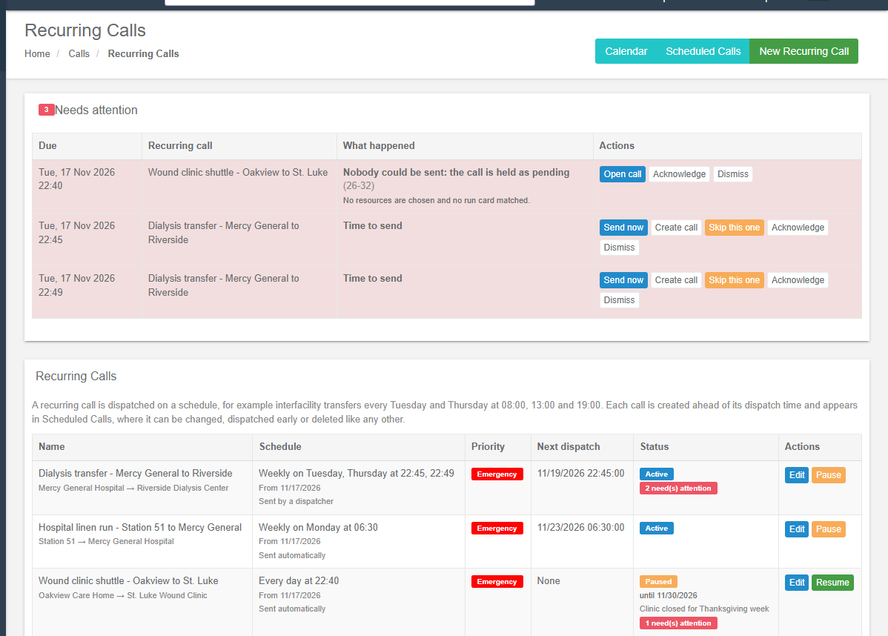

## Where to find it

- **Calls → Scheduled Calls** lists the scheduled calls waiting for their time, with a **Calendar** tab.
- **Calls → Scheduled Calls → Recurring Calls** (or `/User/RecurringCalls`) lists the recurring calls, with **Needs attention** at the top.
- **Repeat** on any call (View Call) starts a recurring call filled in from that call.
- The department [calendar](calendar) can show scheduled calls too (**Show scheduled calls**).
- In the [Dispatch app](../apps/dispatch#recurring-calls-and-alerts), under **Calls → Recurring Calls** and **Recurring Call Alerts** (with a count badge and a banner on the console).

Everyone who can see calls sees scheduled and recurring calls, the calendar and the alerts. A dispatcher limited to some groups sees only the ones their dispatch scope covers, as on the call lists. Creating a recurring call, and sending, skipping or creating one of its calls, needs permission to create calls. Changing, pausing, resuming or deleting a recurring call is for the person who created it or a department admin.

## Scheduled calls

On **New Call**, set **Schedule dispatch** to a time at least 15 minutes ahead. The call is saved and numbered but nobody is told until its time; then it goes out by itself (within five minutes of the time) and becomes an active call. Until then it waits on **Scheduled Calls**, where you can **View**, **Update**, **Dispatch Now** (send it early), **Close** (it is never sent) or **Delete** it. Changing who it goes to before then notifies nobody — the list as it stands is used when it goes out.

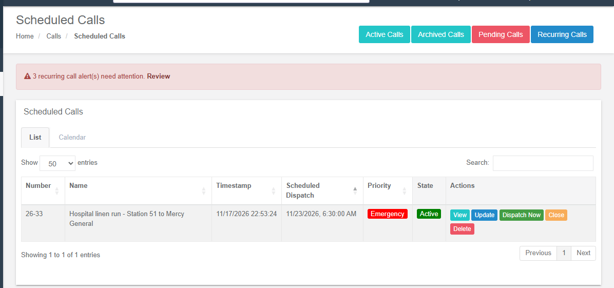

See [Pending and scheduled calls](dispatch-calls#pending-and-scheduled-calls) for what a waiting call does and does not do (field apps, maps, status linking) and for pending calls, which wait for a dispatcher instead of a time.

## The calendar

The **Calendar** tab on Scheduled Calls shows by month, week, day or as a list:

| Entry | What it is |
|---|---|
| **Scheduled** | A call waiting for its time (one-off, or created by a recurring call). Click to open it. |
| **Recurring, not created yet** (dashed) | A run of a recurring call whose call does not exist yet. |
| **Waiting for a dispatcher** (orange) | A run of a recurring call sent by a dispatcher: it is due and has not been sent. |
| **Held, nobody available** (red) | A recurring call that came due with nobody it could be sent to. It waits as a pending call. |
| **Missed** (red, dashed) | A run whose time passed without a call being created. |
| **Dispatched** (faded) | A recurring call that has gone out. |
| **Skipped** (struck through) | A run a dispatcher skipped. |
| **Closed before dispatch** | A recurring call closed before it went out. |

Times are your department's time. A red banner above the calendar says how many recurring call alerts need attention and links to them.

On the department [calendar](calendar), **Show scheduled calls** adds the same entries next to the department's events:

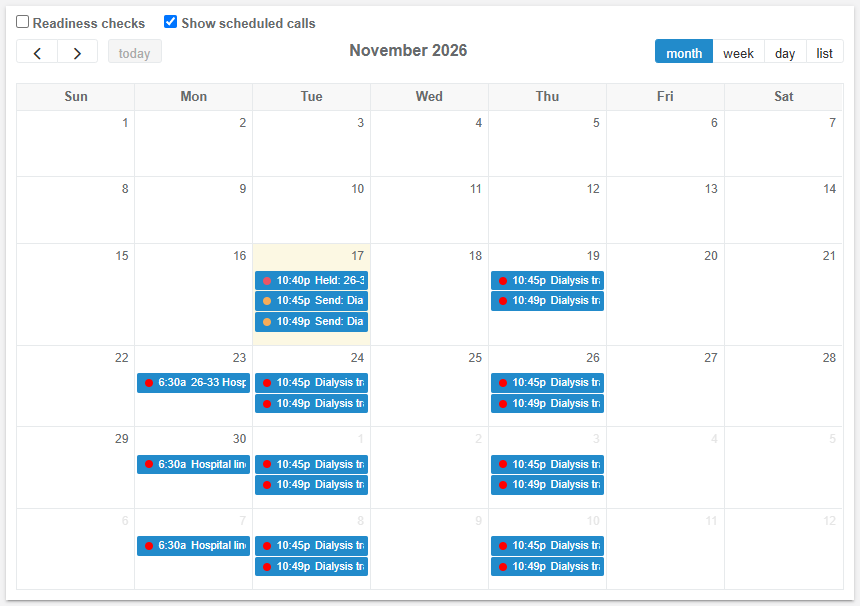

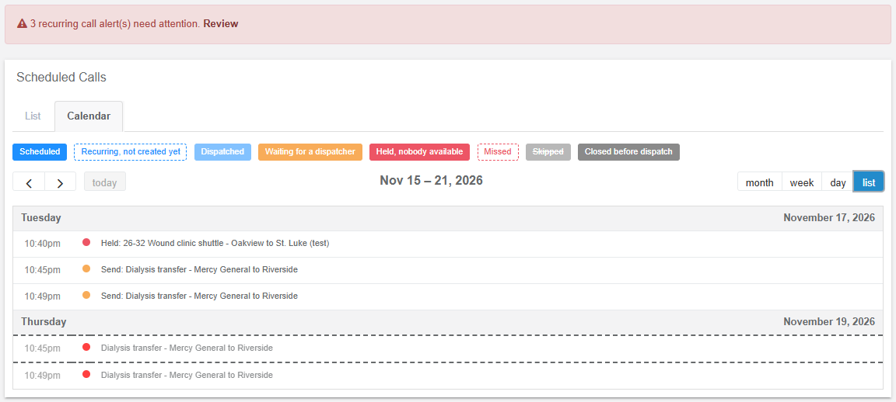
<!-- Retake note (2026-11-17): the held entry still carries the test schedule's old "(test)" name, and a month-view image was not taken (QA link dropped sessions). Harness: Core artifacts/docs-screenshots-2026-11-17-recurring-calls/shots.js (tidy2, tidy, shots with RG_CALENDAR_ONLY). -->

Click a run that has no call yet to act on it:

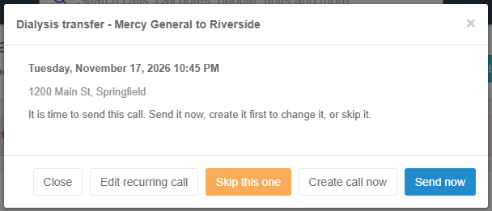

| Button | What happens |
|---|---|
| **Send now** | Creates its call (if it has none) and dispatches it at once, with the same checks as when it is due. |
| **Create call now** | Creates its call without sending it, to change it on its own first (another patient, another crew). A future run becomes a scheduled call for its time and opens on Update Call; one that is already due waits as a pending call. |
| **Skip this one** | No call is created for it. **Restore** undoes it. |
| **Edit recurring call** | Opens the recurring call (its creator or a department admin). |

## Recurring calls

Press **New Recurring Call** on Recurring Calls, or **Repeat** on a call. The form has five parts.

### Call details

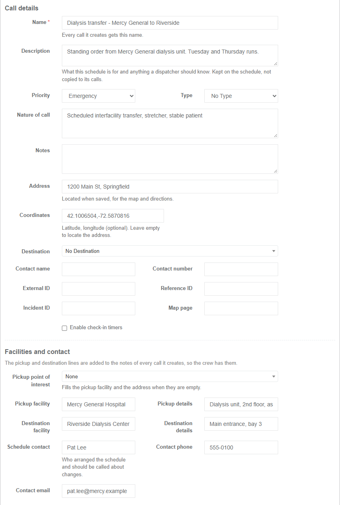

| Field | What it holds |
|---|---|
| **Name** | Every call it creates gets this name; also how the recurring call is listed. |
| **Description** | What the schedule is for and what a dispatcher should know about it. Kept on the recurring call, not copied to its calls. |
| **Priority, Type, Nature, Notes, Address / Coordinates, Destination, Contact, External / Reference / Incident ID, Map page, Check-in timers** | As on New Call; every call it creates gets them. The address is located when saved. Fields your [New Call Form Fields](department-settings#new-call-form-fields) rules hide are left off, and required ones are required here too (protocols, linked calls, contacts and indoor locations can't be set on a recurring call, so their rules don't apply). |

### Facilities and contact

| Field | What it holds |
|---|---|
| **Pickup point of interest** | A [point of interest](mapping) the calls start from. It fills the pickup facility and the address when they are empty, and becomes each created call's **location point of interest** (the call's *Location POI*). |
| **Pickup facility**, **Pickup details** | The facility's name and where in it: unit, floor, room, entrance, who to ask for. |
| **Destination facility**, **Destination details** | Where the calls go, by name and where in it, when the transport **Destination** above is not enough. |
| **Schedule contact** (name, phone, email) | Who arranged the schedule — a facility coordinator, a family member — and should be called about a change. |

The pickup and destination lines are added to the notes of every call it creates (*Pickup: Mercy General Hospital - Dialysis unit, 2nd floor*), so the crew has them.

### Destination location and route

A recurring call has the same kinds of destination and route as a single call ([Locations, destinations and routes](dispatch-calls#locations-destinations-and-routes)):

| Field | What it holds |
|---|---|
| **Destination address**, **Destination coordinates** | Where the calls go when it is not a point of interest: an address, and optionally a point as *latitude, longitude* (`39.7392,-104.9903`). A transport **Destination** point of interest takes their place: one destination only. Part of the *Destination* [New Call Form Fields](department-settings#new-call-form-fields) rule. |
| **Route** | A pre-defined route every call it creates follows: a blank location starts at the route start and a blank destination ends at the route end. A location that already has coordinates, with or without an address, is left as it is. Shown when the department has a route a call can follow; it has no New Call Form Fields rule. |

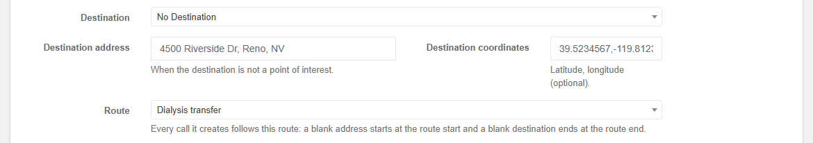

Each created call gets the schedule's destination location and route. A route that is no longer active (paused, archived or deleted since) is left off the calls created from then on; the recurring call keeps it, marked *(no longer available)*, so saving another change does not drop it. Choose another route to put one back on the calls. Likewise a pickup point of interest that has been deleted is not linked to the calls.

**Repeat** on a call brings its destination location and route along, and the point of interest its location was picked from becomes the pickup point of interest.

### Who to dispatch and who to alert

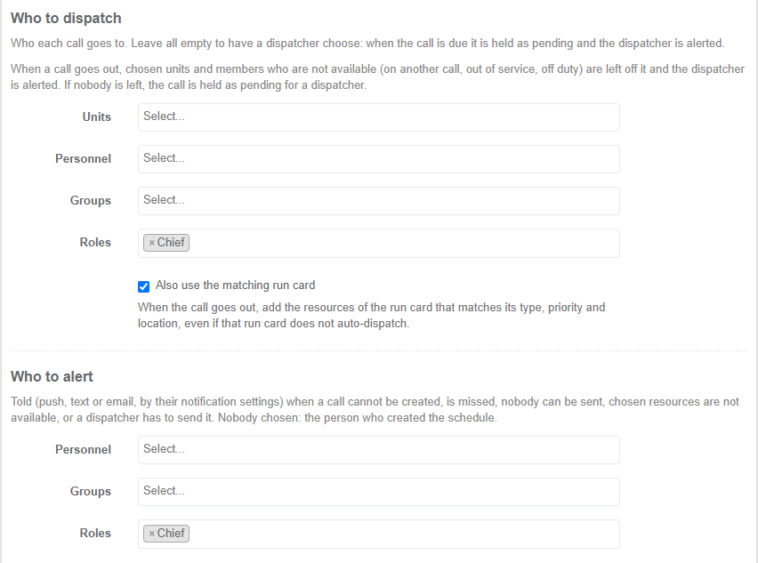

| Field | What it holds |
|---|---|
| **Units, Personnel, Groups, Roles** | Who each call goes to. Someone who has left, or a unit, group or role deleted since, is simply not sent. Leave them all empty to have a dispatcher choose each time: the call is held when it is due and the dispatcher is alerted. |
| **Also use the matching run card** | When the call goes out, add the resources of the [run card](run-cards) that matches its type, priority and location — even if that run card does not auto-dispatch. The run card engine only offers resources that are available. Needs run cards turned on for the department. Without this, a run card that auto-dispatches still adds its resources, as for any scheduled call. |
| **Who to alert** (Personnel, Groups, Roles) | Who is told when a call cannot be created, is missed, nobody can be sent, chosen resources are not available, or it is time for a dispatcher to send it. They get it by push, text or email according to their [notification settings](notifications). If nobody is chosen, the person who created the recurring call is told. A group or role chosen here that has no members right now reaches nobody. |

### Schedule

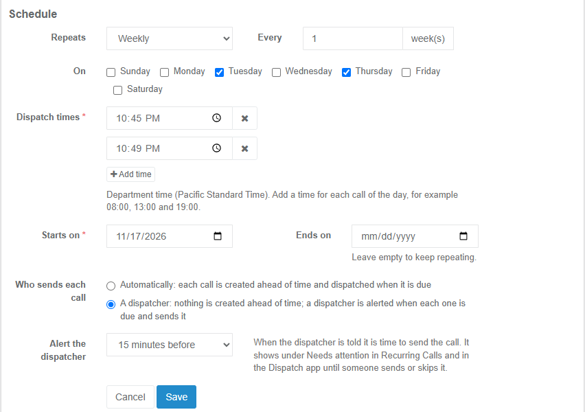

| Field | What it holds |
|---|---|
| **Repeats** | *Daily*, *Weekly* on chosen days, or *Monthly* on a date (a shorter month uses its last day) or on the first, second, third, fourth or last weekday. |
| **Every** | Every 1–52 days, weeks or months. |
| **Dispatch times** | One or more times a day, in your department's time (they stay put across daylight-saving changes). |
| **Starts on**, **Ends on** | The first date, and an optional last date. |
| **Who sends each call** | **Automatically**, or **A dispatcher** (see below). |
| **Create each call** (automatic) | How long before its time each call is created: 1 hour to 7 days (default 1 day). It then appears on Scheduled Calls. |
| **Alert the dispatcher** (dispatcher) | How long before each run the dispatcher is told it is time to send it: when it is due, or 5 minutes to 4 hours before. |

The **Next dispatches** panel beside the form shows what will actually go out next (skipped runs and calls deleted on their own are left out).

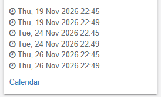

## Who sends each call

**Automatically** (the default). Each run becomes an ordinary scheduled call at its lead time, so it appears on Scheduled Calls and can be changed, sent early or deleted on its own. When it is due, Resgrid sends it:

1. adds the matching run card's resources, if the recurring call asks for it (or the run card auto-dispatches);
2. leaves off chosen units and people who are **not available** — a unit whose status means *committed* (responding, on scene, transporting, returning) or *unavailable* (out of service), a person who is responding to another call, riding a unit that is, or whose staffing is *unavailable* or *committed*. A status with no meaning set (a custom status without a base type) is not judged, so it never holds a call up;
3. dispatches everyone left. If some were left off, the dispatcher gets a **Sent without some chosen resources** alert naming them, to add or replace resources;
4. if **nobody** is left (or nobody was chosen and no run card matched), the call is **held**: it becomes a [pending call](dispatch-calls#pending-and-scheduled-calls), waiting on **Pending Calls**, and the dispatcher gets a **Nobody could be sent** alert. Dispatching the pending call (choose who to send it to) clears the alert.

**A dispatcher.** Nothing is created ahead of time. When a run is due (less the alert time), the dispatcher gets a **Time to send** alert and sends it with **Send now** — or **Create call** to change it first, or **Skip this one**. A run nobody acts on stays in *Needs attention* for a day.

## Needs attention

Alerts are listed at the top of Recurring Calls, counted on a banner on Scheduled Calls and on the Dispatch app's console, pushed to the dispatch apps as they happen, and sent to the recurring call's alert recipients once when raised.

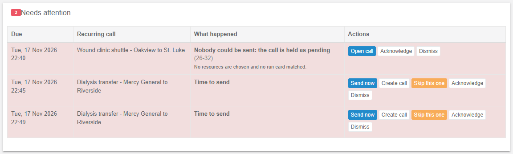

| Alert | When | What to do |
|---|---|---|
| **Time to send** | A dispatcher-sent run is due. | **Send now**, **Create call** or **Skip this one**. |
| **Nobody could be sent** | The call came due and nobody chosen was available, or nobody was chosen and no run card matched. The reason is shown. | **Open call**, choose who to send it to and dispatch it. |
| **Sent without some chosen resources** | The call went out, but the units or people named were not available. | **Open call** and add or replace resources if needed. Closes by itself after a day or when the call is closed. |
| **Missed** | A run's time passed and no call was created (Resgrid's job was not running, or creating it kept failing). Only runs from the last 24 hours are reported. | **Send now** or **Skip this one**. |
| **The call could not be created** | Saving the call failed. It is tried again every few minutes until it is due. | Check the recurring call; **Create call** to try at once. Closes by itself once the call exists. |

**Acknowledge** marks an alert seen by you (others see who); **Dismiss** closes it with an optional note. An alert also closes by itself when what it is about is settled: the held call goes out or is closed, the run is skipped or its call created, or the recurring call is deleted.

## Pausing, changing and deleting

**Pause** keeps the recurring call, its settings and its history but creates and alerts nothing until it is resumed. Give a **Reason** (shown on the list) and, optionally, a **Resume on** date: it starts again by itself at the start of that day. **Also delete the calls it already created** removes the upcoming calls that have not gone out. **Resume** starts it again; nothing that came due while it was paused is created afterwards.

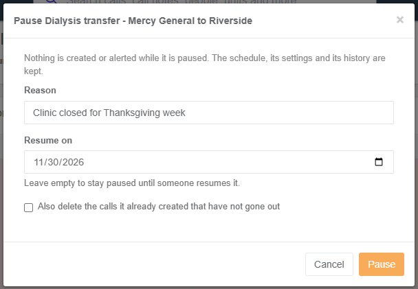

Saving a change to a recurring call can **replace the upcoming calls already created** (they are deleted and created again with the new details, losing changes made to them on their own); untick it to leave them. Deleting a recurring call can also delete the upcoming calls it created. Deleting one call does not bring it back. A call a recurring call created shows *This call was created by a recurring call* when you view it.

## Audit log and workflows

Every change is in the department **Audit Logs**: *Recurring Call Created, Updated, Paused, Resumed, Deleted*, *Occurrence Skipped, Restored, Created* (a dispatcher created or sent a run by hand), *Alert Acknowledged, Dismissed* — with who did it, from where, and what changed.

[Workflows](workflows#trigger-event-types) can act on: **Recurring Call Schedule Created / Updated / Paused / Resumed / Deleted**, **Recurring Call Occurrence Created / Skipped / Dispatched**, and **Recurring Call Alert Raised / Resolved** — for example, email the facility coordinator when a transfer is held, or post to a team channel when a schedule is paused. The created calls also fire **Call Added** and **Call Updated** as usual.

## Setup examples

| Organization | Setup |
|---|---|
| **EMS / interfacility transport** | One recurring call per standing transfer (*Dialysis transfer - Mercy General to Riverside*, weekly Tue/Thu 08:00, 13:00, 19:00), dispatched to the transfer unit, with pickup and destination details and the facility coordinator as schedule contact. Alert the dispatch group. Pause it with a resume date for the patient's hospital stay. |
| **Fire** | Monthly hydrant flushing or pump testing as a recurring call to the engine company, created a week ahead so the crew sees it coming; **Also use the matching run card** to send the station's first-due engine. |
| **Search and rescue** | Weekly training night as a recurring call to the team role, sent by a dispatcher (the duty officer confirms it each week). |
| **Event / security** | A scheduled call for each standby at a venue; a recurring call for the weekly market. |
| **Facilities / industrial** | Daily rounds or weekly generator tests to a maintenance group, alerting the supervisor role if nobody is available. |

## Technical reference

| Item | Detail |
|---|---|
| Routes | MVC `RecurringCallsController`: `/User/RecurringCalls/{Index,New?fromCallId=,Edit?id=}`; POST `Save`, `Pause` (`id`, `reason`, `resumeOn` yyyy-MM-dd, `deleteUpcomingCalls`), `Resume`, `Delete`, `SkipOccurrence`, `RestoreOccurrence`, `CreateOccurrenceNow`, `DispatchOccurrenceNow` (`id`, `occurrence` = Unix seconds), `AcknowledgeAlert`, `DismissAlert` (`alertId`, `note`); GET `GetCalendarEvents?start=&end=` (FullCalendar feed, department-local times, at most 100 days), `GetAlertCount`. |
| API (v4) | `RecurringCalls/` `GetRecurringCalls`, `GetRecurringCall`, `GetRecurringCallOptions`, `SaveRecurringCall`, `PauseRecurringCall`, `ResumeRecurringCall`, `DeleteRecurringCall`, `GetScheduledCallsCalendar`, `SkipOccurrence`, `RestoreOccurrence`, `CreateOccurrenceCall`, `DispatchOccurrenceNow`, `GetRecurringCallAlerts`, `AcknowledgeRecurringCallAlert`, `DismissRecurringCallAlert`; `Calls` results carry `RecurringCallId`. `SaveRecurringCall` takes `DestinationAddress`, `DestinationGeoLocationData` (`"lat,lon"`) and `RoutePlanId` (from `Routes/GetCallRoutePlans`; errors `ErrorDestinationCoordinatesInvalid`, `ErrorRoutePlanInvalid`, the route checked only when it changes). Created calls: `BuildCall` sets `LocationPoiId` from `FacilityPoiId` and `RoutePlanId` only while each is still usable. See [API information](../api/information#recurring-calls). |
| Data | `RecurringCalls` (M0319, M0320: description, schedule contact, facility and destination, `CreationMode` 0 automatic / 1 dispatcher, `ManualAlertMinutes`, `UseRunCard`, alert recipients, pause details; M0322 `DestinationAddress`, `DestinationGeoLocationData`, `RoutePlanId`), `RecurringCallOccurrences` (one row per run dealt with: 1 creating, 2 created, 3 skipped, 4 missed, 5 awaiting a dispatcher; unique per schedule and time, so a run is created once), `RecurringCallAlerts` (M0320; one per run and kind: 1 create failed, 2 missed, 3 nobody could be sent, 4 resources unavailable, 5 time to send; closed ones kept 90 days), `Calls.RecurringCallId`. No foreign keys; removed with the department. |
| Worker | The scheduled-calls job (worker command 12, every 5 minutes): resumes paused schedules whose date has come, creates the calls due within each lead time (never one due more than 10 minutes ago or before the last save or resume), raises *time to send* and *missed* alerts, sends due recurring calls with the availability and run card rules, closes settled alerts. |
| Realtime and push | Hub event `recurringCallAlertsUpdated` (schedule id, `{alertId, kind, raised}`); alert notifications carry the push code `RCA:{alertId}`. |
| Workflow triggers | 208 Schedule Created, 209 Updated, 210 Paused, 211 Resumed, 212 Deleted, 213 Occurrence Created, 214 Skipped, 215 Dispatched, 216 Alert Raised, 217 Alert Resolved; variables `recurring_call.*`, `occurrence.*`, `alert.*`. |
| Permissions | View: `Call_View`. Create, send, skip, create now, acknowledge, dismiss: `Call_Create` and call creation rights. Edit, pause, resume, delete: the creator or a department admin. |
