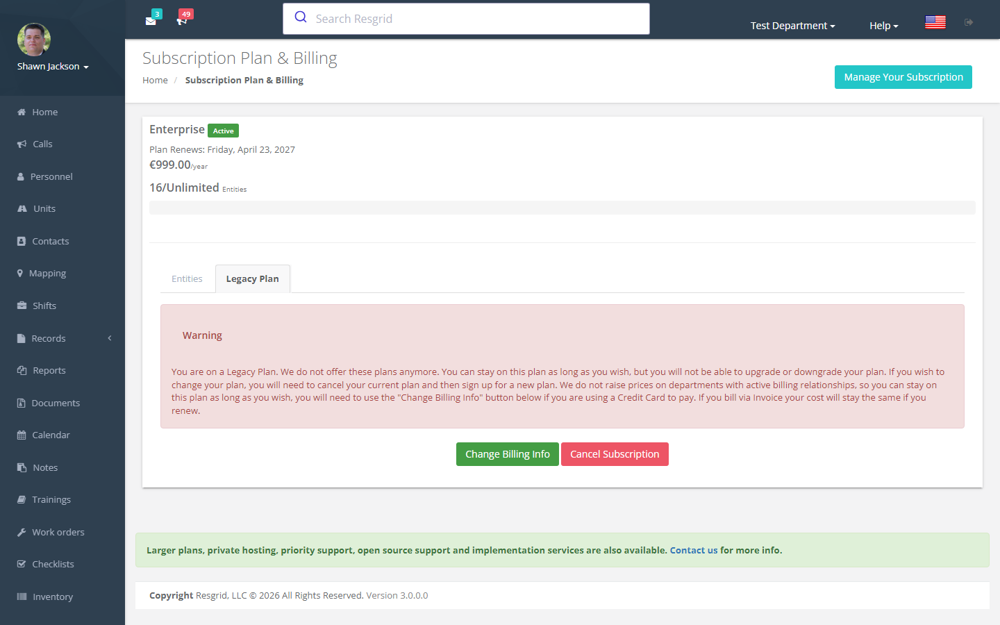
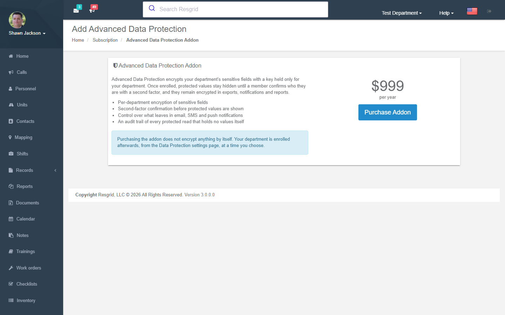
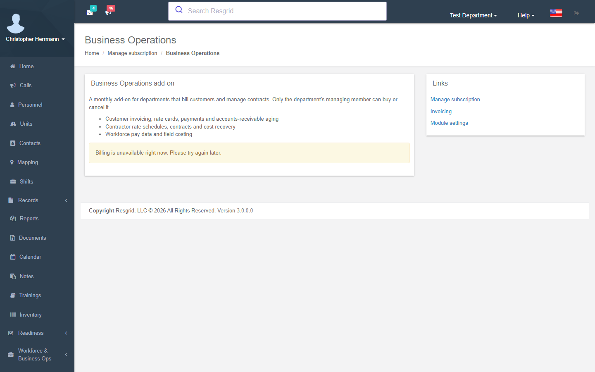
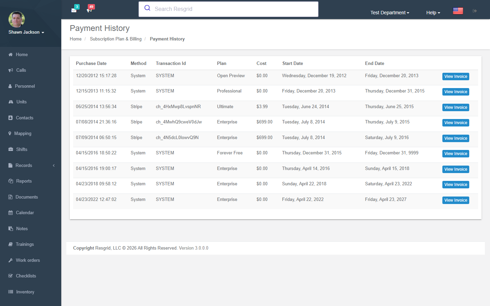

# Subscription & Billing

**Subscription & Billing** shows the department's plan (Free, Standard, Premium, Ultimate, Enterprise), what it includes and its limits (personnel, units, features), lets the **managing user** upgrade, change billing details, buy **add-ons** (Push-to-Talk, Advanced Data Protection, Readiness Pro, Business Ops, LMS, Workforce Pro and others) and download invoices. Self-hosted installations show the plan they are licensed for.

**Department menu → Subscription and Billing.** Only the managing user can purchase or cancel.

<AcademyVideo id="20-plans" />

## Subscription Dashboard

**Authorization:** `Department_Update` + `CanUserManageSubscription` runtime check

The dashboard displays:
- Current plan name and details
- Personnel count vs. plan limit
- Unit count vs. plan limit
- Progress bars (info < 75%, warning 75-99%, danger ≥ 100%)
- PTT (Push-to-Talk) addon status
- Stripe customer portal link

### Plan Types

Plans are divided into two categories:

| Plan Range | Limit Calculation |
|------------|-------------------|
| Plans < 36 | Personnel-based limits |
| Plans ≥ 36 | Entity-based limits (personnel + units combined) |

## Billing Information

### Viewing
Displays current Stripe card information and provides the Stripe client key for card updates.

### Updating
Process:
1. Client-side collects card via Stripe.js
2. Token submitted to server
3. Creates new card on Stripe customer
4. Sets as default source
5. Audit event logged

### Stripe Response Logging
The `LogStripeResponse` endpoint records Stripe card token responses as `PaymentProviderEvent` entries.

## Plan Purchase

### Stripe Checkout
The `GetStripeSession` endpoint creates a Stripe checkout session:
- Returns `SessionId` and `HasActiveSub` flag
- Redirects to Stripe-hosted checkout page
- Completion redirects to processing page

### Processing
After purchase:
- `Processing` page shown while payment is confirmed
- `CheckProcessingStatus` polls until payment matches the plan
- Redirects to completion or failure pages

## Subscription Update

### Stripe Update Session
The `GetStripeUpdate` endpoint creates a Stripe session for modifying an existing subscription.

## Subscription Cancellation

**Authorization:** `Department_Update` + `CanUserManageSubscription`

### Cancellation Process
1. View cancellation confirmation page
2. Must check the confirmation checkbox
3. Cancels via Stripe API
4. Audit event logged
5. Redirects to success or failure page

## Coupon Validation

The `ValidateCoupon` endpoint checks a Stripe coupon code and returns "Valid" or "Invalid."

## Plan Addons

### PTT (Push-to-Talk) Addon

Manage the PTT addon subscription:
- View current PTT quantity from active Stripe subscription
- Add PTT addon (modifies subscription quantity)
- Cancel PTT addon by type

### Business Ops add-on

**Subscription and Billing → Business Ops** opens the add-on page for the [Business Ops](business-ops/overview) modules: customer invoicing, rate cards, payments and AR aging; contractor rate schedules, contracts and cost recovery (Cal OES MARS); Labor & Costing pay data and field costing. It is a **monthly** add-on (USD 250 on Stripe / EUR 295 on Paddle at the time of writing), and only the department's **managing member** can **Buy** or **Cancel subscription**. The page shows the price, whether the add-on is active, the paid-through date and a cancelled flag; checkout runs on Stripe Checkout or Paddle and never on this page.

When the add-on lapses nothing is deleted: every Business Ops page stays readable and every change is refused until it is bought again. Certifications and Deployment Finance are free and unaffected. Turn the whole area off for the department without cancelling under **Department Settings → Module Settings → Business Ops**.

### LMS add-on

**Subscription and Billing → LMS** (*Courses, formal training reports and verifiable certificates*) opens the billing page of the [LMS add-on](/web-app/trainings/lms/): courses with question banks and hosted video, requirements and the compliance matrix, programs, classes, skills, external learners, SCORM / cmi5 / LTI / xAPI and the formal training reports. The free Training module and the [Resgrid Academy](/web-app/trainings/academy/) need no add-on.

- It is sold in **packs of 25 seats**, billed **monthly**, with graduated prices: packs 1–4 at **US$79 / €99**, packs 5–20 at **US$49 / €59**, packs 21 and up at **US$29 / €35** per pack per month. Each pack is billed at its own tier's price. There is no trial and no annual term.
- It needs a **paid Resgrid plan**. Cancelling the plan also cancels paid add-ons.
- Only the **managing member** can buy, change the number of packs or cancel the renewal. Adding packs is charged at once, prorated to the billing date; removing packs takes effect at the next billing date, and never below the packs your LMS-enabled members need. The price of every change is previewed first.
- Seats are given to members on the **Personnel** pages. Instructors, evaluators and officers need no seat.
- A failed renewal keeps the LMS working for 7 days while the card is retried. When the add-on ends nothing is deleted: records, certificates and transcripts stay readable and exportable, and the lapse rules decide what still runs.
- The card shows only while Resgrid has switched the LMS on for your department (the `Training.Lms` rollout flag).

See [LMS packs and pricing](/web-app/trainings/lms/packs/), [LMS seats](/web-app/trainings/lms/seats/) and [When the add-on ends](/web-app/trainings/lms/#when-the-add-on-ends). Technical: `LmsBillingController` (`/User/LmsBilling/{Index,Checkout,PreviewPacks,ChangePacks,CancelRenewal}`), `PlanAddonTypes.Lms = 9`, prices in `LmsAddonConfig`, entitlement checked live by `LmsAccessService`.

### Workforce Pro add-on

**Subscription and Billing → Workforce Pro** (*Member wellness and workplace exposure records, for the members you choose*) opens the billing page of the [Workforce Pro add-on](workforce-pro/index.md). Today it holds member [wellness and workplace exposure](workforce-pro/wellness.md): the exposure log, exposure cases, injuries with duty status, medical clearance and the OSHA log.

- It is sold in **packs of 25 seats**, billed **monthly**, with graduated prices: packs 1–4 at **US$119 / €139**, packs 5–20 at **US$79 / €95**, packs 21 and up at **US$49 / €59** per pack per month. No setup fee, no annual term.
- It needs a **paid Resgrid plan**.
- Only the **managing member** can buy, change the number of packs or cancel the renewal. Adding packs is charged at once, prorated to the billing date; removing packs takes effect at the next billing date, and never below the members switched on.
- Department admins switch Workforce Pro on per member under **Manage Workforce Pro seats**. Officers acting on others need no seat.
- A failed renewal keeps Workforce Pro working for 7 days while the card is retried. When the add-on ends (a cancelled renewal at the end of the paid month), wellness becomes read-only. Nothing is deleted; members still see and export their own records.
- The card shows only while Resgrid has made Workforce Pro available to your department (the `Workforce.Pro` rollout flag).

See [Workforce Pro add-on](workforce-pro/index.md) and [Workforce Pro seats](workforce-pro/seats.md). Technical: `WorkforceProBillingController` (`/User/WorkforceProBilling/{Index,Checkout,PreviewPacks,ChangePacks,CancelRenewal}`), `PlanAddonTypes.WorkforcePro = 8`, prices in `WorkforceProAddonConfig`, entitlement checked live by `WorkforceProAccessService`.

### Private Inbound Dispatch Number add-on

The **Private Inbound Dispatch Number** card (*Your department's own number for texts and calls*) opens the add-on's billing page. It gives your department its own phone number: texts become pending calls with a text conversation, members can call it to reach the voice menu, and with Enhanced AI, callers who are not members leave a report by voice. Replies come from the main Resgrid number (inbound only).

- **US$15 per month** on Stripe (US and Canadian numbers) or **€20 per month** on Paddle (a number in your country where available), billed monthly per department even on an annual plan.
- Needs an **active entity plan**. Cancelling the plan also cancels paid add-ons.
- Only the **managing member** can buy or cancel it. It can also be bought straight from **Department → Private Inbound Dispatch Number**, which is where you then pick the number.
- If payment stops, texts and calls stop after 3 days and the number is released 30 days after payment stopped, with warnings to the administrators along the way.

See [Private Inbound Dispatch Number → Buying and lifecycle](intake-channels/dedicated-number#buying-and-lifecycle).

The [dispatcher desk](dispatcher-desk) is free and needs no add-on; its Enhanced AI options use the Enhanced AI add-on.

### Other Addons
The `BuyAddon` action supports purchasing plan addons:
- View addon plan details
- Current addon payment info
- Frequency information

### Add-ons on the home dashboard

Each add-on has widgets on the [home dashboard](dashboard#add-on-widgets-and-locked-cards) — Push-To-Talk (PTT), Data Protection (ADP), Work Orders (Readiness Pro), receivables, bids, contracts, Cal OES MARS and Labor & Costing (Business Ops), the Assistant and AI Dispatch Triage (Enhanced AI), and the incident desks (Incident Back Office). They appear only while the add-on is active. Department admins see the rest as **locked** cards in the widget gallery with a **View add-on** link to the add-on's billing page; members never see them. The **Plan & Add-ons** widget shows the plan, limits used, add-ons held or available and the renewal date (billing figures for the managing member only).

## Payment History

View all historical payments for the department.

## Invoice Viewing

**Authorization:** `CanUserViewPayment` runtime check

Displays invoice details with deserialized Stripe `Charge` data.

## Setup examples

| Department type | How to set it up |
|---|---|
| **Small volunteer department** | Free or Standard covers dispatch, personnel and units; add PTT if you use the apps as radios. |
| **Career fire / EMS** | Premium/Ultimate for voice alerting, shifts and records; Readiness Pro for work orders; ADP if patient data is stored; Business Ops for cost recovery, Cal OES MARS and invoicing. |
| **Multi-agency / government** | Enterprise for SSO/SCIM and security policy; department links for shared dispatch; a Private Inbound Dispatch Number for the public's non-emergency texts. |
| **Business / industrial** | Standard plus Readiness Pro (maintenance) and PTT; Business Ops for invoicing, contracts, bids and labor costing. |

## Technical reference

`SubscriptionController`, `ReadinessProBillingController`, `BusinessOperationsBillingController` (`/User/BusinessOperationsBilling/{Index,Checkout,CancelRenewal}`, Billing API `api/BusinessOperationsBilling/{Status,Checkout,CancelRenewal}`, `PlanAddonTypes.BusinessOperations = 4`); routes `/User/Subscription/{Index,UpdateBillingInfo,Cancel,BuyAddon,ManagePTTAddon,BuyAdpAddon,ManageAdpAddon,PaymentHistory,ViewInvoice,SelectRegistrationPlan}`; payments through Stripe or Paddle; plan limits cached 14 days (`SubscriptionsService`, `LimitsService`); addon entitlements checked live (`ReadinessAccessService`, `BusinessOperationsAccessService`, `IDedicatedNumberAccessService`). Private Inbound Dispatch Number: `DedicatedNumberBillingController` (`/User/DedicatedNumberBilling/{Index,Checkout}`, `returnTo` 0 billing page / 1 number page), `PlanAddonTypes.DedicatedNumber = 7`, prices in `DedicatedNumberAddonConfig` (see [Private Inbound Dispatch Number → Technical reference](intake-channels/dedicated-number#technical-reference)).

### Interactions with Other Modules
| Module | Interaction |
|--------|-------------|
| **Dashboard** | Plan limit warnings displayed; the [home dashboard](dashboard)'s Plan & Add-ons widget and locked add-on widget cards for department admins |
| **Department** | Personnel/unit counts checked against limits |
| **Personnel** | Personnel count affects plan usage |
| **Units** | Unit count affects plan usage |
| **Voice** | PTT addon enables voice features |
| **Department Links** | Plan determines link availability |
