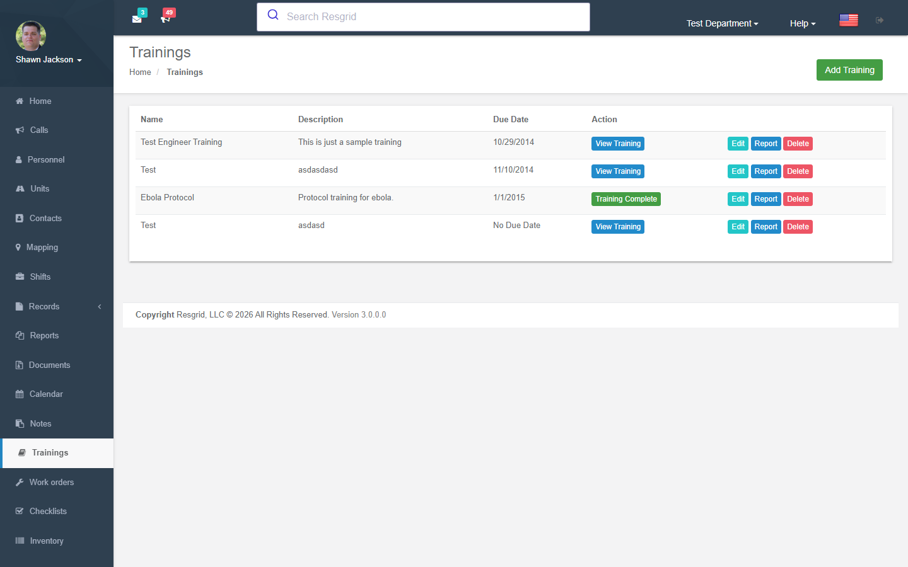
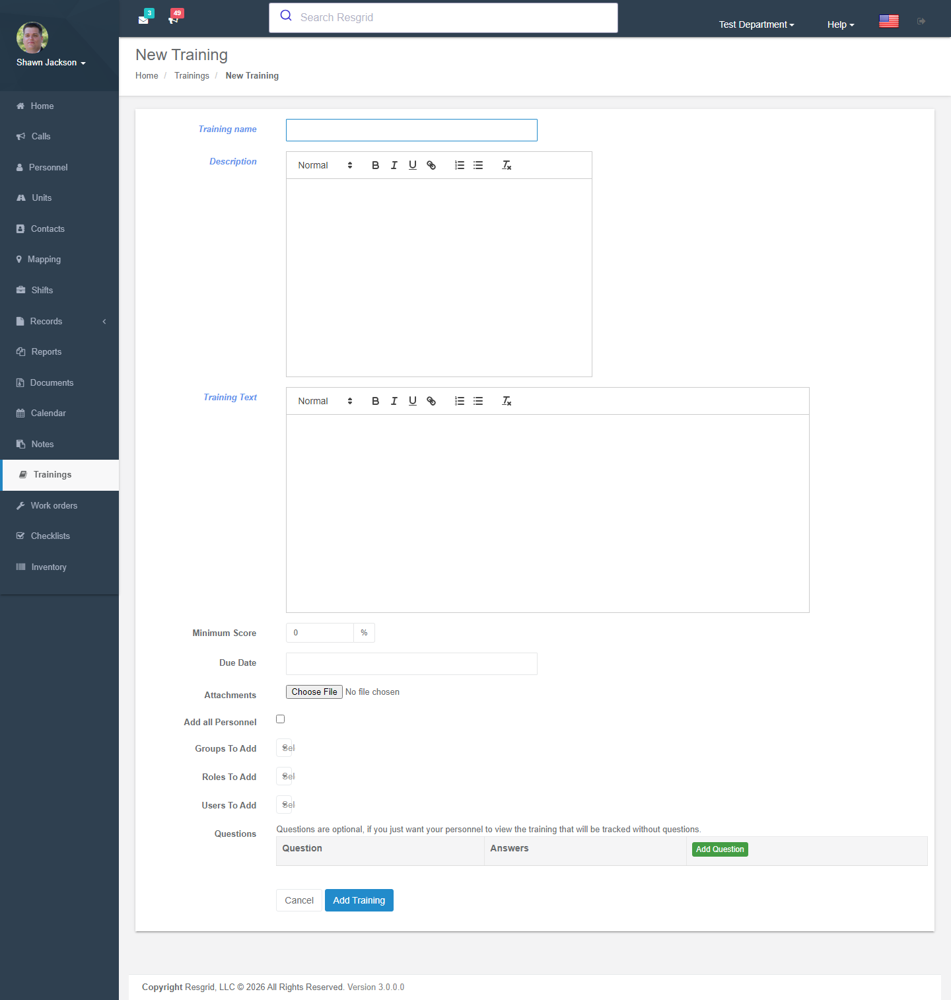

# Trainings

**Trainings** is where a department writes training material, assigns it to the people who need it, and tracks who has read it, passed its quiz and completed it on time. A training is one page: text, attachments and video embeds, an optional quiz with a pass mark, and the rules for who it is for and when it is due. Completions go on each member's [transcript](/web-app/trainings/transcript/) and can count toward certification renewals.

Everything on this page is **free** for every department. Multi-lesson courses, learning requirements, classes, skill sheets and the program tools on top of it are the paid **LMS add-on** (see [LMS add-on](/web-app/trainings/lms/)). The [Resgrid Academy](/web-app/trainings/academy/) is free too.

<AcademyVideo id="09-training" />

## Free and LMS at a glance

| Area | Free (every department) | LMS add-on |
|---|---|---|
| Trainings | Single-page trainings with attachments, embeds and a quiz; assignment to people, groups, roles, shifts, certification holders and unit types that stays current; due dates, reminders, overdue notices, a yearly (or any N-month) repeat; read-and-confirm; leave of absence; the training report; [recorded completions](./recording-completions.md) | — |
| Courses | My courses, the [Resgrid Academy](/web-app/trainings/academy/) and its role paths | Department [courses](./courses.md): modules and lessons, question banks, manual grading, hosted video, group viewing, approval and versions |
| Requirements and programs | — | [Learning requirements, paths, onboarding and enforcement](./paths-and-requirements.md); [annual plans, competencies, training requests and reports](./programs-and-plans.md) |
| Classes and skills | Calendar event types that count as training (check-in hours go on the transcript) | [Class sessions](./classes.md) with rosters, waitlists and QR sign-in; [skill sheets and task books](./skills-and-task-books.md) |
| Records | Transcript, categories, hours, outside submissions and their review | Formal reports (ISO, NCCP and others) |

**Where to find it:** left menu → **Trainings** (or the name your department gave the module under department terminology). Every training page shows the module's sections in a strip under the heading. Which sections you see depends on your rights:

| Section | Who sees it |
|---|---|
| **My Training** | Everyone. |
| **Transcript**, **Courses**, **Academy** | Everyone. |
| **Course library**, **Standards** | LMS authors (*Manage Courses*) and graders (*Grade Assessments*), while the LMS is switched on. |
| **Requirements** | On the LMS pages, for LMS managers and readers. |
| **Manage Trainings** | Anyone who may create, assign or delete trainings. |
| **Records** | *Assign Training* holders department-wide, and group admins for their group. |
| **Training reviews** | *Record Training Completions* holders and training record reviewers (see [Training reviews](/web-app/trainings/training-reviews/)). |
| **Leave of Absence** | *Assign Training* holders. |
| **Programs**, **Classes**, **Skills**, **External learners** | While the `Training.Lms` flag is on for the department. |

The rights are four separate permissions under **Department → Permissions** ([Security & permissions](/web-app/security-permissions)):

| Permission | What it allows | Default with no saved rule |
|---|---|---|
| **Create Training** (`CreateTraining`, 3) | Create trainings and author their content and quiz (the edit page shows the answer key). | Department admins. |
| **Assign Training** (126) | Choose who is assigned, set due dates, extensions and exemptions, enter leave, read the report and attempt history. | Follows *Create Training*. |
| **Delete Training** (127) | Archive, restore and delete trainings. | Follows *Create Training*. |
| **Record Training Completions** (135) | Record that members completed a training together ([Recording completions](./recording-completions.md)). | Department admins. |

When a rule is set to *Department and group admins*, a group admin manages only the trainings assigned to their own group's members. When it is set to *Everyone*, a member manages only the trainings they created. Everyone can always open and complete the trainings assigned to them or open to all members.

A department that does not use training can switch the module off under **Department Settings → Module Settings** (Training). That closes every training page; nothing is deleted.

## What members see: My Training

**Trainings → My Training** is each member's home for training:

- **Next up**: the one training that needs attention first, with its status and due date.
- Cards grouped as **Overdue**, **Due soon**, **In progress** and **Not started**, each with **Open training**, **Continue**, **Take Quiz** or **Retake quiz**.
- With the LMS add-on, the member's requirements, learning paths, certification progress and **Recommended for you** appear here as well.
- **Certifications due**: the member's certifications that expire soon or have expired. **Pin** keeps any certification on this list; **Unpin** removes it.
- **Open trainings**: reference trainings open to every member. **Read** opens one; **Enrol** has it tracked for you with its due date and reminders (when the training allows it).
- **Recently completed**, with score and hours.

Status pills on the cards and in reports are: **Not started**, **In progress**, **Quiz failed**, **Complete**, **Overdue**, **Exempt**, **On leave**, **Scheduled** and **Removed**.

## The officer list: Manage Trainings

**Trainings → Manage Trainings** lists the trainings you author, assign or report on.

- KPI tiles: **Overdue**, **Due this week**, **Completion**.
- **Show** filter: **Active**, **Scheduled** (start date in the future), **Archived**, **All**; and **Search** by name.
- Columns: **Name** (with badges such as *Archived*, *Starts*, *Closed to new assignees*, *Open to all members*, *Every N month(s)*, the question count), **Due Date**, **Assigned**, **Completed**.
- Actions, depending on your rights: **Edit**, **Report**, **Copy**, **Archive** or **Restore**, **Delete**.

**Add Training** opens the editor.

## Creating a training

**Trainings → Manage Trainings → Add Training** (*Create Training*). The editor has these sections:

### Content

| Field | Notes |
|---|---|
| **Training name** | Required, up to 500 characters. |
| **Description** | Short summary shown in lists and on the training page. |
| **Training Text** | The material itself, in the rich text editor. Video and document embeds from YouTube, Vimeo, Google Docs and Sheets, and Microsoft Stream and Teams are kept; other embedded frames are removed. |
| **Do not use for AI knowledge answers** | For licensed material whose license forbids processing: the training is never indexed or used in knowledge answers or drafting aids. |

With Enhanced AI, a drafting panel beside the editor can suggest quiz questions and an outline from the text you are writing (see [Drafting aids](/web-app/trainings/drafting-aids/)). You still review and save.

### Quiz

Questions are optional: without them, members complete the training by opening it (or by confirming it, below).

| Field | Notes |
|---|---|
| **Minimum Score** | The pass mark, 0 to 100 %. |
| **Attempt limit** | 1 to 100; leave empty for unlimited attempts. |
| **Show one question at a time** | Members page through the quiz with **Previous** and **Next**. |
| **Members confirm they have read and reviewed it** | For handbooks, policies and notices: opening is not enough, each member ticks *I have read and reviewed this training* and presses **Confirm**. With a quiz, passing the quiz completes it instead. |
| Questions | **Add Question**; each question has a **Question type** — **Single choice**, **Multiple choice (all correct options)** or **True or false** — its answers (**Add Answer**) and the **Correct** mark. |

Rules the editor checks: at most 100 questions; every question needs text and 2 to 26 answers (true or false has exactly two); single choice and true or false have one correct answer, multiple choice at least one. The answer key never leaves the server: members' browsers and apps receive only the questions and options.

### Schedule and availability

| Field | Notes |
|---|---|
| **Starts on** | Optional. Until then assignees do not see the training and nobody is notified. |
| **Due date** | **No due date**, **On a date** (due by the end of that day; members assigned after it has passed get 30 days) or **Days after each assignment** (1 to 3650 days, counted per member). |
| **Repeat every (months)** | 1 to 120. Each interval assigns the training again with a fresh due date; earlier completions stay on record. Use 12 for an annual refresher. |
| **Closed to new assignees** | Nobody else is added, by an edit, a membership change or enrolment (a one-off briefing). |
| **Open to all members** | Any member can view it without being assigned; only assigned members are tracked and take the quiz. |
| **Members may enrol themselves to be tracked** | With *Open to all members*: the training shows under **Open trainings** with **Enrol**. |

For a yearly required reading such as an employee handbook or a site rule, the editor suggests: attach or write it, tick *Members confirm they have read and reviewed it*, set a due date and repeat every 12 months. For a versioned policy members sign, use [Protocols](/web-app/protocols/) instead.

### Reminders

| Field | Notes |
|---|---|
| **Remind before due (days)** | Comma separated, for example `7,1`. Empty reminds one day before. |
| **Repeat overdue notice every (days)** | 1 to 365. Empty sends it once. |
| **Send an overdue notice to the member and the training's creator** | On by default. The creator gets one summary per run that found members overdue. |
| **Message added to notices** | Optional, up to 500 characters, added to the new-training, reminder and overdue notices. |

### Hours and continuing education

**Training hours**, **CE hours**, **CE provider**, **CE course number**, and the training's category, method, course code, tags and objectives. These travel with each completion onto the transcript; see [Transcript](/web-app/trainings/transcript/) for categories and credits.

### Attachments

Images, PDF, Office documents, text and video files up to **30 MB** each: `jpg`, `jpeg`, `png`, `gif`, `pdf`, `doc`, `docx`, `ppt`, `pptx`, `pps`, `ppsx`, `odt`, `xls`, `xlsx`, `txt`, `mpg`, `mpeg`, `avi`, `mp4`. Attachments download only for people who may open the training.

### Who is assigned

Needs *Assign Training* (without it, a new training must be *Open to all members*).

- **Add all Personnel**: everyone in the department.
- **Users To Add**, **Groups To Add**, **Roles To Add**, **Holders of certifications**, **Members of unit types**, **Members of shifts**.

Groups, roles, shifts, certifications and unit types **stay current**: members who join one later are assigned automatically, and members who leave before opening the training are withdrawn. On an existing training the editor says whether the assignment is dynamic or a fixed list; **Make this assignment dynamic (keep it current as memberships change)** converts a fixed list.

**Preview who would be added** shows, without saving, how many members would be added and who would be skipped and why. Deleted, disabled and hidden members, members imported but not activated yet, and (for a group admin) members outside their group are never assigned.

### Editing after people completed

Changing a question, an answer, the answer key or the pass mark after members completed the training asks **The quiz or pass mark changed**: **Material: assign it again to members who completed it**, or **Not material: completed results stand**. Changing the due rule moves the open assignments' due dates.

## Taking a training

A member opens a training from **My Training** or a notification. Opening it marks it viewed.

1. The **Your progress** panel shows viewed, quiz state, attempts left, due date (and any extension, exemption or leave).
2. The member reads the text and opens the **Training Attachments**.
3. If the training asks for it, they tick the statement and press **Confirm**.
4. If it has a quiz, **Take Quiz** opens it. The quiz page says how many questions there are and the pass mark. They answer and press **Finish**, then confirm *Submit your answers?*
5. **Quiz result** shows **Passed** or **Not passed**, the score (*Score N%: X of Y correct. Pass mark Z%*) and attempts left. **Retake quiz** appears while attempts remain.
6. **Flag a question** on the result page tells the training's author that a question looks wrong.

A passed quiz, a confirmation, or (with neither) the first view completes the assignment. Every submitted attempt is kept and scored against the quiz as it was then.

A manager who is not assigned sees **Preview quiz**; nothing is submitted.

## The training report

**Report** (from Manage Trainings or the training) needs *Assign Training* for that training.

- KPI tiles: completion, complete, overdue, exempt.
- **Assignees**: name, status, due date, viewed, completed, score, attempts. **Show former members** adds people who left the department.
- Per member: **Extend** (a new due date and a reason), **Exempt** (a reason, optionally **Until**) and **End exemption**, **Reset User** (a completion moves to the history and they start again), **Remove** (a completion is kept).
- **Flagged questions** with the member's comment and **Resolve**.
- **Attempt history**: every submitted attempt and the quiz version it was scored against.
- **Earlier completions**: completions moved to history by a repeat, a reset or a material change, with the reason.
- **Record completion** opens [Recording completions](./recording-completions.md) for holders of that right.

## Leave of absence

**Trainings → Leave of Absence** (*Assign Training*): record a member's leave with **Member**, **First day**, **Last day**, **Kind** (**Light duty**, **Medical**, **Military**, **Parental**, **Other**) and a **Note**. While a leave period runs, that member's training due dates and reminders pause; afterwards they move on by the length of the leave. The member sees *You are on leave* on their trainings.

## Archive, copy and delete

- **Archive** hides a training from members and keeps its records; **Restore** brings it back (*Delete Training*).
- **Delete** works only while nobody has completed the training. Once someone has, you are told to archive it instead.
- **Copy** makes a copy named *(copy)* and opens it; choose who it is for before saving.

## Notifications

Training notices follow each member's [notification settings](/web-app/notifications):

| Notice | Sent to | When |
|---|---|---|
| New training | Each member assigned | When they are assigned (or when a scheduled training starts). |
| Reminder | Each open assignee | The days before due you set (default one day). |
| Overdue | The member; the creator gets one summary | When overdue, and again every N days if set. |
| Question flagged | The training's creator | When a member flags a question. |
| Recorded completion | The member | When an instructor records or voids their completion. |

New-training and question-flagged notices go out when the change is saved (or, for a scheduled training, once it starts); reminders and overdue notices are sent by the **Training Notifier** worker, which runs every 30 minutes. Inactive members are never notified.

## Walkthrough: create and assign a training

Dana Whitlock, training officer at Cedar Valley Fire & Rescue, sets up the yearly SCBA refresher.

1. **Trainings → Manage Trainings → Add Training**.
2. **Training name**: *Annual SCBA Refresher 2026*. **Training Text**: the department's SCBA procedure, plus a YouTube video of the donning drill.
3. **Quiz**: **Minimum Score** 80, **Attempt limit** 3, five single-choice questions with the correct answers marked.
4. **Schedule and availability**: **Due date** → **Days after each assignment**, 30. **Repeat every (months)**: 12.
5. **Reminders**: **Remind before due (days)** `7,1`; **Repeat overdue notice every (days)** 7.
6. **Hours and continuing education**: **Training hours** 1.
7. **Who is assigned**: **Roles To Add** *Firefighter* and *Engineer*. **Preview who would be added** shows 22 members; Sam Kowalczyk is skipped because he has not activated his account yet.
8. **Add Training**. The notice says how many were assigned; each member gets the new-training notice.

## Walkthrough: a member completes it

1. Tomas Okafor gets the notice and opens **Trainings → My Training**. *Annual SCBA Refresher 2026* is **Next up**, due in 30 days.
2. **Open training**: he reads the procedure and watches the video.
3. **Take Quiz**, answers five questions, **Finish**, confirms.
4. He scores 80 % and passes. The training moves to **Recently completed**, one hour goes on his transcript, and it will be assigned again in 12 months.
5. Dana's report shows him **Complete** with his score and attempt.

## Setup examples

| Organization | How they use Trainings |
|---|---|
| **Volunteer fire** | Annual refreshers (SCBA, bloodborne pathogens, driver safety), each a short quiz at 80 %, due 30 days after assignment, repeating every 12 months, assigned to the *Firefighter* role so new members get them automatically. |
| **EMS** | Protocol update briefings with a quiz, assigned to *EMT* and *Paramedic* certification holders; CE hours and provider entered so completions count toward recertification. |
| **SAR** | Navigation and radio trainings assigned to the *Ground Team* group; an open-to-all map book for reference. |
| **Industrial / HAZMAT** | Hazard communication and LOTO awareness with read-and-confirm, assigned by shift, repeating yearly; overdue notices to the safety coordinator who created them. |
| **Security / facilities** | Post orders as trainings with *Members confirm they have read and reviewed it*, closed to new assignees for one-off briefings. |
| **Business / volunteer organizations** | Employee handbook or code of conduct reviewed every year (read-and-confirm, repeat 12 months). |
| **Canada / EU** | The UI is available in 10 languages (the non-English text is a first machine translation); CE fields take your own provider and course numbers. |

## Technical reference

| Item | Value |
|---|---|
| Controller and routes | `TrainingsController`: `/User/Trainings/Index` (My Training), `Manage`, `New`, `Edit`, `View`, `Quiz`, `SubmitQuiz`, `Report`, `Leave`, `SaveLeave`, `DeleteLeave`, `Enroll`, `Acknowledge`, `FlagQuestion`, `ResolveFlag`, `PinCertification`, `Extend`, `Exempt`, `ClearExemption`, `ResetUserTraining`, `RemoveAssignee`, `Archive`, `Restore`, `Copy`, `DeleteTraining`, `RemoveAttachment`, `GetTrainingAttachment`, `RecordCompletions`, `VoidRecordedCompletion` |
| Policies | `Training_View` (members), `Training_Create`, `Training_Update` (assign and report), `Training_Delete`, `Training_RecordCompletions` |
| Permissions | `CreateTraining` (3), `AssignTraining` (126), `DeleteTraining` (127), `RecordTrainingCompletions` (135) |
| Module switch | `DepartmentModuleSettings.TrainingDisabled` (Department Settings → Module Settings) |
| Workers | Training Notifier (worker 9, every 30 minutes: new, reminder, overdue notices); Training Assignment (worker 83, every 5 minutes: dynamic assignment from group, role, shift, certification and unit crew changes, then due repeats) |
| Events and workflow triggers | `TrainingAddedEvent` / `TrainingUpdatedEvent` (triggers 20 and 21); recorded completions 244 and 285 |
| Migrations | M0338 (T0 columns), M0339 (baseline tables), M0340 (content audiences and member leave), M0355 (exclude from AI), M0407 (read-and-confirm) |
| v4 API | `Trainings/GetMyTrainings`, `GetTraining`, `GetTrainingAttachment`, `SubmitQuiz`, `GetMyAttempts`, `SelfEnroll`, `AcknowledgeTraining`, `FlagQuestion`, `PinCertification`, `GetTrainingReport`, `GetTranscript`, `GetTrainingCategories`, `SubmitExternalTraining` |
| Related | [Transcript](/web-app/trainings/transcript/), [Certifications from training](/web-app/trainings/certifications-from-training), [Recording completions](./recording-completions.md), [LMS add-on](/web-app/trainings/lms/) |

### Interactions with other modules

| Module | Interaction |
|---|---|
| **Personnel, Groups, Roles, Shifts, Units** | Assignment targets; membership changes re-evaluate dynamic assignments. |
| **Certifications** | Certification holders as an audience; certifications due on My Training; completions can credit renewals. |
| **Calendar** | Event types can count as training (see [Classes](./classes.md#calendar-events-that-count-as-training)). |
| **Protocols** | Versioned read-and-sign policies live there; a protocol version can be a course lesson. |
| **Workflows** | Training triggers start workflows ([Workflows](/web-app/workflows)). |
| **Department Settings** | The module can be switched off. |
