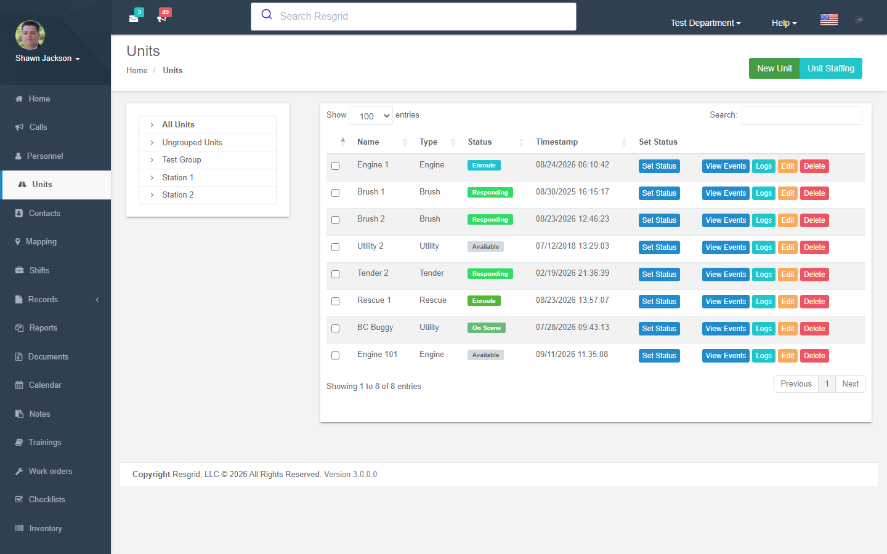
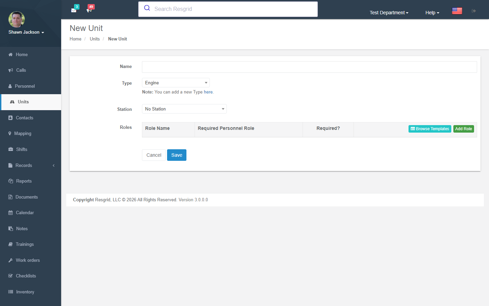
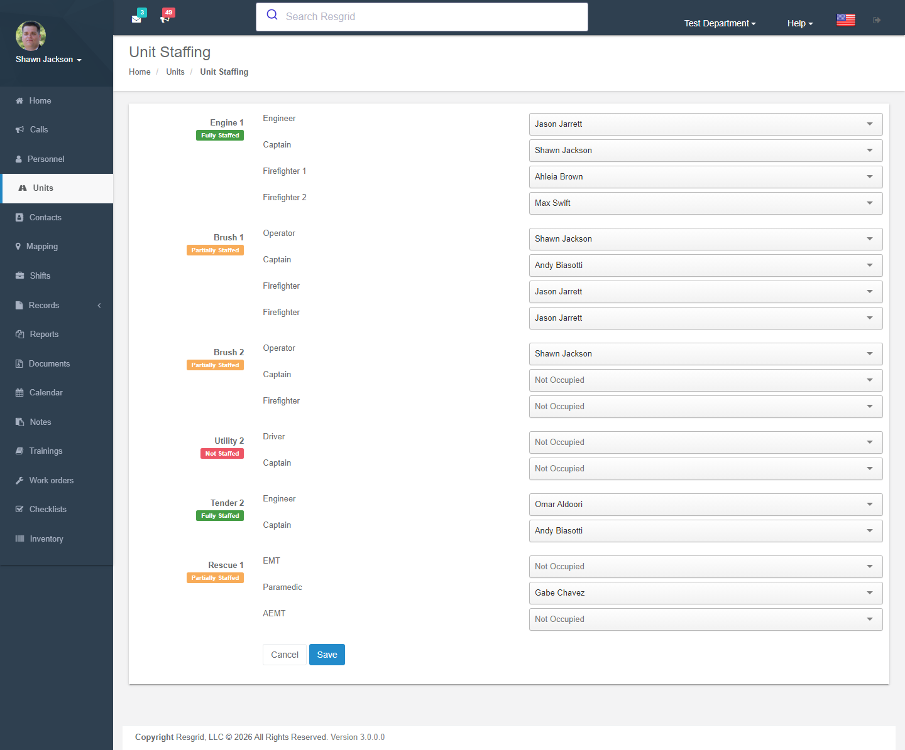

# Units

A **unit** is anything that responds as one thing and has a status of its own: an engine, ambulance, ladder, brush truck, command vehicle, patrol car, delivery van, a SAR team, a hazmat team, a drone. Units have a **type**, a **station**, optional **roles** (seats) that people are assigned to, a live **status** (Available, Responding, On scene, Out of service …), GPS position from the Unit app or a [hardware tracker](unit-tracking), and their own logs and equipment.

<AcademyVideo id="03-units" />

## Where to find it

**Left menu → Units.** Units are listed by station/group with type, current state and timestamp. Buttons: **Events**, **Logs**, **Edit**, **Delete**; select several to **set status** at once (only units sharing the same status set can be selected together). **Unit Staffing** and **New Unit** are in the toolbar.

## Creating a unit

| Field | Notes |
|---|---|
| **Name** | `Engine 1`, `Medic 12`, `Patrol 3`, `Team Alpha`. |
| **Type** | From your [unit types](types-configuration#unit-types). Type decides which custom statuses apply and is used by run cards and coverage minimums. |
| **Station / group** | Where it is based. Units can also be un-grouped. |
| **Unit roles** | Seats that can be staffed: *Driver*, *Officer*, *Firefighter*, *Paramedic*, *Navigator*. Mark a role **required** so the unit shows as partially staffed until it is filled. |
| **Custom fields** | Any [User Defined Fields](user-defined-fields) configured for units (VIN, radio ID, capacity …). |

Adding is blocked when the plan's unit limit is reached.

:::tip Have a spreadsheet?
To add many units and unit types at once — from an apparatus list or the system you are leaving — use [Import & Migration](import-and-migration/overview) (**Department menu → Import & Migration**, department administrators, where it is turned on). Every row is checked and previewed before anything is saved. See the [Units field reference](import-and-migration/units).
:::

## Vehicle size and weight

The **Vehicle size and weight** section of the unit's edit page (and of its [unit type](types-configuration#unit-types)) lets routing keep a truck off roads it cannot use: low bridges, narrow lanes, weight-limited bridges, tunnels closed to hazardous loads.

| Field | Range | Notes |
|---|---|---|
| **Height** | 1–6 m | |
| **Width** | 1–4 m | |
| **Length (including trailer)** | 2–40 m | Overall length, with anything towed |
| **Gross weight** | 500–80,000 kg | |
| **Heaviest axle load** | 500–25,000 kg | |
| **Axles** | 2–12 | |
| **Hazardous materials** | Yes / No | For tunnel and route restrictions on hazardous loads |

Enter values in feet and pounds or in metres and kilograms (the units picker beside the fields); Resgrid stores them in metric. Fields left blank on a unit use the unit type's value, shown greyed in the empty field, so set sizes once on the type and override them only for the unit that differs (a ladder truck among engines of the same type).

Where a size applies: the **Truck** profile of [route plans](routes#creating-a-route-plan) assigned to the unit, the unit's in-app navigation, and the drive times used to rank units for dispatch. Which limits are honoured depends on your installation's routing provider, and the page says which: **Valhalla** applies all of them, **Mapbox** height, width and weight only, **Google** and **OSRM** none.

:::caution
Restrictions are only as complete as the map's road data. Crews remain responsible for posted limits.
:::

## Travel mode

The **Travel mode** section of the unit's edit page (below **Vehicle size and weight**, and the same on its [unit type](types-configuration#unit-types)) tells dispatch how the unit gets to a call, so a bike team, a foot patrol or a helicopter is measured the way it moves instead of as a car.

| Travel mode | How travel time is measured | Default speed |
|---|---|---|
| **Driving (roads)** (the default) | The routed road drive time, as before. Vehicle size and weight limits still apply, and live traffic where the installation uses it | 40 km/h |
| **Cycling** | Routed on cycle routes and roads open to bicycles | 15 km/h |
| **On foot** | Routed on footpaths and walkable streets | 5 km/h |
| **Air (straight line)** | The straight line at the unit's air speed. Never routed, and road closures don't apply | 180 km/h |

**Average speed** is entered in km/h or mph (the picker beside the field) and stored in km/h, from 1 to 1,000 km/h. Leave it blank to use the default speed for the mode. The speed is used for:

- **straight-line estimates**, for units without a routed time: the straight-line distance plus 30 % for the way roads and paths wind (× 1.3), at the unit's speed;
- **air travel**: the straight line at the unit's speed;
- **walking and cycling routes**: routing providers walk and cycle at fixed speeds, so with a speed set the time is the routed distance at that speed. With no speed set, the provider's own time is used.

Driving routes keep the road speeds of the routing provider. Valhalla, Mapbox, Google and OSRM all route walking and cycling; when routing fails, the unit gets a straight-line estimate at its speed.

On a unit, **Use the unit type's** (the default) and a blank speed take the type's mode and speed, shown under the fields. A unit that changes its mode does not inherit the type's speed: a bike team on a unit type set to driving uses 15 km/h unless you enter its own.

**Where it applies:** the closest-unit [run cards](run-cards#travel-modes-and-road-closures) (conditional run cards included), the [Nearest Units](dispatch-calls#nearest-units) list on New Call and Update Call, the Dispatch app's picker, and the Awaiting Resources estimates. Turnout times are added on top, as before. Driving units rank exactly as they did before travel modes, and personnel (responders) are always measured as driving. [Road closures](mapping#road-closures) apply to a unit only when they stop its kind of traffic: a closure that stops vehicles leaves foot and bike teams' routes alone.

In-app navigation routes a walking or cycling unit on foot or by bike; an air unit gets the road route.

| Unit | Travel mode and speed |
|---|---|
| **Bike team** at events | Cycling; blank speed (15 km/h), or the team's own pace |
| **Foot patrol** or first-aid team at a festival | On foot; 4 km/h where crowds slow them down |
| **Helicopter** | Air; its cruise speed, for example 220 km/h |
| **Drone** | Air; for example 60 km/h |

## Unit status

Set a unit's status from the list, the [Dashboard](dashboard), the Unit app or the API. Statuses come from the default set — Available, Delayed, Unavailable, Committed, Out of Service — or, more usually, from [custom unit statuses](custom-statuses) defined per unit type (Responding, On Scene, Transporting, At Hospital, Returning …). A status can require a **destination** (a station or an active call) and carries an optional note and location. Statuses drive dispatch availability, the map, Big Board and reports.

## Unit staffing

**Unit Staffing** assigns people to unit roles for the shift or day — who is driving Engine 1, who is the officer. Staffing is what the Unit app shows as the crew, what checklists route to, and what the *minimum staffing* gate uses in [run cards](run-cards). Members are searched by name; only active members appear.

## Unit logs and events

- **Logs** — narrative entries for the unit (mileage, maintenance notes, activity). After Records activation these become **Unit activity** records in [Records](records/authoring).
- **Events** — every status, staffing and location change; **Generate report** prints it; administrators can clear all statuses for a unit.

## Equipment, checklists and tracking

From a unit you also reach its **equipment** (everything issued to it in [Inventory](inventory)), its [checklists](checklists) (target type *Unit*), its [work orders](work-orders), its **certifications & inspections** (registration, insurance, pump and ladder tests, DOT inspections — see [Certifications](business-ops/certifications#unit-certifications-and-inspections)) and its **hardware GPS tracking** bindings.

## Setup examples

| Department | Units and roles |
|---|---|
| **Fire** | Engine (Driver, Officer, FF ×2), Ladder, Rescue, Tender, Brush, Chief (Officer). One unit type per apparatus kind so statuses fit. |
| **EMS** | Medic units (Driver/EMT, Attendant/Paramedic), Supervisor; statuses Responding / On scene / Transporting / At hospital / Available. |
| **SAR** | Teams as units (Team Leader, Navigator, Medic, Searchers), UTVs and K9 as units. |
| **Emergency management** | EOC sections as units are *not* recommended — use groups; units for MCVs, trailers, generators that move. |
| **Security** | Patrol vehicles and foot posts as units with a single *Officer* role; statuses On patrol / At post / Responding / Break. |
| **Delivery / transit** | One unit per vehicle with *Driver* role; statuses Loading / En route / Delivering / Returning. |
| **Industrial ERT** | Brigade engine, hazmat trailer, rescue truck; roles per certification. |

## Technical reference

| Item | Value |
|---|---|
| Controller | `UnitsController`, `UnitTrackingController` |
| Routes | `/User/Units/{Index,NewUnit,EditUnit,DeleteUnit,UnitStaffing,AddLog,ViewLogs,ViewEvents}` (`?unitId=`) |
| Policies | `Unit_View/Create/Update/Delete` + `CanUserViewUnit`, `CanUserEditUnit` |
| Permissions | `ViewGroupUnits`, `CanSeeUnitLocations` |
| Data endpoints | `GetUnitsList`, `GetUnits`, `GetUnitsForGroup?groupId=`, `GetUnitsAndRolesForGroup`, `GetUnitsForCallGrid?callLat=&callLong=` (ETA), `GetUnitEvents?UnitId=`, `SetUnitState`, `SetUnitStateWithDest`, `SetUnitStateForMultiple`, `GetUnitStatusHtmlForDropdown`, `GetPersonnelForUnitStaffingJson?search=` |
| Events | `UnitAddedEvent`, `UnitStatusEvent`, `AuditEvent` |
| Legacy | `UnitLog` writes are blocked after Records activation (use Unit activity records) |
| Travel mode | `UnitTypes.TravelMode` (`UnitTravelModes` 0 driving, 1 cycling, 2 walking, 3 air; default 0) and `TravelSpeedKmh` (null = the mode's default), `Units.TravelMode` and `Units.TravelSpeedKmh` (null = the type's), M0314. `UnitTravelProfile.Resolve` picks the unit's mode, else the type's; the speed likewise, except that a unit whose mode differs from the type's never takes the type's speed. Shared partial `_TravelModeFields` on the unit and unit type pages |
| API | `api/v4/Units/*`, `api/v4/UnitStatus/*`, `api/v4/UnitLocation/*` |
