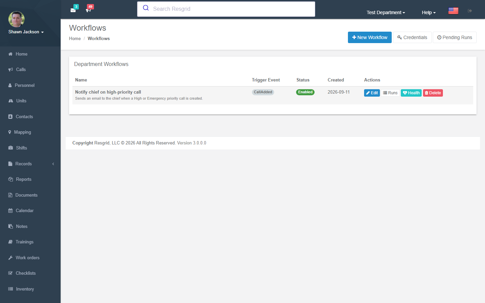
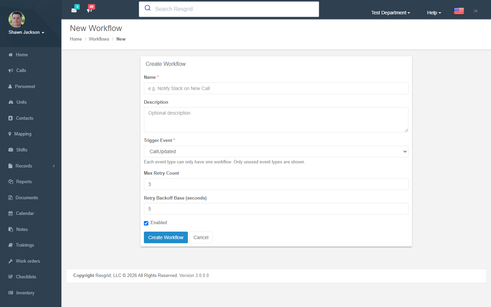
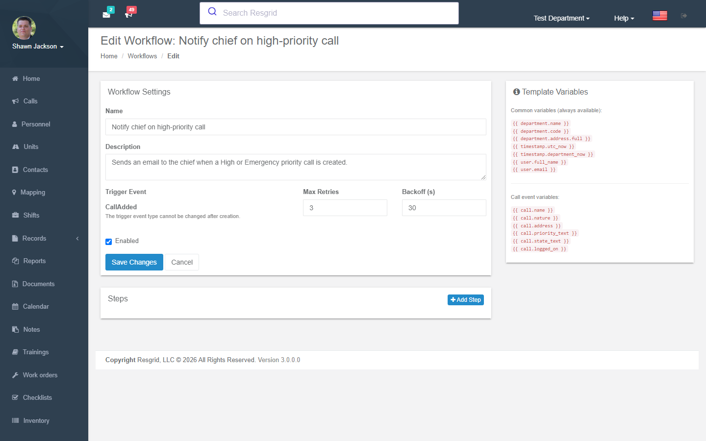
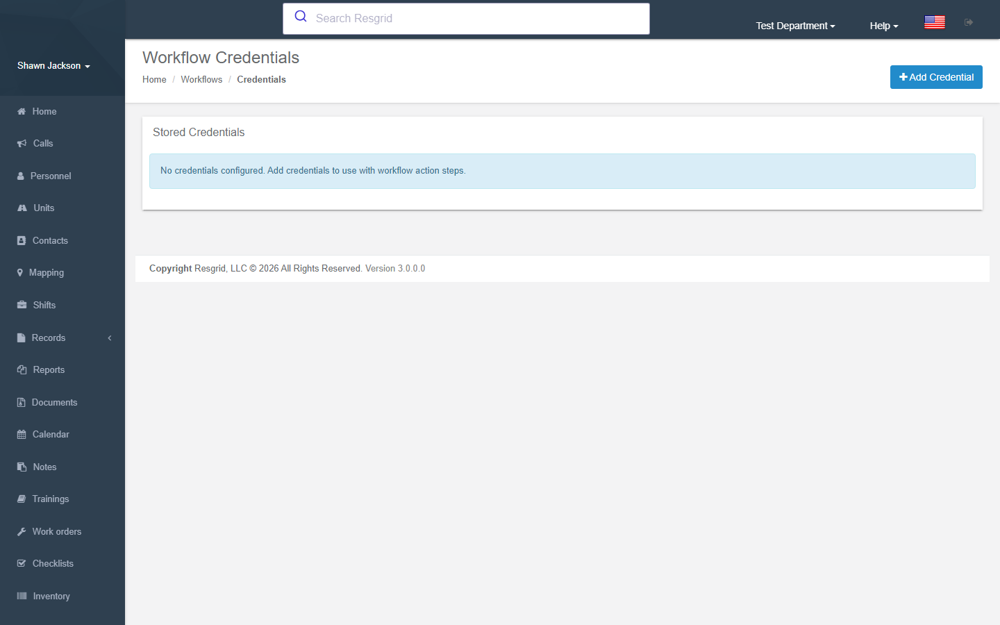
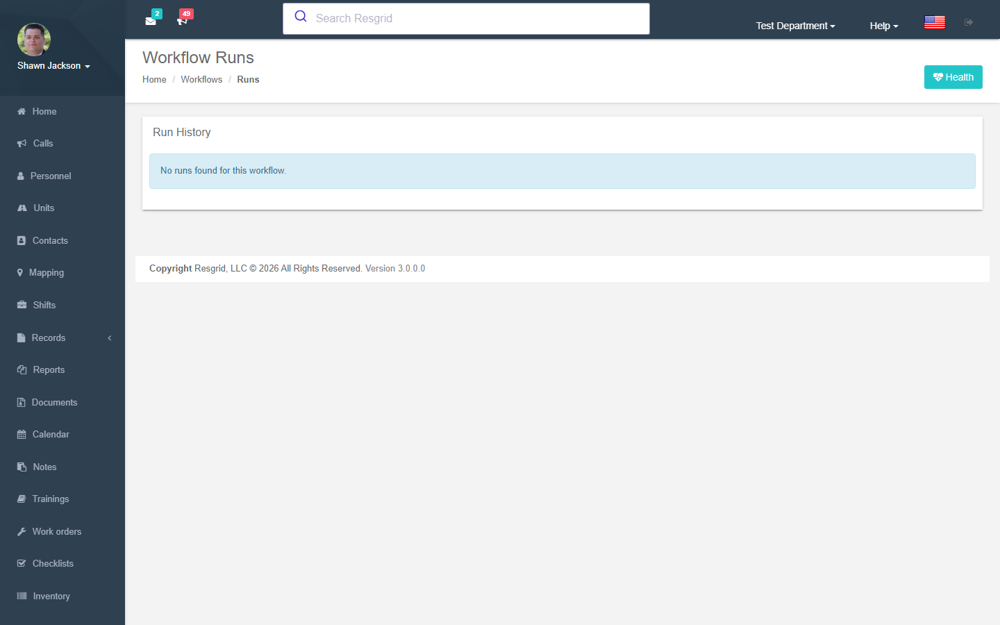

# Workflows

**Workflows** are Resgrid's automation engine: *when X happens, do Y*. Pick a trigger (a call is created, a unit goes out of service, a record is finalized, a checklist fails, a work order is overdue, a form is submitted …), add optional conditions, and chain actions — send an email or SMS, post to Slack/Teams/Discord, call a webhook or REST API, upload a file, create a call, attach a Records export. Templates use the event's data, credentials are stored encrypted, and every run is logged with retries and a health view.

**Department menu → Workflows.** Start from the built-in **templates** or create a blank workflow; test with **Run now** on a past event before enabling.



**Authorization:** Department Admins only. Access is controlled via `ClaimsAuthorizationHelper.IsUserDepartmentAdmin()`.

**Navigation:** Department Menu → Workflows

<AcademyVideo id="17-automation" />

## Overview

Workflows follow an **Event → Transform → Action** pipeline:

```
System Event Occurs → Match Active Workflows → Render Scriban Templates → Execute Action Steps → Log Results
```

1. A system event fires (e.g., a new call is created, a unit changes status)
2. Resgrid evaluates all active workflows for the department that subscribe to that event type
3. For each matching workflow, the event data is transformed using user-defined [Scriban](https://github.com/scriban/scriban) templates
4. The rendered output is passed to the configured action (send email, call API, etc.)
5. Every execution is fully audited with run logs and per-step details

Workflow execution is **asynchronous** — events are enqueued to a message queue and processed in the background, ensuring no impact on the responsiveness of the core system.

## Workflow List (Index)

Displays all workflows configured for the department with:

- **Trigger** — The event the workflow runs on, by the same plain-language name the trigger picker shows (for example "Call added" or "Unit status changed")
- **Status indicators** — Enabled/disabled toggle
- **Last run status** — Color-coded badge (green = success, yellow = retrying, red = failed)
- **Success rate** — Percentage badge based on recent runs
- Quick links to create, edit, view runs, and enable/disable workflows

## Creating a Workflow

Navigate to **Department → Workflows** and click **New Workflow**.

A trigger can have any number of workflows. When the event happens, every enabled workflow on that trigger gets its own run, with its own steps, retries and history. Your plan limits how many workflows a department can have in total.

To start from a ready-made workflow, pick one under **Start from a template**: a JSON webhook for new calls or an email when a call closes. Departments using [Protected Workflows](protected-workflows) also see the FHIR R4 and HL7 v2 EHR samples. A template creates the workflow **disabled**, with a placeholder destination and no credential, so nothing runs until you set the URL and credential on each step and enable it.



### Workflow Fields

| Field | Required | Description |
|-------|----------|-------------|
| Name | Yes | A descriptive name for the workflow (max 250 characters) |
| Description | No | Optional description of the workflow's purpose (max 1000 characters) |
| Trigger Event Type | Yes | The system event that triggers this workflow (see [Trigger Event Types](#trigger-event-types)) |
| Enabled | Yes | Whether the workflow is active (default: enabled) |
| Max Retry Count | No | Number of retry attempts on failure (default: 3, maximum: 5) |
| Retry Backoff Base (seconds) | No | Base delay for exponential backoff between retries (default: 5) |

## Editing a Workflow

The edit view allows you to modify the workflow settings and manage its steps inline.



### Workflow Steps

Each workflow can have one or more **steps** that execute in sequence. Each step defines:

| Field | Required | Description |
|-------|----------|-------------|
| Action Type | Yes | The action to perform (see [Action Types](#action-types)) |
| Credential | Conditional | The stored credential to use (filtered by compatible credential types) |
| Output Template | Yes | A [Scriban template](#template-editor) that transforms event data into the action's input |
| Action Config | Conditional | Action-specific settings (e.g., email subject/recipients, API URL, S3 bucket) |
| Enabled | Yes | Whether this step is active (default: enabled) |
| Step Order | Yes | Execution order when multiple steps exist |

Steps are executed sequentially in `Step Order`. If a step fails, subsequent steps still execute (failures are logged per-step). Disabled steps are skipped.

### Template Editor

The workflow editor embeds an **Ace Editor** with Scriban syntax highlighting for editing output templates. Features include:

- **Syntax highlighting** for Scriban template syntax (`{{ variable }}`, ``, loops, etc.)
- **Variable side panel** — Lists all available template variables for the selected trigger event type (e.g., for `CallAdded`: `{{ call.name }}`, `{{ call.nature }}`, `{{ call.address }}`, etc.). **Array variables** are visually distinguished with a list icon and an "array" badge. Clicking an array variable inserts a Scriban `for` loop snippet instead of a simple variable reference.
- **Preview button** — Renders the template with sample data and shows the output inline
- **Test button** — Triggers a real execution with sample data and shows the run result

:::tip Iterating Over Collections
Some event variables are arrays (e.g., `call.unit_dispatches`, `call.notes_list`). When you click an array variable in the side panel, a `for` loop snippet is inserted automatically:
```
{{ for unit in call.unit_dispatches }}
  {{ unit.unit_name }}
{{ end }}
```
Hover over an array variable to see the child properties available inside each iteration.
:::

See the [Workflows Configuration](../configuration/workflows) page for the full template variable reference.

:::tip Escaping values in structured payloads
Pass free text through `json_escape`, `xml_escape` or `hl7_escape` when you put it inside a JSON string, an XML document or an HL7 v2 field, for example `"notes": "{{ call.notes | json_escape }}"`. A quote or line break in the value then can't break the payload. `fhir_datetime` and `hl7_ts` format a date in UTC for FHIR and HL7. See [Workflow Variables](../reference/workflow-variables#template-helpers).
:::

## Trigger Event Types

Workflows can subscribe to any of the following system events:

| Event | Description |
|-------|-------------|
| **Call Added** | New call/dispatch created. A [pending call](dispatch-calls#pending-and-scheduled-calls) fires it when it is dispatched, not when it is saved |
| **Call Updated** | Existing call updated (also fires when a pending call is saved or edited) |
| **Call Closed** | Call closed |
| **Unit Status Changed** | Unit status changed |
| **Personnel Staffing Changed** | Personnel staffing level changed |
| **Personnel Status Changed** | Personnel action status changed |
| **User Created** | New user added to department |
| **User Assigned to Group** | User assigned to a group |
| **Document Added** | Document uploaded |
| **Note Added** | Note created |
| **Unit Added** | Unit created |
| **Log Added** | Log entry created |
| **Calendar Event Added** | Calendar event created |
| **Calendar Event Updated** | Calendar event updated |
| **Shift Created** | Shift created |
| **Shift Updated** | Shift updated |
| **Resource Order Added** | Resource order created |
| **Shift Trade Requested** | Shift trade requested |
| **Shift Trade Filled** | Shift trade filled |
| **Message Sent** | New message sent |
| **Training Added** | Training created |
| **Training Updated** | Training updated |
| **Inventory Adjusted** | Inventory quantity changed |
| **Certification Expiring** | Personnel certification nearing expiry |
| **Form Submitted** | Form submitted |
| **Personnel Role Changed** | User role assignment changed |
| **Group Added** | Department group created |
| **Group Updated** | Department group updated |
| **Invoice Created / Sent / Payment Recorded / Paid / Overdue / Voided / Payment Refunded / Payment Disputed** | [Invoicing](business-ops/invoicing) lifecycle |
| **Bid Created / Sent / Accepted / Declined / Expired** | [Bids](business-ops/bids-and-deployment-wizard) |
| **Contract Status Changed / Contract Expiring** | [Service contracts](business-ops/contracts-and-compliance) (expiring = 30 days before the end date) |
| **Deployment Created / Status Changed / Roster Changed / Expense Added / Attachment Added** | [Deployment Finance](business-ops/deployment-finance) |
| **Time Report Created / Submitted / Approved / Voided** | Daily time reports |
| **Certification Added / Renewed / Expired / Role Removed / Status Changed / Removed / Credit Added** | [Certifications](business-ops/certifications) (people) |
| **Unit Certification Added / Expiring / Expired / Status Changed / Removed** | Certifications (units) |
| **Recurring Call Schedule Created / Updated / Paused / Resumed / Deleted** | A [recurring call](scheduled-calls) was set up, changed, paused (with its reason and resume date), resumed or deleted. Variables `recurring_call.*` (name, facility, destination, schedule contact, times, mode, next occurrence) |
| **Recurring Call Occurrence Created / Skipped / Dispatched** | One run of a recurring call: its call was created (ahead of time or by a dispatcher), a dispatcher skipped it, or it went out. Variables `occurrence.*` (when it is due, call number, how many units and people, how many were left off as unavailable, whether a run card added resources) |
| **Recurring Call Alert Raised / Resolved** | A [recurring call alert](scheduled-calls#needs-attention) was raised (call not created, missed, nobody could be sent, resources unavailable, time to send) or closed. Variables `alert.*` (kind, reason, call, resolution) |
| **Protocols, training, e-Sign and knowledge (218–285)** | Protocol versions and acknowledgments, dispatch case reviews, LMS courses, requirements, classes, skills, certifications backed by training, hours submissions, signatures and approvals. See [Protocols, training, e-Sign and knowledge triggers](#protocols-training-e-sign-and-knowledge-triggers). |

### Protocols, training, e-Sign and knowledge triggers

These triggers (ids 218–285) fire after the change is saved, from the web site, the API or the scheduled workers. Each group has its own variable prefix, and every group has a `<prefix>.change` variable that names what happened (for example `Published` or `Overdue`). When the event is about one member, the usual `user.*` block is filled for that member under the workflow's own rules.

The payloads carry ids, content names, dates, statuses and counts only. They never carry contact details, values protected by [Advanced Data Protection](data-protection), wellness or health data, answer keys or free-text comments. [Wellness and exposure tracking](workforce-pro/wellness.md) raises no workflow events at all.

Every trigger in this section has a plain-language name in the trigger list, shown in the tables below.

**Protocols** ([Protocols](/web-app/protocols/))

| Id | Trigger | When it fires | Key variables |
|---|---|---|---|
| 230 | Protocol version published | A version is published (also when a scheduled version takes effect). | `protocol_event.protocol_code`, `.protocol_name`, `.protocol_kind`, `.version_label`, `.is_major_version`, `.requires_acknowledgment`, `.effective_on` |
| 231 | Protocol retired | A protocol is retired. | `protocol_event.protocol_id`, `.protocol_name`, `.user_id` |
| 232 | Protocol version expired | A version reaches its expiry date. | `protocol_event.expires_on` |
| 233 / 234 | Protocol review due / Protocol review overdue | The scheduled review is 30 or 7 days away, or past due. | `protocol_event.next_review_on`, `.review_stage` (ThirtyDays, SevenDays, Overdue), `.owner_user_id` |
| 235 / 248 | Priority bulletin issued / withdrawn | A must-read bulletin is issued or withdrawn. | `protocol_event.protocol_name`, `.version_label` |
| 249 | Protocol translation approved | A translation of a version is approved. | `protocol_event.locale`, `.translation_id` |
| 250 | Protocol public link created or revoked | A public link to a protocol or a category is created or revoked. | `protocol_event.public_link_kind`, `.public_link_action`, `.embed_enabled` |

**Acknowledgments** ([read-and-sign](protocols/acknowledgments-and-bulletins.md))

| Id | Trigger | When it fires | Key variables |
|---|---|---|---|
| 251 | Protocol acknowledgment assigned | A member owes an acknowledgment (on publish, on joining the audience, or for a bulletin). | `acknowledgment.user_id`, `.protocol_name`, `.version_label`, `.assignment_source`, `.due_on`, `.quiz_required` |
| 252 | Protocol acknowledgment completed | The member signed (and passed the quiz, when there is one). | `acknowledgment.completed_on` |
| 253 | Protocol acknowledgment overdue | The acknowledgment is past due, or was escalated to the supervisor. | `acknowledgment.days_overdue`, `.reminder_stage` (Overdue, Escalated) |

**Dispatch case review** ([protocol QA](protocols/dispatch-case-reviews.md))

| Id | Trigger | When it fires | Key variables |
|---|---|---|---|
| 254 | Call determinant changed | The determinant on a call's protocol changes. | `dispatch_case.call_number`, `.protocol_code`, `.determinant`, `.previous_determinant`, `.computed_determinant`, `.overridden` |
| 255 | Dispatch case review sent | A reviewer sends a scored review to the dispatcher. | `dispatch_case.review_id`, `.review_score`, `.question_points`, `.instruction_points`, `.reviewer_user_id` |
| 256 | Dispatch case review acknowledged | The dispatcher acknowledges the review. | `dispatch_case.review_id`, `.user_id` |

**Knowledge and the community exchange** ([knowledge answers](protocols/knowledge-answers.md), [community exchange](protocols/community-exchange.md))

| Id | Trigger | When it fires | Key variables |
|---|---|---|---|
| 257 | Community exchange submission reviewed | A protocol, training, skill sheet or lesson plan you submitted to the exchange is listed, rejected or removed. | `exchange_listing.item_kind`, `.listing_title`, `.decision` |
| 258 | Knowledge gap recorded | A question the department's knowledge sources could not answer (or a thumbs-down) is recorded. The question itself is never sent. | `knowledge_gap.gap_reason`, `.surface`, `.nearest_source_count` |

**Courses and assessments** ([LMS](/web-app/trainings/lms/))

| Id | Trigger | When it fires | Key variables |
|---|---|---|---|
| 259 | Course version published | A course version is published. | `course_event.course_code`, `.course_title`, `.version_label`, `.is_major_version`, `.hours` |
| 271 | Course assigned | An officer assigns a course to a member. | `course_event.user_id`, `.due_on`, `.actor_user_id` |
| 260 | Course completed | A learner completes a course (or tests out with a pre-test). | `course_event.completed_on`, `.tested_out`, `.certification_type_id` |
| 272 | Assessment awaiting grading | An attempt has answers waiting for a grader. | `course_event.attempt_id`, `.lesson_title` |
| 261 | Assessment graded | A graded attempt is finished. | `course_event.passed`, `.score` |
| 273 | Course retired | A course is retired. | `course_event.course_id`, `.actor_user_id` |

**Learning requirements** ([requirements and paths](trainings/paths-and-requirements.md))

| Id | Trigger | When it fires | Key variables |
|---|---|---|---|
| 224 | Training assigned | A requirement or path starts to apply to a member. | `training_event.user_id`, `.requirement_name`, `.requirement_kind`, `.training_name`, `.due_on` |
| 225 | Training completed | The member meets the requirement. | `training_event.completed_on`, `.state` |
| 226 | Assessment failed | The member fails an assessment the requirement needs. | `training_event.score` |
| 227 | Training overdue | The requirement is past due. | `training_event.days` (days overdue), `.state` |
| 228 | Requirement at risk | The due date is close and the member is not done. | `training_event.days` (days left) |
| 229 | Requirement enforced | Enforcement expired the certification the requirement backs. | `training_event.certification_type_id`, `.certification_type_name` |
| 264 | Requirement enforcement undone | The expired certification was restored (completed, lapse, no longer applies, or by hand). | `enforcement.requirement_name`, `.undo_reason`, `.restored_role_count` |

**Classes, recorded completions and external learners** ([classes](trainings/classes.md), [recording completions](trainings/recording-completions.md), [external learners](trainings/external-learners.md))

| Id | Trigger | When it fires | Key variables |
|---|---|---|---|
| 240 / 241 | Class session scheduled / Class session cancelled | A class session is scheduled or cancelled. | `training_class.title`, `.starts_on`, `.ends_on`, `.capacity`, `.enrolled`, `.series_key` |
| 242 | Class session signed off | The instructor signs off the roster. | `training_class.attended`, `.absent` |
| 243 | Moved up from a class waitlist | Someone moves from the waitlist into a seat. | `training_class.user_id`, `.is_external_learner` |
| 244 | Training completion recorded | An instructor records a completion for a member (from a class roster or by hand). | `recorded_completion.target_kind`, `.target_name`, `.source`, `.recorded_by_user_id`, `.certification_id` |
| 285 | Recorded training completion voided | A recorded completion is voided. | `completion_void.target_name`, `.voided_by_user_id`, `.completed_on` |
| 245 / 246 / 247 | External learner registered / External learner enrolled / External learner completed a course | An external learner registers, enrolls in a class or course, or completes a course. Never the learner's name or e-mail. | `external_learner.source`, `.subject`, `.title`, `.status`, `.fee`, `.currency` |

**Skills and task books** ([skills and task books](trainings/skills-and-task-books.md))

| Id | Trigger | When it fires | Key variables |
|---|---|---|---|
| 262 | Skill evaluation completed | A skill evaluation is finished. | `skill_event.skill_code`, `.skill_title`, `.result` (Passed, Failed), `.score`, `.critical_failed` |
| 263 | Task book closed | A position task book is certified, expires or is cancelled. | `skill_event.result` (Certified, Expired, Cancelled), `.certification_type_id` |

**Certifications backed by training** ([certifications from training](trainings/certifications-from-training.md))

| Id | Trigger | When it fires | Key variables |
|---|---|---|---|
| 275 / 276 | Certification issued by training / renewed by training | A course or path completion, a requirement set or a cycle's hours issue or renew a certification. | `certification_event.certification_type_name`, `.certification_type_code`, `.source`, `.expires_on`, `.previous_expires_on` |
| 277 | Certification taken back by a void | Voiding the completion behind a certification withdraws or restores it. | `certification_event.outcome` (Withdrawn, Restored) |
| 278 | Certification requirements due | A certification expires soon (or is in its grace period) and its requirement set is not complete. | `certification_event.items_done`, `.items_total`, `.days_until_expiry` |

**Training requests and hours submissions** ([CE / CPD hours submissions](trainings/records/external-submissions.md), [training reviews](trainings/records/training-reviews.md))

| Id | Trigger | When it fires | Key variables |
|---|---|---|---|
| 265 / 266 | Training request submitted / decided | A member asks to attend outside training, or the request is approved or rejected. | `training_request.request_title`, `.provider`, `.hours`, `.total_cost`, `.currency`, `.status`, `.awaiting_step` |
| 280 | Training hours submission received | A member submits hours (waiting for review, or accepted as self-reported). | `training_submission.record_title`, `.hours`, `.ce_hours`, `.review_required`, `.evidence_files` |
| 281 / 282 | Training hours submission approved / not accepted | A reviewer approves or does not accept it. | `training_submission.review_state`, `.reviewer_user_id` |
| 283 / 284 | More information asked for / resubmitted | The reviewer asks for more, or the member sends it again. | `training_submission.review_state`, `.submitted_on` |

**LMS add-on administration**

| Id | Trigger | When it fires | Key variables |
|---|---|---|---|
| 267 / 268 | LMS add-on lapsed / reactivated | The LMS add-on lapses (renewal cancelled, payment failed, revoked) or comes back. | `training_admin.lapse_reason`, `.lapsed_since`, `.paid_through` |
| 269 | Training data export ready | A requested training data export can be downloaded. | `training_admin.export_scope`, `.includes_media`, `.size_bytes`, `.expires_on` |
| 274 | LMS seats or packs changed | Member seats are turned on or off, or the pack count changes. Counts only, never who. | `training_admin.packs`, `.seats_added`, `.seats_removed`, `.enabled_seats` |

**Signatures, sealed documents and approvals** ([e-Sign](signatures/index.md), [approval chains](signatures/approval-chains.md))

| Id | Trigger | When it fires | Key variables |
|---|---|---|---|
| 220 / 221 / 222 / 223 | Signature requested / Signature request completed / Signature request declined / Signature request expired | A request to an outside signer (time report, bid, service contract, inspection, custody transfer) is sent, signed, declined or expires. Never the signer's name, e-mail or phone. | `signature.subject_kind`, `.title`, `.channel`, `.status`, `.signer_count`, `.signed_count`, `.sealed_document_id` |
| 270 | Your turn to sign | A member's step of a multi-signer request starts. | `signature_step.request_title`, `.subject_kind`, `.step_order`, `.signer_role`, `.user_id`, `.expires_on` |
| 218 / 219 | Document sealed / Document sealing failed | A signed document (protocol version, protocol book, time report, skill evaluation …) is sealed as a PDF, or sealing failed. | `sealed_document.subject_kind`, `.document_title`, `.pades_level`, `.attempts`, `.error_code` |
| 236 / 237 / 238 / 239 | Approval requested / Approval granted / Approval rejected / Approval escalated | An approval chain step waits, is approved, is rejected (with the reason) or escalates. Subjects: purchase requisitions, incident plans, invoices, Cal OES MARS packages, mutual aid agreements. | `approval.subject_kind`, `.title`, `.amount`, `.currency`, `.step_label`, `.reason`, `.submitted_by_user_id` |

The variable panel in the editor lists every variable of the selected trigger with its type, and **Preview** fills them with sample values.

## Action Types

Each workflow step supports one of the following action types:

### Communication Actions

| Action | Description | Credential Required |
|--------|-------------|---------------------|
| **Send Email** | Sends an email via SMTP. Template renders the HTML email body. Rendered HTML is automatically sanitized (scripts, iframes, event handlers, etc. are stripped). | SMTP (host, port, username, password, from address) |
| **Send SMS** | Sends an SMS message via Twilio. Template renders the message body. | Twilio (Account SID, Auth Token, from number) |
| **Send Teams Message** | Posts a message to Microsoft Teams via Incoming Webhook. Template renders the message body (plain text or Adaptive Card JSON). Webhook URL must target `.webhook.office.com` or `.logic.azure.com`. | Microsoft Teams (webhook URL) |
| **Send Slack Message** | Posts a message to Slack via Incoming Webhook. Template renders the message text (supports Slack mrkdwn). Webhook URL must target `hooks.slack.com`. | Slack (webhook URL) |
| **Send Discord Message** | Posts a message to Discord via Webhook. Template renders the message content (supports embed JSON). Webhook URL must target `discord.com` or `discordapp.com` with path `/api/webhooks/`. | Discord (webhook URL) |

### API Actions

| Action | Description | Credential Required |
|--------|-------------|---------------------|
| **Call API (GET)** | Sends an HTTP GET request to a URL. HTTPS only; private/internal IPs blocked. | Optional (Bearer, Basic, or API Key) |
| **Call API (POST)** | Sends an HTTP POST request. Template renders the request body. HTTPS only; private/internal IPs blocked. | Optional |
| **Call API (PUT)** | Sends an HTTP PUT request. Template renders the request body. HTTPS only; private/internal IPs blocked. | Optional |
| **Call API (DELETE)** | Sends an HTTP DELETE request. HTTPS only; private/internal IPs blocked. | Optional |

### File Upload Actions

| Action | Description | Credential Required |
|--------|-------------|---------------------|
| **Upload File (FTP)** | Uploads a file via FTP. Template renders the file content. | FTP (host, port, username, password) |
| **Upload File (SFTP)** | Uploads a file via SFTP. Template renders the file content. | SFTP (host, port, username, password/key) |
| **Upload File (S3)** | Uploads a file to Amazon S3. Template renders the file content. | AWS S3 (Access Key, Secret Key, Region, Bucket) |
| **Upload File (Azure Blob)** | Uploads a file to Azure Blob Storage. Template renders the file content. | Azure Blob Storage (Connection String, Container Name) |
| **Upload File (Box)** | Uploads a file to Box. Template renders the file content. | Box (JWT credentials or Developer Token) |
| **Upload File (Dropbox)** | Uploads a file to Dropbox. Template renders the file content. | Dropbox (OAuth2 refresh token, app key/secret) |

### Action Configuration

Each action type has specific configuration fields set via `Action Config`:

#### Email Action Config

| Field | Required | Description |
|-------|----------|-------------|
| To | Yes | Recipient email address(es) |
| CC | No | CC email address(es) |
| Subject | Yes | Email subject line |

#### SMS Action Config

| Field | Required | Description |
|-------|----------|-------------|
| To | Yes | Recipient phone number(s) |

#### API Action Config

| Field | Required | Description |
|-------|----------|-------------|
| URL | Yes | The API endpoint URL |
| Headers | No | Custom HTTP headers (key-value pairs) |
| Content Type | No | Request content type (default: `application/json`) |

#### Teams Action Config

| Field | Required | Description |
|-------|----------|-------------|
| Title | No | Optional message title |
| Theme Color | No | Optional theme color (hex) |

#### Slack Action Config

| Field | Required | Description |
|-------|----------|-------------|
| Channel | No | Channel override |
| Username | No | Bot username override |
| Icon Emoji | No | Bot icon emoji |

#### Discord Action Config

| Field | Required | Description |
|-------|----------|-------------|
| Username | No | Username override |
| Avatar URL | No | Avatar URL override |

#### File Upload Action Config (FTP/SFTP)

| Field | Required | Description |
|-------|----------|-------------|
| Remote Path | Yes | Destination directory on the server |
| Filename | Yes | Filename template for the uploaded file |

#### S3 Action Config

| Field | Required | Description |
|-------|----------|-------------|
| Key/Path | Yes | S3 object key/path |

#### Azure Blob Action Config

| Field | Required | Description |
|-------|----------|-------------|
| Blob Name/Path | Yes | Blob name or path template |
| Content Type | No | Blob content type |

#### Box Action Config

| Field | Required | Description |
|-------|----------|-------------|
| Folder ID | Yes | Target Box folder ID |
| Filename | Yes | Filename template |

#### Dropbox Action Config

| Field | Required | Description |
|-------|----------|-------------|
| Target Path | Yes | Destination path in Dropbox |
| Filename | Yes | Filename template |
| Write Mode | No | Overwrite or add (default: add) |

## Workflow Credentials

Credentials store the authentication details needed by workflow actions (SMTP passwords, API keys, webhook URLs, etc.). All credentials are **encrypted at rest** using AES-256 encryption with department-specific key derivation, ensuring each department's secrets are isolated.



### Managing Credentials

Navigate to **Department → Workflows → Credentials** to manage stored credentials.

- Credentials are grouped by type for easy browsing
- Secret values are always displayed as `••••••` — they are **write-only** and never returned in responses
- When editing a credential, existing secret values are preserved unless you explicitly provide new values

### Credential Types

| Type | Fields |
|------|--------|
| **SMTP** | Host, Port, Username, Password, Use SSL, From Address |
| **Twilio** | Account SID, Auth Token, From Number |
| **FTP** | Host, Port, Username, Password |
| **SFTP** | Host, Port, Username, Password/Private Key |
| **AWS S3** | Access Key, Secret Key, Region, Bucket |
| **HTTP Bearer** | Bearer Token |
| **HTTP Basic** | Username, Password |
| **HTTP API Key** | Header Name, API Key Value |
| **Microsoft Teams** | Webhook URL |
| **Slack** | Webhook URL |
| **Discord** | Webhook URL |
| **Azure Blob Storage** | Connection String (or Account Name + Account Key), Container Name |
| **Box** | Developer Token or JWT credentials (Client ID, Client Secret, Enterprise ID, Private Key) |
| **Dropbox** | App Key, App Secret, OAuth2 Refresh Token |
| **OAuth2 Client Credentials** | Token URL (https), Client ID, Scope, Audience (optional), and a **client authentication**: **Client secret**, or **Private key JWT** (SMART Backend Services, RS384 or ES384) where Resgrid generates and keeps the key pair and publishes the public key at `/api/v4/workflow-credentials/{id}/jwks.json`. The HTTP action fetches a bearer token and reuses it until 60 seconds before it expires. Use it for Microsoft Dataverse, Entra-protected Azure Functions or Logic Apps, and FHIR EHRs. |

HTTP Bearer, HTTP Basic and HTTP API Key credentials are applied from their type, so the stored fields need no extra `authType`.

### Creating a Credential

Click **New Credential** and select the credential type. Fill in the type-specific fields — all secret fields are encrypted before storage.

## Workflow Runs (Execution History)

The **Runs** view provides a paginated audit trail of all workflow executions:



| Column | Description |
|--------|-------------|
| Timestamp | When the workflow execution started |
| Workflow Name | The workflow that was triggered |
| Status | Color-coded badge: Pending, Running, Completed, Failed, Cancelled, Retrying |
| Duration | Total execution time |
| Attempt | Current attempt number (if retrying) |
| Error Summary | Brief error description (if failed) |

Click a run to expand and see per-step `WorkflowRunLog` detail, including:
- Rendered template output
- Action result (HTTP status, SMTP response, etc.)
- Error messages
- Duration per step

### Filtering Runs

Filter runs by:
- **Status** — Pending, Running, Completed, Failed, Cancelled, Retrying
- **Date range** — Start and end date
- **Workflow** — Specific workflow

## Workflow Health

The **Health** view provides per-workflow health metrics:

| Metric | Description |
|--------|-------------|
| Success/Failure counts | Broken down by 24h, 7d, and 30d windows |
| Success rate | Percentage of successful runs |
| Average duration | Mean execution time |
| Last run timestamp | When the workflow last executed |
| Last error | Most recent error message |
| Recent run timeline | Visual timeline of recent executions |

## Pending Runs

The **Pending** view lists all currently pending and in-progress workflow runs for the department. Actions available:

- **Cancel** — Cancel an individual pending run
- **Clear All** — Cancel all pending runs for the department (with confirmation dialog)

## Protected Workflows (Advanced Data Protection)

In a department with [Advanced Data Protection](data-protection), workflow templates receive `REDACTED` in place of protected values. An administrator can approve a specific workflow as a [Protected Workflow](protected-workflows). It can then send selected fields, available as `protected.call.*`, to one pinned HTTPS destination through API POST or PUT steps. Any later edit to the workflow sends the approval back for re-approval. Every send is recorded in a disclosure log.

Protected API steps also have delivery options for EHR integration: a checked content type (JSON, FHIR JSON, XML, SOAP, HL7 v2), a success rule (for example an HL7 `AA` acknowledgement), response values saved encrypted on the call, and an idempotency header. See [EHR integration](protected-workflows#ehr-integration).

## Setup examples

| Department type | How to set it up |
|---|---|
| **Volunteer fire** | *Call created (High/Emergency)* → email the chief and post to the department Discord; *Certification expiring* → email the member and training officer; *Unit out of service* → SMS the apparatus officer. |
| **Career fire** | *Record finalized (NERIS)* → upload the export to the state fire marshal SFTP nightly; *Work order overdue* → Teams channel post; *Call closed* → webhook to the city records system. |
| **EMS** | *Call created* → API call to the billing/ePCR system with call number and address; *Checklist failed (narcotics count)* → email the medical director. |
| **SAR** | *Call created* → SMS the mutual-aid coordinator; *Message sent (deployment poll)* → collect responses into a webhook to a spreadsheet. |
| **Emergency management** | *Call created (Activation)* → email every ESF lead and create the EOC incident channel; *Weather alert received* → Slack post. |
| **Security / business** | *Call closed* → email the client contact a summary (from a Records export); *Form submitted (incident form)* → create a work order via API. |
| **Training and protocols** | *Protocol acknowledgment overdue* → Teams post to the shift channel; `TrainingOverdue` → webhook that opens a task in the HR system; *Certification requirements due* → email the training officer; *Training data export ready* → email the records manager. |

## Technical reference

`WorkflowsController`; routes `/User/Workflows/{Index,New,Edit,Runs,RunDetail,Health,Pending,Credentials,CredentialNew,CredentialEdit}`; permissions `CreateWorkflow`, `ManageWorkflowCredentials`, `ViewWorkflowRuns`; execution by the workflow worker with retry/back-off; templates sandboxed (see [Workflow variables](../reference/workflow-variables) and [Workflows API](../api/workflows)).

### Retry Behavior
When a workflow step fails:

1. If `Attempt Number < Max Retry Count`, the run is re-enqueued with exponential backoff delay (`Retry Backoff Base × 2^(attempt - 1)` seconds)
2. Status is set to **Retrying** during the delay
3. If max retries are exceeded, status is set to **Failed** with the final error message
4. All retry attempts are visible in the run logs for auditing

The `Max Retry Count` has a server-side ceiling of **5** to prevent infinite retry abuse.

A [Protected Workflow](protected-workflows) retries only failures another attempt could fix: a connection error, a timeout, a 5xx or a 429. Anything else (a 4xx, a rejected acknowledgement, an invalid payload) fails the run at once and notifies the department administrators.

### Template Sandboxing
Scriban templates are executed in a sandboxed environment to prevent abuse:

| Protection | Limit |
|------------|-------|
| Loop iterations | 500 maximum |
| Recursion depth | 50 maximum |
| Regex timeout | Enforced to prevent ReDoS |
| Output template size (save time) | 64 KB |
| Rendered content size | 256 KB |
| `import` / `include` built-ins | Disabled |

### Dynamic Action Config Fields
All text fields in action configuration (email Subject, To, CC, filenames, URLs, etc.) are rendered through the Scriban template engine at execution time. You can use `{{ }}` expressions in any config field:

- **Subject:** `New Call: {{ call.name }}`
- **Filename:** `report_{{ timestamp.date }}.csv`
- **Recipient:** `{{ user.email }}`

### Security Protections
### SSRF Prevention

HTTP API calls, FTP, and SFTP actions enforce:
- **HTTPS only** for HTTP calls
- Blocking of private/internal IP ranges (RFC 1918, loopback, link-local, cloud metadata `169.254.169.254`)
- Configurable domain allowlist/blocklist

### Webhook URL Validation

Chat platform webhook URLs are validated against expected vendor domains:
- **Teams:** `.webhook.office.com` or `.logic.azure.com`
- **Slack:** `hooks.slack.com`
- **Discord:** `discord.com` or `discordapp.com` with `/api/webhooks/` path

### Email HTML Sanitization

Rendered email body HTML is sanitized before sending. Dangerous elements (`<script>`, `<iframe>`, `<object>`, `<embed>`, `<form>`), `on*` event attributes, and `javascript:` URLs are stripped. Standard formatting tags are preserved.

## Rate Limiting

Workflow execution is rate-limited per department to prevent a single department from flooding the system. Limits are **tiered by subscription plan**:

| Limit | Free Plan | Paid Plans |
|-------|-----------|------------|
| Executions per minute | 5 | 60 |
| Daily run limit | 50 | Unlimited |

Free-plan rate limits are strictly enforced with **no exemptions** — no event types bypass the limit.

## Workflow and Step Limits

The number of workflows and steps per department is capped based on subscription plan:

| Limit | Free Plan | Paid Plans |
|-------|-----------|------------|
| Workflows per department | 3 | 28 |
| Steps per workflow | 5 | 20 |
| Credentials per department | 2 | 20 |
| Max retry count (ceiling) | 5 | 5 |

## Daily Send Limits

Outbound email and SMS messages sent via workflows are subject to daily limits:

| Channel | Free Plan | Paid Plans |
|---------|-----------|------------|
| Emails per day | 10 | 500 |
| SMS per day | 5 | 200 |

When the daily limit is reached, further email/SMS steps will fail with a clear error. Limits reset at midnight UTC.

## Recipient Caps

To prevent bulk messaging abuse, the number of recipients per outbound step is capped:

| Action | Free Plan | Paid Plans |
|--------|-----------|------------|
| Email To + CC | 1 (no CC) | 10 |
| SMS To | 1 | 5 |

### Interactions with Other Modules
| Module | Interaction |
|--------|-------------|
| **Dispatch & Calls** | Call Added, Call Updated, Call Closed events trigger workflows |
| **Units** | Unit Status Changed, Unit Added events trigger workflows |
| **Personnel** | Personnel Staffing/Status Changed, User Created, Role Changed events |
| **Groups & Stations** | User Assigned to Group, Group Added/Updated events |
| **Documents** | Document Added events trigger workflows |
| **Notes** | Note Added events trigger workflows |
| **Logs** | Log Added events trigger workflows |
| **Calendar** | Calendar Event Added/Updated events trigger workflows |
| **Shifts** | Shift Created/Updated, Trade Requested/Filled events |
| **Messages** | Message Sent events trigger workflows |
| **Trainings** | Training Added/Updated events trigger workflows |
| **Inventory** | Inventory Adjusted events trigger workflows |
| **Forms** | Form Submitted events trigger workflows |
| **Notifications** | Workflows complement notifications — notifications handle push/SMS to personnel, while workflows enable external integrations |
| **Resource Orders** | Resource Order Added events trigger workflows |
| **Certifications** | Certification Expiring events trigger workflows (via daily scheduled check) |
| **Protocols** | Version, review, bulletin, translation, public link, acknowledgment, dispatch case review, exchange and knowledge gap events (230–235, 248–258) |
| **Training / LMS** | Course, assessment, requirement, class, skill, task book, certification-by-training, request and hours submission events (224–229, 240–247, 259–269, 271–278, 280–285) |
| **e-Sign and approvals** | Signature request, signing step, sealed document and approval chain events (218–223, 236–239, 270) |
| **Wellness** | None: [wellness and health records](workforce-pro/wellness.md) never raise workflow events |
